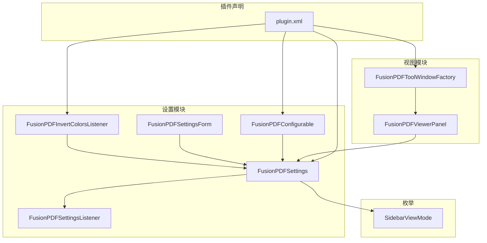
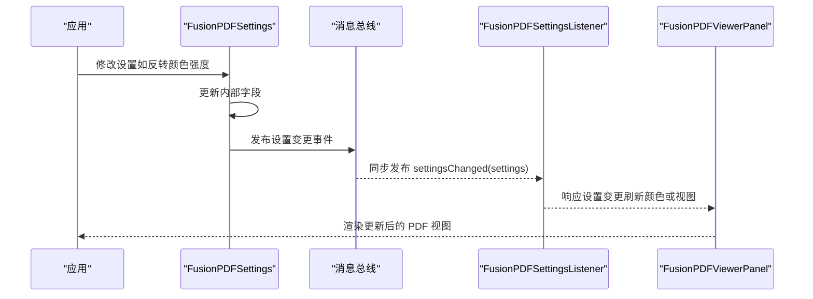
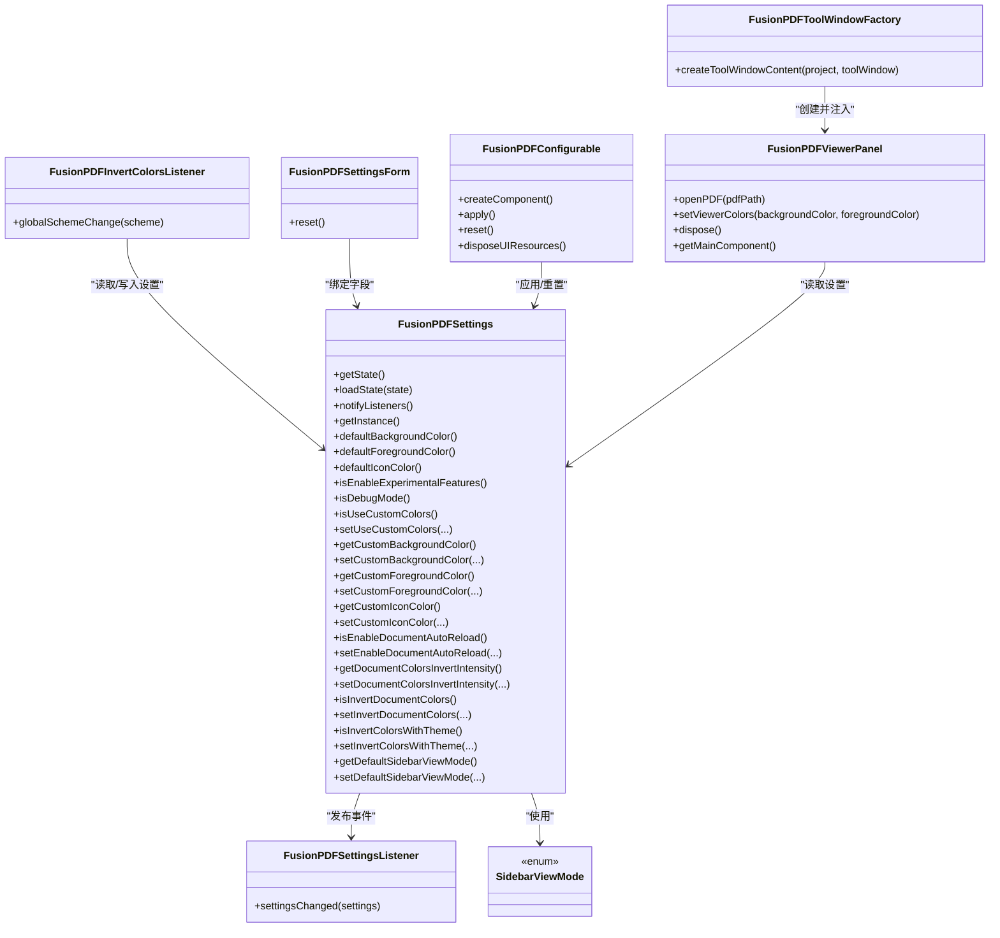
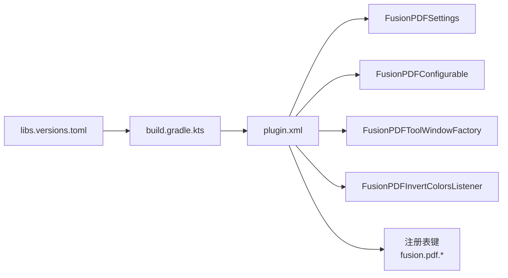

# API 参考

<cite>
**本文引用的文件**
- [FusionPDFSettings.java](file://src/main/java/com/github/wkkya/fusionpdf/settings/FusionPDFSettings.java)
- [SidebarViewMode.java](file://src/main/java/com/github/wkkya/fusionpdf/enums/SidebarViewMode.java)
- [FusionPDFSettingsListener.java](file://src/main/java/com/github/wkkya/fusionpdf/settings/FusionPDFSettingsListener.java)
- [FusionPDFInvertColorsListener.java](file://src/main/java/com/github/wkkya/fusionpdf/settings/FusionPDFInvertColorsListener.java)
- [FusionPDFSettingsForm.java](file://src/main/java/com/github/wkkya/fusionpdf/settings/FusionPDFSettingsForm.java)
- [FusionPDFConfigurable.java](file://src/main/java/com/github/wkkya/fusionpdf/settings/FusionPDFConfigurable.java)
- [FusionPDFViewerPanel.java](file://src/main/java/com/github/wkkya/fusionpdf/viewer/FusionPDFViewerPanel.java)
- [FusionPDFToolWindowFactory.java](file://src/main/java/com/github/wkkya/fusionpdf/factory/FusionPDFToolWindowFactory.java)
- [plugin.xml](file://src/main/resources/META-INF/plugin.xml)
- [build.gradle.kts.bak](file://build.gradle.kts.bak)
- [libs.versions.toml](file://gradle/libs.versions.toml)
</cite>

## 目录
1. [简介](#简介)
2. [项目结构](#项目结构)
3. [核心组件](#核心组件)
4. [架构总览](#架构总览)
5. [详细组件分析](#详细组件分析)
6. [依赖关系分析](#依赖关系分析)
7. [性能考量](#性能考量)
8. [故障排查指南](#故障排查指南)
9. [结论](#结论)
10. [附录](#附录)

## 简介
本文件为 FusionPDF 插件的 API 参考，聚焦于以下目标：
- 记录核心类的公共接口，尤其是 FusionPDFSettings 的方法、参数与返回值说明
- 说明设置监听器接口的使用方式与回调机制
- 解释 SidebarViewMode 枚举的视图模式及其切换逻辑
- 提供类层次结构图与接口继承关系
- 给出每个 API 的使用示例与最佳实践
- 说明版本兼容性与废弃策略
- 提供错误处理指南与异常场景处理
- 列出使用限制与性能注意事项

## 项目结构
FusionPDF 插件采用模块化组织，关键模块如下：
- settings：设置与配置相关（设置类、表单、可配置项、监听器）
- enums：枚举类型（侧边栏视图模式）
- viewer：PDF 查看器实现（基于 JCEF 的浏览器面板）
- factory：工具窗口工厂，负责创建查看器面板
- resources/META-INF：插件声明与注册（服务、配置页、工具窗口、监听器）

图表来源
- [FusionPDFSettings.java:17-146](file://src/main/java/com/github/wkkya/fusionpdf/settings/FusionPDFSettings.java#L17-L146)
- [FusionPDFSettingsListener.java:1-7](file://src/main/java/com/github/wkkya/fusionpdf/settings/FusionPDFSettingsListener.java#L1-L7)
- [FusionPDFInvertColorsListener.java:11-24](file://src/main/java/com/github/wkkya/fusionpdf/settings/FusionPDFInvertColorsListener.java#L11-L24)
- [FusionPDFSettingsForm.java:18-158](file://src/main/java/com/github/wkkya/fusionpdf/settings/FusionPDFSettingsForm.java#L18-L158)
- [FusionPDFConfigurable.java:7-75](file://src/main/java/com/github/wkkya/fusionpdf/settings/FusionPDFConfigurable.java#L7-L75)
- [FusionPDFViewerPanel.java:12-76](file://src/main/java/com/github/wkkya/fusionpdf/viewer/FusionPDFViewerPanel.java#L12-L76)
- [FusionPDFToolWindowFactory.java:12-19](file://src/main/java/com/github/wkkya/fusionpdf/factory/FusionPDFToolWindowFactory.java#L12-L19)
- [SidebarViewMode.java:3-21](file://src/main/java/com/github/wkkya/fusionpdf/enums/SidebarViewMode.java#L3-L21)
- [plugin.xml:26-46](file://src/main/resources/META-INF/plugin.xml#L26-L46)

章节来源
- [plugin.xml:26-46](file://src/main/resources/META-INF/plugin.xml#L26-L46)
- [FusionPDFSettings.java:17-146](file://src/main/java/com/github/wkkya/fusionpdf/settings/FusionPDFSettings.java#L17-L146)
- [FusionPDFSettingsForm.java:18-158](file://src/main/java/com/github/wkkya/fusionpdf/settings/FusionPDFSettingsForm.java#L18-L158)
- [FusionPDFConfigurable.java:7-75](file://src/main/java/com/github/wkkya/fusionpdf/settings/FusionPDFConfigurable.java#L7-L75)
- [FusionPDFViewerPanel.java:12-76](file://src/main/java/com/github/wkkya/fusionpdf/viewer/FusionPDFViewerPanel.java#L12-L76)
- [FusionPDFToolWindowFactory.java:12-19](file://src/main/java/com/github/wkkya/fusionpdf/factory/FusionPDFToolWindowFactory.java#L12-L19)
- [SidebarViewMode.java:3-21](file://src/main/java/com/github/wkkya/fusionpdf/enums/SidebarViewMode.java#L3-L21)

## 核心组件
本节聚焦于 API 的核心类与接口，包括：
- FusionPDFSettings：应用级设置存储与通知机制
- FusionPDFSettingsListener：设置变更监听器接口
- SidebarViewMode：侧边栏视图模式枚举
- FusionPDFInvertColorsListener：主题颜色变化监听器
- FusionPDFSettingsForm / FusionPDFConfigurable：设置 UI 与应用逻辑
- FusionPDFViewerPanel / FusionPDFToolWindowFactory：PDF 查看器与工具窗口集成

章节来源
- [FusionPDFSettings.java:17-146](file://src/main/java/com/github/wkkya/fusionpdf/settings/FusionPDFSettings.java#L17-L146)
- [FusionPDFSettingsListener.java:1-7](file://src/main/java/com/github/wkkya/fusionpdf/settings/FusionPDFSettingsListener.java#L1-L7)
- [SidebarViewMode.java:3-21](file://src/main/java/com/github/wkkya/fusionpdf/enums/SidebarViewMode.java#L3-L21)
- [FusionPDFInvertColorsListener.java:11-24](file://src/main/java/com/github/wkkya/fusionpdf/settings/FusionPDFInvertColorsListener.java#L11-L24)
- [FusionPDFSettingsForm.java:18-158](file://src/main/java/com/github/wkkya/fusionpdf/settings/FusionPDFSettingsForm.java#L18-L158)
- [FusionPDFConfigurable.java:7-75](file://src/main/java/com/github/wkkya/fusionpdf/settings/FusionPDFConfigurable.java#L7-L75)
- [FusionPDFViewerPanel.java:12-76](file://src/main/java/com/github/wkkya/fusionpdf/viewer/FusionPDFViewerPanel.java#L12-L76)
- [FusionPDFToolWindowFactory.java:12-19](file://src/main/java/com/github/wkkya/fusionpdf/factory/FusionPDFToolWindowFactory.java#L12-L19)

## 架构总览
FusionPDF 的整体架构围绕“设置服务 + 监听器 + 视图组件”的模式展开：
- 设置服务通过持久化组件保存状态，并在变更时通过消息总线发布事件
- 监听器订阅设置变更事件，执行相应动作（如根据主题自动反转颜色）
- 工具窗口工厂创建查看器面板，查看器面板通过 JCEF 加载 PDF.js 并与设置交互

图表来源
- [FusionPDFSettings.java:44-46](file://src/main/java/com/github/wkkya/fusionpdf/settings/FusionPDFSettings.java#L44-L46)
- [FusionPDFSettingsListener.java:4-6](file://src/main/java/com/github/wkkya/fusionpdf/settings/FusionPDFSettingsListener.java#L4-L6)
- [FusionPDFViewerPanel.java:54-65](file://src/main/java/com/github/wkkya/fusionpdf/viewer/FusionPDFViewerPanel.java#L54-L65)

## 详细组件分析

### FusionPDFSettings 类 API
- 作用：应用级设置存储、默认值提供、实验特性开关、主题颜色默认值、消息总线发布者
- 关键点：
  - 实现持久化组件接口，状态文件名为 fusion_pdf.xml
  - 提供静态方法用于读取 IDE 主题默认颜色
  - 提供静态开关读取注册表键值（调试模式、实验特性等）
  - 提供设置变更通知方法，通过消息总线同步发布

主要方法与属性概览（按功能分组）：
- 状态持久化
  - getState(): 返回当前实例作为持久化状态
  - loadState(state): 将传入状态复制到当前实例
- 设置变更通知
  - notifyListeners(): 通过消息总线发布设置变更事件
- 单例访问
  - getInstance(): 获取应用级服务实例
- 默认值与工具方法
  - defaultBackgroundColor()/defaultForegroundColor()/defaultIconColor(): 从全局编辑器方案获取默认颜色
  - defaultDocumentColorsInvertIntensity: 默认反转强度常量
  - isEnableExperimentalFeatures()/isDebugMode(): 读取注册表键值
- 颜色与主题相关
  - isUseCustomColors()/setUseCustomColors(...)
  - get/setCustomBackgroundColor/ForegroundColor/IconColor
  - isEnableDocumentAutoReload()/setEnableDocumentAutoReload(...)
  - get/setDocumentColorsInvertIntensity
  - isInvertDocumentColors()/setInvertDocumentColors(...)
  - isInvertColorsWithTheme()/setInvertColorsWithTheme(...)
- 视图模式
  - getDefaultSidebarViewMode()/setDefaultSidebarViewMode(...)

使用示例与最佳实践（路径指引）：
- 订阅设置变更：参考 [FusionPDFSettingsListener.java:4-6](file://src/main/java/com/github/wkkya/fusionpdf/settings/FusionPDFSettingsListener.java#L4-L6)，在应用启动后通过消息总线订阅 Topic
- 修改设置并通知：在业务逻辑中调用对应 setter，随后调用 [FusionPDFSettings.java:44-46](file://src/main/java/com/github/wkkya/fusionpdf/settings/FusionPDFSettings.java#L44-L46) 的 notifyListeners()
- 读取默认颜色：使用 [FusionPDFSettings.java:52-62](file://src/main/java/com/github/wkkya/fusionpdf/settings/FusionPDFSettings.java#L52-L62) 中的静态方法
- 读取注册表开关：使用 [FusionPDFSettings.java:66-72](file://src/main/java/com/github/wkkya/fusionpdf/settings/FusionPDFSettings.java#L66-L72) 中的静态方法

章节来源
- [FusionPDFSettings.java:17-146](file://src/main/java/com/github/wkkya/fusionpdf/settings/FusionPDFSettings.java#L17-L146)

### 设置监听器接口与回调机制
- 接口定义：FusionPDFSettingsListener
  - 方法：settingsChanged(FusionPDFSettings settings)
  - 注解：@FunctionalInterface，便于 Lambda 使用
- 回调机制：
  - 设置变更时，调用 FusionPDFSettings.notifyListeners() 通过消息总线同步发布
  - 订阅方需在应用生命周期内注册 Topic，接收 settingsChanged 回调
- 示例（路径指引）：
  - 订阅位置参考 [plugin.xml:42-46](file://src/main/resources/META-INF/plugin.xml#L42-L46)
  - 监听器实现参考 [FusionPDFInvertColorsListener.java:11-24](file://src/main/java/com/github/wkkya/fusionpdf/settings/FusionPDFInvertColorsListener.java#L11-L24)

章节来源
- [FusionPDFSettingsListener.java:1-7](file://src/main/java/com/github/wkkya/fusionpdf/settings/FusionPDFSettingsListener.java#L1-L7)
- [FusionPDFSettings.java:20-46](file://src/main/java/com/github/wkkya/fusionpdf/settings/FusionPDFSettings.java#L20-L46)
- [plugin.xml:42-46](file://src/main/resources/META-INF/plugin.xml#L42-L46)
- [FusionPDFInvertColorsListener.java:11-24](file://src/main/java/com/github/wkkya/fusionpdf/settings/FusionPDFInvertColorsListener.java#L11-L24)

### SidebarViewMode 枚举与视图切换逻辑
- 枚举值与含义：
  - NONE：关闭侧边栏
  - THUMBNAILS：缩略图
  - OUTLINE：文档大纲
  - ATTACHMENTS：附件
- UI 显示映射（本地化显示名）：
  - NONE -> Closed
  - THUMBNAILS -> Thumbnails
  - ATTACHMENTS -> Attachments
  - OUTLINE -> Outline (document structure)
- 切换逻辑：
  - 设置项为默认侧边栏视图模式，可通过设置表单选择
  - 设置变更后，建议调用 FusionPDFSettings.notifyListeners() 以触发视图更新
  - 查看器面板可依据当前设置进行初始化或动态切换（具体由查看器实现决定）

章节来源
- [SidebarViewMode.java:3-21](file://src/main/java/com/github/wkkya/fusionpdf/enums/SidebarViewMode.java#L3-L21)
- [FusionPDFSettingsForm.java:43-54](file://src/main/java/com/github/wkkya/fusionpdf/settings/FusionPDFSettingsForm.java#L43-L54)
- [FusionPDFSettings.java:140-146](file://src/main/java/com/github/wkkya/fusionpdf/settings/FusionPDFSettings.java#L140-L146)

### 设置表单与可配置项
- FusionPDFSettingsForm
  - 包含复选框、下拉框、颜色面板、数值输入等 UI 组件
  - 绑定到 FusionPDFSettings 的对应字段
  - 提供重置方法，恢复到当前设置值
- FusionPDFConfigurable
  - 实现 Configurable 接口，作为设置页面入口
  - 提供 createComponent()/apply()/reset()/disposeUIResources() 生命周期管理
  - 当设置被修改时，调用 FusionPDFSettings.notifyListeners() 通知订阅者

章节来源
- [FusionPDFSettingsForm.java:18-158](file://src/main/java/com/github/wkkya/fusionpdf/settings/FusionPDFSettingsForm.java#L18-L158)
- [FusionPDFConfigurable.java:7-75](file://src/main/java/com/github/wkkya/fusionpdf/settings/FusionPDFConfigurable.java#L7-L75)

### PDF 查看器与工具窗口
- FusionPDFViewerPanel
  - 基于 JCEF 的浏览器组件，加载 PDF.js viewer.html
  - 提供打开 PDF、设置查看器颜色、释放资源等方法
  - 提供 getMainComponent() 返回自身作为工具窗口内容
- FusionPDFToolWindowFactory
  - 实现 ToolWindowFactory，在工具窗口中创建并添加查看器面板

章节来源
- [FusionPDFViewerPanel.java:12-76](file://src/main/java/com/github/wkkya/fusionpdf/viewer/FusionPDFViewerPanel.java#L12-L76)
- [FusionPDFToolWindowFactory.java:12-19](file://src/main/java/com/github/wkkya/fusionpdf/factory/FusionPDFToolWindowFactory.java#L12-L19)

### 类层次结构与接口关系

图表来源
- [FusionPDFSettings.java:17-146](file://src/main/java/com/github/wkkya/fusionpdf/settings/FusionPDFSettings.java#L17-L146)
- [FusionPDFSettingsListener.java:1-7](file://src/main/java/com/github/wkkya/fusionpdf/settings/FusionPDFSettingsListener.java#L1-L7)
- [FusionPDFInvertColorsListener.java:11-24](file://src/main/java/com/github/wkkya/fusionpdf/settings/FusionPDFInvertColorsListener.java#L11-L24)
- [FusionPDFSettingsForm.java:18-158](file://src/main/java/com/github/wkkya/fusionpdf/settings/FusionPDFSettingsForm.java#L18-L158)
- [FusionPDFConfigurable.java:7-75](file://src/main/java/com/github/wkkya/fusionpdf/settings/FusionPDFConfigurable.java#L7-L75)
- [FusionPDFViewerPanel.java:12-76](file://src/main/java/com/github/wkkya/fusionpdf/viewer/FusionPDFViewerPanel.java#L12-L76)
- [FusionPDFToolWindowFactory.java:12-19](file://src/main/java/com/github/wkkya/fusionpdf/factory/FusionPDFToolWindowFactory.java#L12-L19)
- [SidebarViewMode.java:3-21](file://src/main/java/com/github/wkkya/fusionpdf/enums/SidebarViewMode.java#L3-L21)

## 依赖关系分析
- 插件声明与注册
  - plugin.xml 中注册了应用服务、可配置项、工具窗口以及主题颜色监听器
  - 注册表键用于启用调试模式、实验特性、JCEF OSR 等
- 构建与版本
  - 构建脚本指定了平台类型、版本范围、签名与发布渠道
  - 版本号与兼容性由插件声明中的 since-build/until-build 控制

图表来源
- [plugin.xml:26-46](file://src/main/resources/META-INF/plugin.xml#L26-L46)
- [build.gradle.kts.bak:57-92](file://build.gradle.kts.bak#L57-L92)
- [libs.versions.toml:1-21](file://gradle/libs.versions.toml#L1-L21)

章节来源
- [plugin.xml:26-46](file://src/main/resources/META-INF/plugin.xml#L26-L46)
- [build.gradle.kts.bak:57-92](file://build.gradle.kts.bak#L57-L92)
- [libs.versions.toml:1-21](file://gradle/libs.versions.toml#L1-L21)

## 性能考量
- JCEF 浏览器初始化与资源释放
  - 初始化时创建客户端与浏览器实例，应在不再使用时调用 dispose 释放资源
  - 参考 [FusionPDFViewerPanel.java:17-38](file://src/main/java/com/github/wkkya/fusionpdf/viewer/FusionPDFViewerPanel.java#L17-L38) 与 [FusionPDFViewerPanel.java:67-70](file://src/main/java/com/github/wkkya/fusionpdf/viewer/FusionPDFViewerPanel.java#L67-L70)
- PDF.js 加载与渲染
  - 通过加载本地资源 viewer.html 进行渲染，避免网络依赖
  - 参考 [FusionPDFViewerPanel.java:49-52](file://src/main/java/com/github/wkkya/fusionpdf/viewer/FusionPDFViewerPanel.java#L49-L52)
- 设置变更通知
  - 仅在必要时调用 notifyListeners()，避免频繁广播导致 UI 抖动
  - 参考 [FusionPDFSettings.java:44-46](file://src/main/java/com/github/wkkya/fusionpdf/settings/FusionPDFSettings.java#L44-L46)
- 自动重载与反转强度
  - 文档自动重载与颜色反转强度会影响渲染开销，建议按需开启
  - 参考 [FusionPDFSettings.java:108-138](file://src/main/java/com/github/wkkya/fusionpdf/settings/FusionPDFSettings.java#L108-L138)

[本节为通用性能建议，不直接分析特定文件]

## 故障排查指南
- 浏览器初始化失败
  - 现象：抛出非法状态异常，提示无法初始化浏览器
  - 处理：检查 JCEF 客户端与浏览器实例创建流程，确保非空后再创建 JS 查询
  - 参考 [FusionPDFViewerPanel.java:20-31](file://src/main/java/com/github/wkkya/fusionpdf/viewer/FusionPDFViewerPanel.java#L20-L31)
- 设置未生效
  - 现象：更改设置后界面未更新
  - 处理：确认是否调用了 notifyListeners()；检查监听器是否正确订阅 Topic
  - 参考 [FusionPDFSettings.java:44-46](file://src/main/java/com/github/wkkya/fusionpdf/settings/FusionPDFSettings.java#L44-L46)、[plugin.xml:42-46](file://src/main/resources/META-INF/plugin.xml#L42-L46)
- 主题颜色反转未触发
  - 现象：切换 IDE 主题后 PDF 颜色未反转
  - 处理：确认 isInvertColorsWithTheme 开关已启用；检查 EditorColorsListener 是否注册
  - 参考 [FusionPDFInvertColorsListener.java:11-24](file://src/main/java/com/github/wkkya/fusionpdf/settings/FusionPDFInvertColorsListener.java#L11-L24)、[plugin.xml:42-46](file://src/main/resources/META-INF/plugin.xml#L42-L46)

章节来源
- [FusionPDFViewerPanel.java:17-38](file://src/main/java/com/github/wkkya/fusionpdf/viewer/FusionPDFViewerPanel.java#L17-L38)
- [FusionPDFSettings.java:44-46](file://src/main/java/com/github/wkkya/fusionpdf/settings/FusionPDFSettings.java#L44-L46)
- [plugin.xml:42-46](file://src/main/resources/META-INF/plugin.xml#L42-L46)
- [FusionPDFInvertColorsListener.java:11-24](file://src/main/java/com/github/wkkya/fusionpdf/settings/FusionPDFInvertColorsListener.java#L11-L24)

## 结论
FusionPDF 的 API 设计清晰，围绕设置服务与消息总线实现了松耦合的监听与响应机制。SidebarViewMode 枚举提供了直观的视图模式选择，配合设置表单与工具窗口工厂，形成完整的用户交互链路。遵循本文的最佳实践与故障排查建议，可在保证性能的前提下稳定地扩展与维护该插件。

[本节为总结性内容，不直接分析特定文件]

## 附录

### 版本兼容性与废弃策略
- 版本与兼容性
  - 插件版本：1.0.1
  - 兼容 IDE 版本范围：since-build="233.1"，until-build="243.*"
  - 参考 [plugin.xml:6-12](file://src/main/resources/META-INF/plugin.xml#L6-L12)
- 构建与发布
  - 构建脚本使用 IntelliJ Platform Gradle Plugin，指定平台类型与版本
  - 参考 [build.gradle.kts.bak:57-92](file://build.gradle.kts.bak#L57-L92)
- 废弃策略
  - 当前仓库未显式声明废弃 API 或迁移计划，建议在升级时关注 IDE 新版本变更与插件声明中的 until-build 限制

章节来源
- [plugin.xml:6-12](file://src/main/resources/META-INF/plugin.xml#L6-L12)
- [build.gradle.kts.bak:57-92](file://build.gradle.kts.bak#L57-L92)

### 使用示例与最佳实践（路径指引）
- 订阅设置变更
  - 在应用启动后注册 Topic，接收 settingsChanged 回调
  - 参考 [plugin.xml:42-46](file://src/main/resources/META-INF/plugin.xml#L42-L46)、[FusionPDFSettingsListener.java:4-6](file://src/main/java/com/github/wkkya/fusionpdf/settings/FusionPDFSettingsListener.java#L4-L6)
- 修改设置并通知
  - 修改字段后调用 notifyListeners()
  - 参考 [FusionPDFSettings.java:44-46](file://src/main/java/com/github/wkkya/fusionpdf/settings/FusionPDFSettings.java#L44-L46)
- 设置默认颜色
  - 使用默认颜色工具方法获取主题默认颜色
  - 参考 [FusionPDFSettings.java:52-62](file://src/main/java/com/github/wkkya/fusionpdf/settings/FusionPDFSettings.java#L52-L62)
- 打开 PDF 与设置颜色
  - 通过查看器面板打开 PDF 并设置颜色
  - 参考 [FusionPDFViewerPanel.java:54-65](file://src/main/java/com/github/wkkya/fusionpdf/viewer/FusionPDFViewerPanel.java#L54-L65)

章节来源
- [plugin.xml:42-46](file://src/main/resources/META-INF/plugin.xml#L42-L46)
- [FusionPDFSettingsListener.java:1-7](file://src/main/java/com/github/wkkya/fusionpdf/settings/FusionPDFSettingsListener.java#L1-L7)
- [FusionPDFSettings.java:44-62](file://src/main/java/com/github/wkkya/fusionpdf/settings/FusionPDFSettings.java#L44-L62)
- [FusionPDFViewerPanel.java:54-65](file://src/main/java/com/github/wkkya/fusionpdf/viewer/FusionPDFViewerPanel.java#L54-L65)