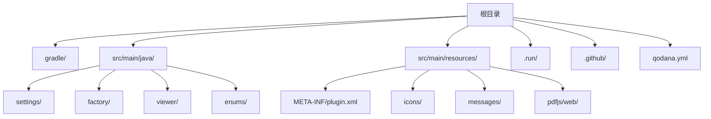
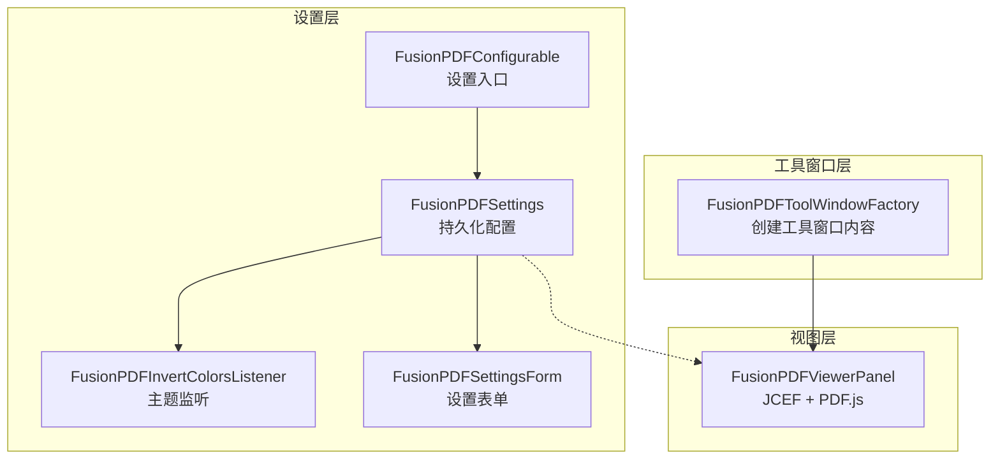
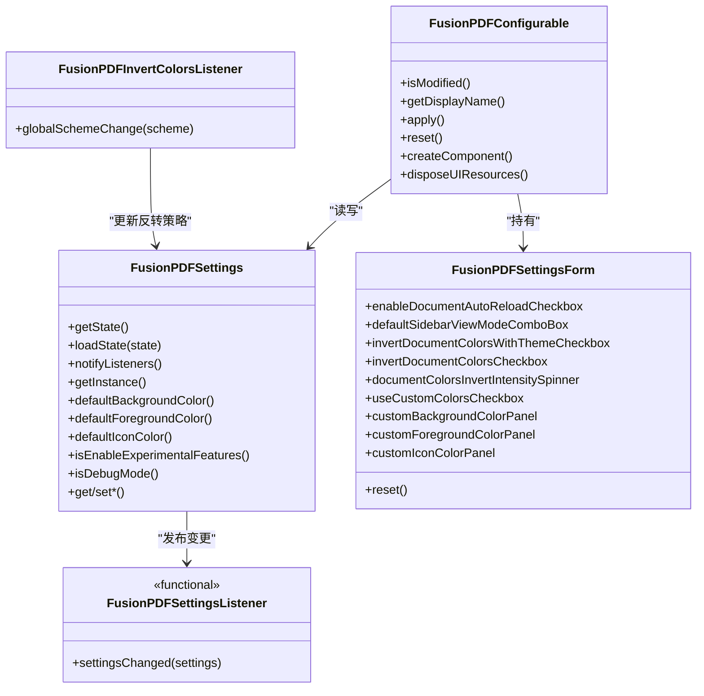
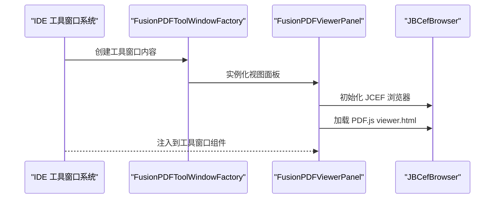
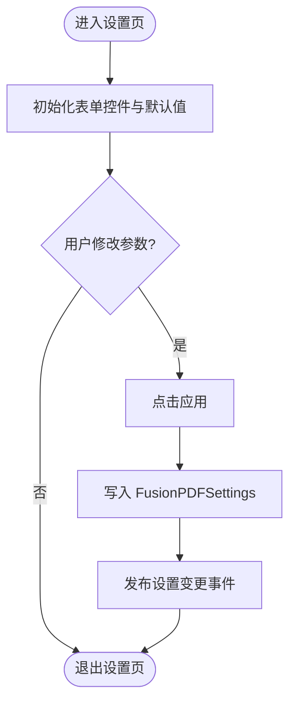
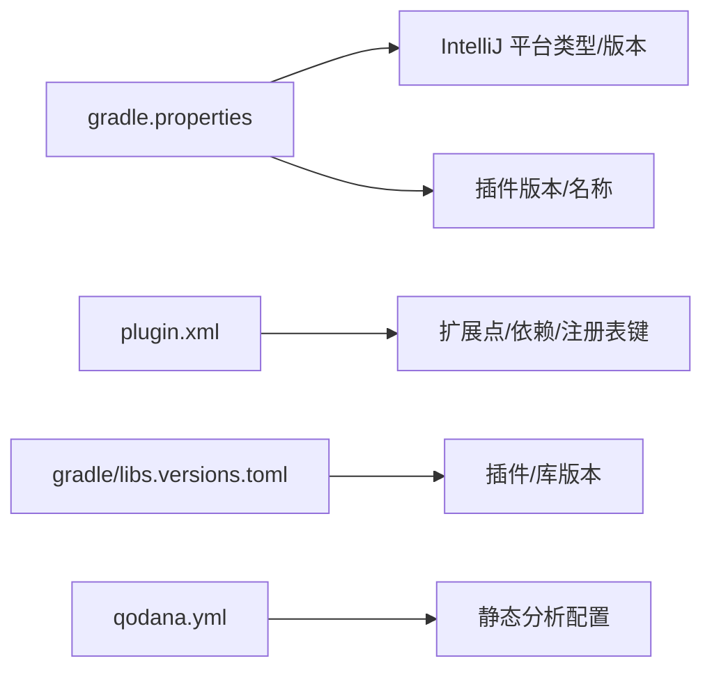

# 开发指南

<cite>
**本文引用的文件**
- [README.md](file://README.md)
- [settings.gradle.kts](file://settings.gradle.kts)
- [gradle\libs.versions.toml](file://gradle/libs.versions.toml)
- [gradle.properties](file://gradle.properties)
- [qodana.yml](file://qodana.yml)
- [.github\workflows](file://.github/workflows)
- [.github\dependabot.yml](file://.github/dependabot.yml)
- [.run\Run Plugin.run.xml](file://.run/Run Plugin.run.xml)
- [.run\Run Tests.run.xml](file://.run/Run Tests.run.xml)
- [.run\Run Verifications.run.xml](file://.run/Run Verifications.run.xml)
- [src\main\resources\META-INF\plugin.xml](file://src/main/resources/META-INF/plugin.xml)
- [src\main\java\com\github\wkkya\fusionpdf\settings\FusionPDFSettings.java](file://src/main/java/com/github/wkkya/fusionpdf/settings/FusionPDFSettings.java)
- [src\main\java\com\github\wkkya\fusionpdf\settings\FusionPDFSettingsForm.java](file://src/main/java/com/github/wkkya/fusionpdf/settings/FusionPDFSettingsForm.java)
- [src\main\java\com\github\wkkya\fusionpdf\settings\FusionPDFConfigurable.java](file://src/main/java/com/github/wkkya/fusionpdf/settings/FusionPDFConfigurable.java)
- [src\main\java\com\github\wkkya\fusionpdf\settings\FusionPDFInvertColorsListener.java](file://src/main/java/com/github/wkkya/fusionpdf/settings/FusionPDFInvertColorsListener.java)
- [src\main\java\com\github\wkkya\fusionpdf\settings\FusionPDFSettingsListener.java](file://src/main/java/com/github/wkkya/fusionpdf/settings/FusionPDFSettingsListener.java)
- [src\main\java\com\github\wkkya\fusionpdf\factory\FusionPDFToolWindowFactory.java](file://src/main/java/com/github/wkkya/fusionpdf/factory/FusionPDFToolWindowFactory.java)
- [src\main\java\com\github\wkkya\fusionpdf\viewer\FusionPDFViewerPanel.java](file://src/main/java/com/github/wkkya/fusionpdf/viewer/FusionPDFViewerPanel.java)
- [src\main\java\com\github\wkkya\fusionpdf\enums\SidebarViewMode.java](file://src/main/java/com/github/wkkya/fusionpdf/enums/SidebarViewMode.java)
</cite>

## 目录
1. [简介](#简介)
2. [项目结构](#项目结构)
3. [核心组件](#核心组件)
4. [架构总览](#架构总览)
5. [详细组件分析](#详细组件分析)
6. [依赖分析](#依赖分析)
7. [性能考虑](#性能考虑)
8. [故障排查指南](#故障排查指南)
9. [结论](#结论)
10. [附录](#附录)

## 简介
本开发指南面向希望参与 FusionPDF 插件开发与维护的贡献者，覆盖开发环境搭建、构建与运行、代码贡献流程、调试与测试实践、代码结构与命名约定、常见问题与性能优化建议，以及开发工具配置示例与快捷键建议。FusionPDF 是一个为 IntelliJ IDEA 设计的轻量级 PDF 阅读器插件，通过内置 PDF.js 在 IDE 中提供主题适配、可定制颜色与背景移除等能力。

## 项目结构
仓库采用标准的 IntelliJ 平台插件工程布局，主要目录与职责如下：
- gradle：版本化依赖与插件版本集中管理
- src/main/java：Java 源码，按功能域分包（settings、factory、viewer、enums）
- src/main/resources：资源文件，含插件声明、图标、消息与 PDF.js 资源
- .run：IDE 运行配置，便于本地启动插件与运行测试
- .github：CI 工作流与依赖更新策略
- qodana.yml：静态分析配置

图表来源
- [settings.gradle.kts:1-6](file://settings.gradle.kts#L1-L6)
- [gradle\libs.versions.toml:1-21](file://gradle/libs.versions.toml#L1-L21)
- [src\main\resources\META-INF\plugin.xml:1-51](file://src/main/resources/META-INF/plugin.xml#L1-L51)
- [src\main\java\com\github\wkkya\fusionpdf\settings](file://src/main/java/com/github/wkkya/fusionpdf/settings)
- [src\main\java\com\github\wkkya\fusionpdf\factory](file://src/main/java/com/github/wkkya/fusionpdf/factory)
- [src\main\java\com\github\wkkya\fusionpdf\viewer](file://src/main/java/com/github/wkkya/fusionpdf/viewer)
- [src\main\java\com\github\wkkya\fusionpdf\enums](file://src/main/java/com/github/wkkya/fusionpdf/enums)

章节来源
- [settings.gradle.kts:1-6](file://settings.gradle.kts#L1-L6)
- [gradle\libs.versions.toml:1-21](file://gradle/libs.versions.toml#L1-L21)
- [src\main\resources\META-INF\plugin.xml:1-51](file://src/main/resources/META-INF/plugin.xml#L1-L51)

## 核心组件
- 设置系统：持久化配置、监听主题变化、暴露可调参数
- 工具窗口工厂：注册并创建底部工具窗口内容
- 视图面板：基于 JCEF 的 PDF.js 集成，支持动态加载 PDF 与颜色注入
- 枚举类型：侧边栏视图模式定义
- 可配置界面：用户在设置页修改参数并应用到全局设置

章节来源
- [src\main\java\com\github\wkkya\fusionpdf\settings\FusionPDFSettings.java:1-151](file://src/main/java/com/github/wkkya/fusionpdf/settings/FusionPDFSettings.java#L1-L151)
- [src\main\java\com\github\wkkya\fusionpdf\factory\FusionPDFToolWindowFactory.java:1-21](file://src/main/java/com/github/wkkya/fusionpdf/factory/FusionPDFToolWindowFactory.java#L1-L21)
- [src\main\java\com\github\wkkya\fusionpdf\viewer\FusionPDFViewerPanel.java:1-78](file://src/main/java/com/github/wkkya/fusionpdf/viewer/FusionPDFViewerPanel.java#L1-L78)
- [src\main\java\com\github\wkkya\fusionpdf\enums\SidebarViewMode.java:1-22](file://src/main/java/com/github/wkkya/fusionpdf/enums/SidebarViewMode.java#L1-L22)
- [src\main\java\com\github\wkkya\fusionpdf\settings\FusionPDFConfigurable.java:1-76](file://src/main/java/com/github/wkkya/fusionpdf/settings/FusionPDFConfigurable.java#L1-L76)

## 架构总览
FusionPDF 插件围绕“设置-视图-工具窗口”三层结构组织：
- 设置层：持久化存储与主题监听，负责颜色与行为参数
- 视图层：JCEF 承载 PDF.js，负责渲染与交互
- 工具窗口层：IDE 工具窗口容器，注入视图面板

图表来源
- [src\main\java\com\github\wkkya\fusionpdf\settings\FusionPDFSettings.java:1-151](file://src/main/java/com/github/wkkya/fusionpdf/settings/FusionPDFSettings.java#L1-L151)
- [src\main\java\com\github\wkkya\fusionpdf\settings\FusionPDFInvertColorsListener.java:1-25](file://src/main/java/com/github/wkkya/fusionpdf/settings/FusionPDFInvertColorsListener.java#L1-L25)
- [src\main\java\com\github\wkkya\fusionpdf\settings\FusionPDFSettingsForm.java:1-159](file://src/main/java/com/github/wkkya/fusionpdf/settings/FusionPDFSettingsForm.java#L1-L159)
- [src\main\java\com\github\wkkya\fusionpdf\settings\FusionPDFConfigurable.java:1-76](file://src/main/java/com/github/wkkya/fusionpdf/settings/FusionPDFConfigurable.java#L1-L76)
- [src\main\java\com\github\wkkya\fusionpdf\factory\FusionPDFToolWindowFactory.java:1-21](file://src/main/java/com/github/wkkya/fusionpdf/factory/FusionPDFToolWindowFactory.java#L1-L21)
- [src\main\java\com\github\wkkya\fusionpdf\viewer\FusionPDFViewerPanel.java:1-78](file://src/main/java/com/github/wkkya/fusionpdf/viewer/FusionPDFViewerPanel.java#L1-L78)

## 详细组件分析

### 设置系统（持久化与主题监听）
- 持久化配置：通过注解声明状态与存储位置，提供默认值与主题色提取
- 主题监听：响应 IDE 全局配色方案变更，自动切换文档颜色反转策略
- 设置表单：提供 UI 控件映射与重置逻辑
- 设置入口：实现可配置接口，承载表单并处理应用/重置

图表来源
- [src\main\java\com\github\wkkya\fusionpdf\settings\FusionPDFSettings.java:1-151](file://src/main/java/com/github/wkkya/fusionpdf/settings/FusionPDFSettings.java#L1-L151)
- [src\main\java\com\github\wkkya\fusionpdf\settings\FusionPDFInvertColorsListener.java:1-25](file://src/main/java/com/github/wkkya/fusionpdf/settings/FusionPDFInvertColorsListener.java#L1-L25)
- [src\main\java\com\github\wkkya\fusionpdf\settings\FusionPDFSettingsForm.java:1-159](file://src/main/java/com/github/wkkya/fusionpdf/settings/FusionPDFSettingsForm.java#L1-L159)
- [src\main\java\com\github\wkkya\fusionpdf\settings\FusionPDFConfigurable.java:1-76](file://src/main/java/com/github/wkkya/fusionpdf/settings/FusionPDFConfigurable.java#L1-L76)
- [src\main\java\com\github\wkkya\fusionpdf\settings\FusionPDFSettingsListener.java:1-7](file://src/main/java/com/github/wkkya/fusionpdf/settings/FusionPDFSettingsListener.java#L1-L7)

章节来源
- [src\main\java\com\github\wkkya\fusionpdf\settings\FusionPDFSettings.java:1-151](file://src/main/java/com/github/wkkya/fusionpdf/settings/FusionPDFSettings.java#L1-L151)
- [src\main\java\com\github\wkkya\fusionpdf\settings\FusionPDFInvertColorsListener.java:1-25](file://src/main/java/com/github/wkkya/fusionpdf/settings/FusionPDFInvertColorsListener.java#L1-L25)
- [src\main\java\com\github\wkkya\fusionpdf\settings\FusionPDFSettingsForm.java:1-159](file://src/main/java/com/github/wkkya/fusionpdf/settings/FusionPDFSettingsForm.java#L1-L159)
- [src\main\java\com\github\wkkya\fusionpdf\settings\FusionPDFConfigurable.java:1-76](file://src/main/java/com/github/wkkya/fusionpdf/settings/FusionPDFConfigurable.java#L1-L76)
- [src\main\java\com\github\wkkya\fusionpdf\settings\FusionPDFSettingsListener.java:1-7](file://src/main/java/com/github/wkkya/fusionpdf/settings/FusionPDFSettingsListener.java#L1-L7)

### 工具窗口与视图面板
- 工具窗口工厂：在 IDE 底部创建 FusionPDF 工具窗口，并注入视图面板
- 视图面板：初始化 JCEF 客户端与浏览器，加载 PDF.js viewer.html，支持打开 PDF 与注入颜色

图表来源
- [src\main\java\com\github\wkkya\fusionpdf\factory\FusionPDFToolWindowFactory.java:1-21](file://src/main/java/com/github/wkkya/fusionpdf/factory/FusionPDFToolWindowFactory.java#L1-L21)
- [src\main\java\com\github\wkkya\fusionpdf\viewer\FusionPDFViewerPanel.java:1-78](file://src/main/java/com/github/wkkya/fusionpdf/viewer/FusionPDFViewerPanel.java#L1-L78)

章节来源
- [src\main\java\com\github\wkkya\fusionpdf\factory\FusionPDFToolWindowFactory.java:1-21](file://src/main/java/com/github/wkkya/fusionpdf/factory/FusionPDFToolWindowFactory.java#L1-L21)
- [src\main\java\com\github\wkkya\fusionpdf\viewer\FusionPDFViewerPanel.java:1-78](file://src/main/java/com/github/wkkya/fusionpdf/viewer/FusionPDFViewerPanel.java#L1-L78)

### 设置页面与参数应用流程
- 表单控件与默认值绑定
- 应用时根据修改标记写入设置并通知监听者
- 主题变化触发颜色反转策略更新

图表来源
- [src\main\java\com\github\wkkya\fusionpdf\settings\FusionPDFConfigurable.java:1-76](file://src/main/java/com/github/wkkya/fusionpdf/settings/FusionPDFConfigurable.java#L1-L76)
- [src\main\java\com\github\wkkya\fusionpdf\settings\FusionPDFSettingsForm.java:1-159](file://src/main/java/com/github/wkkya/fusionpdf/settings/FusionPDFSettingsForm.java#L1-L159)
- [src\main\java\com\github\wkkya\fusionpdf\settings\FusionPDFSettings.java:1-151](file://src/main/java/com/github/wkkya/fusionpdf/settings/FusionPDFSettings.java#L1-L151)
- [src\main\java\com\github\wkkya\fusionpdf\settings\FusionPDFInvertColorsListener.java:1-25](file://src/main/java/com/github/wkkya/fusionpdf/settings/FusionPDFInvertColorsListener.java#L1-L25)

章节来源
- [src\main\java\com\github\wkkya\fusionpdf\settings\FusionPDFConfigurable.java:1-76](file://src/main/java/com/github/wkkya/fusionpdf/settings/FusionPDFConfigurable.java#L1-L76)
- [src\main\java\com\github\wkkya\fusionpdf\settings\FusionPDFSettingsForm.java:1-159](file://src/main/java/com/github/wkkya/fusionpdf/settings/FusionPDFSettingsForm.java#L1-L159)
- [src\main\java\com\github\wkkya\fusionpdf\settings\FusionPDFSettings.java:1-151](file://src/main/java/com/github/wkkya/fusionpdf/settings/FusionPDFSettings.java#L1-L151)
- [src\main\java\com\github\wkkya\fusionpdf\settings\FusionPDFInvertColorsListener.java:1-25](file://src/main/java/com/github/wkkya/fusionpdf/settings/FusionPDFInvertColorsListener.java#L1-L25)

## 依赖分析
- 构建与平台
  - Gradle 版本由属性文件指定
  - IntelliJ Platform 类型与版本在属性文件中声明
  - 插件版本与名称在属性文件中统一管理
- 插件声明
  - 插件 ID、名称、版本、兼容构建号范围、依赖模块与扩展点在插件 XML 中声明
  - 注册表键用于调试、超时、实验特性与 JCEF OSR 渲染开关
- 依赖版本
  - 版本化管理文件集中声明了 JUnit、Qodana、IntelliJ Platform、Kotlin、Kover 等版本

图表来源
- [gradle.properties:1-54](file://gradle.properties#L1-L54)
- [src\main\resources\META-INF\plugin.xml:1-51](file://src/main/resources/META-INF/plugin.xml#L1-L51)
- [gradle\libs.versions.toml:1-21](file://gradle/libs.versions.toml#L1-L21)
- [qodana.yml:1-13](file://qodana.yml#L1-L13)

章节来源
- [gradle.properties:1-54](file://gradle.properties#L1-L54)
- [src\main\resources\META-INF\plugin.xml:1-51](file://src/main/resources/META-INF/plugin.xml#L1-L51)
- [gradle\libs.versions.toml:1-21](file://gradle/libs.versions.toml#L1-L21)
- [qodana.yml:1-13](file://qodana.yml#L1-L13)

## 性能考虑
- JCEF 与 PDF.js
  - 使用 JCEF OSR 渲染选项可通过注册表键控制，有助于减少主线程阻塞
  - 合理设置 WebView 加载超时，避免长时间等待
- 颜色反转与主题适配
  - 主题监听仅在启用“随主题反转”时生效，避免不必要的计算
  - 自定义颜色仅在启用“使用自定义颜色”时应用，降低额外 JS 注入开销
- 文档自动重载
  - 自动重载在大文件或频繁刷新场景下可能带来额外负载，可根据需要关闭

章节来源
- [src\main\resources\META-INF\plugin.xml:26-31](file://src/main/resources/META-INF/plugin.xml#L26-L31)
- [src\main\java\com\github\wkkya\fusionpdf\settings\FusionPDFSettings.java:66-72](file://src/main/java/com/github/wkkya/fusionpdf/settings/FusionPDFSettings.java#L66-L72)
- [src\main\java\com\github\wkkya\fusionpdf\settings\FusionPDFInvertColorsListener.java:11-25](file://src/main/java/com/github/wkkya/fusionpdf/settings/FusionPDFInvertColorsListener.java#L11-L25)

## 故障排查指南
- 启动与运行
  - 使用 .run 配置中的“Run Plugin”直接在 IDE 中启动插件
  - 若日志路径异常，检查构建属性中的日志路径配置
- 调试模式
  - 通过注册表键开启调试模式以输出更多诊断信息
- JCEF 初始化失败
  - 视图面板在浏览器初始化失败时会抛出异常，需检查 JCEF 客户端与浏览器创建流程
- PDF 加载异常
  - 确认 PDF.js viewer.html 资源路径正确，且已打包进插件资源
- 设置未生效
  - 确认设置页已点击“应用”，并触发设置变更通知；监听器会在主题变化时自动更新

章节来源
- [.run\Run Plugin.run.xml](file://.run/Run%20Plugin.run.xml)
- [gradle.properties:27-27](file://gradle.properties#L27-L27)
- [src\main\resources\META-INF\plugin.xml:26-31](file://src/main/resources/META-INF/plugin.xml#L26-L31)
- [src\main\java\com\github\wkkya\fusionpdf\viewer\FusionPDFViewerPanel.java:17-38](file://src/main/java/com/github/wkkya/fusionpdf/viewer/FusionPDFViewerPanel.java#L17-L38)
- [src\main\java\com\github\wkkya\fusionpdf\settings\FusionPDFSettings.java:44-46](file://src/main/java/com/github/wkkya/fusionpdf/settings/FusionPDFSettings.java#L44-L46)

## 结论
FusionPDF 插件通过清晰的分层设计与 IDE 原生扩展机制实现了 PDF 阅读体验的无缝集成。遵循本文的开发与测试实践，可高效推进功能迭代与质量保障。

## 附录

### 开发环境搭建
- JDK 与平台
  - 推荐使用与平台版本匹配的 JDK（参考静态分析配置的 JDK 版本）
  - Gradle 版本由属性文件统一管理
- IntelliJ IDEA 插件开发环境
  - 安装 IntelliJ IDEA 并导入项目
  - 使用 .run 配置启动插件进行本地验证
- 必要工具
  - Gradle Wrapper 已包含，确保网络代理配置正确（如需）

章节来源
- [qodana.yml:6-6](file://qodana.yml#L6-L6)
- [gradle.properties:44-44](file://gradle.properties#L44-L44)
- [.run\Run Plugin.run.xml](file://.run/Run%20Plugin.run.xml)

### 代码贡献流程
- 分支管理
  - 建议采用功能分支开发，合并前保持与主干同步
- 提交流程
  - 提交前运行静态分析与测试
  - 提交信息遵循约定式提交风格
- 代码审查
  - 至少一名维护者审查
  - 关注设置变更、JCEF 交互与主题适配逻辑
- 测试要求
  - 单元测试：针对设置与工具类逻辑
  - 集成测试：验证工具窗口创建与视图面板初始化
  - 手动测试：在不同主题与 PDF 场景下验证颜色与加载行为

章节来源
- [.github\workflows](file://.github/workflows)
- [.github\dependabot.yml](file://.github/dependabot.yml)

### 调试与测试最佳实践
- 单元测试
  - 针对设置类的 getter/setter 与默认值逻辑
- 集成测试
  - 验证工具窗口工厂创建视图面板
  - 验证设置表单与配置入口的交互
- 手动测试
  - 切换 IDE 主题，验证颜色反转策略
  - 打开不同类型的 PDF，验证加载与滚动
  - 开启/关闭实验特性与调试模式，观察行为差异

章节来源
- [src\main\java\com\github\wkkya\fusionpdf\factory\FusionPDFToolWindowFactory.java:12-18](file://src/main/java/com/github/wkkya/fusionpdf/factory/FusionPDFToolWindowFactory.java#L12-L18)
- [src\main\java\com\github\wkkya\fusionpdf\settings\FusionPDFSettingsForm.java:36-87](file://src/main/java/com/github/wkkya/fusionpdf/settings/FusionPDFSettingsForm.java#L36-L87)
- [src\main\java\com\github\wkkya\fusionpdf\settings\FusionPDFConfigurable.java:37-53](file://src/main/java/com/github/wkkya/fusionpdf/settings/FusionPDFConfigurable.java#L37-L53)

### 代码结构与命名约定
- 包结构
  - settings：设置与配置相关类
  - factory：工具窗口工厂
  - viewer：视图与 JCEF 集成
  - enums：枚举类型
- 命名约定
  - 类名采用帕斯卡命名法
  - 方法与字段采用驼峰命名法
  - 设置类以 Settings 结尾，表单以 Form 结尾，工厂以 Factory 结尾

章节来源
- [src\main\java\com\github\wkkya\fusionpdf\enums\SidebarViewMode.java:1-22](file://src/main/java/com/github/wkkya/fusionpdf/enums/SidebarViewMode.java#L1-L22)
- [src\main\java\com\github\wkkya\fusionpdf\settings\FusionPDFSettings.java:1-151](file://src/main/java/com/github/wkkya/fusionpdf/settings/FusionPDFSettings.java#L1-L151)
- [src\main\java\com\github\wkkya\fusionpdf\factory\FusionPDFToolWindowFactory.java:1-21](file://src/main/java/com/github/wkkya/fusionpdf/factory/FusionPDFToolWindowFactory.java#L1-L21)
- [src\main\java\com\github\wkkya\fusionpdf\viewer\FusionPDFViewerPanel.java:1-78](file://src/main/java/com/github/wkkya/fusionpdf/viewer/FusionPDFViewerPanel.java#L1-L78)

### 常见开发问题与解决方案
- JCEF 初始化失败
  - 检查 JCEF 客户端创建与浏览器实例化顺序
- PDF 无法加载
  - 确认资源路径与打包情况
- 设置不生效
  - 确认应用按钮被点击并触发通知

章节来源
- [src\main\java\com\github\wkkya\fusionpdf\viewer\FusionPDFViewerPanel.java:17-38](file://src/main/java/com/github/wkkya/fusionpdf/viewer/FusionPDFViewerPanel.java#L17-L38)
- [src\main\java\com\github\wkkya\fusionpdf\settings\FusionPDFConfigurable.java:37-53](file://src/main/java/com/github/wkkya/fusionpdf/settings/FusionPDFConfigurable.java#L37-L53)

### 性能优化技巧
- 合理使用 JCEF OSR 渲染
- 控制颜色反转强度与范围
- 在大文档场景下谨慎开启自动重载

章节来源
- [src\main\resources\META-INF\plugin.xml:26-31](file://src/main/resources/META-INF/plugin.xml#L26-L31)
- [src\main\java\com\github\wkkya\fusionpdf\settings\FusionPDFSettings.java:116-122](file://src/main/java/com/github/wkkya/fusionpdf/settings/FusionPDFSettings.java#L116-L122)

### 开发工具配置示例与快捷键建议
- 运行配置
  - 使用 .run 中的“Run Plugin”启动插件
  - 使用“Run Tests”与“Run Verifications”执行测试与验证
- 代理配置
  - 如需网络访问，可在属性文件中配置 HTTP/HTTPS 代理
- 静态分析
  - 使用 Qodana 进行代码质量检查，JDK 版本与推荐规则已在配置中声明

章节来源
- [.run\Run Plugin.run.xml](file://.run/Run%20Plugin.run.xml)
- [.run\Run Tests.run.xml](file://.run/Run%20Tests.run.xml)
- [.run\Run Verifications.run.xml](file://.run/Run%20Verifications.run.xml)
- [gradle.properties:9-16](file://gradle.properties#L9-L16)
- [qodana.yml:6-8](file://qodana.yml#L6-L8)