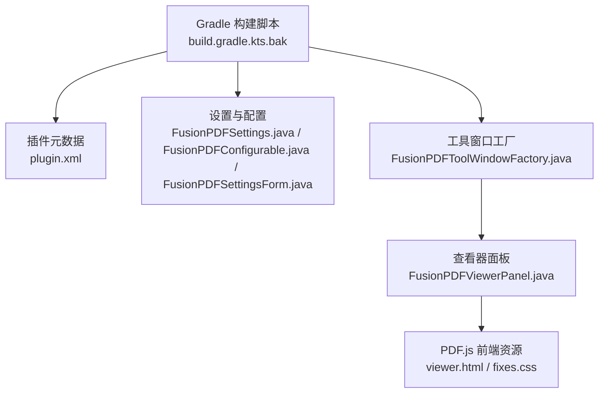
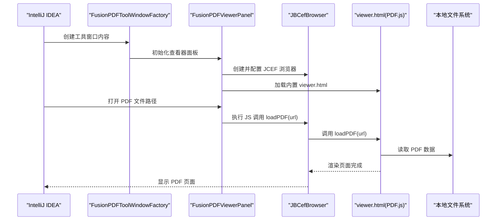
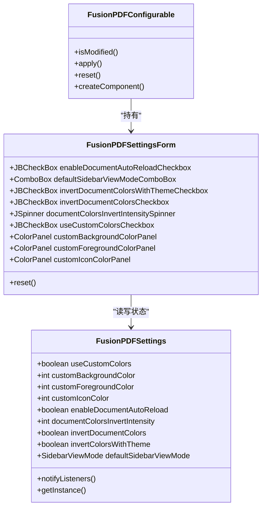
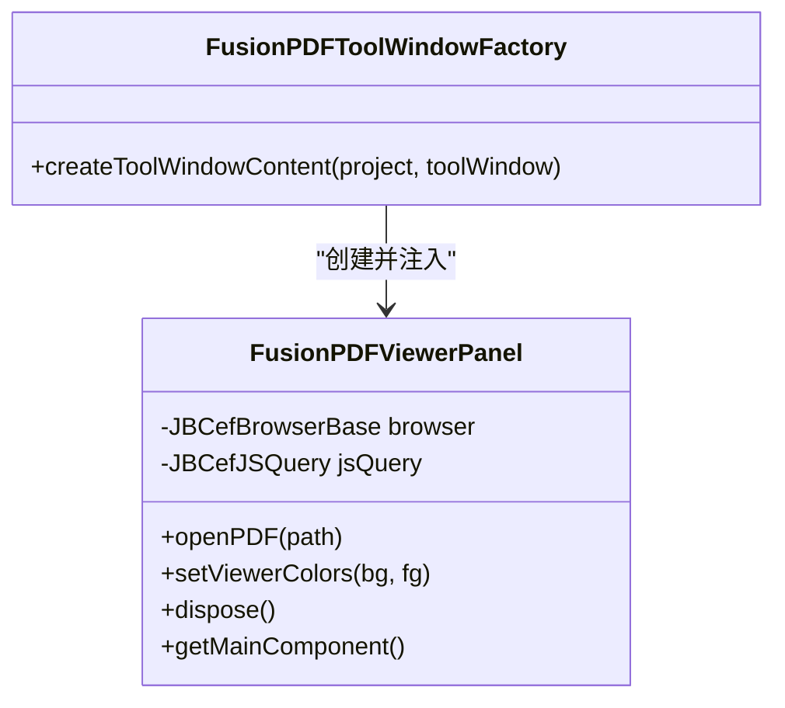
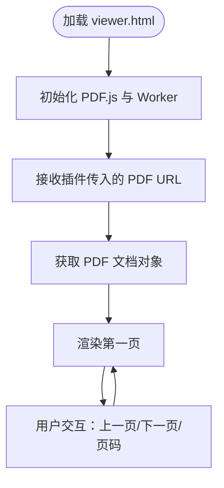
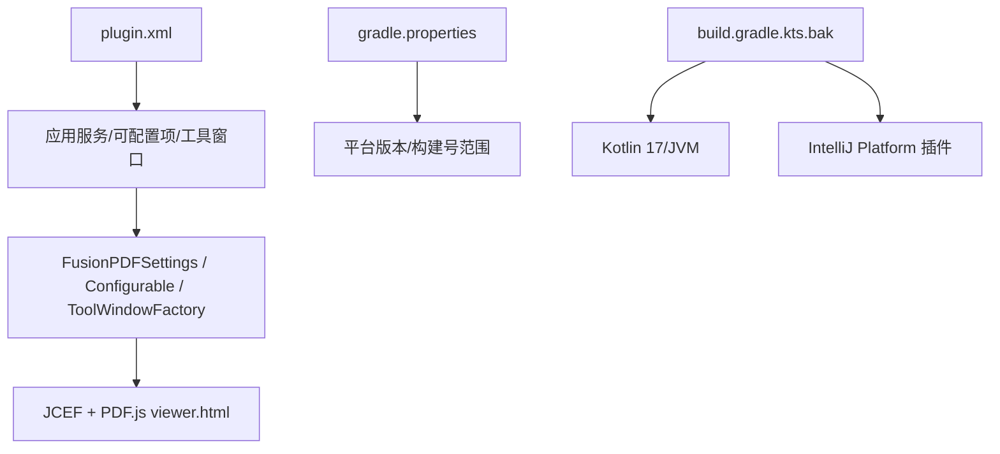

# 快速开始

<cite>
**本文引用的文件**
- [README.zh-CN.md](file://README.zh-CN.md)
- [README.md](file://README.md)
- [build.gradle.kts.bak](file://build.gradle.kts.bak)
- [gradle.properties](file://gradle.properties)
- [settings.gradle.kts](file://settings.gradle.kts)
- [plugin.xml](file://src/main/resources/META-INF/plugin.xml)
- [FusionPDFSettings.java](file://src/main/java/com/github/wkkya/fusionpdf/settings/FusionPDFSettings.java)
- [FusionPDFConfigurable.java](file://src/main/java/com/github/wkkya/fusionpdf/settings/FusionPDFConfigurable.java)
- [FusionPDFSettingsForm.java](file://src/main/java/com/github/wkkya/fusionpdf/settings/FusionPDFSettingsForm.java)
- [FusionPDFToolWindowFactory.java](file://src/main/java/com/github/wkkya/fusionpdf/factory/FusionPDFToolWindowFactory.java)
- [FusionPDFViewerPanel.java](file://src/main/java/com/github/wkkya/fusionpdf/viewer/FusionPDFViewerPanel.java)
- [SidebarViewMode.java](file://src/main/java/com/github/wkkya/fusionpdf/enums/SidebarViewMode.java)
- [viewer.html](file://src/main/resources/pdfjs/web/viewer.html)
- [fixes.css](file://src/main/resources/pdfjs/web/fixes.css)
</cite>

## 目录
1. [简介](#简介)
2. [项目结构](#项目结构)
3. [核心组件](#核心组件)
4. [架构总览](#架构总览)
5. [详细组件分析](#详细组件分析)
6. [依赖分析](#依赖分析)
7. [性能考虑](#性能考虑)
8. [故障排除指南](#故障排除指南)
9. [结论](#结论)
10. [附录](#附录)

## 简介
FusionPDF 是一款为 IntelliJ IDEA 设计的轻量级 PDF 阅读插件，可无缝融入当前 IDE 主题，支持自定义字体颜色、移除背景干扰，并通过内置 PDF.js 实现高性能的 PDF 查看体验。它提供工具窗口集成、主题适配、可选的文档反色处理以及多种侧边栏视图模式，帮助开发者在编码间隙高效阅读技术文档。

## 项目结构
该插件采用标准的 IntelliJ 平台插件工程布局，核心模块与资源分布如下：
- 核心代码位于 src/main/java，按功能域划分为 settings（设置）、viewer（查看器）、factory（工具窗口工厂）与 enums（枚举）。
- 插件元数据与扩展点定义于 src/main/resources/META-INF/plugin.xml。
- PDF 查看器前端资源位于 src/main/resources/pdfjs/web，包含 viewer.html 与 fixes.css。
- 构建与平台配置位于根目录的 Gradle 配置文件中。

图表来源
- [build.gradle.kts.bak:1-182](file://build.gradle.kts.bak#L1-L182)
- [plugin.xml:1-51](file://src/main/resources/META-INF/plugin.xml#L1-L51)
- [FusionPDFSettings.java:1-151](file://src/main/java/com/github/wkkya/fusionpdf/settings/FusionPDFSettings.java#L1-L151)
- [FusionPDFConfigurable.java:1-76](file://src/main/java/com/github/wkkya/fusionpdf/settings/FusionPDFConfigurable.java#L1-L76)
- [FusionPDFSettingsForm.java:1-159](file://src/main/java/com/github/wkkya/fusionpdf/settings/FusionPDFSettingsForm.java#L1-L159)
- [FusionPDFToolWindowFactory.java:1-21](file://src/main/java/com/github/wkkya/fusionpdf/factory/FusionPDFToolWindowFactory.java#L1-L21)
- [FusionPDFViewerPanel.java:1-78](file://src/main/java/com/github/wkkya/fusionpdf/viewer/FusionPDFViewerPanel.java#L1-L78)
- [viewer.html:1-175](file://src/main/resources/pdfjs/web/viewer.html#L1-L175)
- [fixes.css:1-22](file://src/main/resources/pdfjs/web/fixes.css#L1-L22)

章节来源
- [settings.gradle.kts:1-6](file://settings.gradle.kts#L1-L6)
- [build.gradle.kts.bak:1-182](file://build.gradle.kts.bak#L1-L182)
- [plugin.xml:1-51](file://src/main/resources/META-INF/plugin.xml#L1-L51)

## 核心组件
- 设置与持久化：负责存储用户偏好（如自定义颜色、文档反色强度、默认侧边栏视图等），并提供消息总线通知变更。
- 配置界面：提供设置表单，允许用户启用自动重载、选择侧边栏视图模式、配置文档反色与查看器颜色。
- 工具窗口工厂：创建并注入 PDF 查看器面板到 IDE 底部工具窗口。
- 查看器面板：基于 JCEF 承载 PDF.js viewer.html，负责加载 PDF、设置颜色、与前端交互。
- PDF.js 前端：内置 viewer.html 与 fixes.css，屏蔽部分 UI 控件，聚焦内容展示。

章节来源
- [FusionPDFSettings.java:1-151](file://src/main/java/com/github/wkkya/fusionpdf/settings/FusionPDFSettings.java#L1-L151)
- [FusionPDFSettingsForm.java:1-159](file://src/main/java/com/github/wkkya/fusionpdf/settings/FusionPDFSettingsForm.java#L1-L159)
- [FusionPDFToolWindowFactory.java:1-21](file://src/main/java/com/github/wkkya/fusionpdf/factory/FusionPDFToolWindowFactory.java#L1-L21)
- [FusionPDFViewerPanel.java:1-78](file://src/main/java/com/github/wkkya/fusionpdf/viewer/FusionPDFViewerPanel.java#L1-L78)
- [viewer.html:1-175](file://src/main/resources/pdfjs/web/viewer.html#L1-L175)
- [fixes.css:1-22](file://src/main/resources/pdfjs/web/fixes.css#L1-L22)

## 架构总览
下图展示了从 IDE 启动到 PDF 查看的整体流程：IDE 注册插件与工具窗口；用户打开工具窗口后，查看器面板初始化 JCEF 浏览器并加载 PDF.js；随后通过 JavaScript 调用在浏览器内渲染 PDF。

图表来源
- [FusionPDFToolWindowFactory.java:12-18](file://src/main/java/com/github/wkkya/fusionpdf/factory/FusionPDFToolWindowFactory.java#L12-L18)
- [FusionPDFViewerPanel.java:17-57](file://src/main/java/com/github/wkkya/fusionpdf/viewer/FusionPDFViewerPanel.java#L17-L57)
- [viewer.html:156-171](file://src/main/resources/pdfjs/web/viewer.html#L156-L171)

## 详细组件分析

### 组件一：设置与配置（持久化与 UI）
- 设置类负责保存用户偏好并提供默认值，支持主题联动的颜色与实验性功能开关。
- 配置界面提供复选框、下拉框与颜色选择器，支持一键重置为当前主题颜色。
- 变更通过消息总线通知监听者，确保界面即时更新。

图表来源
- [FusionPDFSettings.java:17-146](file://src/main/java/com/github/wkkya/fusionpdf/settings/FusionPDFSettings.java#L17-L146)
- [FusionPDFSettingsForm.java:18-158](file://src/main/java/com/github/wkkya/fusionpdf/settings/FusionPDFSettingsForm.java#L18-L158)
- [FusionPDFConfigurable.java:7-74](file://src/main/java/com/github/wkkya/fusionpdf/settings/FusionPDFConfigurable.java#L7-L74)

章节来源
- [FusionPDFSettings.java:1-151](file://src/main/java/com/github/wkkya/fusionpdf/settings/FusionPDFSettings.java#L1-L151)
- [FusionPDFSettingsForm.java:1-159](file://src/main/java/com/github/wkkya/fusionpdf/settings/FusionPDFSettingsForm.java#L1-L159)
- [FusionPDFConfigurable.java:1-76](file://src/main/java/com/github/wkkya/fusionpdf/settings/FusionPDFConfigurable.java#L1-L76)

### 组件二：工具窗口与查看器面板
- 工具窗口工厂在 IDE 中注册“FusionPDF”底部工具窗口，并注入查看器面板。
- 查看器面板基于 JCEF 初始化浏览器实例，加载内置 viewer.html，并通过 JavaScript 与前端交互以打开 PDF 与设置颜色。

图表来源
- [FusionPDFToolWindowFactory.java:12-18](file://src/main/java/com/github/wkkya/fusionpdf/factory/FusionPDFToolWindowFactory.java#L12-L18)
- [FusionPDFViewerPanel.java:12-76](file://src/main/java/com/github/wkkya/fusionpdf/viewer/FusionPDFViewerPanel.java#L12-L76)

章节来源
- [FusionPDFToolWindowFactory.java:1-21](file://src/main/java/com/github/wkkya/fusionpdf/factory/FusionPDFToolWindowFactory.java#L1-L21)
- [FusionPDFViewerPanel.java:1-78](file://src/main/java/com/github/wkkya/fusionpdf/viewer/FusionPDFViewerPanel.java#L1-L78)

### 组件三：PDF.js 前端与样式
- viewer.html 内置 PDF.js，提供分页渲染、前后翻页与页码显示；通过 loadPDF(url) 接口接收来自插件的 PDF 路径。
- fixes.css 屏蔽部分 UI 控件，使查看器更贴合 IDE 工具窗口布局。

图表来源
- [viewer.html:59-171](file://src/main/resources/pdfjs/web/viewer.html#L59-L171)
- [fixes.css:1-22](file://src/main/resources/pdfjs/web/fixes.css#L1-L22)

章节来源
- [viewer.html:1-175](file://src/main/resources/pdfjs/web/viewer.html#L1-L175)
- [fixes.css:1-22](file://src/main/resources/pdfjs/web/fixes.css#L1-L22)

## 依赖分析
- 构建与平台版本：插件使用 Kotlin JVM 与 IntelliJ Platform Gradle 插件，JVM 语言级别为 17；目标平台版本为 2024.2.3，兼容构建号范围由插件声明文件与属性文件共同约束。
- 插件扩展点：通过 plugin.xml 注册应用服务、可配置项、工具窗口与监听器；同时声明一组调试与实验性功能的注册表键。
- 运行时依赖：查看器依赖 JCEF 与 PDF.js 前端资源；设置类依赖编辑器颜色方案以匹配主题。

图表来源
- [plugin.xml:26-46](file://src/main/resources/META-INF/plugin.xml#L26-L46)
- [gradle.properties:34-41](file://gradle.properties#L34-L41)
- [build.gradle.kts.bak:19-54](file://build.gradle.kts.bak#L19-L54)

章节来源
- [plugin.xml:1-51](file://src/main/resources/META-INF/plugin.xml#L1-L51)
- [gradle.properties:1-54](file://gradle.properties#L1-L54)
- [build.gradle.kts.bak:1-182](file://build.gradle.kts.bak#L1-L182)

## 性能考虑
- 轻量化设计：插件通过内置 PDF.js 与 JCEF 提供高效渲染，避免额外外部依赖。
- 主题适配：使用全局颜色方案默认值，减少重复计算与样式切换成本。
- 实验性功能与调试：提供注册表键用于开启实验特性与调试模式，便于问题定位与性能优化。

## 故障排除指南
- 无法打开 PDF 或空白页面
  - 检查是否正确调用打开 PDF 的接口与路径格式。
  - 确认 viewer.html 已成功加载且未被样式覆盖导致不可见。
- 工具窗口未出现
  - 确认插件已在 IDE 中启用，且工具窗口 ID 与工厂类注册一致。
- 颜色不匹配或反色异常
  - 检查设置中的“随主题反色”与“查看器颜色”开关，确认颜色面板值是否生效。
- 性能问题或卡顿
  - 尝试关闭实验性功能与调试模式，必要时降低页面缩放比例。
- 构建或运行问题
  - 确认 JDK 版本满足要求（JVM 语言级别 17），并使用推荐的平台版本与构建号范围。

章节来源
- [FusionPDFViewerPanel.java:54-65](file://src/main/java/com/github/wkkya/fusionpdf/viewer/FusionPDFViewerPanel.java#L54-L65)
- [plugin.xml:32-46](file://src/main/resources/META-INF/plugin.xml#L32-L46)
- [FusionPDFSettings.java:66-72](file://src/main/java/com/github/wkkya/fusionpdf/settings/FusionPDFSettings.java#L66-L72)

## 结论
FusionPDF 通过与 IntelliJ IDEA 的深度集成，提供主题适配、可定制颜色与轻量渲染的 PDF 查看体验。借助内置 PDF.js 与 JCEF，用户可在 IDE 内高效阅读各类 PDF 文档，并根据个人偏好进行个性化配置。

## 附录

### 环境要求与前置条件
- IntelliJ IDEA 版本兼容性
  - 插件声明的兼容构建号范围与平台版本，请参考插件元数据与属性文件中的平台版本与构建号字段。
- Java 与构建工具
  - JVM 语言级别：17
  - 构建工具：Gradle（版本与配置由属性文件与插件管理）
- 运行时依赖
  - JCEF（随平台捆绑或按需配置）

章节来源
- [plugin.xml:11-14](file://src/main/resources/META-INF/plugin.xml#L11-L14)
- [gradle.properties:34-41](file://gradle.properties#L34-L41)
- [build.gradle.kts.bak:20-22](file://build.gradle.kts.bak#L20-L22)

### 安装与配置步骤
- 从 JetBrains Marketplace 安装
  - 在 IDE 中打开插件市场，搜索 FusionPDF 并安装，重启 IDE 后即可使用。
- 手动安装（开发/测试）
  - 使用构建脚本生成插件包并在 IDE 中通过“安装插件来自磁盘”方式进行安装。
- 首次使用
  - 打开底部工具窗口中的 FusionPDF，点击打开 PDF 文件，选择本地 PDF 即可开始阅读。
- 基本查看操作
  - 使用上下翻页按钮或键盘快捷键浏览页面；根据需要调整缩放比例。
- 自定义选项
  - 在设置中启用“随主题反色”或“查看器颜色”，选择默认侧边栏视图模式；可一键将查看器颜色重置为当前主题颜色。

章节来源
- [README.md:19-27](file://README.md#L19-L27)
- [README.zh-CN.md:18-23](file://README.zh-CN.md#L18-L23)
- [FusionPDFToolWindowFactory.java:14-18](file://src/main/java/com/github/wkkya/fusionpdf/factory/FusionPDFToolWindowFactory.java#L14-L18)
- [FusionPDFViewerPanel.java:54-65](file://src/main/java/com/github/wkkya/fusionpdf/viewer/FusionPDFViewerPanel.java#L54-L65)
- [FusionPDFSettingsForm.java:36-119](file://src/main/java/com/github/wkkya/fusionpdf/settings/FusionPDFSettingsForm.java#L36-L119)

### 常见初始配置场景
- 需要沉浸式阅读：关闭侧边栏控件，启用“随主题反色”并设置合适的反色强度。
- 高对比度阅读：启用“查看器颜色”，将背景与前景色设为高对比组合。
- 快速定位：选择“大纲”作为默认侧边栏视图模式，便于跳转到文档结构。

章节来源
- [SidebarViewMode.java:3-21](file://src/main/java/com/github/wkkya/fusionpdf/enums/SidebarViewMode.java#L3-L21)
- [FusionPDFSettingsForm.java:43-54](file://src/main/java/com/github/wkkya/fusionpdf/settings/FusionPDFSettingsForm.java#L43-L54)
- [FusionPDFSettings.java:140-146](file://src/main/java/com/github/wkkya/fusionpdf/settings/FusionPDFSettings.java#L140-L146)