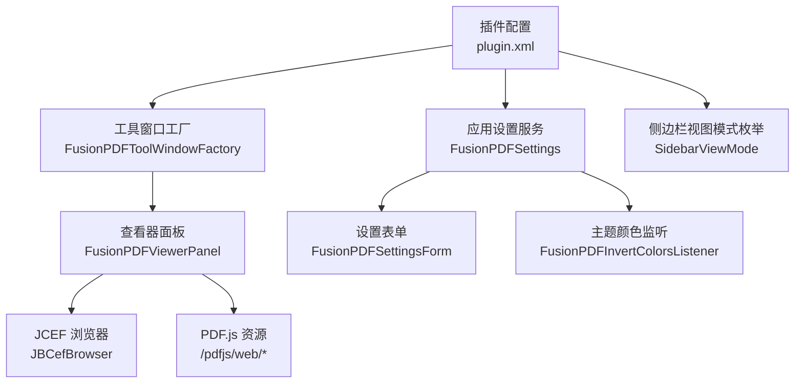
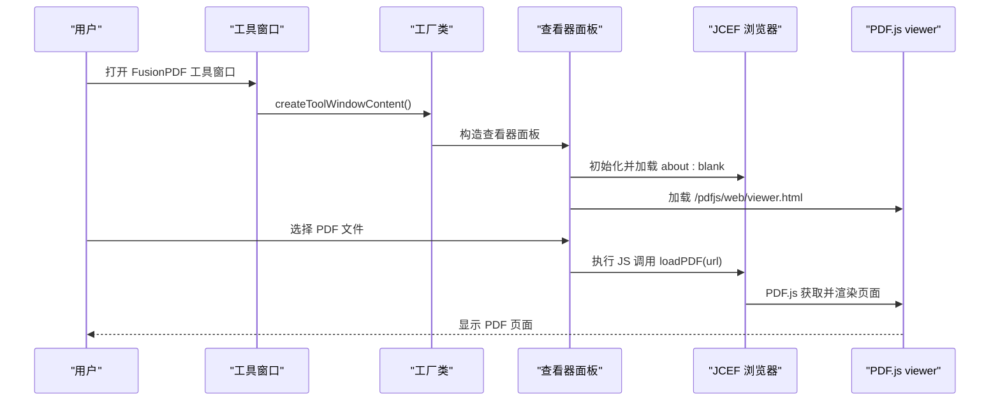
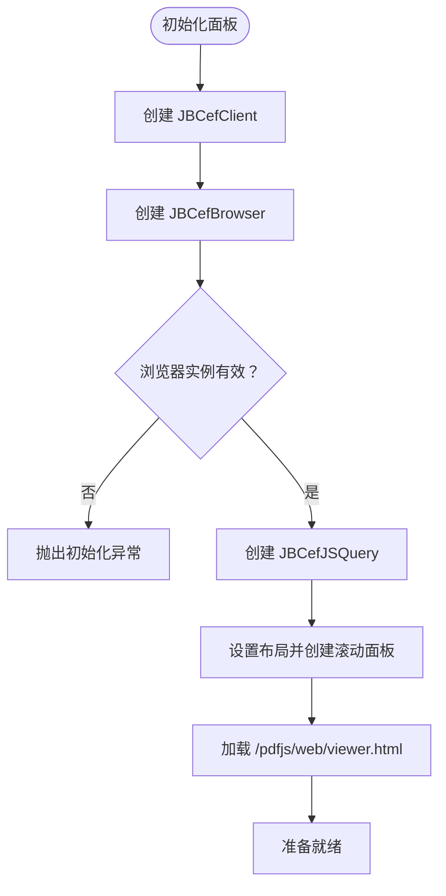
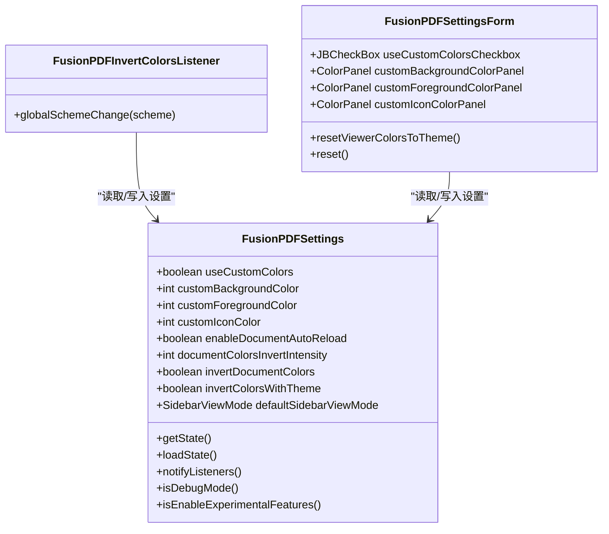
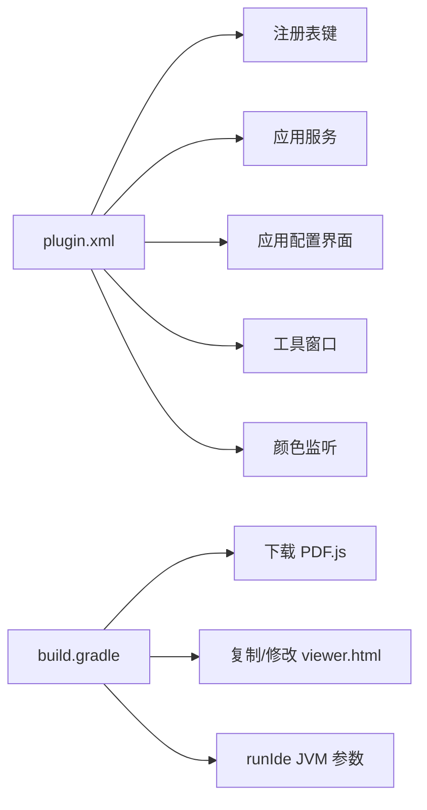
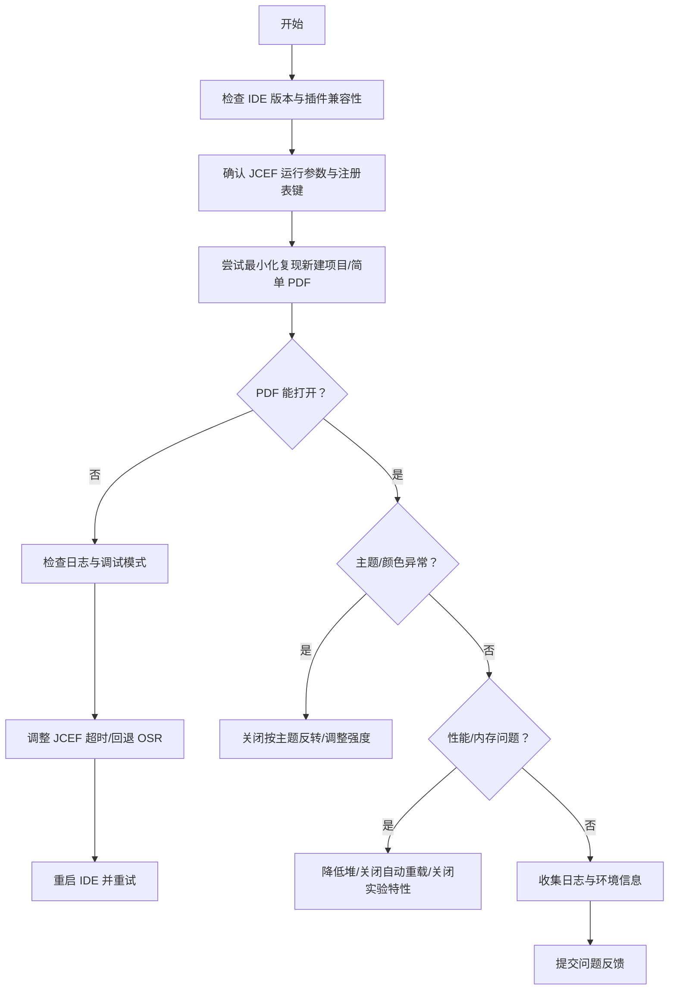

# 故障排除

<cite>
**本文引用的文件**
- [README.md](file://README.md)
- [README.zh-CN.md](file://README.zh-CN.md)
- [plugin.xml](file://src/main/resources/META-INF/plugin.xml)
- [build.gradle](file://build.gradle)
- [FusionPDFViewerPanel.java](file://src/main/java/com/github/wkkya/fusionpdf/viewer/FusionPDFViewerPanel.java)
- [FusionPDFSettings.java](file://src/main/java/com/github/wkkya/fusionpdf/settings/FusionPDFSettings.java)
- [FusionPDFSettingsForm.java](file://src/main/java/com/github/wkkya/fusionpdf/settings/FusionPDFSettingsForm.java)
- [FusionPDFConfigurable.java](file://src/main/java/com/github/wkkya/fusionpdf/settings/FusionPDFConfigurable.java)
- [FusionPDFInvertColorsListener.java](file://src/main/java/com/github/wkkya/fusionpdf/settings/FusionPDFInvertColorsListener.java)
- [FusionPDFToolWindowFactory.java](file://src/main/java/com/github/wkkya/fusionpdf/factory/FusionPDFToolWindowFactory.java)
- [SidebarViewMode.java](file://src/main/java/com/github/wkkya/fusionpdf/enums/SidebarViewMode.java)
- [FusionPDFBundle.properties](file://src/main/resources/messages/FusionPDFBundle.properties)
- [FusionPDFActionsBundle.properties](file://src/main/resources/messages/FusionPDFActionsBundle.properties)
- [Run Plugin.run.xml](file://.run/Run%20Plugin.run.xml)
- [Run Tests.run.xml](file://.run/Run%Tests.run.xml)
- [Run Verifications.run.xml](file://.run/Run%20Verifications.run.xml)
- [build.yml](file://.github/workflows/build.yml)
- [run-ui-tests.yml](file://.github/workflows/run-ui-tests.yml)
</cite>

## 目录
1. [简介](#简介)
2. [项目结构](#项目结构)
3. [核心组件](#核心组件)
4. [架构总览](#架构总览)
5. [详细组件分析](#详细组件分析)
6. [依赖分析](#依赖分析)
7. [性能考虑](#性能考虑)
8. [故障排除指南](#故障排除指南)
9. [结论](#结论)
10. [附录](#附录)

## 简介
本指南面向 FusionPDF 插件的使用者与开发者，聚焦于常见问题的系统化诊断与解决，涵盖安装失败、PDF 打不开、主题适配异常、JCEF 相关问题、性能与内存优化、与其他插件的兼容性以及社区支持与反馈流程。文档基于仓库中的实际实现与配置进行分析，并提供可操作的排障步骤与最佳实践。

## 项目结构
FusionPDF 是一个 IntelliJ 平台插件，采用模块化结构组织：
- 配置与扩展点：通过 plugin.xml 声明工具窗口、应用服务、配置界面与注册表键。
- 视图与浏览器：使用 JCEF 集成 PDF.js，在工具窗口中渲染 PDF。
- 设置与监听：持久化设置、主题颜色监听与 UI 表单。
- 构建与运行：Gradle 任务下载 PDF.js、打包 Web 资源、配置 JBR/JCEF 运行参数。

图表来源
- [plugin.xml:26-46](file://src/main/resources/META-INF/plugin.xml#L26-L46)
- [FusionPDFToolWindowFactory.java:12-18](file://src/main/java/com/github/wkkya/fusionpdf/factory/FusionPDFToolWindowFactory.java#L12-L18)
- [FusionPDFViewerPanel.java:12-38](file://src/main/java/com/github/wkkya/fusionpdf/viewer/FusionPDFViewerPanel.java#L12-L38)
- [FusionPDFSettings.java:17-46](file://src/main/java/com/github/wkkya/fusionpdf/settings/FusionPDFSettings.java#L17-L46)
- [FusionPDFSettingsForm.java:18-87](file://src/main/java/com/github/wkkya/fusionpdf/settings/FusionPDFSettingsForm.java#L18-L87)
- [FusionPDFInvertColorsListener.java:11-24](file://src/main/java/com/github/wkkya/fusionpdf/settings/FusionPDFInvertColorsListener.java#L11-L24)
- [SidebarViewMode.java:3-21](file://src/main/java/com/github/wkkya/fusionpdf/enums/SidebarViewMode.java#L3-L21)

章节来源
- [plugin.xml:1-51](file://src/main/resources/META-INF/plugin.xml#L1-L51)
- [build.gradle:16-21](file://build.gradle#L16-L21)

## 核心组件
- 工具窗口与面板
  - 工具窗口由工厂类创建，面板负责初始化 JCEF 浏览器、加载 PDF.js viewer 并执行 JS 调用以打开 PDF。
- 应用设置与监听
  - 设置类提供持久化存储、默认颜色计算、注册表开关（调试、JCEF 超时、实验特性、OSR）与变更通知。
  - 监听器在主题变化时根据全局方案自动反转文档颜色。
- 设置 UI
  - 表单组件支持“按主题反转”“反转强度”“自定义查看器颜色”等选项，并提供“恢复为当前主题颜色”的快捷入口。
- 插件扩展点
  - 注册表键用于开启调试、JCEF 超时、实验特性与 OSR 渲染；声明应用服务与可配置项；注册工具窗口。

章节来源
- [FusionPDFToolWindowFactory.java:12-18](file://src/main/java/com/github/wkkya/fusionpdf/factory/FusionPDFToolWindowFactory.java#L12-L18)
- [FusionPDFViewerPanel.java:12-76](file://src/main/java/com/github/wkkya/fusionpdf/viewer/FusionPDFViewerPanel.java#L12-L76)
- [FusionPDFSettings.java:17-147](file://src/main/java/com/github/wkkya/fusionpdf/settings/FusionPDFSettings.java#L17-L147)
- [FusionPDFInvertColorsListener.java:11-24](file://src/main/java/com/github/wkkya/fusionpdf/settings/FusionPDFInvertColorsListener.java#L11-L24)
- [FusionPDFSettingsForm.java:18-159](file://src/main/java/com/github/wkkya/fusionpdf/settings/FusionPDFSettingsForm.java#L18-L159)
- [plugin.xml:26-46](file://src/main/resources/META-INF/plugin.xml#L26-L46)

## 架构总览
下图展示从用户触发到 PDF 渲染的关键路径，以及与 JCEF/PDF.js 的交互。

图表来源
- [FusionPDFToolWindowFactory.java:12-18](file://src/main/java/com/github/wkkya/fusionpdf/factory/FusionPDFToolWindowFactory.java#L12-L18)
- [FusionPDFViewerPanel.java:17-57](file://src/main/java/com/github/wkkya/fusionpdf/viewer/FusionPDFViewerPanel.java#L17-L57)
- [plugin.xml:36-36](file://src/main/resources/META-INF/plugin.xml#L36-L36)

## 详细组件分析

### 查看器面板（JCEF + PDF.js）
- 初始化流程
  - 创建 JBCefClient 与 JBCefBrowser，确保浏览器实例非空后创建 JS 查询对象。
  - 设置布局并创建带滚动条的容器，加载 PDF.js 的 viewer.html。
- 打开 PDF
  - 将本地 PDF 路径转为 URI 字符串，通过 JS 调用 PDF.js 的加载函数。
- 颜色设置
  - 将背景/前景色转换为十六进制字符串，调用 JS 函数设置查看器颜色。
- 资源路径
  - viewer.html 位于 /pdfjs/web，由构建脚本复制并注入额外脚本与样式修复。

图表来源
- [FusionPDFViewerPanel.java:17-38](file://src/main/java/com/github/wkkya/fusionpdf/viewer/FusionPDFViewerPanel.java#L17-L38)

章节来源
- [FusionPDFViewerPanel.java:12-76](file://src/main/java/com/github/wkkya/fusionpdf/viewer/FusionPDFViewerPanel.java#L12-L76)

### 设置与主题监听
- 设置类
  - 提供持久化字段（自定义颜色、反转开关、反转强度、默认侧边栏视图模式等），默认颜色来自全局编辑器方案。
  - 通过注册表键控制调试模式、JCEF 超时、实验特性与 OSR。
  - 变更通知通过消息总线发布。
- 监听器
  - 在全局颜色方案变化时，若启用“按主题反转”，则根据背景亮度自动切换文档反转状态。
- 设置 UI
  - 表单组件绑定设置类，支持“按主题反转”联动禁用“手动反转”，并提供“恢复为当前主题颜色”。

图表来源
- [FusionPDFSettings.java:17-147](file://src/main/java/com/github/wkkya/fusionpdf/settings/FusionPDFSettings.java#L17-L147)
- [FusionPDFInvertColorsListener.java:11-24](file://src/main/java/com/github/wkkya/fusionpdf/settings/FusionPDFInvertColorsListener.java#L11-L24)
- [FusionPDFSettingsForm.java:18-159](file://src/main/java/com/github/wkkya/fusionpdf/settings/FusionPDFSettingsForm.java#L18-L159)

章节来源
- [FusionPDFSettings.java:17-147](file://src/main/java/com/github/wkkya/fusionpdf/settings/FusionPDFSettings.java#L17-L147)
- [FusionPDFInvertColorsListener.java:11-24](file://src/main/java/com/github/wkkya/fusionpdf/settings/FusionPDFInvertColorsListener.java#L11-L24)
- [FusionPDFSettingsForm.java:18-159](file://src/main/java/com/github/wkkya/fusionpdf/settings/FusionPDFSettingsForm.java#L18-L159)

### 工具窗口与侧边栏视图模式
- 工具窗口工厂负责创建查看器面板并加入窗口组件。
- 侧边栏视图模式枚举支持关闭、缩略图、书签/大纲、附件四种模式，用于控制 PDF.js 侧边栏显示。

章节来源
- [FusionPDFToolWindowFactory.java:12-18](file://src/main/java/com/github/wkkya/fusionpdf/factory/FusionPDFToolWindowFactory.java#L12-L18)
- [SidebarViewMode.java:3-21](file://src/main/java/com/github/wkkya/fusionpdf/enums/SidebarViewMode.java#L3-L21)

## 依赖分析
- 插件扩展点
  - 注册表键：调试模式、JCEF 加载超时、实验特性、JCEF OSR 视图。
  - 应用服务：FusionPDFSettings。
  - 可配置项：FusionPDFConfigurable。
  - 工具窗口：底部停靠，工厂类为 FusionPDFToolWindowFactory。
  - 应用监听：EditorColorsListener，用于主题颜色变化事件。
- 构建与运行
  - 构建阶段下载 PDF.js 并复制 viewer.html，注入样式修复与脚本。
  - 运行阶段启用 JCEF、禁用沙箱、设置最大堆与 JBR 版本，输出日志路径可配置。

图表来源
- [plugin.xml:26-46](file://src/main/resources/META-INF/plugin.xml#L26-L46)
- [build.gradle:36-95](file://build.gradle#L36-L95)

章节来源
- [plugin.xml:26-46](file://src/main/resources/META-INF/plugin.xml#L26-L46)
- [build.gradle:36-95](file://build.gradle#L36-L95)

## 性能考虑
- JCEF 与内存
  - 运行参数中设置了较大的堆上限，适合处理大型 PDF；如遇内存压力，可适当降低堆上限或减少同时打开的 PDF 数量。
- OSR 与渲染
  - 注册表键允许启用 JCEF OSR 视图，可能改善某些平台下的渲染稳定性；若出现闪烁或黑屏，可尝试关闭该选项。
- 文档自动重载
  - 设置项支持“更改时重载文档”，在频繁更新 PDF 时可提升效率，但可能增加资源占用；在大型文档上谨慎开启。
- PDF.js 资源
  - 构建阶段仅复制必要资源并排除映射文件，有助于减小打包体积与启动时间。

章节来源
- [build.gradle:84-90](file://build.gradle#L84-L90)
- [plugin.xml:27-30](file://src/main/resources/META-INF/plugin.xml#L27-L30)
- [FusionPDFSettings.java:27-27](file://src/main/java/com/github/wkkya/fusionpdf/settings/FusionPDFSettings.java#L27-L27)

## 故障排除指南

### 一、安装与兼容性问题
- 现象
  - 插件无法安装或在 IDE 中不可见。
- 排查步骤
  - 检查 IDE 版本范围是否满足 since-build/until-build。
  - 确认插件模块依赖 platform 是否存在。
  - 若使用 Marketplace，请确认发布版本与目标 IDE 版本一致。
- 参考配置
  - 插件版本与兼容性范围、依赖模块在配置文件中声明。

章节来源
- [plugin.xml:7-14](file://src/main/resources/META-INF/plugin.xml#L7-L14)

### 二、PDF 文件无法打开
- 现象
  - 打开 PDF 后空白、无响应或报错。
- 排查步骤
  - 确认查看器面板已成功加载 PDF.js viewer.html。
  - 检查本地 PDF 路径是否有效且可访问。
  - 在调试模式下观察 JS 调用是否成功执行。
  - 若使用“按主题反转”，检查反转强度设置是否导致视觉异常。
- 关键路径
  - 面板加载 PDF.js → 执行 JS 调用 loadPDF → PDF.js 获取并渲染页面。

章节来源
- [FusionPDFViewerPanel.java:49-57](file://src/main/java/com/github/wkkya/fusionpdf/viewer/FusionPDFViewerPanel.java#L49-L57)
- [FusionPDFBundle.properties:60-62](file://src/main/resources/messages/FusionPDFBundle.properties#L60-L62)

### 三、主题适配问题
- 现象
  - 文档颜色与主题不匹配，或反转后对比度过高/过低。
- 排查步骤
  - 检查“按主题反转”是否启用；若启用，背景偏暗时会自动反转文档颜色。
  - 调整“反转强度”滑杆，观察对比度变化。
  - 使用“恢复为当前主题颜色”按钮重置查看器颜色。
- 参考实现
  - 主题监听器在颜色方案变化时更新反转状态；设置类提供默认颜色与反转强度。

章节来源
- [FusionPDFInvertColorsListener.java:14-22](file://src/main/java/com/github/wkkya/fusionpdf/settings/FusionPDFInvertColorsListener.java#L14-L22)
- [FusionPDFSettingsForm.java:56-80](file://src/main/java/com/github/wkkya/fusionpdf/settings/FusionPDFSettingsForm.java#L56-L80)
- [FusionPDFSettings.java:52-64](file://src/main/java/com/github/wkkya/fusionpdf/settings/FusionPDFSettings.java#L52-L64)

### 四、JCEF 相关问题
- 常见症状
  - 启动后黑屏、页面不渲染、崩溃或卡死。
- 排查步骤
  - 确认运行参数已启用 JCEF、禁用沙箱并设置合适的堆大小。
  - 检查注册表键 fusion.pdf.debug 是否开启，以便输出调试信息。
  - 调整 fusion.pdf.jcefLatchTimeout，增大等待时间以应对慢速加载。
  - 如需，关闭 fusion.pdf.use.jcef.osr.view 以回退到标准渲染。
  - 若问题出现在特定操作系统，尝试更换 JBR 版本或禁用沙箱。
- 参考配置
  - 运行参数、注册表键与构建任务。

章节来源
- [build.gradle:84-90](file://build.gradle#L84-L90)
- [plugin.xml:27-30](file://src/main/resources/META-INF/plugin.xml#L27-L30)

### 五、性能与内存问题
- 症状
  - 打开大文档卡顿、内存占用过高、IDE 响应迟缓。
- 优化建议
  - 降低堆上限或减少同时打开的 PDF 数量。
  - 关闭“按主题反转”或降低“反转强度”。
  - 关闭“文档自动重载”以减少频繁刷新。
  - 关闭实验特性以避免不稳定行为。
  - 使用 OSR 视图（若稳定）或回退到标准渲染。
- 参考设置
  - 注册表键与设置项。

章节来源
- [plugin.xml:27-30](file://src/main/resources/META-INF/plugin.xml#L27-L30)
- [FusionPDFSettings.java:27-27](file://src/main/java/com/github/wkkya/fusionpdf/settings/FusionPDFSettings.java#L27-L27)

### 六、与其他插件的兼容性
- 建议
  - 若与其他浏览器/渲染相关插件冲突，尝试禁用或调整其优先级。
  - 若存在 UI 工具窗口冲突，调整 FusionPDF 工具窗口位置或关闭其他同类工具。
  - 在 CI/本地运行配置中统一 JCEF 与日志路径，避免多份日志造成混淆。

章节来源
- [plugin.xml:36-36](file://src/main/resources/META-INF/plugin.xml#L36-L36)
- [Run Plugin.run.xml:3-3](file://.run/Run%20Plugin.run.xml#L3-L3)

### 七、日志分析与调试技巧
- 日志位置
  - 运行配置中已指定 idea.log 路径，可在运行配置与验证配置中查看。
- 调试开关
  - fusion.pdf.debug：开启调试模式，便于捕获 JS 与渲染异常。
  - fusion.pdf.jcefLatchTimeout：增大 JCEF 加载等待时间，避免过早超时。
  - fusion.pdf.enableExperimentalFeatures：开启实验特性，注意稳定性。
  - fusion.pdf.use.jcef.osr.view：切换 JCEF OSR 视图。
- 建议流程
  - 开启调试 → 复现问题 → 截取日志 → 分析 JCEF 初始化与 PDF.js 加载阶段 → 调整注册表键后重试。

章节来源
- [plugin.xml:27-30](file://src/main/resources/META-INF/plugin.xml#L27-L30)
- [Run Plugin.run.xml:3-3](file://.run/Run%20Plugin.run.xml#L3-L3)
- [Run Verifications.run.xml:3-3](file://.run/Run%20Verifications.run.xml#L3-L3)

### 八、问题诊断流程（推荐）

[本图为概念性流程图，无需图表来源]

## 结论
通过结合插件配置、JCEF 运行参数、注册表键与设置项，大多数安装、打开、主题与性能问题均可快速定位与缓解。建议在排障过程中逐步启用/禁用调试与实验特性，配合日志定位根因，并依据本指南的优化建议调整运行参数与设置项。

## 附录

### A. 常用注册表键与用途
- fusion.pdf.debug：启用 PDF 查看器调试模式。
- fusion.pdf.jcefLatchTimeout：设置 WebView 最大等待时间。
- fusion.pdf.enableExperimentalFeatures：启用实验特性。
- fusion.pdf.use.jcef.osr.view：启用 JCEF OSR 视图。

章节来源
- [plugin.xml:27-30](file://src/main/resources/META-INF/plugin.xml#L27-L30)

### B. 社区支持与问题反馈
- 参考仓库中的工作流与运行配置，可定位日志输出与测试运行方式。
- 建议在提交问题时附带：
  - IDE 版本与平台
  - 插件版本
  - fusion.pdf.debug 日志片段
  - 复现步骤与受影响的 PDF 示例（如可行）

章节来源
- [build.yml:40-77](file://.github/workflows/build.yml#L40-L77)
- [run-ui-tests.yml:10-63](file://.github/workflows/run-ui-tests.yml#L10-L63)
- [Run Plugin.run.xml:3-3](file://.run/Run%20Plugin.run.xml#L3-L3)

### C. 预防性维护与最佳实践
- 定期更新 PDF.js 与 JBR，保持与 IDE 版本同步。
- 在团队内统一 JCEF 与日志配置，避免环境差异。
- 对大文档使用分卷或预处理，减少一次性加载压力。
- 限制实验特性在生产环境的使用，关注稳定性。

[本节为通用建议，无需章节来源]