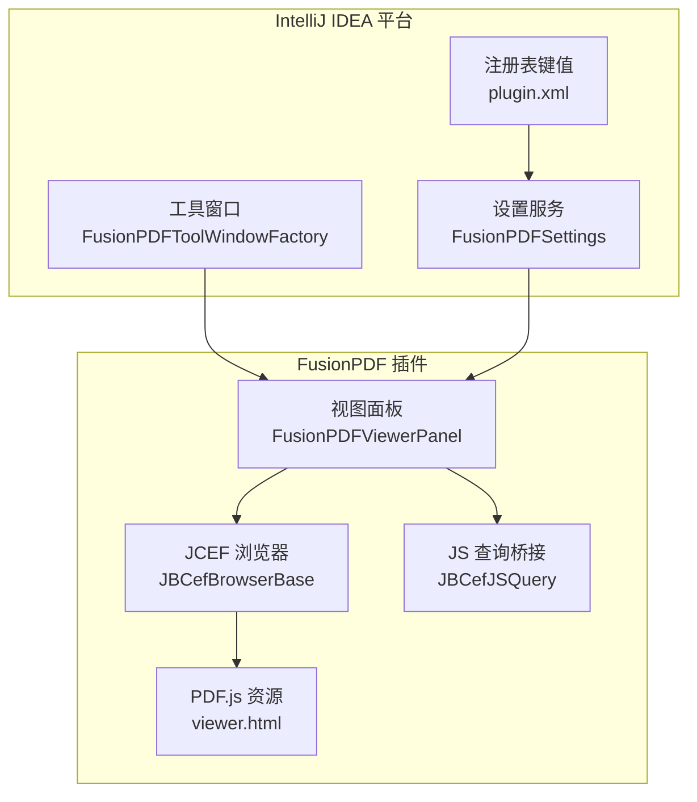
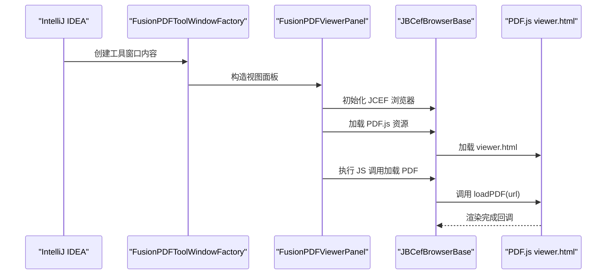
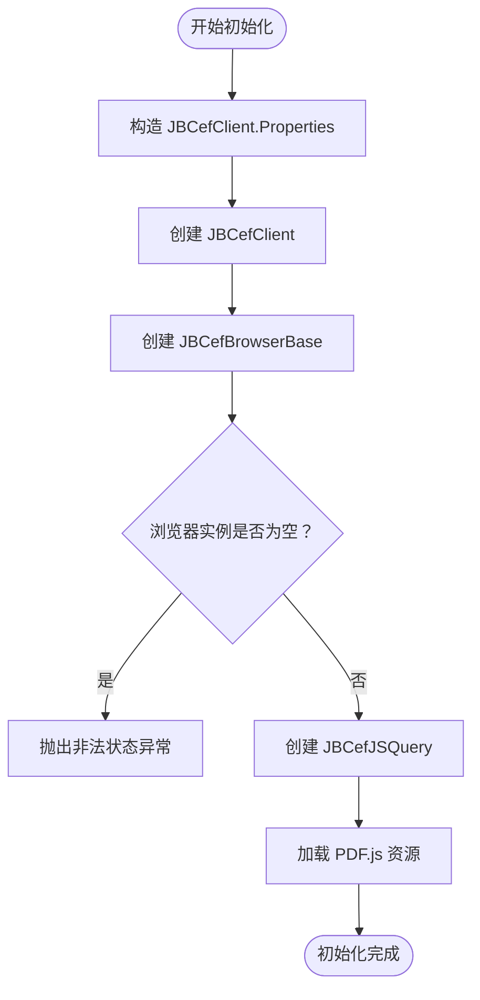
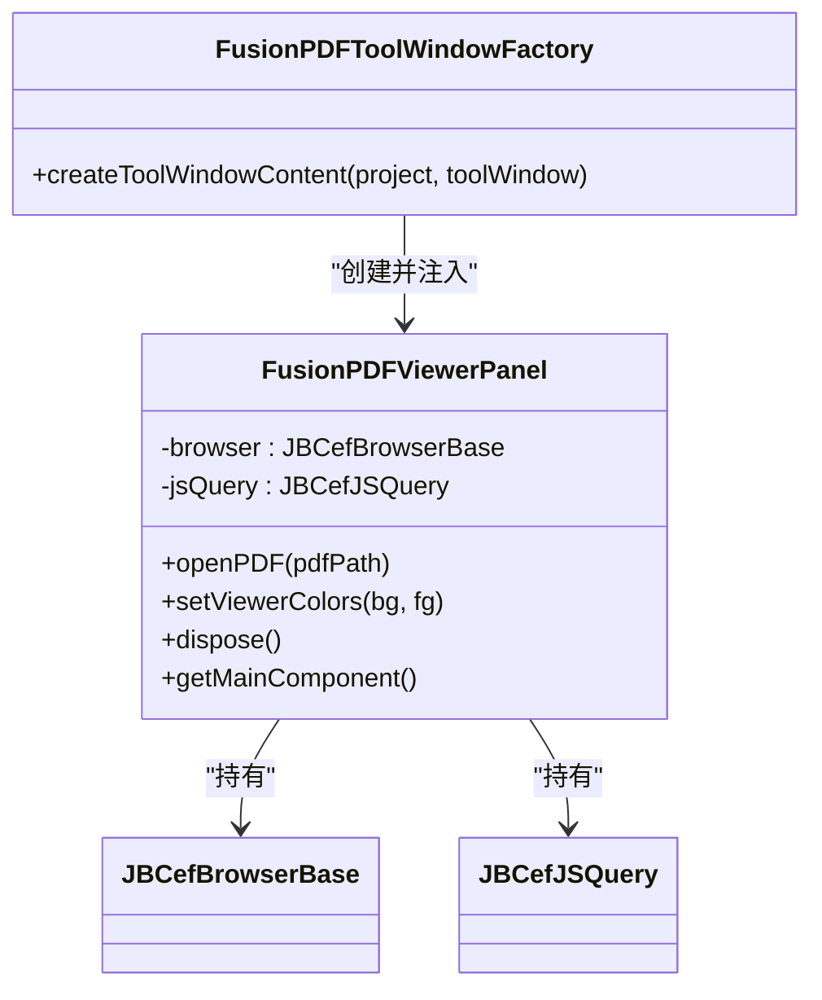
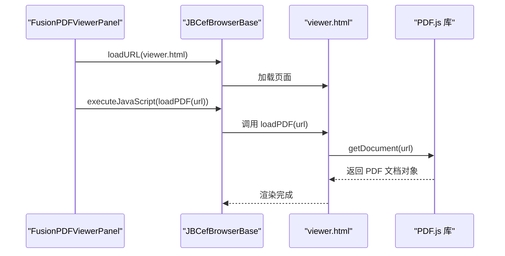
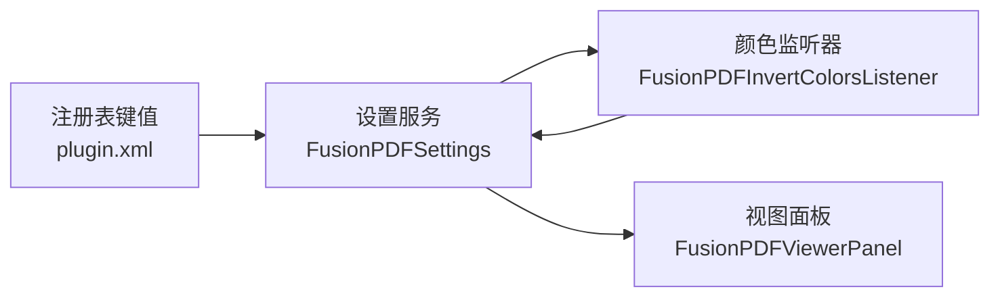
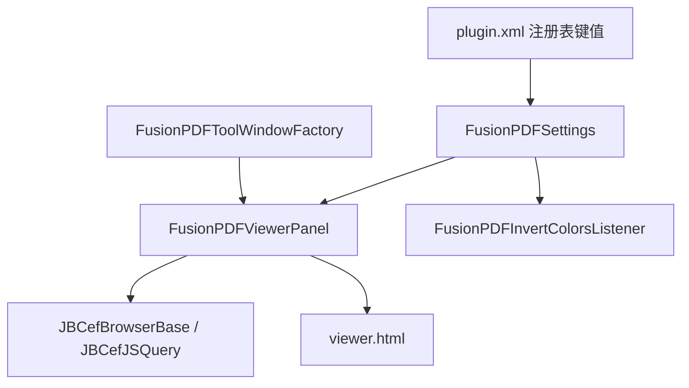

# JCEF 集成架构

<cite>
**本文引用的文件**
- [FusionPDFViewerPanel.java](file://src/main/java/com/github/wkkya/fusionpdf/viewer/FusionPDFViewerPanel.java)
- [FusionPDFToolWindowFactory.java](file://src/main/java/com/github/wkkya/fusionpdf/factory/FusionPDFToolWindowFactory.java)
- [plugin.xml](file://src/main/resources/META-INF/plugin.xml)
- [FusionPDFSettings.java](file://src/main/java/com/github/wkkya/fusionpdf/settings/FusionPDFSettings.java)
- [FusionPDFConfigurable.java](file://src/main/java/com/github/wkkya/fusionpdf/settings/FusionPDFConfigurable.java)
- [FusionPDFInvertColorsListener.java](file://src/main/java/com/github/wkkya/fusionpdf/settings/FusionPDFInvertColorsListener.java)
- [SidebarViewMode.java](file://src/main/java/com/github/wkkya/fusionpdf/enums/SidebarViewMode.java)
- [viewer.html](file://src/main/resources/pdfjs/web/viewer.html)
- [build.gradle](file://build.gradle)
- [build.gradle.kts.bak](file://build.gradle.kts.bak)
- [README.md](file://README.md)
</cite>

## 目录
1. [简介](#简介)
2. [项目结构](#项目结构)
3. [核心组件](#核心组件)
4. [架构总览](#架构总览)
5. [详细组件分析](#详细组件分析)
6. [依赖关系分析](#依赖关系分析)
7. [性能考虑](#性能考虑)
8. [故障排查指南](#故障排查指南)
9. [结论](#结论)
10. [附录](#附录)

## 简介
本文件系统化梳理 FusionPDF 的 JCEF（Java Chromium Embedded Framework）集成架构，重点解释 JCEF 在 PDF 查看器中的作用与实现原理，涵盖 JBCefBrowserBase 初始化流程、客户端配置、浏览器实例创建与 JSQuery 查询机制；阐述 JCEF 浏览器与 IntelliJ IDEA 工具窗口的集成方式（布局管理与组件生命周期）；说明 JCEF 的安全模型与权限控制；给出 JCEF 配置参数的最佳实践（内存限制、缓存策略、性能调优）；并提供常见问题的解决方案与调试技巧。

## 项目结构
FusionPDF 将 JCEF 集成与工具窗口装配解耦，采用“视图面板 + 工厂 + 配置”的分层组织：
- 视图层：FusionPDFViewerPanel 负责 JCEF 浏览器初始化、PDF.js 加载、JS 调用与资源释放。
- 工具窗口层：FusionPDFToolWindowFactory 将视图面板注入到 IDE 工具窗口中。
- 配置层：plugin.xml 声明注册表键值与工具窗口扩展；FusionPDFSettings 提供持久化配置与监听。
- 资源层：PDF.js 资源嵌入至插件资源，viewer.html 作为 PDF 渲染入口。

图表来源
- [FusionPDFToolWindowFactory.java:12-19](file://src/main/java/com/github/wkkya/fusionpdf/factory/FusionPDFToolWindowFactory.java#L12-L19)
- [FusionPDFViewerPanel.java:17-38](file://src/main/java/com/github/wkkya/fusionpdf/viewer/FusionPDFViewerPanel.java#L17-L38)
- [plugin.xml:26-36](file://src/main/resources/META-INF/plugin.xml#L26-L36)
- [FusionPDFSettings.java:17-50](file://src/main/java/com/github/wkkya/fusionpdf/settings/FusionPDFSettings.java#L17-L50)

章节来源
- [FusionPDFToolWindowFactory.java:12-19](file://src/main/java/com/github/wkkya/fusionpdf/factory/FusionPDFToolWindowFactory.java#L12-L19)
- [FusionPDFViewerPanel.java:17-38](file://src/main/java/com/github/wkkya/fusionpdf/viewer/FusionPDFViewerPanel.java#L17-L38)
- [plugin.xml:26-36](file://src/main/resources/META-INF/plugin.xml#L26-L36)

## 核心组件
- JCEF 浏览器与 JS 查询桥接
  - 通过 JBCefApp 获取客户端，创建 JBCefBrowserBase 实例，并基于该实例创建 JBCefJSQuery，用于与前端 JS 进行双向通信。
  - 初始化顺序：先构造 JBCefClient.Properties，再通过 JBCefApp.getInstance().createClient() 创建客户端，随后创建浏览器实例，最后创建 JSQuery。
- PDF.js 集成
  - 从资源路径加载 viewer.html，设置为浏览器初始页面，随后通过 executeJavaScript 调用前端函数加载 PDF。
- 工具窗口集成
  - 工厂类在 createToolWindowContent 中创建视图面板并加入工具窗口组件树，实现 IDE 生命周期内的显示与销毁。
- 设置与主题联动
  - 通过 FusionPDFSettings 读取注册表键值与持久化配置，结合 EditorColorsListener 监听主题变化，动态更新 PDF 文档颜色策略。

章节来源
- [FusionPDFViewerPanel.java:17-38](file://src/main/java/com/github/wkkya/fusionpdf/viewer/FusionPDFViewerPanel.java#L17-L38)
- [FusionPDFViewerPanel.java:49-52](file://src/main/java/com/github/wkkya/fusionpdf/viewer/FusionPDFViewerPanel.java#L49-L52)
- [FusionPDFToolWindowFactory.java:14-18](file://src/main/java/com/github/wkkya/fusionpdf/factory/FusionPDFToolWindowFactory.java#L14-L18)
- [FusionPDFSettings.java:66-72](file://src/main/java/com/github/wkkya/fusionpdf/settings/FusionPDFSettings.java#L66-L72)
- [FusionPDFInvertColorsListener.java:11-23](file://src/main/java/com/github/wkkya/fusionpdf/settings/FusionPDFInvertColorsListener.java#L11-23)

## 架构总览
下图展示从 IDE 启动到 PDF 渲染的关键交互路径：工厂创建视图面板 → 初始化 JCEF → 加载 PDF.js → 执行 JS 函数加载 PDF → 通过 JSQuery 与前端通信。

图表来源
- [FusionPDFToolWindowFactory.java:14-18](file://src/main/java/com/github/wkkya/fusionpdf/factory/FusionPDFToolWindowFactory.java#L14-L18)
- [FusionPDFViewerPanel.java:49-52](file://src/main/java/com/github/wkkya/fusionpdf/viewer/FusionPDFViewerPanel.java#L49-L52)
- [viewer.html:156-171](file://src/main/resources/pdfjs/web/viewer.html#L156-L171)

## 详细组件分析

### 组件一：JCEF 初始化与 JS 查询机制
- 初始化流程要点
  - 先构造 JBCefClient.Properties，确保客户端属性可用。
  - 通过 JBCefApp.getInstance().createClient() 创建客户端实例。
  - 创建 JBCefBrowserBase 实例并传入初始 URL（如 about:blank），随后基于该实例创建 JBCefJSQuery。
  - 若浏览器实例为空，抛出非法状态异常，避免后续空指针。
- JS 查询机制
  - 使用 JBCefJSQuery.create(browser) 建立查询通道，便于在 Java 侧与前端 JS 交互（例如传递 PDF URL、颜色配置等）。
- 资源加载与 JS 调用
  - 通过 browser.loadURL 加载嵌入式 PDF.js 资源路径。
  - 通过 browser.getCefBrowser().executeJavaScript 执行前端函数（如 loadPDF、setViewerColors）。

图表来源
- [FusionPDFViewerPanel.java:20-30](file://src/main/java/com/github/wkkya/fusionpdf/viewer/FusionPDFViewerPanel.java#L20-L30)
- [FusionPDFViewerPanel.java:23-28](file://src/main/java/com/github/wkkya/fusionpdf/viewer/FusionPDFViewerPanel.java#L23-L28)

章节来源
- [FusionPDFViewerPanel.java:17-38](file://src/main/java/com/github/wkkya/fusionpdf/viewer/FusionPDFViewerPanel.java#L17-L38)

### 组件二：JCEF 与工具窗口集成（布局与生命周期）
- 工具窗口装配
  - 工厂类在 createToolWindowContent 中创建 FusionPDFViewerPanel，并将其主组件加入工具窗口根组件。
- 布局管理
  - 视图面板使用 BorderLayout，中心放置带滚动条的浏览器组件，保证 PDF 内容可滚动浏览。
- 组件生命周期
  - 视图面板提供 dispose 方法，依次释放 JSQuery 与浏览器资源，避免内存泄漏与句柄泄露。
  - 工具窗口关闭时，IDE 会触发组件树清理，配合面板 dispose 可确保资源回收。

图表来源
- [FusionPDFToolWindowFactory.java:14-18](file://src/main/java/com/github/wkkya/fusionpdf/factory/FusionPDFToolWindowFactory.java#L14-L18)
- [FusionPDFViewerPanel.java:14-15](file://src/main/java/com/github/wkkya/fusionpdf/viewer/FusionPDFViewerPanel.java#L14-L15)
- [FusionPDFViewerPanel.java:67-70](file://src/main/java/com/github/wkkya/fusionpdf/viewer/FusionPDFViewerPanel.java#L67-L70)

章节来源
- [FusionPDFToolWindowFactory.java:14-18](file://src/main/java/com/github/wkkya/fusionpdf/factory/FusionPDFToolWindowFactory.java#L14-L18)
- [FusionPDFViewerPanel.java:32-47](file://src/main/java/com/github/wkkya/fusionpdf/viewer/FusionPDFViewerPanel.java#L32-L47)
- [FusionPDFViewerPanel.java:67-70](file://src/main/java/com/github/wkkya/fusionpdf/viewer/FusionPDFViewerPanel.java#L67-L70)

### 组件三：PDF.js 集成与前端交互
- 资源加载
  - 通过 getClass().getResource(...) 获取 viewer.html 的外部表单路径，然后调用 browser.loadURL 加载。
- JS 调用
  - 通过 executeJavaScript 调用前端函数，如 loadPDF(url) 与 setViewerColors(bg, fg)。
- 前端入口
  - viewer.html 中定义了 loadPDF(url) 与 window.intellij.onLoadPDF 回调，用于接收来自 Java 侧的 PDF URL 并进行渲染。

图表来源
- [FusionPDFViewerPanel.java:49-52](file://src/main/java/com/github/wkkya/fusionpdf/viewer/FusionPDFViewerPanel.java#L49-L52)
- [FusionPDFViewerPanel.java:54-65](file://src/main/java/com/github/wkkya/fusionpdf/viewer/FusionPDFViewerPanel.java#L54-L65)
- [viewer.html:156-171](file://src/main/resources/pdfjs/web/viewer.html#L156-L171)

章节来源
- [FusionPDFViewerPanel.java:49-65](file://src/main/java/com/github/wkkya/fusionpdf/viewer/FusionPDFViewerPanel.java#L49-L65)
- [viewer.html:156-171](file://src/main/resources/pdfjs/web/viewer.html#L156-L171)

### 组件四：设置与主题联动
- 注册表键值
  - plugin.xml 声明多个注册表键值，如 fusion.pdf.debug、fusion.pdf.jcefLatchTimeout、fusion.pdf.use.jcef.osr.view 等，用于控制调试模式、JCEF 加载等待时间与 OSR 渲染开关。
- 设置持久化
  - FusionPDFSettings 提供默认背景/前景色、图标色、文档反转强度、主题联动开关等配置项，并通过 PersistentStateComponent 保存到 fusion_pdf.xml。
- 主题监听
  - FusionPDFInvertColorsListener 监听 EditorColorsListener，在主题切换时根据背景色明暗动态启用/禁用文档颜色反转，并通知设置变更。

图表来源
- [plugin.xml:27-30](file://src/main/resources/META-INF/plugin.xml#L27-L30)
- [FusionPDFSettings.java:17-50](file://src/main/java/com/github/wkkya/fusionpdf/settings/FusionPDFSettings.java#L17-L50)
- [FusionPDFInvertColorsListener.java:11-23](file://src/main/java/com/github/wkkya/fusionpdf/settings/FusionPDFInvertColorsListener.java#L11-L23)

章节来源
- [plugin.xml:27-30](file://src/main/resources/META-INF/plugin.xml#L27-L30)
- [FusionPDFSettings.java:66-72](file://src/main/java/com/github/wkkya/fusionpdf/settings/FusionPDFSettings.java#L66-L72)
- [FusionPDFInvertColorsListener.java:11-23](file://src/main/java/com/github/wkkya/fusionpdf/settings/FusionPDFInvertColorsListener.java#L11-L23)

## 依赖关系分析
- 外部依赖
  - JCEF 由 IntelliJ 平台内置支持，通过 ide.browser.jcef.enabled 控制启用。
  - PDF.js 资源随插件打包，viewer.html 作为渲染入口。
- 内部依赖
  - 工具窗口工厂依赖视图面板；视图面板依赖 JCEF 浏览器与 JS 查询；设置服务贯穿主题联动与配置持久化。

图表来源
- [FusionPDFToolWindowFactory.java:14-18](file://src/main/java/com/github/wkkya/fusionpdf/factory/FusionPDFToolWindowFactory.java#L14-L18)
- [FusionPDFViewerPanel.java:14-15](file://src/main/java/com/github/wkkya/fusionpdf/viewer/FusionPDFViewerPanel.java#L14-L15)
- [plugin.xml:26-36](file://src/main/resources/META-INF/plugin.xml#L26-L36)

章节来源
- [FusionPDFToolWindowFactory.java:14-18](file://src/main/java/com/github/wkkya/fusionpdf/factory/FusionPDFToolWindowFactory.java#L14-L18)
- [FusionPDFViewerPanel.java:14-15](file://src/main/java/com/github/wkkya/fusionpdf/viewer/FusionPDFViewerPanel.java#L14-L15)
- [plugin.xml:26-36](file://src/main/resources/META-INF/plugin.xml#L26-L36)

## 性能考虑
- 内存与线程
  - 构建脚本中设置了较大的堆上限与必要的 JVM 导出参数，有助于稳定运行 JCEF。
- 缓存与资源
  - PDF.js 资源随插件打包，减少网络加载开销；建议保持资源版本一致，避免重复下载。
- 渲染策略
  - 通过注册表键值 fusion.pdf.use.jcef.osr.view 控制 JCEF OSR（Off-Screen Rendering）视图，可在某些平台上提升渲染性能与稳定性。
- 调试与超时
  - fusion.pdf.debug 与 fusion.pdf.jcefLatchTimeout 可帮助定位加载卡顿或超时问题。

章节来源
- [build.gradle:83-95](file://build.gradle#L83-L95)
- [plugin.xml:27-30](file://src/main/resources/META-INF/plugin.xml#L27-L30)

## 故障排查指南
- 浏览器初始化失败
  - 现象：抛出“Failed to initialize browser”异常。
  - 排查：确认 JBCefApp.getInstance().createClient() 返回非空客户端；检查 JCEF 是否启用（ide.browser.jcef.enabled）。
- PDF 无法加载
  - 现象：页面空白或加载失败。
  - 排查：确认 viewer.html 路径正确；检查 executeJavaScript 调用的 JS 函数名与参数格式；验证 PDF URL 可访问性。
- 颜色不匹配
  - 现象：PDF 文档颜色与主题不协调。
  - 排查：检查 FusionPDFSettings 的颜色反转策略与主题监听逻辑；确认 setViewerColors 调用成功。
- 工具窗口不显示
  - 现象：未出现 FusionPDF 工具窗口。
  - 排查：确认 plugin.xml 中的工具窗口声明与工厂类路径正确；检查 IDE 日志中是否有注册错误。
- 性能问题
  - 现象：界面卡顿或内存占用高。
  - 排查：开启 fusion.pdf.debug 查看加载日志；调整 OSR 视图开关；适当降低 PDF 渲染缩放比例。

章节来源
- [FusionPDFViewerPanel.java:28-30](file://src/main/java/com/github/wkkya/fusionpdf/viewer/FusionPDFViewerPanel.java#L28-L30)
- [FusionPDFViewerPanel.java:54-65](file://src/main/java/com/github/wkkya/fusionpdf/viewer/FusionPDFViewerPanel.java#L54-L65)
- [plugin.xml:36](file://src/main/resources/META-INF/plugin.xml#L36)

## 结论
FusionPDF 通过 JCEF 将 PDF.js 集成到 IntelliJ IDEA 工具窗口中，实现了与 IDE 主题的深度契合与良好的用户体验。其架构清晰地分离了工具窗口装配、JCEF 初始化、PDF.js 渲染与设置联动等职责，具备良好的可维护性与扩展性。遵循本文的初始化流程、配置参数与故障排查建议，可有效提升集成稳定性与性能表现。

## 附录
- 关键实现路径参考
  - JCEF 初始化与 JS 查询：[FusionPDFViewerPanel.java:17-38](file://src/main/java/com/github/wkkya/fusionpdf/viewer/FusionPDFViewerPanel.java#L17-L38)
  - PDF.js 加载与 JS 调用：[FusionPDFViewerPanel.java:49-65](file://src/main/java/com/github/wkkya/fusionpdf/viewer/FusionPDFViewerPanel.java#L49-L65)
  - 工具窗口装配：[FusionPDFToolWindowFactory.java:14-18](file://src/main/java/com/github/wkkya/fusionpdf/factory/FusionPDFToolWindowFactory.java#L14-L18)
  - 注册表键值与工具窗口声明：[plugin.xml:26-36](file://src/main/resources/META-INF/plugin.xml#L26-L36)
  - 设置与主题监听：[FusionPDFSettings.java:66-72](file://src/main/java/com/github/wkkya/fusionpdf/settings/FusionPDFSettings.java#L66-L72)、[FusionPDFInvertColorsListener.java:11-23](file://src/main/java/com/github/wkkya/fusionpdf/settings/FusionPDFInvertColorsListener.java#L11-L23)
  - PDF.js 资源入口：[viewer.html:156-171](file://src/main/resources/pdfjs/web/viewer.html#L156-L171)
  - 构建与 JVM 参数：[build.gradle:83-95](file://build.gradle#L83-L95)