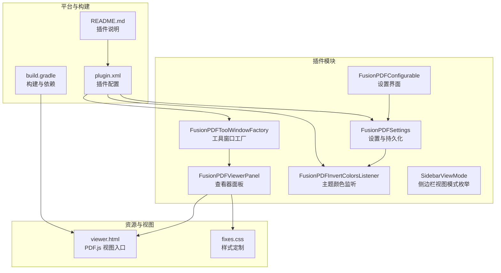
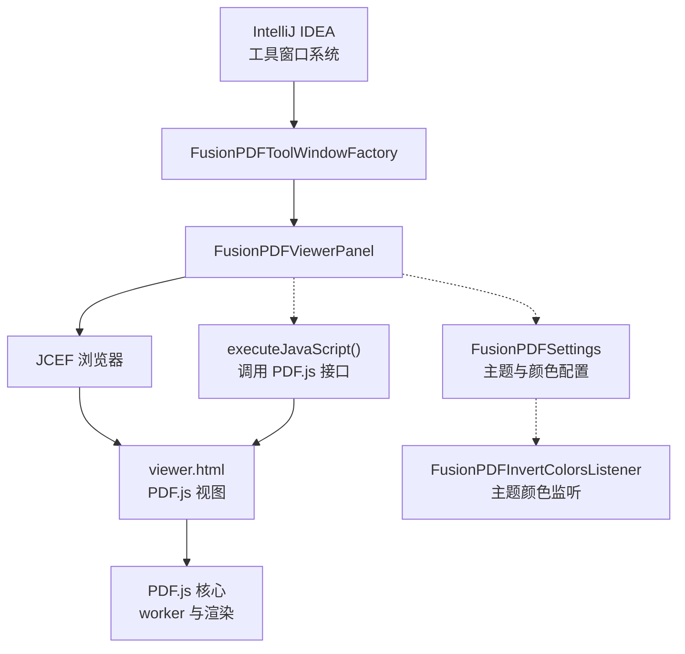
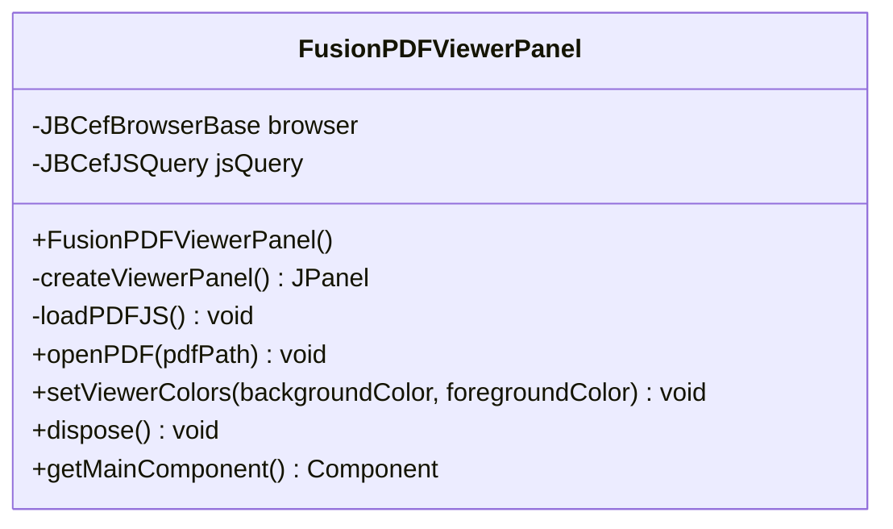
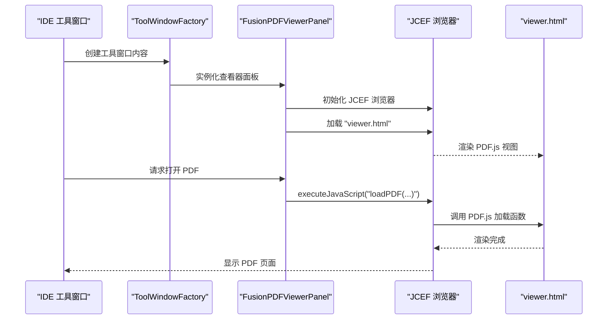
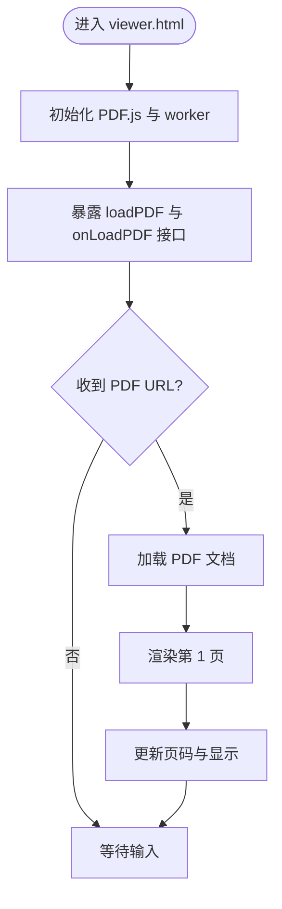
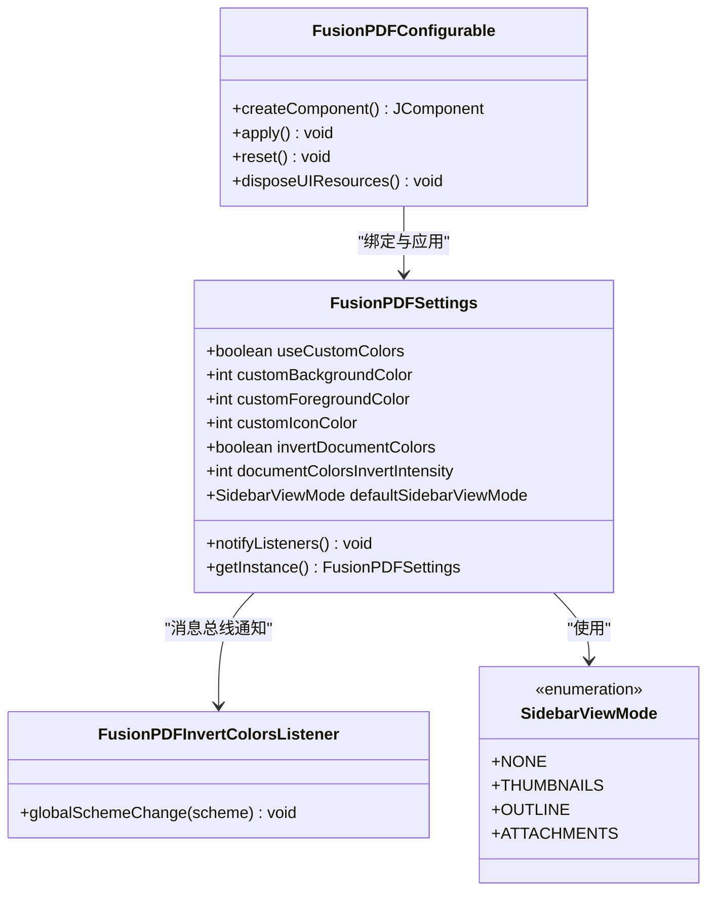
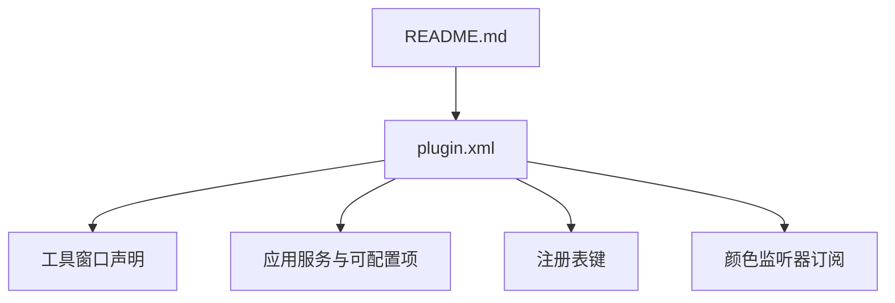
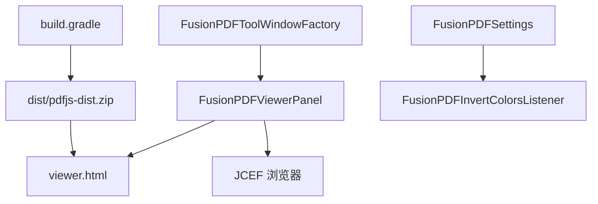

# PDF 查看器架构

<cite>
**本文档引用的文件**
- [FusionPDFViewerPanel.java](file://src/main/java/com/github/wkkya/fusionpdf/viewer/FusionPDFViewerPanel.java)
- [FusionPDFToolWindowFactory.java](file://src/main/java/com/github/wkkya/fusionpdf/factory/FusionPDFToolWindowFactory.java)
- [plugin.xml](file://src/main/resources/META-INF/plugin.xml)
- [viewer.html](file://src/main/resources/pdfjs/web/viewer.html)
- [fixes.css](file://src/main/resources/pdfjs/web/fixes.css)
- [FusionPDFSettings.java](file://src/main/java/com/github/wkkya/fusionpdf/settings/FusionPDFSettings.java)
- [FusionPDFConfigurable.java](file://src/main/java/com/github/wkkya/fusionpdf/settings/FusionPDFConfigurable.java)
- [FusionPDFInvertColorsListener.java](file://src/main/java/com/github/wkkya/fusionpdf/settings/FusionPDFInvertColorsListener.java)
- [FusionPDFSettingsListener.java](file://src/main/java/com/github/wkkya/fusionpdf/settings/FusionPDFSettingsListener.java)
- [SidebarViewMode.java](file://src/main/java/com/github/wkkya/fusionpdf/enums/SidebarViewMode.java)
- [build.gradle](file://build.gradle)
- [README.md](file://README.md)
</cite>

## 目录
1. [简介](#简介)
2. [项目结构](#项目结构)
3. [核心组件](#核心组件)
4. [架构总览](#架构总览)
5. [详细组件分析](#详细组件分析)
6. [依赖分析](#依赖分析)
7. [性能考虑](#性能考虑)
8. [故障排除指南](#故障排除指南)
9. [结论](#结论)
10. [附录](#附录)

## 简介
本文件为 FusionPDF PDF 查看器模块的架构文档，聚焦于 PDF 查看器的整体设计、JCEF 浏览器集成机制、PDF.js 嵌入方式、文件加载与渲染流程、查看器面板组件结构、性能优化策略以及 PDF.js 的配置与定制化实现细节。目标是帮助开发者快速理解并扩展该模块。

## 项目结构
FusionPDF 插件采用标准的 IntelliJ 平台插件结构，核心代码位于 Java 源码目录中，资源文件（如 PDF.js）放置在资源路径下。工具窗口工厂负责将查看器面板挂载到 IDE 工具窗口中，插件配置通过 plugin.xml 进行声明。

**图表来源**
- [FusionPDFToolWindowFactory.java:12-19](file://src/main/java/com/github/wkkya/fusionpdf/factory/FusionPDFToolWindowFactory.java#L12-L19)
- [FusionPDFViewerPanel.java:12-76](file://src/main/java/com/github/wkkya/fusionpdf/viewer/FusionPDFViewerPanel.java#L12-L76)
- [plugin.xml:26-46](file://src/main/resources/META-INF/plugin.xml#L26-L46)
- [viewer.html:1-175](file://src/main/resources/pdfjs/web/viewer.html#L1-L175)
- [fixes.css:1-22](file://src/main/resources/pdfjs/web/fixes.css#L1-L22)
- [FusionPDFSettings.java:17-46](file://src/main/java/com/github/wkkya/fusionpdf/settings/FusionPDFSettings.java#L17-L46)
- [FusionPDFConfigurable.java:7-74](file://src/main/java/com/github/wkkya/fusionpdf/settings/FusionPDFConfigurable.java#L7-L74)
- [FusionPDFInvertColorsListener.java:11-23](file://src/main/java/com/github/wkkya/fusionpdf/settings/FusionPDFInvertColorsListener.java#L11-L23)
- [SidebarViewMode.java:3-21](file://src/main/java/com/github/wkkya/fusionpdf/enums/SidebarViewMode.java#L3-L21)
- [build.gradle:1-43](file://build.gradle#L1-L43)
- [README.md:1-59](file://README.md#L1-L59)

**章节来源**
- [plugin.xml:1-51](file://src/main/resources/META-INF/plugin.xml#L1-L51)
- [FusionPDFToolWindowFactory.java:12-19](file://src/main/java/com/github/wkkya/fusionpdf/factory/FusionPDFToolWindowFactory.java#L12-L19)
- [FusionPDFViewerPanel.java:12-76](file://src/main/java/com/github/wkkya/fusionpdf/viewer/FusionPDFViewerPanel.java#L12-L76)
- [viewer.html:1-175](file://src/main/resources/pdfjs/web/viewer.html#L1-L175)
- [fixes.css:1-22](file://src/main/resources/pdfjs/web/fixes.css#L1-L22)
- [FusionPDFSettings.java:17-46](file://src/main/java/com/github/wkkya/fusionpdf/settings/FusionPDFSettings.java#L17-L46)
- [FusionPDFConfigurable.java:7-74](file://src/main/java/com/github/wkkya/fusionpdf/settings/FusionPDFConfigurable.java#L7-L74)
- [FusionPDFInvertColorsListener.java:11-23](file://src/main/java/com/github/wkkya/fusionpdf/settings/FusionPDFInvertColorsListener.java#L11-L23)
- [SidebarViewMode.java:3-21](file://src/main/java/com/github/wkkya/fusionpdf/enums/SidebarViewMode.java#L3-L21)
- [build.gradle:1-43](file://build.gradle#L1-L43)
- [README.md:1-59](file://README.md#L1-L59)

## 核心组件
- FusionPDFViewerPanel：查看器面板的核心类，负责初始化 JCEF 浏览器、嵌入 PDF.js、加载 PDF、设置主题颜色以及资源释放。
- FusionPDFToolWindowFactory：工具窗口工厂，将查看器面板注入到 IDE 底部工具窗口。
- viewer.html：PDF.js 视图入口页面，包含 PDF.js 脚本、工作线程配置、页面渲染逻辑与插件调用接口。
- FusionPDFSettings：设置与持久化组件，提供主题颜色、反转强度、侧边栏视图模式等配置项，并通过消息总线通知变更。
- FusionPDFConfigurable：设置界面容器，负责 UI 组件与设置模型的绑定与应用。
- FusionPDFInvertColorsListener：监听编辑器全局配色方案变化，按需触发文档颜色反转策略。
- SidebarViewMode：侧边栏视图模式枚举，用于控制 PDF.js 侧边栏显示状态。
- plugin.xml：插件配置文件，声明工具窗口、注册表键、服务与监听器等。
- build.gradle：构建脚本，包含 PDF.js 下载与打包逻辑。

**章节来源**
- [FusionPDFViewerPanel.java:12-76](file://src/main/java/com/github/wkkya/fusionpdf/viewer/FusionPDFViewerPanel.java#L12-L76)
- [FusionPDFToolWindowFactory.java:12-19](file://src/main/java/com/github/wkkya/fusionpdf/factory/FusionPDFToolWindowFactory.java#L12-L19)
- [viewer.html:1-175](file://src/main/resources/pdfjs/web/viewer.html#L1-L175)
- [FusionPDFSettings.java:17-46](file://src/main/java/com/github/wkkya/fusionpdf/settings/FusionPDFSettings.java#L17-L46)
- [FusionPDFConfigurable.java:7-74](file://src/main/java/com/github/wkkya/fusionpdf/settings/FusionPDFConfigurable.java#L7-L74)
- [FusionPDFInvertColorsListener.java:11-23](file://src/main/java/com/github/wkkya/fusionpdf/settings/FusionPDFInvertColorsListener.java#L11-L23)
- [SidebarViewMode.java:3-21](file://src/main/java/com/github/wkkya/fusionpdf/enums/SidebarViewMode.java#L3-L21)
- [plugin.xml:26-46](file://src/main/resources/META-INF/plugin.xml#L26-L46)
- [build.gradle:36-43](file://build.gradle#L36-L43)

## 架构总览
FusionPDF 的整体架构围绕“IDE 工具窗口 + JCEF 浏览器 + PDF.js 视图”展开。IDE 启动后，工具窗口工厂创建查看器面板；查看器面板初始化 JCEF 浏览器并加载 PDF.js 的 viewer.html；当外部请求打开 PDF 时，查看器通过 JavaScript 执行调用 PDF.js 的加载函数，完成文档解析与渲染。

**图表来源**
- [FusionPDFToolWindowFactory.java:12-19](file://src/main/java/com/github/wkkya/fusionpdf/factory/FusionPDFToolWindowFactory.java#L12-L19)
- [FusionPDFViewerPanel.java:17-57](file://src/main/java/com/github/wkkya/fusionpdf/viewer/FusionPDFViewerPanel.java#L17-L57)
- [viewer.html:59-172](file://src/main/resources/pdfjs/web/viewer.html#L59-L172)
- [FusionPDFSettings.java:44-46](file://src/main/java/com/github/wkkya/fusionpdf/settings/FusionPDFSettings.java#L44-L46)
- [FusionPDFInvertColorsListener.java:11-23](file://src/main/java/com/github/wkkya/fusionpdf/settings/FusionPDFInvertColorsListener.java#L11-L23)

## 详细组件分析

### FusionPDFViewerPanel 组件分析
- 职责与实现要点
  - 初始化 JCEF 客户端与浏览器实例，确保非空后再创建 JS 查询对象。
  - 构建查看器面板布局，使用滚动面板承载浏览器组件。
  - 加载 PDF.js 的 viewer.html 作为初始页面。
  - 提供打开 PDF 的方法，通过执行 JavaScript 调用 PDF.js 的加载函数。
  - 提供设置查看器颜色的方法，将背景与前景色传递给 PDF.js。
  - 提供资源释放方法，确保浏览器与 JS 查询对象被正确销毁。
  - 提供获取主组件的方法，便于工具窗口工厂挂载。

**图表来源**
- [FusionPDFViewerPanel.java:12-76](file://src/main/java/com/github/wkkya/fusionpdf/viewer/FusionPDFViewerPanel.java#L12-L76)

**章节来源**
- [FusionPDFViewerPanel.java:17-76](file://src/main/java/com/github/wkkya/fusionpdf/viewer/FusionPDFViewerPanel.java#L17-L76)

### JCEF 浏览器集成机制
- 初始化与生命周期
  - 通过 JBCefApp 获取客户端并创建浏览器实例，使用 about:blank 作为初始地址。
  - 使用 JBCefJSQuery 在浏览器上下文中建立 JS 查询通道，便于后续调用。
  - 在面板 dispose 时释放 JS 查询与浏览器资源。
- 页面加载与导航
  - 通过 getResource 获取 viewer.html 的资源路径并加载到浏览器。
  - 通过 executeJavaScript 在浏览器上下文中执行指定脚本，实现与 PDF.js 的交互。

**图表来源**
- [FusionPDFToolWindowFactory.java:12-19](file://src/main/java/com/github/wkkya/fusionpdf/factory/FusionPDFToolWindowFactory.java#L12-L19)
- [FusionPDFViewerPanel.java:37-57](file://src/main/java/com/github/wkkya/fusionpdf/viewer/FusionPDFViewerPanel.java#L37-L57)
- [viewer.html:156-172](file://src/main/resources/pdfjs/web/viewer.html#L156-L172)

**章节来源**
- [FusionPDFViewerPanel.java:20-57](file://src/main/java/com/github/wkkya/fusionpdf/viewer/FusionPDFViewerPanel.java#L20-L57)
- [viewer.html:59-172](file://src/main/resources/pdfjs/web/viewer.html#L59-L172)

### PDF.js 集成与定制化
- viewer.html 的职责
  - 引入 PDF.js 与 worker 脚本，设置 workerSrc。
  - 提供页面渲染逻辑（renderPage、queueRenderPage），支持上一页/下一页导航。
  - 提供本地文件上传与 ArrayBuffer 解析能力。
  - 对外暴露 loadPDF 函数，接收外部传入的 PDF URL 并开始加载。
  - 支持通过 window.intellij.onLoadPDF 接收来自 IDE 的加载指令。
- fixes.css 的作用
  - 隐藏 PDF.js 默认工具栏、侧栏等元素，使视图更贴合 IDE 界面风格。
  - 调整容器定位与边框，保证在 IDE 内的显示效果。

**图表来源**
- [viewer.html:59-172](file://src/main/resources/pdfjs/web/viewer.html#L59-L172)
- [fixes.css:1-22](file://src/main/resources/pdfjs/web/fixes.css#L1-L22)

**章节来源**
- [viewer.html:59-172](file://src/main/resources/pdfjs/web/viewer.html#L59-L172)
- [fixes.css:1-22](file://src/main/resources/pdfjs/web/fixes.css#L1-L22)

### 设置与主题适配
- FusionPDFSettings
  - 提供持久化配置（背景色、前景色、图标色、反转强度、侧边栏模式等）。
  - 通过消息总线发布设置变更事件，通知订阅者刷新视图。
- FusionPDFInvertColorsListener
  - 监听编辑器全局配色方案变化，根据背景色明暗自动切换文档颜色反转策略。
- FusionPDFConfigurable
  - 作为设置界面容器，负责 UI 与设置模型的绑定与应用。
- SidebarViewMode
  - 定义侧边栏视图模式（关闭、缩略图、大纲、附件），用于控制 PDF.js 侧边栏显示。

**图表来源**
- [FusionPDFSettings.java:17-147](file://src/main/java/com/github/wkkya/fusionpdf/settings/FusionPDFSettings.java#L17-L147)
- [FusionPDFInvertColorsListener.java:11-23](file://src/main/java/com/github/wkkya/fusionpdf/settings/FusionPDFInvertColorsListener.java#L11-L23)
- [FusionPDFConfigurable.java:7-74](file://src/main/java/com/github/wkkya/fusionpdf/settings/FusionPDFConfigurable.java#L7-L74)
- [SidebarViewMode.java:3-21](file://src/main/java/com/github/wkkya/fusionpdf/enums/SidebarViewMode.java#L3-L21)

**章节来源**
- [FusionPDFSettings.java:17-147](file://src/main/java/com/github/wkkya/fusionpdf/settings/FusionPDFSettings.java#L17-L147)
- [FusionPDFInvertColorsListener.java:11-23](file://src/main/java/com/github/wkkya/fusionpdf/settings/FusionPDFInvertColorsListener.java#L11-L23)
- [FusionPDFConfigurable.java:7-74](file://src/main/java/com/github/wkkya/fusionpdf/settings/FusionPDFConfigurable.java#L7-L74)
- [SidebarViewMode.java:3-21](file://src/main/java/com/github/wkkya/fusionpdf/enums/SidebarViewMode.java#L3-L21)

### 工具窗口与插件配置
- plugin.xml
  - 声明工具窗口 ID、停靠位置、工厂类。
  - 注册应用服务、可配置项、注册表键（调试模式、JCEF 超时、实验特性、OSR 渲染开关）。
  - 订阅编辑器颜色变化监听器。
- README.md
  - 描述插件功能、安装与使用说明。

**图表来源**
- [plugin.xml:26-46](file://src/main/resources/META-INF/plugin.xml#L26-L46)
- [README.md:1-59](file://README.md#L1-L59)

**章节来源**
- [plugin.xml:26-46](file://src/main/resources/META-INF/plugin.xml#L26-L46)
- [README.md:1-59](file://README.md#L1-L59)

## 依赖分析
- 外部依赖
  - PDF.js：通过构建脚本下载并打包到 dist 目录，viewer.html 引入 dist 中的 pdf.js 与 pdf.worker.js。
  - JCEF：IDE 平台内置的 Chromium 嵌入式浏览器，用于在 IDE 中渲染网页。
- 内部耦合
  - 工具窗口工厂依赖查看器面板。
  - 查看器面板依赖 JCEF 浏览器与 PDF.js 视图。
  - 设置模块通过消息总线与监听器解耦，避免直接耦合。
  - viewer.html 与查看器面板通过 JavaScript 执行接口进行通信。

**图表来源**
- [build.gradle:36-43](file://build.gradle#L36-L43)
- [FusionPDFViewerPanel.java:20-57](file://src/main/java/com/github/wkkya/fusionpdf/viewer/FusionPDFViewerPanel.java#L20-L57)
- [viewer.html:59-62](file://src/main/resources/pdfjs/web/viewer.html#L59-L62)
- [FusionPDFToolWindowFactory.java:12-19](file://src/main/java/com/github/wkkya/fusionpdf/factory/FusionPDFToolWindowFactory.java#L12-L19)
- [FusionPDFSettings.java:44-46](file://src/main/java/com/github/wkkya/fusionpdf/settings/FusionPDFSettings.java#L44-L46)
- [FusionPDFInvertColorsListener.java:11-23](file://src/main/java/com/github/wkkya/fusionpdf/settings/FusionPDFInvertColorsListener.java#L11-L23)

**章节来源**
- [build.gradle:36-43](file://build.gradle#L36-L43)
- [FusionPDFViewerPanel.java:20-57](file://src/main/java/com/github/wkkya/fusionpdf/viewer/FusionPDFViewerPanel.java#L20-L57)
- [viewer.html:59-62](file://src/main/resources/pdfjs/web/viewer.html#L59-L62)
- [FusionPDFToolWindowFactory.java:12-19](file://src/main/java/com/github/wkkya/fusionpdf/factory/FusionPDFToolWindowFactory.java#L12-L19)
- [FusionPDFSettings.java:44-46](file://src/main/java/com/github/wkkya/fusionpdf/settings/FusionPDFSettings.java#L44-L46)
- [FusionPDFInvertColorsListener.java:11-23](file://src/main/java/com/github/wkkya/fusionpdf/settings/FusionPDFInvertColorsListener.java#L11-L23)

## 性能考虑
- 内存管理
  - 在查看器面板的 dispose 方法中显式释放 JCEF 浏览器与 JS 查询对象，防止内存泄漏。
- 渲染优化
  - PDF.js 默认使用 Canvas 渲染，viewer.html 中设置了固定缩放比例，可在不牺牲清晰度的前提下减少过度渲染开销。
  - 通过 queueRenderPage 控制并发渲染，避免频繁切换导致的卡顿。
- 响应式设计
  - fixes.css 隐藏默认工具栏与侧栏，减少不必要的 DOM 占用，提高在 IDE 窗口内的响应速度。
- JCEF 配置
  - plugin.xml 中提供启用 JCEF OSR（Off-Screen Rendering）的注册表键，可在需要时开启以提升渲染性能与稳定性。

**章节来源**
- [FusionPDFViewerPanel.java:67-70](file://src/main/java/com/github/wkkya/fusionpdf/viewer/FusionPDFViewerPanel.java#L67-L70)
- [viewer.html:69-110](file://src/main/resources/pdfjs/web/viewer.html#L69-L110)
- [fixes.css:1-22](file://src/main/resources/pdfjs/web/fixes.css#L1-L22)
- [plugin.xml:27-31](file://src/main/resources/META-INF/plugin.xml#L27-L31)

## 故障排除指南
- 无法加载 PDF.js
  - 检查 viewer.html 是否成功加载，确认资源路径与打包后的 dist 结构一致。
  - 确认 JCEF 浏览器已初始化且未为 null。
- 打不开 PDF 或空白页
  - 确认通过 openPDF 调用 executeJavaScript 成功执行了 loadPDF。
  - 检查 PDF URL 是否有效，或是否为本地文件路径。
- 颜色不匹配或主题未生效
  - 确认 FusionPDFSettings 的颜色配置已保存并通知监听器。
  - 检查主题监听器是否正确触发颜色反转策略。
- 工具窗口不显示
  - 确认 plugin.xml 中工具窗口声明与工厂类配置正确。

**章节来源**
- [FusionPDFViewerPanel.java:37-57](file://src/main/java/com/github/wkkya/fusionpdf/viewer/FusionPDFViewerPanel.java#L37-L57)
- [viewer.html:156-172](file://src/main/resources/pdfjs/web/viewer.html#L156-L172)
- [FusionPDFSettings.java:44-46](file://src/main/java/com/github/wkkya/fusionpdf/settings/FusionPDFSettings.java#L44-L46)
- [FusionPDFInvertColorsListener.java:11-23](file://src/main/java/com/github/wkkya/fusionpdf/settings/FusionPDFInvertColorsListener.java#L11-L23)
- [plugin.xml:36-36](file://src/main/resources/META-INF/plugin.xml#L36-L36)

## 结论
FusionPDF 通过 JCEF 将 PDF.js 视图无缝嵌入到 IntelliJ IDEA 工具窗口中，实现了轻量、可定制的 PDF 查看体验。其架构以查看器面板为核心，配合设置与监听机制，确保与 IDE 主题的深度契合。通过隐藏默认 UI、控制渲染流程与合理释放资源，系统在保持良好性能的同时提供了良好的扩展空间。

## 附录
- PDF.js 配置要点
  - workerSrc：指向 dist 中的 worker 脚本。
  - loadPDF：接收外部 PDF URL 并开始加载。
  - fixes.css：隐藏工具栏与侧栏，适配 IDE 界面。
- 构建与分发
  - 构建脚本自动下载 PDF.js 发行版并打包到插件资源中，确保部署一致性。

**章节来源**
- [viewer.html:59-62](file://src/main/resources/pdfjs/web/viewer.html#L59-L62)
- [fixes.css:1-22](file://src/main/resources/pdfjs/web/fixes.css#L1-L22)
- [build.gradle:36-43](file://build.gradle#L36-L43)