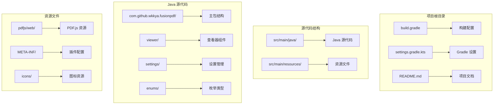
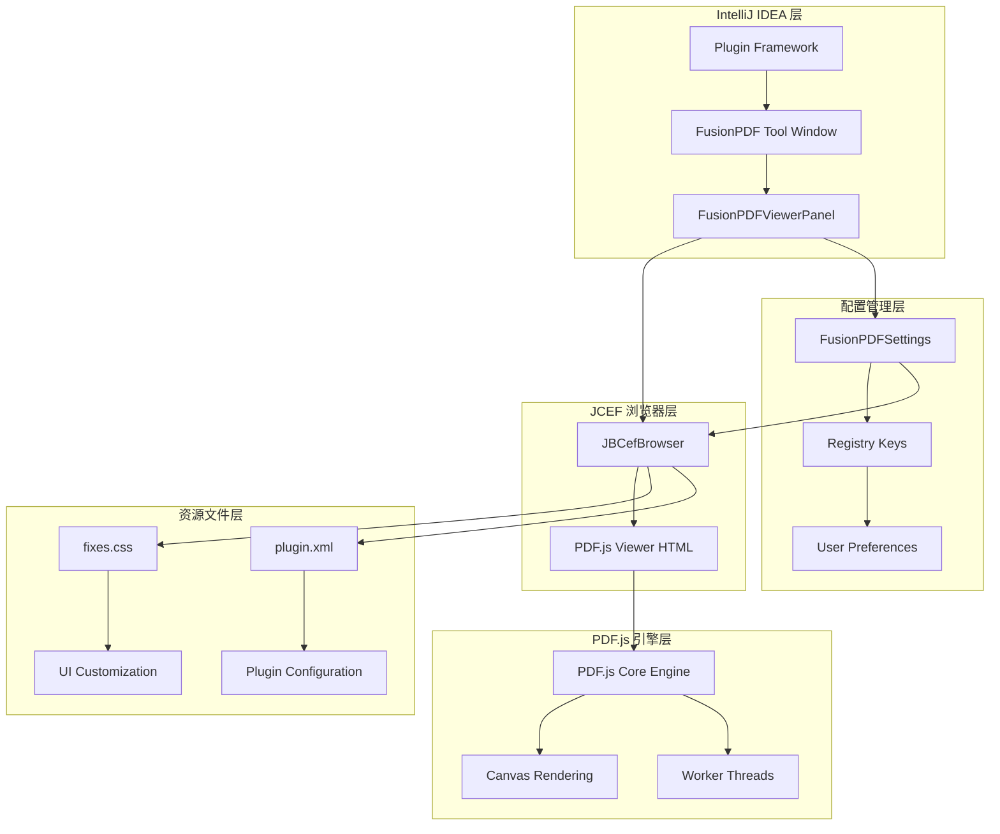
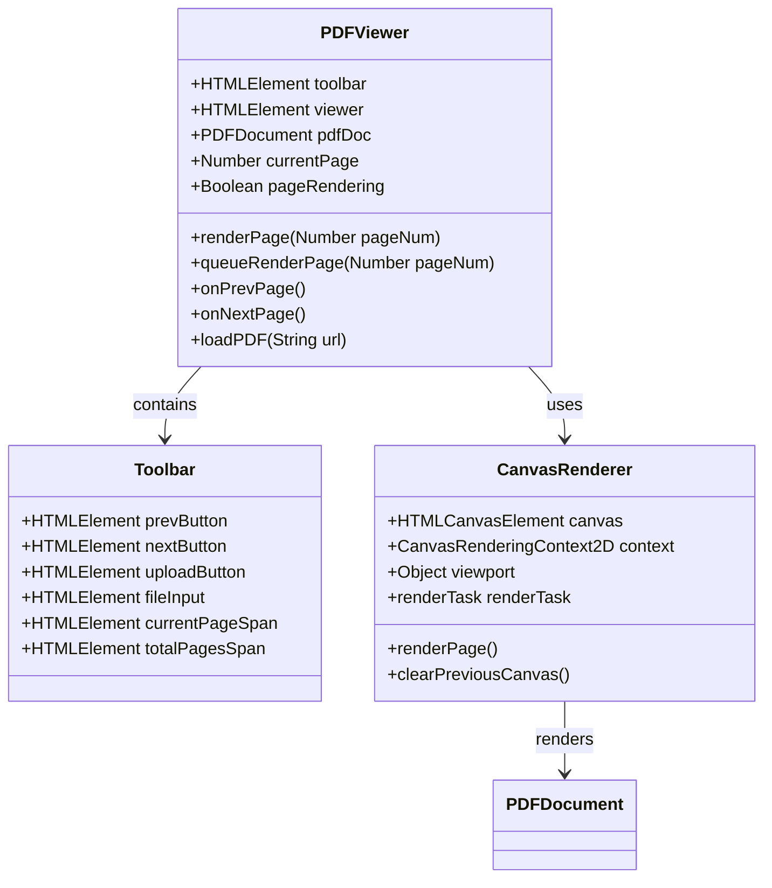
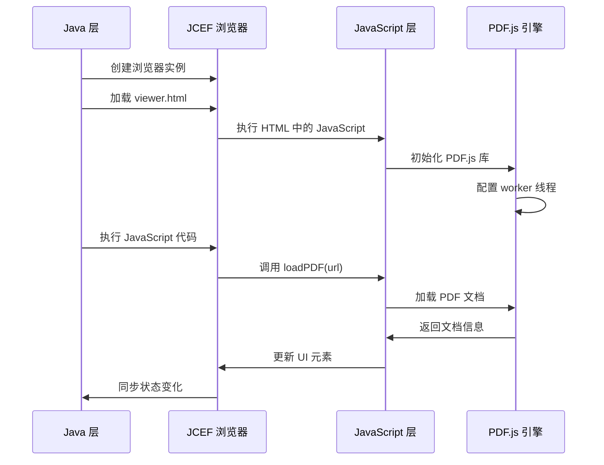
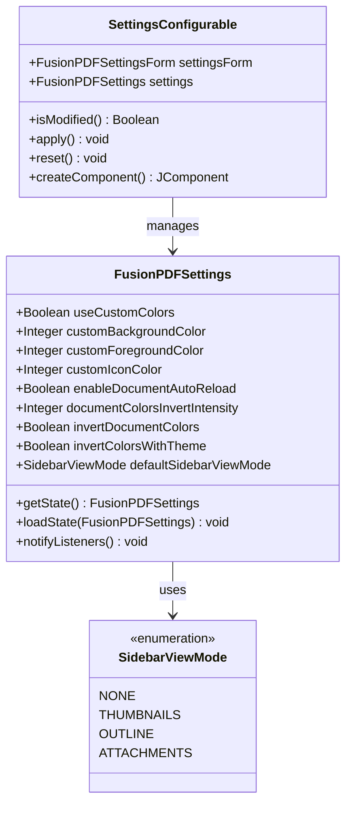
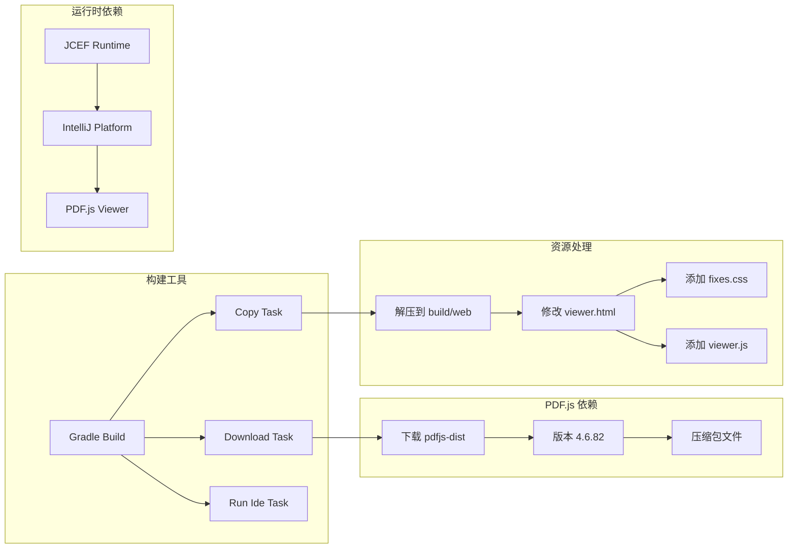
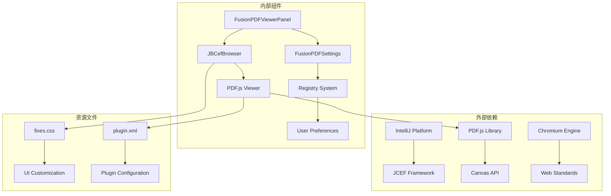
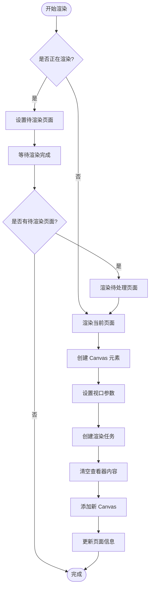

# PDF.js 集成架构

<cite>
**本文档引用的文件**
- [viewer.html](file://src/main/resources/pdfjs/web/viewer.html)
- [FusionPDFViewerPanel.java](file://src/main/java/com/github/wkkya/fusionpdf/viewer/FusionPDFViewerPanel.java)
- [FusionPDFSettings.java](file://src/main/java/com/github/wkkya/fusionpdf/settings/FusionPDFSettings.java)
- [plugin.xml](file://src/main/resources/META-INF/plugin.xml)
- [fixes.css](file://src/main/resources/pdfjs/web/fixes.css)
- [build.gradle](file://build.gradle)
- [SidebarViewMode.java](file://src/main/java/com/github/wkkya/fusionpdf/enums/SidebarViewMode.java)
- [FusionPDFConfigurable.java](file://src/main/java/com/github/wkkya/fusionpdf/settings/FusionPDFConfigurable.java)
- [settings.gradle.kts](file://settings.gradle.kts)
</cite>

## 目录
1. [简介](#简介)
2. [项目结构](#项目结构)
3. [核心组件](#核心组件)
4. [架构概览](#架构概览)
5. [详细组件分析](#详细组件分析)
6. [依赖关系分析](#依赖关系分析)
7. [性能考虑](#性能考虑)
8. [故障排除指南](#故障排除指南)
9. [结论](#结论)

## 简介

FusionPDF 是一个专为 IntelliJ IDEA 设计的轻量级 PDF 阅读器插件，它通过 JCEF（Java Chromium Embedded Framework）浏览器将 PDF.js 查看器无缝集成到 IDE 环境中。该插件提供了主题匹配、自定义颜色选项、缩放功能以及对扫描图像 PDF 的支持，旨在为开发者提供沉浸式的 PDF 阅读体验。

## 项目结构

FusionPDF 项目采用标准的 IntelliJ IDEA 插件结构，主要包含以下关键目录和文件：

**图表来源**
- [build.gradle:1-115](file://build.gradle#L1-L115)
- [settings.gradle.kts:1-6](file://settings.gradle.kts#L1-L6)

**章节来源**
- [build.gradle:1-115](file://build.gradle#L1-L115)
- [settings.gradle.kts:1-6](file://settings.gradle.kts#L1-L6)

## 核心组件

### PDF.js 查看器组件

PDF.js 查看器是整个系统的核心组件，负责 PDF 文档的渲染和显示。它包含以下关键功能：

- **PDF 文档加载**：支持从本地文件系统和网络 URL 加载 PDF 文档
- **页面渲染**：使用 Canvas API 渲染 PDF 页面内容
- **导航控制**：提供上一页、下一页等基本导航功能
- **缩放功能**：支持页面缩放以获得更好的阅读体验

### JCEF 浏览器集成

JCEF（Java Chromium Embedded Framework）浏览器为 PDF.js 提供了运行环境，实现了 Java 层与 JavaScript 层的双向通信。

### 设置管理系统

设置管理系统负责管理用户偏好设置，包括颜色方案、主题模式和功能开关等配置选项。

**章节来源**
- [FusionPDFViewerPanel.java:12-78](file://src/main/java/com/github/wkkya/fusionpdf/viewer/FusionPDFViewerPanel.java#L12-L78)
- [FusionPDFSettings.java:17-151](file://src/main/java/com/github/wkkya/fusionpdf/settings/FusionPDFSettings.java#L17-L151)

## 架构概览

FusionPDF 采用了分层架构设计，将 PDF.js 查看器与 Java 应用程序进行解耦，同时保持紧密的集成关系。

**图表来源**
- [FusionPDFViewerPanel.java:17-38](file://src/main/java/com/github/wkkya/fusionpdf/viewer/FusionPDFViewerPanel.java#L17-L38)
- [plugin.xml:26-36](file://src/main/resources/META-INF/plugin.xml#L26-L36)
- [FusionPDFSettings.java:17-46](file://src/main/java/com/github/wkkya/fusionpdf/settings/FusionPDFSettings.java#L17-L46)

## 详细组件分析

### PDF.js 查看器 HTML 结构

PDF.js 查看器采用简洁的 HTML 结构设计，专注于核心功能实现：

**图表来源**
- [viewer.html:46-57](file://src/main/resources/pdfjs/web/viewer.html#L46-L57)
- [viewer.html:69-101](file://src/main/resources/pdfjs/web/viewer.html#L69-L101)
- [viewer.html:135-154](file://src/main/resources/pdfjs/web/viewer.html#L135-L154)

### JCEF 浏览器集成机制

JCEF 浏览器集成为 Java 应用程序提供了现代 Web 技术的支持，实现了 PDF.js 的完整功能：

**图表来源**
- [FusionPDFViewerPanel.java:23-37](file://src/main/java/com/github/wkkya/fusionpdf/viewer/FusionPDFViewerPanel.java#L23-L37)
- [FusionPDFViewerPanel.java:49-57](file://src/main/java/com/github/wkkya/fusionpdf/viewer/FusionPDFViewerPanel.java#L49-L57)
- [viewer.html:157-164](file://src/main/resources/pdfjs/web/viewer.html#L157-L164)

### 设置管理系统架构

设置管理系统采用持久化状态组件模式，提供了灵活的配置管理能力：

**图表来源**
- [FusionPDFSettings.java:18-46](file://src/main/java/com/github/wkkya/fusionpdf/settings/FusionPDFSettings.java#L18-L46)
- [FusionPDFConfigurable.java:7-76](file://src/main/java/com/github/wkkya/fusionpdf/settings/FusionPDFConfigurable.java#L7-L76)
- [SidebarViewMode.java:3-22](file://src/main/java/com/github/wkkya/fusionpdf/enums/SidebarViewMode.java#L3-L22)

**章节来源**
- [FusionPDFViewerPanel.java:17-78](file://src/main/java/com/github/wkkya/fusionpdf/viewer/FusionPDFViewerPanel.java#L17-L78)
- [FusionPDFSettings.java:17-151](file://src/main/java/com/github/wkkya/fusionpdf/settings/FusionPDFSettings.java#L17-L151)
- [SidebarViewMode.java:1-22](file://src/main/java/com/github/wkkya/fusionpdf/enums/SidebarViewMode.java#L1-L22)

## 依赖关系分析

### 构建时依赖管理

构建系统使用 Gradle 和下载任务来管理 PDF.js 依赖：

**图表来源**
- [build.gradle:36-67](file://build.gradle#L36-L67)
- [build.gradle:80-95](file://build.gradle#L80-L95)

### 运行时依赖关系

运行时依赖关系展示了各个组件之间的交互方式：

**图表来源**
- [plugin.xml:14-12](file://src/main/resources/META-INF/plugin.xml#L14-L12)
- [build.gradle:84-90](file://build.gradle#L84-L90)

**章节来源**
- [build.gradle:36-67](file://build.gradle#L36-L67)
- [plugin.xml:26-36](file://src/main/resources/META-INF/plugin.xml#L26-L36)

## 性能考虑

### PDF.js 渲染优化

PDF.js 查看器采用了多种性能优化策略：

- **Canvas 缓存**：使用 Canvas 元素缓存渲染结果，避免重复计算
- **页面队列管理**：通过 `pageRendering` 和 `pageNumPending` 变量管理页面渲染队列
- **Worker 线程**：利用 PDF.js Worker 线程处理复杂的 PDF 解析任务
- **缩放优化**：通过 `getViewport({ scale: 1.5 })` 控制渲染质量与性能平衡

### 内存管理最佳实践

**图表来源**
- [viewer.html:69-110](file://src/main/resources/pdfjs/web/viewer.html#L69-L110)
- [viewer.html:76](file://src/main/resources/pdfjs/web/viewer.html#L76)

### JCEF 性能配置

构建配置中包含了针对 JCEF 的性能优化设置：

- **JCEF 启用标志**：`-Djcef.enabled=true` 和 `-Dide.browser.jcef.enabled=true`
- **内存限制**：`-Xmx4096m` 设置最大堆内存为 4GB
- **禁用沙箱**：`-Dide.browser.jcef.sandbox.enable=false` 提升性能但降低安全性
- **JBR 版本**：强制使用特定的 Java Browser Runtime 版本

**章节来源**
- [viewer.html:69-110](file://src/main/resources/pdfjs/web/viewer.html#L69-L110)
- [build.gradle:84-90](file://build.gradle#L84-L90)

## 故障排除指南

### 常见问题诊断

1. **PDF.js 无法加载**
   - 检查 PDF.js 资源文件是否正确下载和解压
   - 验证 `dist/build/pdf.js` 和 `dist/build/pdf.worker.js` 文件是否存在
   - 确认 JCEF 浏览器已正确初始化

2. **页面渲染异常**
   - 检查 Canvas 元素的创建和配置
   - 验证 PDF 文档的加载状态
   - 确认渲染任务的 Promise 处理

3. **颜色设置不生效**
   - 验证 `setViewerColors` 函数的调用
   - 检查 CSS 样式应用是否正确
   - 确认颜色值格式转换是否正确

### 调试技巧

- **启用调试模式**：通过注册表键 `fusion.pdf.debug` 启用调试输出
- **检查 JCEF 日志**：查看 IDE 的日志文件获取更详细的错误信息
- **验证资源路径**：确保 PDF.js 资源文件的相对路径配置正确

**章节来源**
- [plugin.xml:27-30](file://src/main/resources/META-INF/plugin.xml#L27-L30)
- [FusionPDFViewerPanel.java:59-65](file://src/main/java/com/github/wkkya/fusionpdf/viewer/FusionPDFViewerPanel.java#L59-L65)

## 结论

FusionPDF 成功地将 PDF.js 查看器集成到 IntelliJ IDEA 中，通过 JCEF 浏览器实现了完整的 PDF 阅读功能。该架构具有以下优势：

- **模块化设计**：清晰的组件分离使得系统易于维护和扩展
- **性能优化**：采用多种技术手段确保流畅的用户体验
- **主题集成**：与 IntelliJ IDEA 主题深度集成，提供一致的视觉体验
- **可配置性**：丰富的设置选项满足不同用户的个性化需求

未来可以考虑的功能增强包括：
- 更完善的错误处理和恢复机制
- 支持更多的 PDF 功能（如注释、搜索等）
- 性能监控和分析工具
- 更灵活的主题定制选项