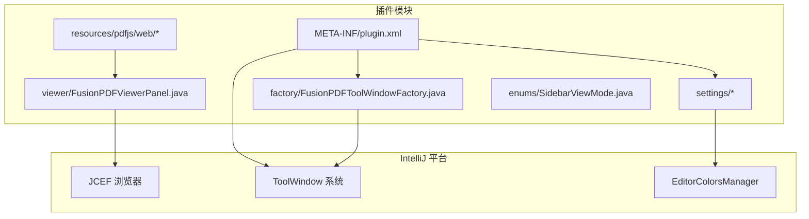
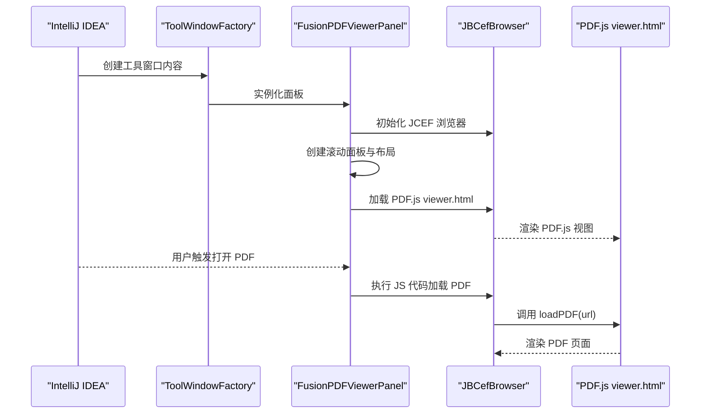
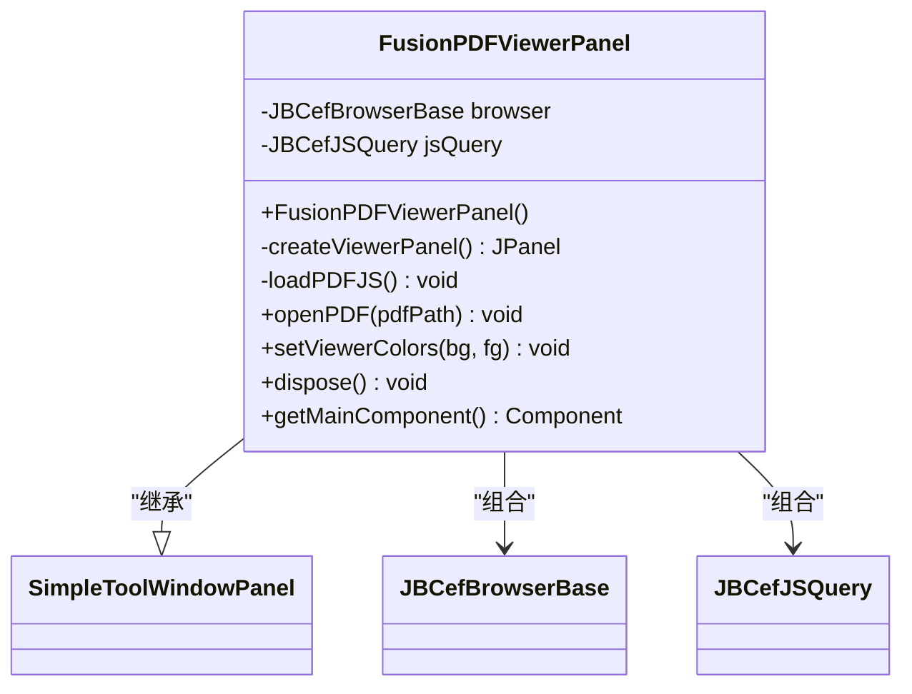
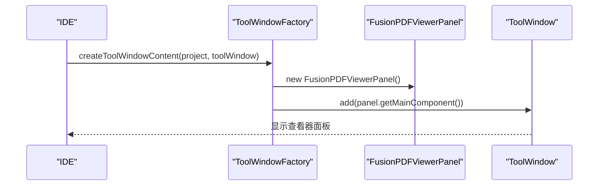
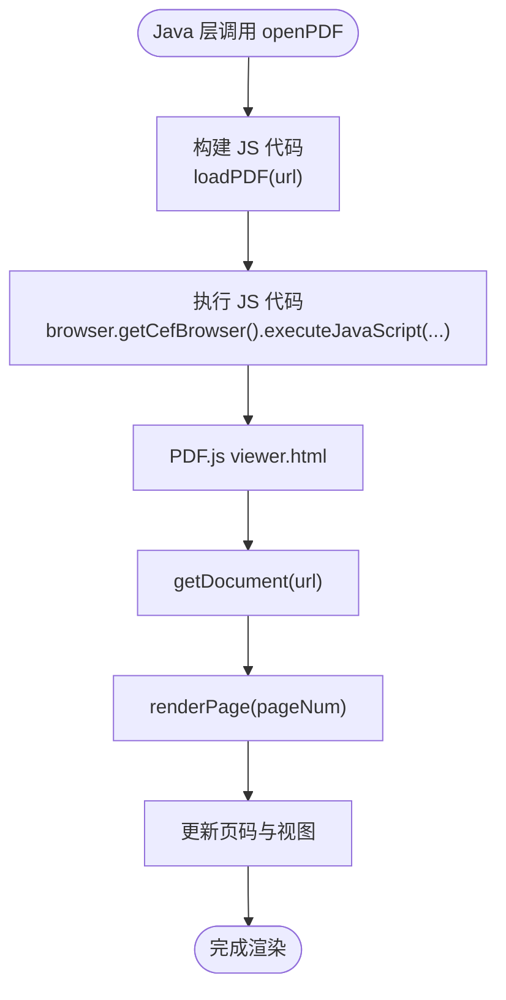
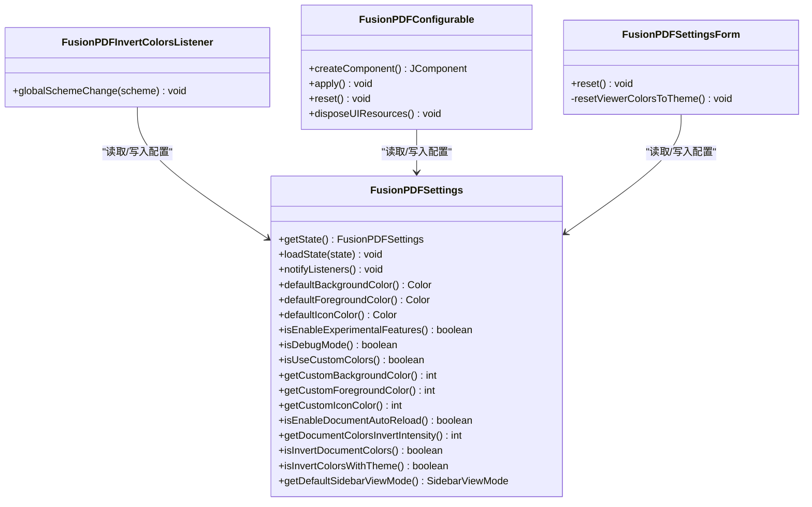
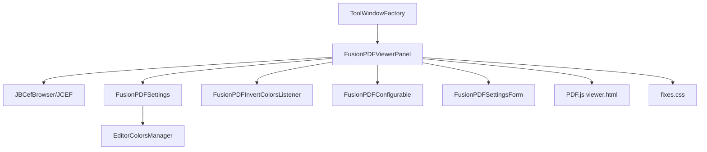

# 查看器面板架构

<cite>
**本文档引用的文件**
- [FusionPDFViewerPanel.java](file://src/main/java/com/github/wkkya/fusionpdf/viewer/FusionPDFViewerPanel.java)
- [FusionPDFToolWindowFactory.java](file://src/main/java/com/github/wkkya/fusionpdf/factory/FusionPDFToolWindowFactory.java)
- [plugin.xml](file://src/main/resources/META-INF/plugin.xml)
- [FusionPDFSettings.java](file://src/main/java/com/github/wkkya/fusionpdf/settings/FusionPDFSettings.java)
- [FusionPDFConfigurable.java](file://src/main/java/com/github/wkkya/fusionpdf/settings/FusionPDFConfigurable.java)
- [FusionPDFInvertColorsListener.java](file://src/main/java/com/github/wkkya/fusionpdf/settings/FusionPDFInvertColorsListener.java)
- [FusionPDFSettingsForm.java](file://src/main/java/com/github/wkkya/fusionpdf/settings/FusionPDFSettingsForm.java)
- [SidebarViewMode.java](file://src/main/java/com/github/wkkya/fusionpdf/enums/SidebarViewMode.java)
- [viewer.html](file://src/main/resources/pdfjs/web/viewer.html)
- [fixes.css](file://src/main/resources/pdfjs/web/fixes.css)
</cite>

## 目录
1. [简介](#简介)
2. [项目结构](#项目结构)
3. [核心组件](#核心组件)
4. [架构总览](#架构总览)
5. [详细组件分析](#详细组件分析)
6. [依赖关系分析](#依赖关系分析)
7. [性能考虑](#性能考虑)
8. [故障排除指南](#故障排除指南)
9. [结论](#结论)
10. [附录](#附录)

## 简介
本文件面向 FusionPDF 插件的查看器面板架构，重点解析 FusionPDFViewerPanel 类的设计模式与架构原则，详细说明其在 IntelliJ IDEA 工具窗口系统中的角色与职责，并覆盖面板的层次结构、生命周期管理、与外部系统的集成接口、事件处理机制、扩展点与定制化能力、内存管理与资源清理策略等关键主题。文档旨在帮助开发者快速理解并基于现有架构进行扩展或维护。

## 项目结构
FusionPDF 插件采用模块化的目录组织方式：
- viewer 包：包含查看器核心实现，其中 FusionPDFViewerPanel 是主要的视图组件。
- factory 包：包含工具窗口工厂类，负责在 IDE 中注册并创建工具窗口内容。
- settings 包：包含设置、配置界面与颜色监听器等，支撑主题适配与个性化。
- resources/pdfjs/web：包含 PDF.js 静态资源（HTML/CSS/JS），用于在 JCEF 浏览器中渲染 PDF。
- META-INF/plugin.xml：插件配置文件，声明工具窗口、扩展点、监听器与注册表键值。

图表来源
- [FusionPDFViewerPanel.java:12-76](file://src/main/java/com/github/wkkya/fusionpdf/viewer/FusionPDFViewerPanel.java#L12-L76)
- [FusionPDFToolWindowFactory.java:12-19](file://src/main/java/com/github/wkkya/fusionpdf/factory/FusionPDFToolWindowFactory.java#L12-L19)
- [plugin.xml:26-46](file://src/main/resources/META-INF/plugin.xml#L26-L46)
- [viewer.html:1-175](file://src/main/resources/pdfjs/web/viewer.html#L1-L175)

章节来源
- [plugin.xml:1-51](file://src/main/resources/META-INF/plugin.xml#L1-L51)

## 核心组件
本节聚焦于查看器面板的核心组件及其职责边界：
- FusionPDFViewerPanel：继承自 SimpleToolWindowPanel，封装 JCEF 浏览器、滚动面板与 PDF.js 视图容器，提供 PDF 打开、颜色设置与资源释放等能力。
- FusionPDFToolWindowFactory：实现 ToolWindowFactory，负责在 IDE 中创建并注入查看器面板。
- 设置与配置：FusionPDFSettings 提供持久化配置与消息总线通知；FusionPDFConfigurable 与 FusionPDFSettingsForm 提供 UI 配置界面；FusionPDFInvertColorsListener 响应主题变化自动调整文档颜色。
- PDF.js 资源：viewer.html 作为 PDF.js 视图入口，fixes.css 用于裁剪 UI 组件以适配工具窗口环境。

章节来源
- [FusionPDFViewerPanel.java:12-76](file://src/main/java/com/github/wkkya/fusionpdf/viewer/FusionPDFViewerPanel.java#L12-L76)
- [FusionPDFToolWindowFactory.java:12-19](file://src/main/java/com/github/wkkya/fusionpdf/factory/FusionPDFToolWindowFactory.java#L12-L19)
- [FusionPDFSettings.java:17-46](file://src/main/java/com/github/wkkya/fusionpdf/settings/FusionPDFSettings.java#L17-L46)
- [FusionPDFConfigurable.java:7-74](file://src/main/java/com/github/wkkya/fusionpdf/settings/FusionPDFConfigurable.java#L7-L74)
- [FusionPDFInvertColorsListener.java:11-24](file://src/main/java/com/github/wkkya/fusionpdf/settings/FusionPDFInvertColorsListener.java#L11-L24)
- [viewer.html:1-175](file://src/main/resources/pdfjs/web/viewer.html#L1-L175)
- [fixes.css:1-22](file://src/main/resources/pdfjs/web/fixes.css#L1-L22)

## 架构总览
查看器面板采用“工具窗口 + JCEF 浏览器 + PDF.js”的三层架构：
- 工具窗口层：由 ToolWindowFactory 注册并注入面板组件，承载整个查看器界面。
- 浏览器层：使用 JCEF 在 Swing/JCEF 组件中嵌入网页视图，加载 PDF.js viewer.html。
- PDF.js 层：通过 JavaScript API 与插件交互，接收来自 Java 层的命令（如打开 PDF、设置颜色）。

图表来源
- [FusionPDFToolWindowFactory.java:14-18](file://src/main/java/com/github/wkkya/fusionpdf/factory/FusionPDFToolWindowFactory.java#L14-L18)
- [FusionPDFViewerPanel.java:17-52](file://src/main/java/com/github/wkkya/fusionpdf/viewer/FusionPDFViewerPanel.java#L17-L52)
- [viewer.html:156-171](file://src/main/resources/pdfjs/web/viewer.html#L156-L171)

## 详细组件分析

### FusionPDFViewerPanel 设计与实现
FusionPDFViewerPanel 是查看器的核心组件，承担以下职责：
- 初始化与布局：构造函数中创建 JCEF 客户端与浏览器实例，设置主容器布局并将滚动面板作为内容。
- PDF.js 集成：通过 getResource 获取 viewer.html 的 URL 并加载到浏览器中，确保 PDF.js 能够正确渲染。
- PDF 加载接口：openPDF 方法将路径转换为 JS 代码并通过 CEF 浏览器执行，调用 PDF.js 的 loadPDF 函数。
- 颜色设置接口：setViewerColors 将背景与前景色转换为十六进制字符串，通过 JS 代码调用 PDF.js 的颜色设置函数。
- 生命周期管理：dispose 方法负责释放 JS 查询与浏览器资源，避免内存泄漏。

图表来源
- [FusionPDFViewerPanel.java:12-76](file://src/main/java/com/github/wkkya/fusionpdf/viewer/FusionPDFViewerPanel.java#L12-L76)

章节来源
- [FusionPDFViewerPanel.java:12-76](file://src/main/java/com/github/wkkya/fusionpdf/viewer/FusionPDFViewerPanel.java#L12-L76)

### 工具窗口工厂与面板注入
FusionPDFToolWindowFactory 实现 ToolWindowFactory 接口，负责：
- 在 IDE 中注册名为 “FusionPDF” 的工具窗口。
- 在工具窗口创建时实例化 FusionPDFViewerPanel，并将其主组件添加到工具窗口根组件中。

图表来源
- [FusionPDFToolWindowFactory.java:14-18](file://src/main/java/com/github/wkkya/fusionpdf/factory/FusionPDFToolWindowFactory.java#L14-L18)
- [plugin.xml](file://src/main/resources/META-INF/plugin.xml#L36)

章节来源
- [FusionPDFToolWindowFactory.java:12-19](file://src/main/java/com/github/wkkya/fusionpdf/factory/FusionPDFToolWindowFactory.java#L12-L19)
- [plugin.xml](file://src/main/resources/META-INF/plugin.xml#L36)

### PDF.js 视图与交互流程
viewer.html 作为 PDF.js 的视图入口，提供：
- PDF 文档加载：通过 loadPDF(url) 接收来自 Java 层的 PDF URL 并开始渲染。
- 页面渲染：使用 PDF.js 的 getDocument 与 render API 渲染页面，支持上一页/下一页导航。
- 插件桥接：当存在 window.intellij 时，暴露 onLoadPDF 回调供插件调用。

图表来源
- [FusionPDFViewerPanel.java:54-57](file://src/main/java/com/github/wkkya/fusionpdf/viewer/FusionPDFViewerPanel.java#L54-L57)
- [viewer.html:156-171](file://src/main/resources/pdfjs/web/viewer.html#L156-L171)

章节来源
- [viewer.html:1-175](file://src/main/resources/pdfjs/web/viewer.html#L1-L175)
- [FusionPDFViewerPanel.java:49-57](file://src/main/java/com/github/wkkya/fusionpdf/viewer/FusionPDFViewerPanel.java#L49-L57)

### 设置系统与主题适配
设置系统围绕 FusionPDFSettings 展开，提供：
- 持久化状态：通过 @State 注解与 PersistentStateComponent 接口保存与恢复配置。
- 主题监听：FusionPDFInvertColorsListener 监听 EditorColorsManager 的全局方案变更，根据当前主题自动切换文档颜色反转策略。
- 配置界面：FusionPDFConfigurable 与 FusionPDFSettingsForm 提供 UI 表单，支持启用/禁用自动重载、默认侧边栏视图模式、颜色反转强度与自定义查看器颜色等。

图表来源
- [FusionPDFSettings.java:17-147](file://src/main/java/com/github/wkkya/fusionpdf/settings/FusionPDFSettings.java#L17-L147)
- [FusionPDFInvertColorsListener.java:11-24](file://src/main/java/com/github/wkkya/fusionpdf/settings/FusionPDFInvertColorsListener.java#L11-L24)
- [FusionPDFConfigurable.java:7-74](file://src/main/java/com/github/wkkya/fusionpdf/settings/FusionPDFConfigurable.java#L7-L74)
- [FusionPDFSettingsForm.java:18-158](file://src/main/java/com/github/wkkya/fusionpdf/settings/FusionPDFSettingsForm.java#L18-L158)

章节来源
- [FusionPDFSettings.java:17-147](file://src/main/java/com/github/wkkya/fusionpdf/settings/FusionPDFSettings.java#L17-L147)
- [FusionPDFInvertColorsListener.java:11-24](file://src/main/java/com/github/wkkya/fusionpdf/settings/FusionPDFInvertColorsListener.java#L11-L24)
- [FusionPDFConfigurable.java:7-74](file://src/main/java/com/github/wkkya/fusionpdf/settings/FusionPDFConfigurable.java#L7-L74)
- [FusionPDFSettingsForm.java:18-158](file://src/main/java/com/github/wkkya/fusionpdf/settings/FusionPDFSettingsForm.java#L18-L158)

### 侧边栏视图模式枚举
SidebarViewMode 定义了默认侧边栏视图模式，支持关闭、缩略图、大纲与附件四种模式，配合设置界面进行选择与持久化。

章节来源
- [SidebarViewMode.java:3-21](file://src/main/java/com/github/wkkya/fusionpdf/enums/SidebarViewMode.java#L3-L21)

## 依赖关系分析
查看器面板与平台及第三方组件的依赖关系如下：
- IntelliJ 平台：依赖 ToolWindowFactory、SimpleToolWindowPanel、JBCefClient/JBCefBrowser、EditorColorsManager 等。
- PDF.js：通过 viewer.html 与 fixes.css 提供 PDF 渲染与 UI 裁剪。
- 设置系统：通过消息总线与注册表键值控制实验特性、调试模式与 OSR 渲染开关。

图表来源
- [FusionPDFViewerPanel.java:12-76](file://src/main/java/com/github/wkkya/fusionpdf/viewer/FusionPDFViewerPanel.java#L12-L76)
- [FusionPDFToolWindowFactory.java:12-19](file://src/main/java/com/github/wkkya/fusionpdf/factory/FusionPDFToolWindowFactory.java#L12-L19)
- [FusionPDFSettings.java:17-46](file://src/main/java/com/github/wkkya/fusionpdf/settings/FusionPDFSettings.java#L17-L46)
- [FusionPDFInvertColorsListener.java:11-24](file://src/main/java/com/github/wkkya/fusionpdf/settings/FusionPDFInvertColorsListener.java#L11-L24)
- [FusionPDFConfigurable.java:7-74](file://src/main/java/com/github/wkkya/fusionpdf/settings/FusionPDFConfigurable.java#L7-L74)
- [FusionPDFSettingsForm.java:18-158](file://src/main/java/com/github/wkkya/fusionpdf/settings/FusionPDFSettingsForm.java#L18-L158)
- [viewer.html:1-175](file://src/main/resources/pdfjs/web/viewer.html#L1-L175)
- [fixes.css:1-22](file://src/main/resources/pdfjs/web/fixes.css#L1-L22)

章节来源
- [plugin.xml:26-46](file://src/main/resources/META-INF/plugin.xml#L26-L46)

## 性能考虑
- JCEF 渲染：JCEF 提供跨平台的浏览器内核，但会带来额外的内存占用。建议在不需要时及时调用 dispose 释放资源。
- PDF.js 渲染：PDF.js 使用 Canvas 进行页面渲染，缩放比例与页面数量直接影响渲染性能。可通过调整缩放参数与按需渲染策略优化。
- UI 裁剪：fixes.css 通过隐藏不必要的 UI 元素减少渲染负担，提升工具窗口内的阅读体验。
- 主题监听：颜色反转逻辑仅在主题变化时触发，避免频繁计算带来的性能损耗。

## 故障排除指南
- 浏览器初始化失败：若浏览器实例为 null，构造函数会抛出异常。请检查 JCEF 初始化与客户端创建流程。
- PDF 加载失败：确认 viewer.html 已正确打包到资源中，且路径可被 getResource 解析；同时检查 openPDF 传入的路径是否有效。
- 颜色设置无效：确保 JS 代码已成功执行，且 PDF.js 端存在对应的颜色设置函数；检查十六进制颜色格式是否正确。
- 资源未释放：在面板销毁时务必调用 dispose，避免内存泄漏；同时确保工具窗口关闭时触发销毁流程。

章节来源
- [FusionPDFViewerPanel.java:17-30](file://src/main/java/com/github/wkkya/fusionpdf/viewer/FusionPDFViewerPanel.java#L17-L30)
- [FusionPDFViewerPanel.java:67-70](file://src/main/java/com/github/wkkya/fusionpdf/viewer/FusionPDFViewerPanel.java#L67-L70)

## 结论
FusionPDF 查看器面板通过清晰的分层设计与平台集成，实现了在 IntelliJ IDEA 工具窗口中无缝嵌入 PDF.js 的能力。其核心在于：
- 使用 JCEF 在 Swing 中嵌入网页视图，加载 PDF.js 并与 Java 层通过 JS 代码交互。
- 通过设置系统与主题监听器实现主题适配与个性化配置。
- 提供简洁的生命周期管理与资源释放策略，保障内存安全。

该架构具备良好的扩展性：可在不破坏现有结构的前提下增加新的 PDF.js 功能、增强设置项或引入新的工具窗口行为。

## 附录
- 工具窗口注册：在 plugin.xml 中声明工具窗口 ID、锚点与工厂类，确保面板在 IDE 中可见。
- 注册表键值：通过注册表键值控制调试模式、JCEF OSR 渲染与实验特性，便于开发与测试阶段的灵活配置。

章节来源
- [plugin.xml:26-46](file://src/main/resources/META-INF/plugin.xml#L26-L46)