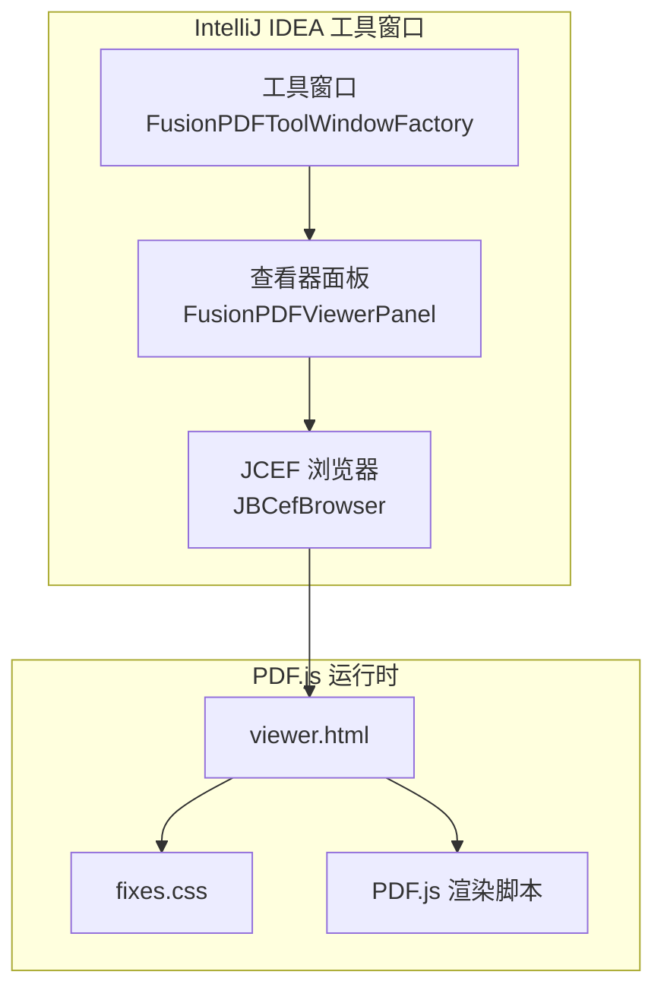
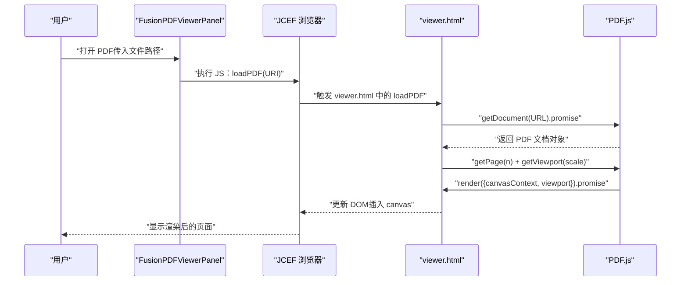
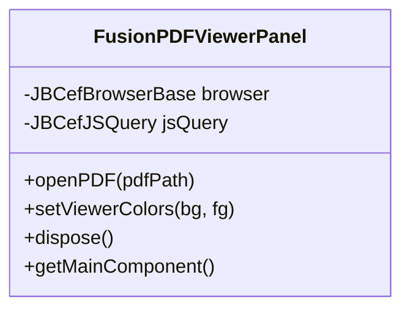
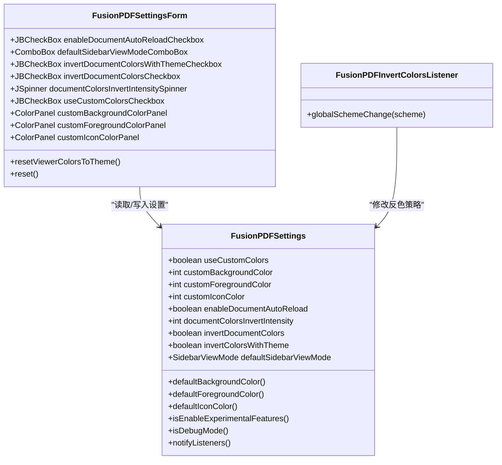
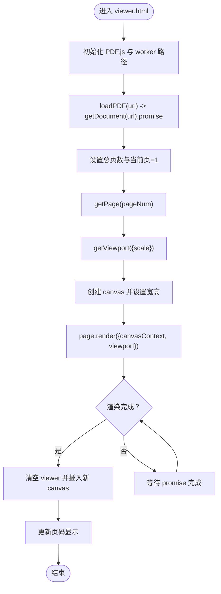
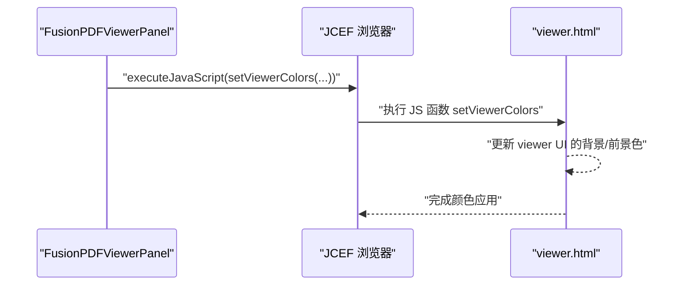
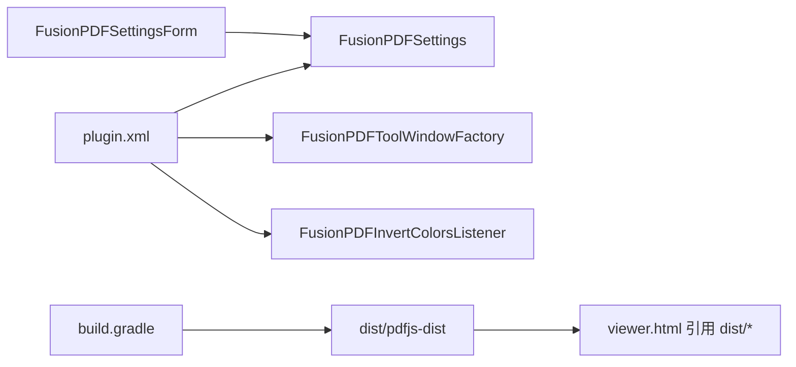

# 渲染引擎架构

<cite>
**本文引用的文件**
- [README.md](file://README.md)
- [plugin.xml](file://src/main/resources/META-INF/plugin.xml)
- [FusionPDFViewerPanel.java](file://src/main/java/com/github/wkkya/fusionpdf/viewer/FusionPDFViewerPanel.java)
- [FusionPDFSettings.java](file://src/main/java/com/github/wkkya/fusionpdf/settings/FusionPDFSettings.java)
- [FusionPDFSettingsForm.java](file://src/main/java/com/github/wkkya/fusionpdf/settings/FusionPDFSettingsForm.java)
- [FusionPDFInvertColorsListener.java](file://src/main/java/com/github/wkkya/fusionpdf/settings/FusionPDFInvertColorsListener.java)
- [SidebarViewMode.java](file://src/main/java/com/github/wkkya/fusionpdf/enums/SidebarViewMode.java)
- [viewer.html](file://src/main/resources/pdfjs/web/viewer.html)
- [fixes.css](file://src/main/resources/pdfjs/web/fixes.css)
- [build.gradle](file://build.gradle)
</cite>

## 目录
1. [简介](#简介)
2. [项目结构](#项目结构)
3. [核心组件](#核心组件)
4. [架构总览](#架构总览)
5. [详细组件分析](#详细组件分析)
6. [依赖关系分析](#依赖关系分析)
7. [性能考量](#性能考量)
8. [故障排查指南](#故障排查指南)
9. [结论](#结论)
10. [附录](#附录)

## 简介
本文件面向 FusionPDF 的渲染引擎架构，系统化阐述从 PDF 文件加载到最终在 IDE 工具窗口中显示的完整流程；解析 PDF.js 渲染管道（解析、页面渲染、图形合成）；说明颜色管理机制（背景色与前景色的动态设置）；总结性能优化策略（增量渲染、缓存与内存管理）；并给出与用户交互的响应机制（滚动、缩放、翻页）以及调试与监控方法、异常处理与恢复策略。

## 项目结构
FusionPDF 将 PDF 渲染委托给浏览器内嵌的 PDF.js viewer，通过 JCEF（Chromium Embedded Framework）在 IntelliJ IDEA 工具窗口中承载该 HTML 页面。核心目录与职责如下：
- viewer 层：负责创建 JCEF 浏览器实例、加载 PDF.js viewer、向 JS 注入 PDF 路径与颜色配置。
- settings 层：提供持久化设置、主题监听与颜色计算逻辑。
- 资源层：包含 PDF.js viewer.html、CSS 适配样式与构建脚本。

图表来源
- [FusionPDFViewerPanel.java:17-52](file://src/main/java/com/github/wkkya/fusionpdf/viewer/FusionPDFViewerPanel.java#L17-L52)
- [viewer.html:45-174](file://src/main/resources/pdfjs/web/viewer.html#L45-L174)
- [fixes.css:1-22](file://src/main/resources/pdfjs/web/fixes.css#L1-22)

章节来源
- [plugin.xml:26-36](file://src/main/resources/META-INF/plugin.xml#L26-L36)
- [FusionPDFViewerPanel.java:17-52](file://src/main/java/com/github/wkkya/fusionpdf/viewer/FusionPDFViewerPanel.java#L17-L52)
- [viewer.html:45-174](file://src/main/resources/pdfjs/web/viewer.html#L45-L174)

## 核心组件
- 查看器面板（FusionPDFViewerPanel）
  - 初始化 JCEF 客户端与浏览器，创建滚动容器，加载 PDF.js viewer.html。
  - 提供打开 PDF 的入口（openPDF），以及动态设置 viewer 颜色的方法（setViewerColors）。
- 设置服务（FusionPDFSettings）
  - 持久化存储用户偏好（自定义颜色、文档反色、侧栏模式等）。
  - 提供默认主题颜色读取与注册表开关读取。
- 设置表单（FusionPDFSettingsForm）
  - GUI 表单控件，支持启用/禁用文档自动重载、默认侧栏视图模式、文档反色与强度、自定义 viewer 颜色等。
- 主题监听（FusionPDFInvertColorsListener）
  - 监听 IDE 全局配色方案变化，按主题明暗自动切换文档反色策略。
- 枚举（SidebarViewMode）
  - 定义侧栏视图模式（关闭/缩略图/大纲/附件）。
- PDF.js 资源（viewer.html、fixes.css）
  - viewer.html 承载 PDF.js 解析与渲染逻辑，并暴露 loadPDF 供插件调用。
  - fixes.css 对 PDF.js 默认 UI 做裁剪与布局适配，契合工具窗口尺寸。

章节来源
- [FusionPDFViewerPanel.java:17-76](file://src/main/java/com/github/wkkya/fusionpdf/viewer/FusionPDFViewerPanel.java#L17-L76)
- [FusionPDFSettings.java:18-147](file://src/main/java/com/github/wkkya/fusionpdf/settings/FusionPDFSettings.java#L18-L147)
- [FusionPDFSettingsForm.java:18-158](file://src/main/java/com/github/wkkya/fusionpdf/settings/FusionPDFSettingsForm.java#L18-L158)
- [FusionPDFInvertColorsListener.java:11-24](file://src/main/java/com/github/wkkya/fusionpdf/settings/FusionPDFInvertColorsListener.java#L11-L24)
- [SidebarViewMode.java:3-21](file://src/main/java/com/github/wkkya/fusionpdf/enums/SidebarViewMode.java#L3-L21)
- [viewer.html:45-174](file://src/main/resources/pdfjs/web/viewer.html#L45-L174)
- [fixes.css:1-22](file://src/main/resources/pdfjs/web/fixes.css#L1-L22)

## 架构总览
下图展示从打开 PDF 到页面渲染完成的端到端流程，包括 Java 层与 JS 层的交互、PDF.js 的解析与渲染阶段，以及颜色注入路径。

图表来源
- [FusionPDFViewerPanel.java:54-57](file://src/main/java/com/github/wkkya/fusionpdf/viewer/FusionPDFViewerPanel.java#L54-L57)
- [viewer.html:156-171](file://src/main/resources/pdfjs/web/viewer.html#L156-L171)
- [viewer.html:73-101](file://src/main/resources/pdfjs/web/viewer.html#L73-L101)

## 详细组件分析

### 组件一：查看器面板（FusionPDFViewerPanel）
职责与行为
- 初始化 JCEF 客户端与浏览器实例，创建滚动面板并加载 PDF.js viewer.html。
- 提供 openPDF 方法，通过 executeJavaScript 向 viewer.html 注入 PDF 路径并触发 loadPDF。
- 提供 setViewerColors 方法，将背景/前景色转换为十六进制字符串并注入到 JS 环境，用于调整 viewer UI 的颜色。

设计要点
- 使用 JBCefJSQuery 进行 JS 查询（构造函数存在），但当前未直接使用其回调能力，主要通过 executeJavaScript 注入命令。
- 采用 BorderLayout 布局，中心放置带滚动条的浏览器组件，便于在工具窗口中适配大小。

图表来源
- [FusionPDFViewerPanel.java:12-76](file://src/main/java/com/github/wkkya/fusionpdf/viewer/FusionPDFViewerPanel.java#L12-L76)

章节来源
- [FusionPDFViewerPanel.java:17-76](file://src/main/java/com/github/wkkya/fusionpdf/viewer/FusionPDFViewerPanel.java#L17-L76)

### 组件二：设置服务与颜色管理（FusionPDFSettings、FusionPDFSettingsForm、FusionPDFInvertColorsListener）
职责与行为
- FusionPDFSettings
  - 持久化存储：自定义背景/前景/图标颜色、是否启用文档自动重载、文档反色开关与强度、默认侧栏视图模式等。
  - 主题集成：提供默认背景/前景色读取，结合 IDE EditorColorsManager 获取全局方案。
  - 注册表开关：读取 fusion.pdf.debug、fusion.pdf.enableExperimentalFeatures、fusion.pdf.use.jcef.osr.view 等键值。
- FusionPDFSettingsForm
  - GUI 控件：复选框、下拉框、颜色面板、强度调节器等，支持“基于主题反色”“自定义 viewer 颜色”等选项。
  - “重置为当前主题颜色”功能，将自定义颜色回填为 IDE 当前主题默认色。
- FusionPDFInvertColorsListener
  - 监听 EditorColorsListener，当主题切换时根据背景色明暗自动设置文档反色策略，并通知监听者。

图表来源
- [FusionPDFSettings.java:18-147](file://src/main/java/com/github/wkkya/fusionpdf/settings/FusionPDFSettings.java#L18-L147)
- [FusionPDFSettingsForm.java:18-158](file://src/main/java/com/github/wkkya/fusionpdf/settings/FusionPDFSettingsForm.java#L18-L158)
- [FusionPDFInvertColorsListener.java:11-24](file://src/main/java/com/github/wkkya/fusionpdf/settings/FusionPDFInvertColorsListener.java#L11-L24)

章节来源
- [FusionPDFSettings.java:18-147](file://src/main/java/com/github/wkkya/fusionpdf/settings/FusionPDFSettings.java#L18-L147)
- [FusionPDFSettingsForm.java:18-158](file://src/main/java/com/github/wkkya/fusionpdf/settings/FusionPDFSettingsForm.java#L18-L158)
- [FusionPDFInvertColorsListener.java:11-24](file://src/main/java/com/github/wkkya/fusionpdf/settings/FusionPDFInvertColorsListener.java#L11-L24)

### 组件三：PDF.js 渲染管道（viewer.html）
职责与行为
- 加载 PDF.js 与 worker 资源，初始化全局 worker 路径。
- 提供 loadPDF(url)：通过 getDocument(url).promise 获取 PDF 文档对象，设置总页数并渲染第一页。
- 页面渲染流程：
  - 获取目标页对象（getPage）。
  - 计算视口（getViewport），创建 canvas 并获取 2D 上下文。
  - 调用 page.render({ canvasContext, viewport })，等待 promise 完成后更新 DOM。
- 事件绑定：上一页/下一页按钮、本地文件选择、页码显示。
- 与插件交互：当存在 window.intellij 时，暴露 onLoadPDF 回调以接收来自 Java 的 URL。

图表来源
- [viewer.html:59-171](file://src/main/resources/pdfjs/web/viewer.html#L59-L171)

章节来源
- [viewer.html:59-171](file://src/main/resources/pdfjs/web/viewer.html#L59-L171)

### 组件四：颜色注入与 UI 适配（setViewerColors 与 fixes.css）
- setViewerColors（Java）
  - 将 AWT Color 转换为十六进制字符串，拼接 JS 代码并通过 executeJavaScript 注入。
  - 该方法用于动态调整 viewer 的 UI 背景色与前景色，不改变 PDF 内容颜色。
- fixes.css
  - 隐藏 PDF.js 的查找栏、二级工具栏、侧边栏容器顶部边框等元素，减少干扰。
  - 调整容器定位与左侧偏移，确保在工具窗口中的布局更贴合。

图表来源
- [FusionPDFViewerPanel.java:59-65](file://src/main/java/com/github/wkkya/fusionpdf/viewer/FusionPDFViewerPanel.java#L59-L65)
- [viewer.html:156-171](file://src/main/resources/pdfjs/web/viewer.html#L156-L171)

章节来源
- [FusionPDFViewerPanel.java:59-65](file://src/main/java/com/github/wkkya/fusionpdf/viewer/FusionPDFViewerPanel.java#L59-L65)
- [fixes.css:1-22](file://src/main/resources/pdfjs/web/fixes.css#L1-L22)

## 依赖关系分析
- 插件配置（plugin.xml）
  - 注册表键：fusion.pdf.debug、fusion.pdf.jcefLatchTimeout、fusion.pdf.enableExperimentalFeatures、fusion.pdf.use.jcef.osr.view。
  - 应用服务：FusionPDFSettings。
  - 工具窗口：FusionPDFToolWindowFactory。
  - 监听器：EditorColorsListener，用于主题切换时的文档反色策略更新。
- 构建脚本（build.gradle）
  - 下载 PDF.js v4.6.82 的 dist 包并解压至项目 dist 目录，供 viewer.html 引用。
  - 启用 JCEF 与相关 JVM 参数，确保浏览器可用。

图表来源
- [plugin.xml:26-46](file://src/main/resources/META-INF/plugin.xml#L26-L46)
- [build.gradle:36-42](file://build.gradle#L36-L42)
- [viewer.html:8-9](file://src/main/resources/pdfjs/web/viewer.html#L8-L9)

章节来源
- [plugin.xml:26-46](file://src/main/resources/META-INF/plugin.xml#L26-L46)
- [build.gradle:36-42](file://build.gradle#L36-L42)

## 性能考量
- 渲染排队与并发控制
  - viewer.html 中通过 pageRendering 与 pageNumPending 实现渲染排队，避免并发渲染导致的资源争用与闪烁。
- 视口缩放与分辨率
  - getViewport({ scale }) 可根据设备像素比或用户缩放需求调整渲染质量与性能平衡。
- 缓存与内存管理
  - PDF.js 默认对页面字形、图像等进行缓存；在长文档场景下，建议限制同时保留的页面数量，及时释放不再可见的 canvas 与上下文。
- JCEF OSR 与线程模型
  - 注册表键 fusion.pdf.use.jcef.osr.view 可开启 JCEF Off-Screen Rendering，有助于在工具窗口中稳定渲染与降低主线程压力。
- 资源下载与打包
  - 构建阶段统一下载并打包 PDF.js dist，避免运行时网络依赖，提升启动稳定性。

章节来源
- [viewer.html:69-110](file://src/main/resources/pdfjs/web/viewer.html#L69-L110)
- [plugin.xml:27-30](file://src/main/resources/META-INF/plugin.xml#L27-L30)
- [build.gradle:36-42](file://build.gradle#L36-L42)

## 故障排查指南
- 调试模式与超时
  - fusion.pdf.debug：启用 PDF 查看器调试模式，便于输出日志与诊断。
  - fusion.pdf.jcefLatchTimeout：设置 web-view 最大等待时间，避免长时间卡顿。
- JCEF 启用与参数
  - 确认 JVM 参数已启用 ide.browser.jcef.enabled 与 jcef.enabled，且未启用沙箱（开发环境可临时关闭以排除权限问题）。
- PDF.js 资源加载失败
  - 检查 dist 目录是否存在且包含 pdf.js 与 pdf.worker.js；确认 viewer.html 正确引用 dist 路径。
- 颜色注入无效
  - 确认 setViewerColors 已被调用，且 viewer.html 中存在对应 JS 函数；检查 CSS 是否覆盖了 viewer 的背景/前景。
- 文档反色策略异常
  - 若启用“基于主题反色”，请确认 EditorColorsListener 生效，且主题明暗判断逻辑符合预期。

章节来源
- [plugin.xml:27-30](file://src/main/resources/META-INF/plugin.xml#L27-L30)
- [build.gradle:83-95](file://build.gradle#L83-L95)
- [viewer.html:59-61](file://src/main/resources/pdfjs/web/viewer.html#L59-L61)
- [FusionPDFInvertColorsListener.java:11-24](file://src/main/java/com/github/wkkya/fusionpdf/settings/FusionPDFInvertColorsListener.java#L11-L24)

## 结论
FusionPDF 采用“IntelliJ 工具窗口 + JCEF + PDF.js”的轻量级架构，将 PDF 解析与渲染完全委托给 PDF.js，由 Java 层负责生命周期管理、颜色注入与主题集成。该设计具备良好的扩展性与可维护性，适合在 IDE 环境中提供沉浸式阅读体验。后续可在页面缓存、OSR 渲染、增量更新等方面进一步优化，以应对大型文档与复杂场景。

## 附录
- 用户交互要点
  - 翻页：viewer.html 提供上一页/下一页按钮，内部通过 queueRenderPage 控制渲染顺序。
  - 缩放：可通过调整 getViewport 的 scale 实现放大/缩小；当前 viewer.html 使用固定比例，可按需改为动态输入。
  - 滚动：工具窗口使用 JBScrollPane 承载浏览器组件，支持垂直滚动。
- 错误处理与恢复
  - 当 getDocument 失败时，应捕获异常并提示用户；可提供“重新加载”或“选择本地文件”备用路径。
  - 若渲染过程中断，应清理 pageRendering 标志与 pending 任务，避免死锁。

章节来源
- [viewer.html:112-128](file://src/main/resources/pdfjs/web/viewer.html#L112-L128)
- [viewer.html:134-154](file://src/main/resources/pdfjs/web/viewer.html#L134-L154)