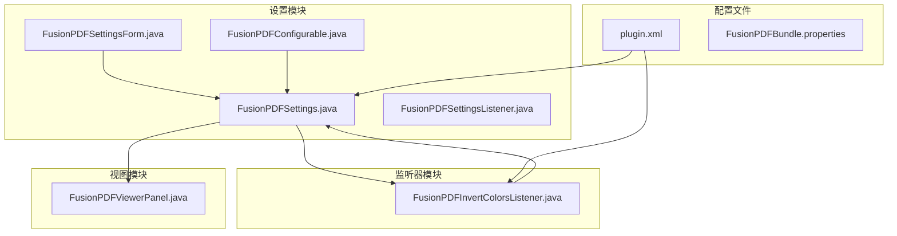
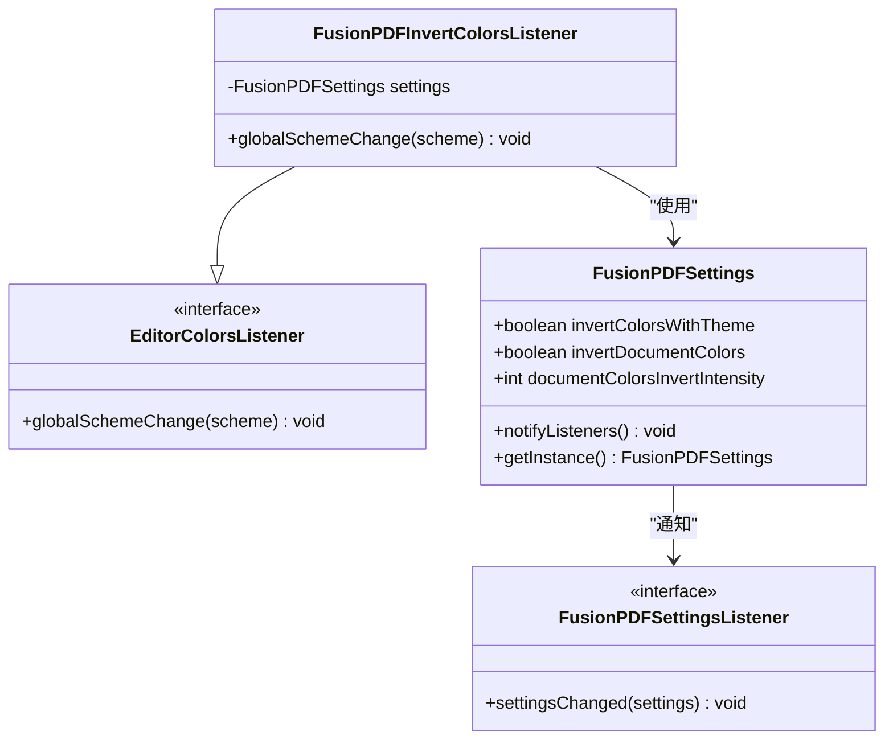
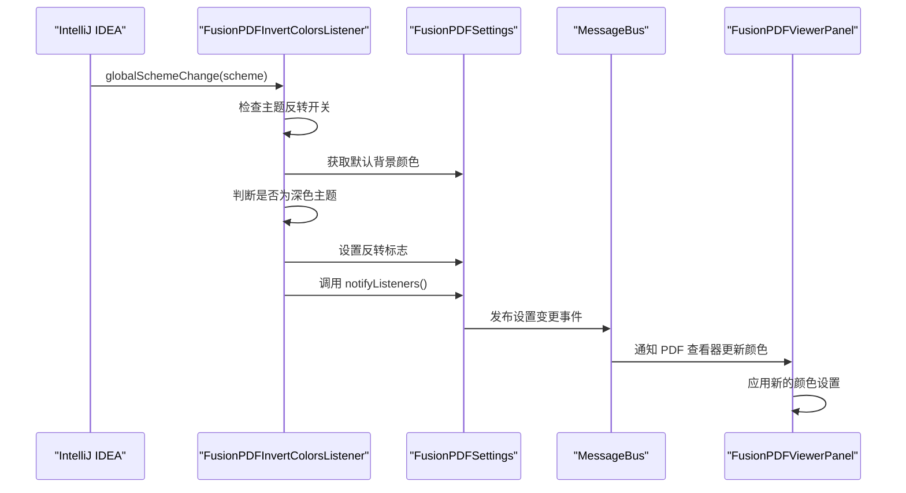
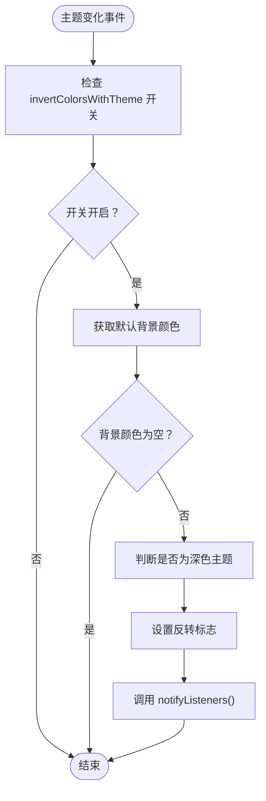
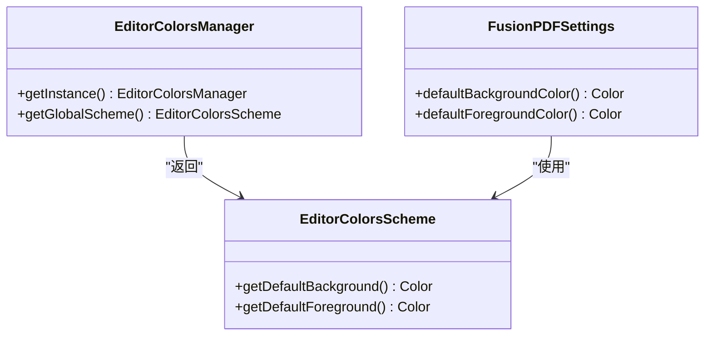
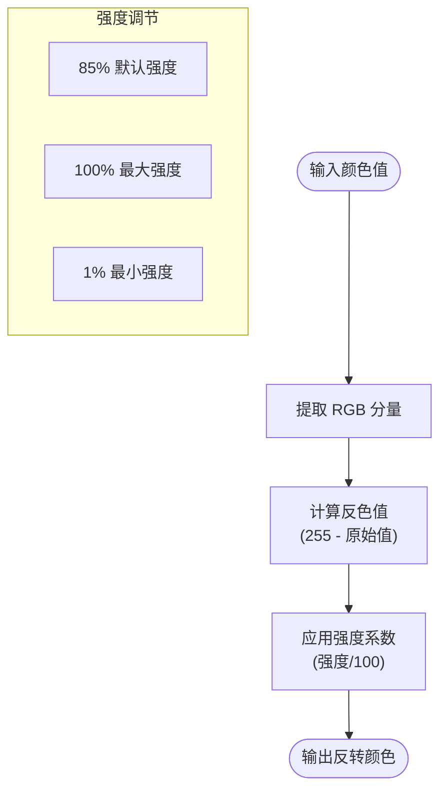
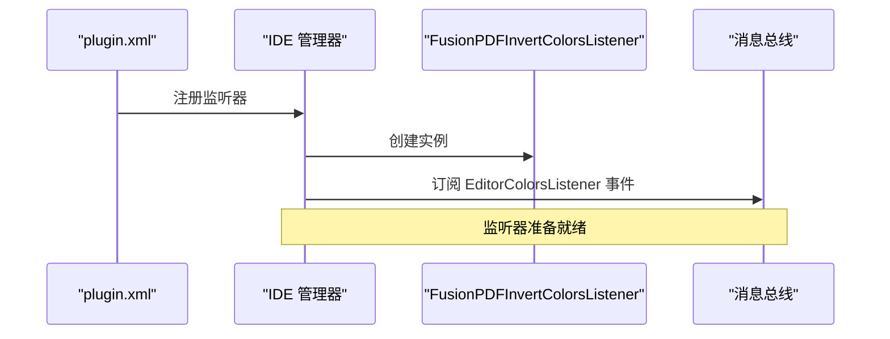
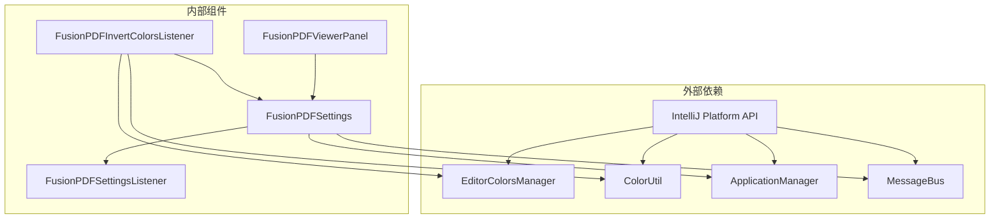

# 主题监听机制

<cite>
**本文档引用的文件**
- [FusionPDFInvertColorsListener.java](file://src/main/java/com/github/wkkya/fusionpdf/settings/FusionPDFInvertColorsListener.java)
- [FusionPDFSettings.java](file://src/main/java/com/github/wkkya/fusionpdf/settings/FusionPDFSettings.java)
- [FusionPDFSettingsListener.java](file://src/main/java/com/github/wkkya/fusionpdf/settings/FusionPDFSettingsListener.java)
- [FusionPDFSettingsForm.java](file://src/main/java/com/github/wkkya/fusionpdf/settings/FusionPDFSettingsForm.java)
- [FusionPDFConfigurable.java](file://src/main/java/com/github/wkkya/fusionpdf/settings/FusionPDFConfigurable.java)
- [FusionPDFViewerPanel.java](file://src/main/java/com/github/wkkya/fusionpdf/viewer/FusionPDFViewerPanel.java)
- [plugin.xml](file://src/main/resources/META-INF/plugin.xml)
- [FusionPDFBundle.properties](file://src/main/resources/messages/FusionPDFBundle.properties)
</cite>

## 目录
1. [简介](#简介)
2. [项目结构](#项目结构)
3. [核心组件](#核心组件)
4. [架构概览](#架构概览)
5. [详细组件分析](#详细组件分析)
6. [依赖关系分析](#依赖关系分析)
7. [性能考虑](#性能考虑)
8. [故障排除指南](#故障排除指南)
9. [结论](#结论)

## 简介

FusionPDF 主题监听机制是一个基于 IntelliJ IDEA 平台的动态主题适配系统，专门用于实现 PDF 查看器的颜色反转功能。该机制通过监听 IDE 主题变化，自动调整 PDF 文档的显示颜色，确保在深色和浅色主题下都能提供最佳的阅读体验。

该系统的核心特性包括：
- 自动检测 IDE 主题变化
- 基于背景颜色的智能颜色反转
- 实时颜色更新通知机制
- 与 IntelliJ IDEA EditorColorsManager 的深度集成

## 项目结构

FusionPDF 主题监听机制主要分布在以下目录结构中：

**图表来源**
- [FusionPDFSettings.java:1-151](file://src/main/java/com/github/wkkya/fusionpdf/settings/FusionPDFSettings.java#L1-L151)
- [FusionPDFInvertColorsListener.java:1-25](file://src/main/java/com/github/wkkya/fusionpdf/settings/FusionPDFInvertColorsListener.java#L1-L25)

**章节来源**
- [plugin.xml:1-51](file://src/main/resources/META-INF/plugin.xml#L1-L51)
- [FusionPDFSettings.java:1-151](file://src/main/java/com/github/wkkya/fusionpdf/settings/FusionPDFSettings.java#L1-L151)

## 核心组件

### 主题监听器组件

FusionPDFInvertColorsListener 是整个主题监听机制的核心组件，实现了 IntelliJ IDEA 的 EditorColorsListener 接口。

**图表来源**
- [FusionPDFInvertColorsListener.java:11-24](file://src/main/java/com/github/wkkya/fusionpdf/settings/FusionPDFInvertColorsListener.java#L11-L24)
- [FusionPDFSettings.java:18-46](file://src/main/java/com/github/wkkya/fusionpdf/settings/FusionPDFSettings.java#L18-L46)

### 设置管理组件

FusionPDFSettings 提供了完整的设置管理和持久化功能，是整个主题监听机制的数据中心。

**章节来源**
- [FusionPDFInvertColorsListener.java:11-24](file://src/main/java/com/github/wkkya/fusionpdf/settings/FusionPDFInvertColorsListener.java#L11-L24)
- [FusionPDFSettings.java:18-147](file://src/main/java/com/github/wkkya/fusionpdf/settings/FusionPDFSettings.java#L18-L147)

## 架构概览

FusionPDF 主题监听机制采用事件驱动的设计模式，通过以下层次结构实现：

**图表来源**
- [FusionPDFInvertColorsListener.java:14-23](file://src/main/java/com/github/wkkya/fusionpdf/settings/FusionPDFInvertColorsListener.java#L14-L23)
- [FusionPDFSettings.java:44-46](file://src/main/java/com/github/wkkya/fusionpdf/settings/FusionPDFSettings.java#L44-L46)

## 详细组件分析

### FusionPDFInvertColorsListener 实现原理

#### 监听机制实现

监听器通过实现 EditorColorsListener 接口，响应 IDE 主题变化事件：

**图表来源**
- [FusionPDFInvertColorsListener.java:14-23](file://src/main/java/com/github/wkkya/fusionpdf/settings/FusionPDFInvertColorsListener.java#L14-L23)

#### 颜色反转触发机制

颜色反转功能的触发基于以下逻辑：
1. **主题检测**：通过 `EditorColorsManager.getInstance().getGlobalScheme().getDefaultBackground()` 获取当前主题的默认背景颜色
2. **明暗判断**：使用 `ColorUtil.isDark()` 方法判断背景颜色是否为深色
3. **状态同步**：根据判断结果设置 `invertDocumentColors` 标志
4. **事件通知**：通过消息总线通知所有监听器

**章节来源**
- [FusionPDFInvertColorsListener.java:14-23](file://src/main/java/com/github/wkkya/fusionpdf/settings/FusionPDFInvertColorsListener.java#L14-L23)

### 主题监听器与 EditorColorsManager 集成

#### 颜色方案获取

系统通过 EditorColorsManager 获取全局颜色方案：

**图表来源**
- [FusionPDFSettings.java:52-62](file://src/main/java/com/github/wkkya/fusionpdf/settings/FusionPDFSettings.java#L52-L62)

#### 主题变更检测

主题变更检测通过以下步骤实现：
1. **监听注册**：在 plugin.xml 中注册监听器
2. **事件接收**：接收 EditorColorsListener.globalSchemeChange 事件
3. **状态检查**：验证主题反转功能是否启用
4. **颜色分析**：分析背景颜色的明暗程度
5. **状态更新**：更新内部状态并通知监听器

**章节来源**
- [plugin.xml:42-46](file://src/main/resources/META-INF/plugin.xml#L42-L46)
- [FusionPDFSettings.java:52-62](file://src/main/java/com/github/wkkya/fusionpdf/settings/FusionPDFSettings.java#L52-L62)

### 颜色反转功能实现细节

#### 颜色反转算法

虽然代码库中没有直接实现颜色反转算法，但系统提供了完整的基础设施：

**图表来源**
- [FusionPDFSettings.java:64](file://src/main/java/com/github/wkkya/fusionpdf/settings/FusionPDFSettings.java#L64)
- [FusionPDFSettingsForm.java:62](file://src/main/java/com/github/wkkya/fusionpdf/settings/FusionPDFSettingsForm.java#L62)

#### 对比度计算

系统支持对比度调节，通过 `documentColorsInvertIntensity` 参数控制：

- **默认值**：85（平衡的对比度）
- **范围**：1-100（百分比）
- **效果**：数值越高，反转后的对比度越强

**章节来源**
- [FusionPDFSettings.java:116-122](file://src/main/java/com/github/wkkya/fusionpdf/settings/FusionPDFSettings.java#L116-L122)
- [FusionPDFSettingsForm.java:62](file://src/main/java/com/github/wkkya/fusionpdf/settings/FusionPDFSettingsForm.java#L62)

### 监听器注册流程

#### 插件配置注册

监听器通过 plugin.xml 进行注册：

**图表来源**
- [plugin.xml:42-46](file://src/main/resources/META-INF/plugin.xml#L42-L46)

#### 运行时注册机制

监听器的运行时注册通过以下步骤完成：
1. **服务发现**：IDE 在启动时发现插件声明
2. **实例创建**：创建 FusionPDFInvertColorsListener 实例
3. **事件订阅**：订阅 EditorColorsListener 事件类型
4. **生命周期管理**：随 IDE 生命周期自动管理

**章节来源**
- [plugin.xml:42-46](file://src/main/resources/META-INF/plugin.xml#L42-L46)

## 依赖关系分析

### 组件耦合关系

**图表来源**
- [FusionPDFInvertColorsListener.java:3-8](file://src/main/java/com/github/wkkya/fusionpdf/settings/FusionPDFInvertColorsListener.java#L3-L8)
- [FusionPDFSettings.java:4-13](file://src/main/java/com/github/wkkya/fusionpdf/settings/FusionPDFSettings.java#L4-L13)

### 外部依赖分析

系统对外部依赖的使用遵循以下原则：

| 依赖组件 | 使用场景 | 作用 |
|---------|---------|------|
| EditorColorsManager | 主题颜色获取 | 获取 IDE 全局颜色方案 |
| ColorUtil | 颜色明暗判断 | 判断背景颜色是否为深色 |
| ApplicationManager | 服务管理 | 获取 FusionPDFSettings 单例 |
| MessageBus | 事件通知 | 向监听器发布设置变更事件 |

**章节来源**
- [FusionPDFInvertColorsListener.java:3-8](file://src/main/java/com/github/wkkya/fusionpdf/settings/FusionPDFInvertColorsListener.java#L3-L8)
- [FusionPDFSettings.java:4-13](file://src/main/java/com/github/wkkya/fusionpdf/settings/FusionPDFSettings.java#L4-L13)

## 性能考虑

### 内存管理策略

1. **单例模式**：FusionPDFSettings 使用单例模式，避免重复创建
2. **事件监听器复用**：监听器在整个 IDE 生命周期内复用
3. **延迟初始化**：颜色面板等组件按需初始化

### 性能优化建议

1. **减少不必要的颜色计算**：仅在主题确实发生变化时进行处理
2. **批量更新**：合并多个设置变更事件
3. **异步处理**：对于复杂的颜色转换操作考虑异步执行

### 内存泄漏防护

1. **正确释放资源**：确保 JBCefBrowser 和相关组件正确释放
2. **监听器生命周期管理**：依赖 IDE 自动管理监听器生命周期
3. **弱引用使用**：避免持有不必要的强引用

## 故障排除指南

### 常见问题诊断

#### 主题监听失效

**症状**：更改 IDE 主题后，PDF 查看器颜色不更新

**可能原因**：
1. `invertColorsWithTheme` 设置未启用
2. 监听器注册失败
3. 颜色方案获取异常

**解决步骤**：
1. 检查设置界面中的主题反转选项
2. 验证 plugin.xml 中的监听器注册
3. 查看 IDE 日志中的相关错误信息

#### 颜色反转异常

**症状**：颜色反转效果不符合预期

**可能原因**：
1. 背景颜色检测异常
2. 颜色明暗判断错误
3. 强度设置不当

**解决步骤**：
1. 检查默认背景颜色是否正确获取
2. 验证 ColorUtil.isDark() 的判断逻辑
3. 调整 documentColorsInvertIntensity 设置

**章节来源**
- [FusionPDFSettingsForm.java:56-62](file://src/main/java/com/github/wkkya/fusionpdf/settings/FusionPDFSettingsForm.java#L56-L62)
- [FusionPDFBundle.properties:23-27](file://src/main/resources/messages/FusionPDFBundle.properties#L23-L27)

### 调试技巧

1. **启用调试模式**：通过 Registry 键 fusion.pdf.debug 启用调试模式
2. **查看日志输出**：关注主题变化和颜色更新的日志信息
3. **断点调试**：在 globalSchemeChange 方法中设置断点跟踪执行流程

## 结论

FusionPDF 主题监听机制展现了优秀的架构设计，通过以下关键特性实现了高效的主题适配：

### 设计优势

1. **事件驱动架构**：基于 IntelliJ IDEA 平台的事件系统，实现响应式主题适配
2. **松耦合设计**：监听器与业务逻辑分离，便于维护和扩展
3. **平台集成度高**：充分利用 EditorColorsManager 等平台 API
4. **用户友好**：提供直观的配置界面和实时反馈

### 技术亮点

1. **智能颜色检测**：自动识别深色和浅色主题
2. **灵活的配置选项**：支持多种颜色反转强度和自定义颜色
3. **高效的事件处理**：通过消息总线实现组件间通信
4. **良好的性能表现**：最小化内存占用和 CPU 使用

### 扩展性考虑

该机制为未来的功能扩展提供了良好的基础：
- 可以轻松添加更多的颜色处理算法
- 支持更精细的主题匹配策略
- 可以集成更多的 IDE 主题元素
- 提供更丰富的用户自定义选项

通过精心设计的架构和实现，FusionPDF 主题监听机制成功地将 IDE 主题与 PDF 查看体验无缝结合，为开发者提供了卓越的阅读体验。