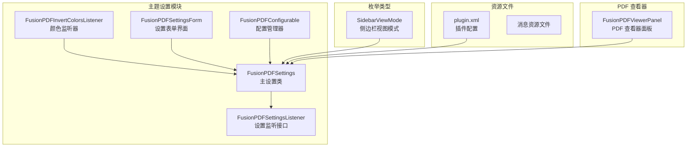
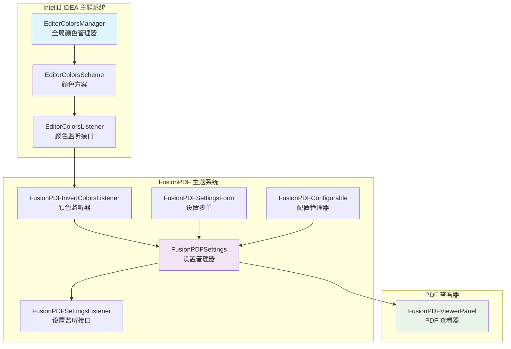
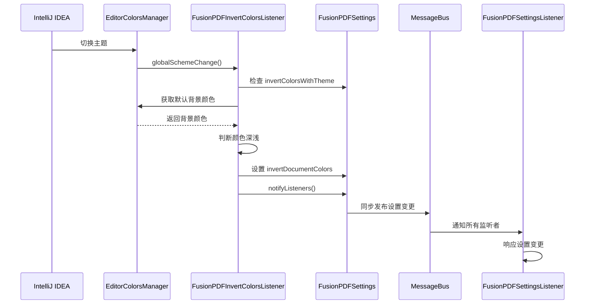
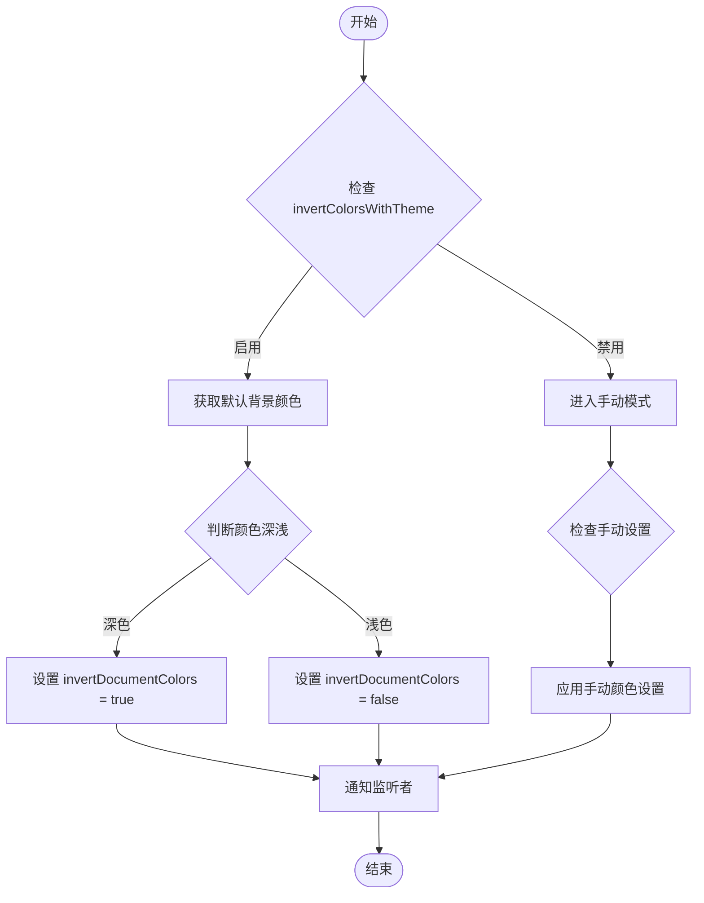
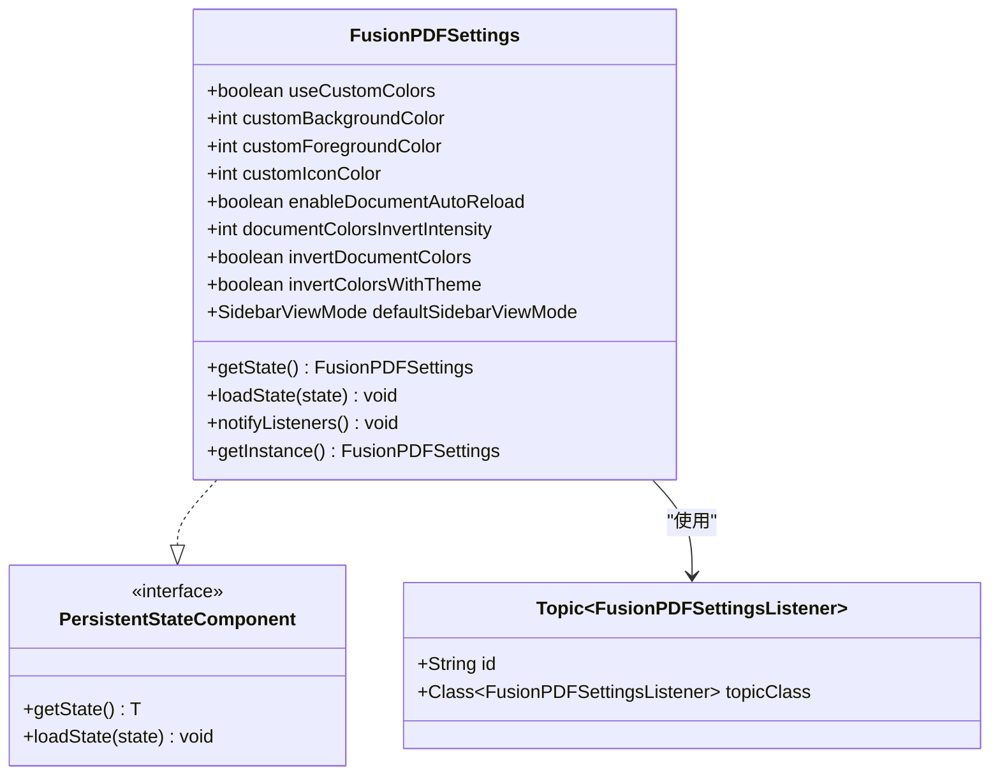
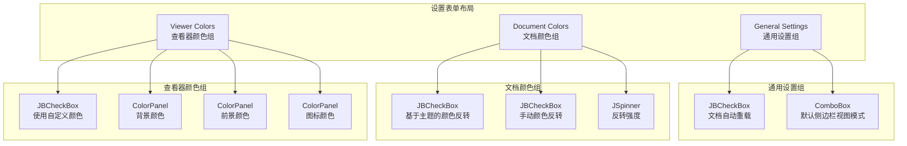
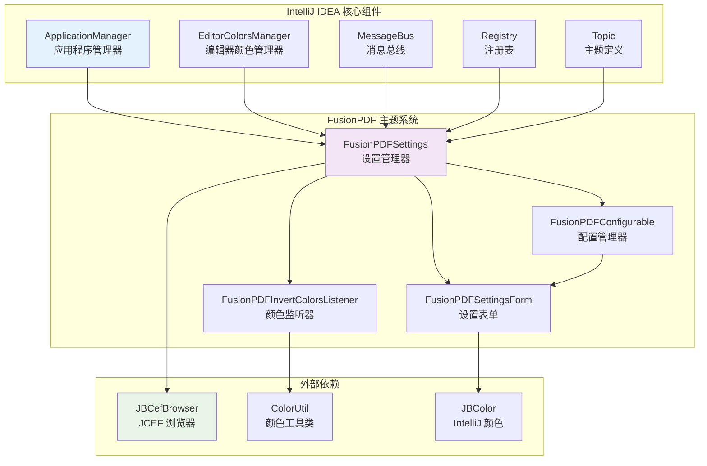

# 主题集成架构

<cite>
**本文档引用的文件**
- [FusionPDFSettings.java](file://src/main/java/com/github/wkkya/fusionpdf/settings/FusionPDFSettings.java)
- [FusionPDFInvertColorsListener.java](file://src/main/java/com/github/wkkya/fusionpdf/settings/FusionPDFInvertColorsListener.java)
- [FusionPDFSettingsListener.java](file://src/main/java/com/github/wkkya/fusionpdf/settings/FusionPDFSettingsListener.java)
- [FusionPDFSettingsForm.java](file://src/main/java/com/github/wkkya/fusionpdf/settings/FusionPDFSettingsForm.java)
- [FusionPDFConfigurable.java](file://src/main/java/com/github/wkkya/fusionpdf/settings/FusionPDFConfigurable.java)
- [SidebarViewMode.java](file://src/main/java/com/github/wkkya/fusionpdf/enums/SidebarViewMode.java)
- [plugin.xml](file://src/main/resources/META-INF/plugin.xml)
- [FusionPDFViewerPanel.java](file://src/main/java/com/github/wkkya/fusionpdf/viewer/FusionPDFViewerPanel.java)
- [build.gradle](file://build.gradle)
</cite>

## 目录
1. [简介](#简介)
2. [项目结构](#项目结构)
3. [核心组件](#核心组件)
4. [架构概览](#架构概览)
5. [详细组件分析](#详细组件分析)
6. [依赖关系分析](#依赖关系分析)
7. [性能考虑](#性能考虑)
8. [故障排除指南](#故障排除指南)
9. [结论](#结论)

## 简介

FusionPDF 主题集成模块是一个专为 IntelliJ IDEA 设计的 PDF 阅读器插件，其核心目标是实现与 IDE 主题的无缝集成。该模块通过智能的颜色管理系统，自动适配当前的 IDE 主题（包括深色和浅色模式），并提供用户可定制的颜色选项，确保在不同环境下都能提供最佳的阅读体验。

该主题系统集成了 IntelliJ IDEA 的 EditorColorsManager，实现了动态的颜色监听和响应机制，能够实时响应 IDE 主题的变化。系统支持多种颜色反转算法，包括基于 RGB 颜色空间的转换和对比度优化，为用户提供丰富的视觉定制选项。

## 项目结构

FusionPDF 主题集成模块采用清晰的分层架构设计，主要包含以下核心目录结构：

**图表来源**
- [FusionPDFSettings.java:17-50](file://src/main/java/com/github/wkkya/fusionpdf/settings/FusionPDFSettings.java#L17-L50)
- [plugin.xml:32-46](file://src/main/resources/META-INF/plugin.xml#L32-L46)

**章节来源**
- [plugin.xml:1-51](file://src/main/resources/META-INF/plugin.xml#L1-L51)
- [build.gradle:1-115](file://build.gradle#L1-L115)

## 核心组件

### FusionPDFSettings - 主要设置管理器

FusionPDFSettings 是整个主题系统的核心组件，负责管理所有与主题相关的配置参数。该类实现了 PersistentStateComponent 接口，确保设置可以在 IDE 重启后保持持久化。

**关键特性：**
- **持久化存储**：使用 @State 注解将设置保存到 fusion_pdf.xml 文件中
- **主题集成**：通过 EditorColorsManager 获取 IDE 默认颜色方案
- **消息总线**：提供同步发布机制通知设置变更
- **默认值管理**：提供合理的默认颜色值和行为

**主要配置参数：**
- `useCustomColors`：启用自定义颜色覆盖
- `invertDocumentColors`：启用文档颜色反转
- `invertColorsWithTheme`：根据主题自动反转颜色
- `documentColorsInvertIntensity`：颜色反转强度（1-100）
- `defaultSidebarViewMode`：默认侧边栏视图模式

**章节来源**
- [FusionPDFSettings.java:17-147](file://src/main/java/com/github/wkkya/fusionpdf/settings/FusionPDFSettings.java#L17-L147)

### FusionPDFInvertColorsListener - 颜色监听器

FusionPDFInvertColorsListener 实现了 EditorColorsListener 接口，专门处理 IDE 主题颜色变化的监听。当用户切换 IDE 主题时，该监听器会自动检测新的背景颜色，并相应地调整 PDF 文档的颜色反转策略。

**工作流程：**
1. 监听 EditorColorsManager 的 globalSchemeChange 事件
2. 检测当前主题的背景颜色是否为深色
3. 自动设置 invertDocumentColors 标志
4. 通过消息总线通知所有监听者

**章节来源**
- [FusionPDFInvertColorsListener.java:11-24](file://src/main/java/com/github/wkkya/fusionpdf/settings/FusionPDFInvertColorsListener.java#L11-L24)

### FusionPDFSettingsForm - 设置界面

FusionPDFSettingsForm 提供了完整的用户界面，允许用户配置各种主题选项。界面采用分组布局，将相关的设置选项组织在一起，提供直观的用户体验。

**界面组件：**
- **通用设置组**：文档自动重载、默认侧边栏视图模式
- **文档颜色组**：主题驱动的颜色反转、手动颜色反转、反转强度
- **查看器颜色组**：自定义背景/前景色、图标颜色

**章节来源**
- [FusionPDFSettingsForm.java:18-158](file://src/main/java/com/github/wkkya/fusionpdf/settings/FusionPDFSettingsForm.java#L18-L158)

## 架构概览

FusionPDF 主题集成系统采用事件驱动的架构模式，通过消息总线实现组件间的松耦合通信。整个系统围绕 FusionPDFSettings 核心类构建，其他组件通过监听设置变化来响应主题更新。

**图表来源**
- [plugin.xml:32-46](file://src/main/resources/META-INF/plugin.xml#L32-L46)
- [FusionPDFSettings.java:20-46](file://src/main/java/com/github/wkkya/fusionpdf/settings/FusionPDFSettings.java#L20-L46)

### 主题切换响应机制

系统实现了完整的主题切换响应机制，确保在 IDE 主题变化时能够及时更新 PDF 文档的显示效果：

**图表来源**
- [FusionPDFInvertColorsListener.java:14-23](file://src/main/java/com/github/wkkya/fusionpdf/settings/FusionPDFInvertColorsListener.java#L14-L23)
- [FusionPDFSettings.java:44-46](file://src/main/java/com/github/wkkya/fusionpdf/settings/FusionPDFSettings.java#L44-L46)

## 详细组件分析

### 颜色管理系统

FusionPDF 的颜色管理系统基于 RGB 颜色空间，实现了智能的颜色反转和对比度优化算法。系统支持两种主要的颜色处理模式：

#### 主题驱动的颜色反转

当启用 `invertColorsWithTheme` 选项时，系统会根据 IDE 主题的背景颜色自动决定是否反转 PDF 文档颜色：

**图表来源**
- [FusionPDFInvertColorsListener.java:14-23](file://src/main/java/com/github/wkkya/fusionpdf/settings/FusionPDFInvertColorsListener.java#L14-L23)

#### 手动颜色控制

用户可以通过 `documentColorsInvertIntensity` 参数精确控制颜色反转的强度，范围从 1 到 100。默认值为 85，提供良好的对比度平衡。

**章节来源**
- [FusionPDFSettings.java:28-64](file://src/main/java/com/github/wkkya/fusionpdf/settings/FusionPDFSettings.java#L28-L64)

### 设置持久化机制

系统使用 IntelliJ IDEA 的 PersistentStateComponent 接口实现设置的持久化存储。所有设置都会保存到项目根目录下的 fusion_pdf.xml 文件中：

**图表来源**
- [FusionPDFSettings.java:17-46](file://src/main/java/com/github/wkkya/fusionpdf/settings/FusionPDFSettings.java#L17-L46)

**章节来源**
- [FusionPDFSettings.java:33-46](file://src/main/java/com/github/wkkya/fusionpdf/settings/FusionPDFSettings.java#L33-L46)

### 用户界面组件

FusionPDFSettingsForm 提供了直观的图形用户界面，采用分组布局将相关的设置选项组织在一起：

**图表来源**
- [FusionPDFSettingsForm.java:89-119](file://src/main/java/com/github/wkkya/fusionpdf/settings/FusionPDFSettingsForm.java#L89-L119)

**章节来源**
- [FusionPDFSettingsForm.java:36-87](file://src/main/java/com/github/wkkya/fusionpdf/settings/FusionPDFSettingsForm.java#L36-L87)

## 依赖关系分析

FusionPDF 主题集成模块与 IntelliJ IDEA 平台的集成关系如下：

**图表来源**
- [plugin.xml:32-46](file://src/main/resources/META-INF/plugin.xml#L32-L46)
- [FusionPDFSettings.java:4-15](file://src/main/java/com/github/wkkya/fusionpdf/settings/FusionPDFSettings.java#L4-L15)

### 外部依赖管理

系统通过 Gradle 构建脚本管理外部依赖，主要依赖包括：

- **IntelliJ Platform SDK**：提供 IDE 集成所需的 API
- **JCEF (Java Chromium Embedded Framework)**：用于 PDF.js 的浏览器渲染
- **PDF.js**：Mozilla 开发的 PDF 阅读器库

**章节来源**
- [build.gradle:16-29](file://build.gradle#L16-L29)
- [build.gradle:36-75](file://build.gradle#L36-L75)

## 性能考虑

### 内存管理

系统采用了高效的内存管理模式，避免不必要的对象创建和颜色计算：

- **延迟初始化**：设置表单仅在首次访问时创建
- **颜色缓存**：利用 IDE 的颜色管理器缓存机制
- **事件去重**：通过消息总线避免重复的通知

### 渲染优化

PDF 文档的渲染过程经过精心优化：

- **JCEF OSR**：启用离屏渲染减少 UI 卡顿
- **增量更新**：仅在设置真正改变时触发重新渲染
- **资源复用**：复用现有的 PDF.js 资源文件

## 故障排除指南

### 常见问题及解决方案

**问题1：主题颜色不响应变化**
- 检查 `invertColorsWithTheme` 选项是否启用
- 确认 FusionPDFInvertColorsListener 是否正确注册
- 验证 EditorColorsManager 是否正常工作

**问题2：颜色反转效果异常**
- 检查 `documentColorsInvertIntensity` 设置值
- 确认 PDF.js 版本兼容性
- 验证颜色空间转换算法

**问题3：设置无法持久化**
- 检查 fusion_pdf.xml 文件权限
- 确认 PersistentStateComponent 实现正确
- 验证 ApplicationManager 服务注册

**章节来源**
- [plugin.xml:42-46](file://src/main/resources/META-INF/plugin.xml#L42-L46)
- [FusionPDFSettings.java:33-46](file://src/main/java/com/github/wkkya/fusionpdf/settings/FusionPDFSettings.java#L33-L46)

## 结论

FusionPDF 主题集成模块展现了现代 IDE 插件开发的最佳实践，通过精心设计的架构实现了与 IntelliJ IDEA 主题系统的深度集成。该系统不仅提供了丰富的自定义选项，还确保了良好的性能表现和用户体验。

**主要优势：**
- **无缝集成**：与 IDE 主题系统完美融合
- **智能响应**：自动检测和响应主题变化
- **灵活定制**：提供多层次的颜色控制选项
- **高性能**：优化的渲染和内存管理
- **可扩展性**：清晰的架构便于功能扩展

该主题系统为开发者提供了一个优秀的参考案例，展示了如何在复杂的 IDE 生态系统中实现高质量的插件功能。通过模块化的架构设计和完善的错误处理机制，FusionPDF 成功地解决了 PDF 阅读器与 IDE 主题集成的技术挑战。