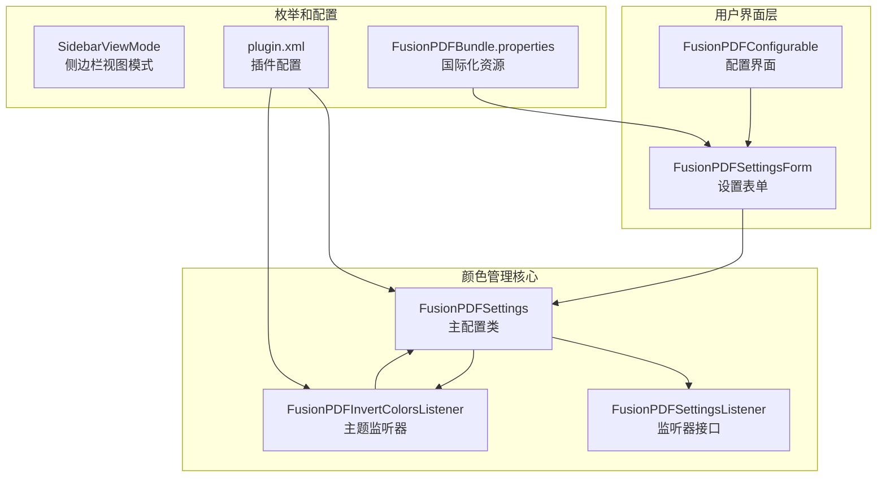
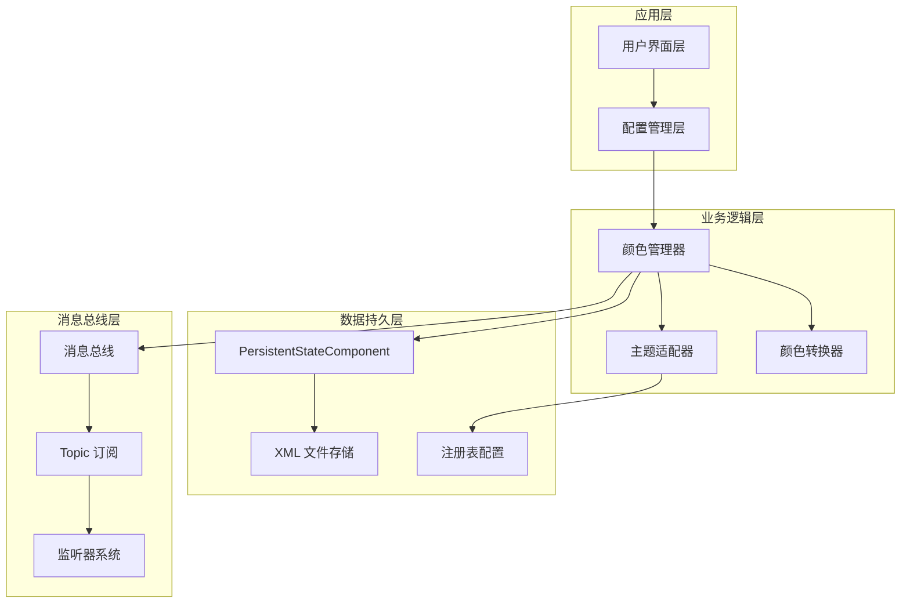
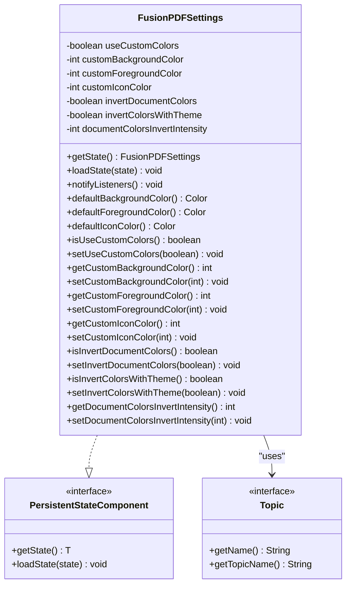
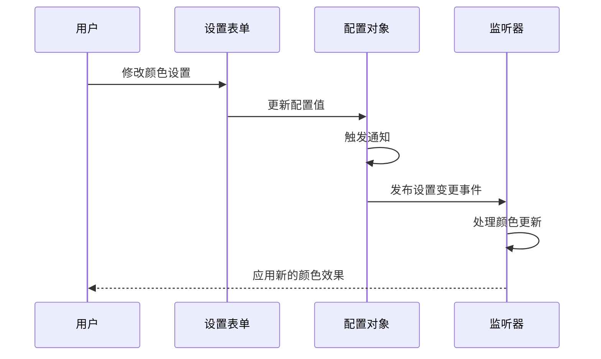
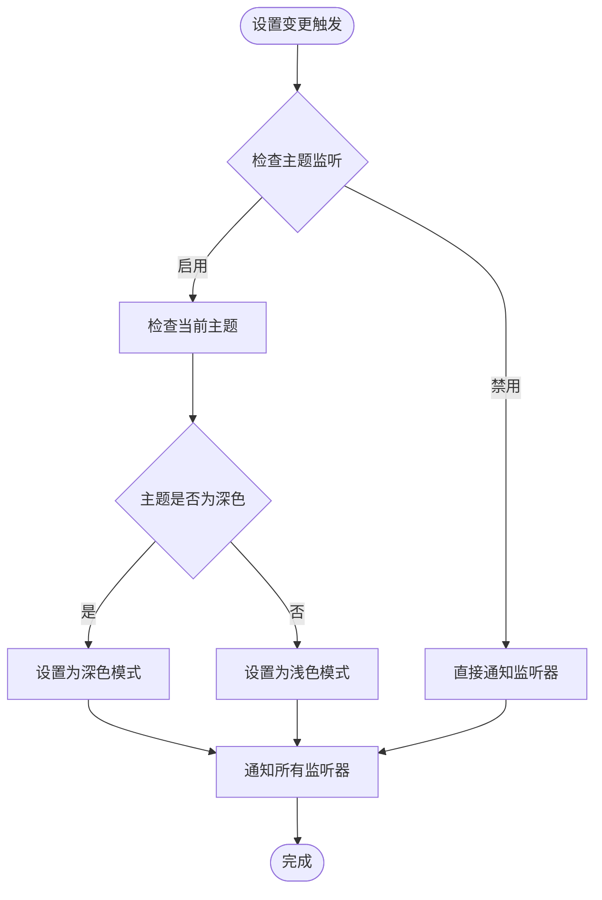
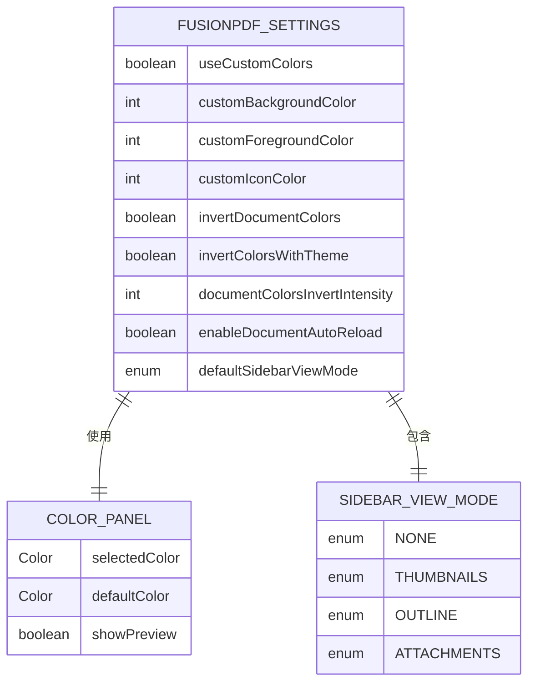
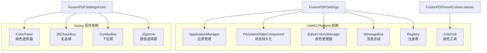

# 颜色管理系统

<cite>
**本文档引用的文件**
- [FusionPDFSettings.java](file://src/main/java/com/github/wkkya/fusionpdf/settings/FusionPDFSettings.java)
- [FusionPDFSettingsForm.java](file://src/main/java/com/github/wkkya/fusionpdf/settings/FusionPDFSettingsForm.java)
- [FusionPDFSettingsListener.java](file://src/main/java/com/github/wkkya/fusionpdf/settings/FusionPDFSettingsListener.java)
- [FusionPDFInvertColorsListener.java](file://src/main/java/com/github/wkkya/fusionpdf/settings/FusionPDFInvertColorsListener.java)
- [FusionPDFConfigurable.java](file://src/main/java/com/github/wkkya/fusionpdf/settings/FusionPDFConfigurable.java)
- [SidebarViewMode.java](file://src/main/java/com/github/wkkya/fusionpdf/enums/SidebarViewMode.java)
- [plugin.xml](file://src/main/resources/META-INF/plugin.xml)
- [FusionPDFBundle.properties](file://src/main/resources/messages/FusionPDFBundle.properties)
</cite>

## 目录
1. [简介](#简介)
2. [项目结构](#项目结构)
3. [核心组件](#核心组件)
4. [架构概览](#架构概览)
5. [详细组件分析](#详细组件分析)
6. [依赖关系分析](#依赖关系分析)
7. [性能考虑](#性能考虑)
8. [故障排除指南](#故障排除指南)
9. [结论](#结论)
10. [附录](#附录)

## 简介
FusionPDF 颜色管理系统是一个基于 IntelliJ IDEA 平台的插件，专门负责 PDF 查看器的颜色管理。该系统实现了完整的颜色状态持久化、主题颜色继承、自定义颜色配置以及监听器通知机制。通过与 IDE 主题系统的深度集成，为用户提供无缝的主题适配体验。

## 项目结构
颜色管理系统主要由以下核心模块组成：

**图表来源**
- [FusionPDFSettings.java:17-50](file://src/main/java/com/github/wkkya/fusionpdf/settings/FusionPDFSettings.java#L17-L50)
- [FusionPDFSettingsForm.java:18-87](file://src/main/java/com/github/wkkya/fusionpdf/settings/FusionPDFSettingsForm.java#L18-L87)
- [FusionPDFConfigurable.java:7-34](file://src/main/java/com/github/wkkya/fusionpdf/settings/FusionPDFConfigurable.java#L7-L34)

**章节来源**
- [FusionPDFSettings.java:1-151](file://src/main/java/com/github/wkkya/fusionpdf/settings/FusionPDFSettings.java#L1-L151)
- [FusionPDFSettingsForm.java:1-159](file://src/main/java/com/github/wkkya/fusionpdf/settings/FusionPDFSettingsForm.java#L1-L159)
- [FusionPDFConfigurable.java:1-76](file://src/main/java/com/github/wkkya/fusionpdf/settings/FusionPDFConfigurable.java#L1-L76)

## 核心组件
颜色管理系统的核心组件包括：

### FusionPDFSettings - 主配置类
这是颜色管理系统的中央控制器，负责：
- 颜色状态的持久化存储
- 默认颜色获取逻辑
- 颜色配置的数据模型
- 监听器通知机制

### FusionPDFSettingsForm - 用户界面
提供图形化的颜色配置界面，包含：
- 文档颜色反转设置
- 查看器颜色自定义选项
- 主题颜色重置功能

### FusionPDFSettingsListener - 监听器接口
定义颜色设置变更的通知机制，采用函数式接口设计。

### FusionPDFInvertColorsListener - 主题监听器
实现 IDE 主题变化时的颜色自动调整功能。

**章节来源**
- [FusionPDFSettings.java:17-147](file://src/main/java/com/github/wkkya/fusionpdf/settings/FusionPDFSettings.java#L17-L147)
- [FusionPDFSettingsForm.java:18-159](file://src/main/java/com/github/wkkya/fusionpdf/settings/FusionPDFSettingsForm.java#L18-L159)
- [FusionPDFSettingsListener.java:1-7](file://src/main/java/com/github/wkkya/fusionpdf/settings/FusionPDFSettingsListener.java#L1-L7)
- [FusionPDFInvertColorsListener.java:1-25](file://src/main/java/com/github/wkkya/fusionpdf/settings/FusionPDFInvertColorsListener.java#L1-L25)

## 架构概览
颜色管理系统采用分层架构设计，实现了清晰的关注点分离：

**图表来源**
- [FusionPDFSettings.java:17-46](file://src/main/java/com/github/wkkya/fusionpdf/settings/FusionPDFSettings.java#L17-L46)
- [plugin.xml:26-46](file://src/main/resources/META-INF/plugin.xml#L26-L46)

## 详细组件分析

### FusionPDFSettings - 颜色管理核心
FusionPDFSettings 类是整个颜色管理系统的核心，实现了以下关键功能：

#### 数据模型设计
系统维护了以下颜色相关属性：
- `useCustomColors`: 是否启用自定义颜色
- `customBackgroundColor`: 自定义背景颜色（RGB 值）
- `customForegroundColor`: 自定义前景颜色（RGB 值）
- `customIconColor`: 自定义图标颜色（RGB 值）
- `invertDocumentColors`: 是否反转文档颜色
- `invertColorsWithTheme`: 是否根据主题反转颜色
- `documentColorsInvertIntensity`: 文档颜色反转强度（1-100）

#### 持久化机制
通过 `@State` 注解实现状态持久化：
- 存储文件名：`fusion_pdf.xml`
- 实现 `PersistentStateComponent` 接口
- 使用 `XmlSerializerUtil` 进行序列化

#### 默认颜色获取逻辑
系统提供了智能的默认颜色获取机制：
- `defaultBackgroundColor()`: 获取 IDE 全局方案的默认背景色
- `defaultForegroundColor()`: 获取 IDE 全局方案的默认前景色
- `defaultIconColor()`: 图标颜色继承自前景色

#### 颜色转换函数
系统实现了颜色值的序列化机制：
- 将 `Color` 对象转换为 RGB 整数值存储
- 在 UI 层重新转换为 `Color` 对象显示

**图表来源**
- [FusionPDFSettings.java:17-147](file://src/main/java/com/github/wkkya/fusionpdf/settings/FusionPDFSettings.java#L17-L147)

**章节来源**
- [FusionPDFSettings.java:17-147](file://src/main/java/com/github/wkkya/fusionpdf/settings/FusionPDFSettings.java#L17-L147)

### FusionPDFSettingsForm - 用户界面层
FusionPDFSettingsForm 提供了完整的图形化配置界面：

#### 组件组织结构
界面采用分组布局设计：
- **通用设置组**: 文档自动重载、默认侧边栏视图模式
- **文档颜色组**: 主题颜色反转、颜色反转强度
- **查看器颜色组**: 自定义颜色开关、背景/前景/图标颜色选择器

#### 交互逻辑
- 实时同步 UI 状态到配置对象
- 支持主题颜色一键重置功能
- 提供颜色值的双向转换

**图表来源**
- [FusionPDFSettingsForm.java:68-77](file://src/main/java/com/github/wkkya/fusionpdf/settings/FusionPDFSettingsForm.java#L68-L77)
- [FusionPDFSettings.java:44-46](file://src/main/java/com/github/wkkya/fusionpdf/settings/FusionPDFSettings.java#L44-L46)

**章节来源**
- [FusionPDFSettingsForm.java:18-159](file://src/main/java/com/github/wkkya/fusionpdf/settings/FusionPDFSettingsForm.java#L18-L159)

### 监听器系统工作原理
颜色管理系统实现了多层次的监听器架构：

#### 消息总线机制
- 使用 IntelliJ Platform 的 `MessageBus` 实现事件发布订阅
- 通过 `Topic` 定义类型安全的事件通道
- 支持同步和异步事件处理

#### 事件传播机制

**图表来源**
- [FusionPDFInvertColorsListener.java:14-23](file://src/main/java/com/github/wkkya/fusionpdf/settings/FusionPDFInvertColorsListener.java#L14-L23)
- [FusionPDFSettings.java:44-46](file://src/main/java/com/github/wkkya/fusionpdf/settings/FusionPDFSettings.java#L44-L46)

**章节来源**
- [FusionPDFSettingsListener.java:1-7](file://src/main/java/com/github/wkkya/fusionpdf/settings/FusionPDFSettingsListener.java#L1-L7)
- [FusionPDFInvertColorsListener.java:1-25](file://src/main/java/com/github/wkkya/fusionpdf/settings/FusionPDFInvertColorsListener.java#L1-L25)

### 颜色配置数据模型
系统采用了简洁而高效的数据模型设计：

**图表来源**
- [FusionPDFSettings.java:23-31](file://src/main/java/com/github/wkkya/fusionpdf/settings/FusionPDFSettings.java#L23-L31)
- [SidebarViewMode.java:3-21](file://src/main/java/com/github/wkkya/fusionpdf/enums/SidebarViewMode.java#L3-L21)

**章节来源**
- [SidebarViewMode.java:1-22](file://src/main/java/com/github/wkkya/fusionpdf/enums/SidebarViewMode.java#L1-L22)

## 依赖关系分析

### 外部依赖关系
颜色管理系统依赖于 IntelliJ Platform 的多个核心组件：

**图表来源**
- [FusionPDFSettings.java:4-15](file://src/main/java/com/github/wkkya/fusionpdf/settings/FusionPDFSettings.java#L4-L15)
- [FusionPDFSettingsForm.java:5-16](file://src/main/java/com/github/wkkya/fusionpdf/settings/FusionPDFSettingsForm.java#L5-L16)
- [FusionPDFInvertColorsListener.java:3-8](file://src/main/java/com/github/wkkya/fusionpdf/settings/FusionPDFInvertColorsListener.java#L3-L8)

### 内部组件耦合
系统内部组件之间保持低耦合高内聚的设计原则：

| 组件 | 耦合关系 | 作用 |
|------|----------|------|
| FusionPDFSettings | 无直接耦合 | 核心配置管理 |
| FusionPDFSettingsForm | 单向依赖 | UI 表单展示 |
| FusionPDFSettingsListener | 无直接依赖 | 事件监听接口 |
| FusionPDFInvertColorsListener | 无直接依赖 | 主题监听器 |

**章节来源**
- [plugin.xml:32-46](file://src/main/resources/META-INF/plugin.xml#L32-L46)

## 性能考虑
颜色管理系统在设计时充分考虑了性能优化：

### 内存优化策略
- 使用整数存储 RGB 值而非 Color 对象，减少内存占用
- 懒加载默认颜色值，仅在需要时获取
- 合理的监听器生命周期管理

### 线程安全性
- 所有颜色操作都在应用线程中执行
- 使用同步消息总线确保线程安全
- 避免在 UI 线程中进行耗时操作

### 缓存机制
- 默认颜色值缓存在静态字段中
- 颜色转换结果进行本地缓存
- 减少重复计算开销

## 故障排除指南

### 常见问题诊断
1. **颜色设置不生效**
   - 检查 `useCustomColors` 标志位
   - 验证颜色值的有效性（0-16777215）
   - 确认监听器是否正常工作

2. **主题颜色反转异常**
   - 检查 `invertColorsWithTheme` 设置
   - 验证 IDE 主题是否正确识别
   - 确认 `globalSchemeChange` 事件是否触发

3. **配置文件损坏**
   - 检查 `fusion_pdf.xml` 文件格式
   - 验证 XML 序列化完整性
   - 重新初始化默认配置

### 调试技巧
- 启用调试模式 (`fusion.pdf.debug`)
- 监控消息总线事件流
- 使用注册表键值验证功能状态

**章节来源**
- [FusionPDFSettings.java:66-72](file://src/main/java/com/github/wkkya/fusionpdf/settings/FusionPDFSettings.java#L66-L72)
- [plugin.xml:27-30](file://src/main/resources/META-INF/plugin.xml#L27-L30)

## 结论
FusionPDF 颜色管理系统展现了优秀的软件工程实践，通过合理的架构设计、完善的监听器机制和高效的持久化策略，为用户提供了灵活且稳定的颜色管理解决方案。系统不仅满足了基本的颜色配置需求，还通过主题适配和智能继承机制提升了用户体验。

## 附录

### API 接口参考

#### 颜色配置 API
| 方法 | 参数 | 返回值 | 描述 |
|------|------|--------|------|
| `isUseCustomColors()` | 无 | boolean | 检查是否启用自定义颜色 |
| `setUseCustomColors(boolean)` | boolean | void | 设置自定义颜色开关 |
| `getCustomBackgroundColor()` | 无 | int | 获取自定义背景颜色 |
| `setCustomBackgroundColor(int)` | int | void | 设置自定义背景颜色 |
| `getCustomForegroundColor()` | 无 | int | 获取自定义前景颜色 |
| `setCustomForegroundColor(int)` | int | void | 设置自定义前景颜色 |
| `getCustomIconColor()` | 无 | int | 获取自定义图标颜色 |
| `setCustomIconColor(int)` | int | void | 设置自定义图标颜色 |

#### 颜色反转 API
| 方法 | 参数 | 返回值 | 描述 |
|------|------|--------|------|
| `isInvertDocumentColors()` | 无 | boolean | 检查是否反转文档颜色 |
| `setInvertDocumentColors(boolean)` | boolean | void | 设置文档颜色反转 |
| `isInvertColorsWithTheme()` | 无 | boolean | 检查是否按主题反转 |
| `setInvertColorsWithTheme(boolean)` | boolean | void | 设置主题颜色反转 |
| `getDocumentColorsInvertIntensity()` | 无 | int | 获取反转强度 |
| `setDocumentColorsInvertIntensity(int)` | int | void | 设置反转强度 |

#### 默认颜色 API
| 方法 | 参数 | 返回值 | 描述 |
|------|------|--------|------|
| `defaultBackgroundColor()` | 无 | Color | 获取默认背景色 |
| `defaultForegroundColor()` | 无 | Color | 获取默认前景色 |
| `defaultIconColor()` | 无 | Color | 获取默认图标色 |

### 配置验证逻辑
系统实现了多层次的配置验证：
- 类型安全的参数验证
- 数值范围检查（1-100）
- 颜色值有效性验证
- 主题兼容性检查