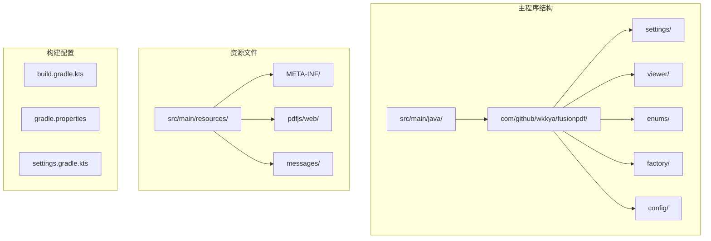
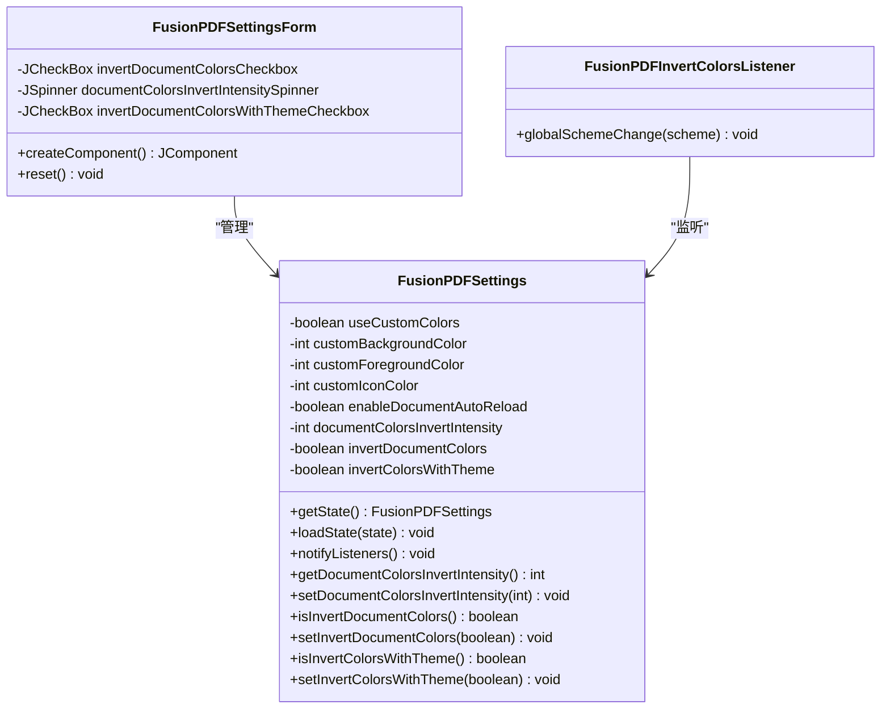
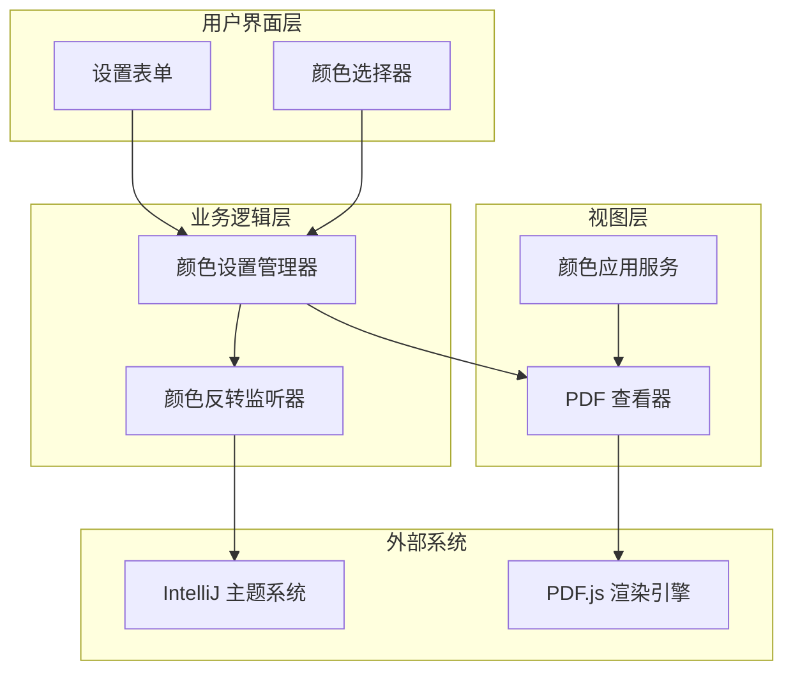
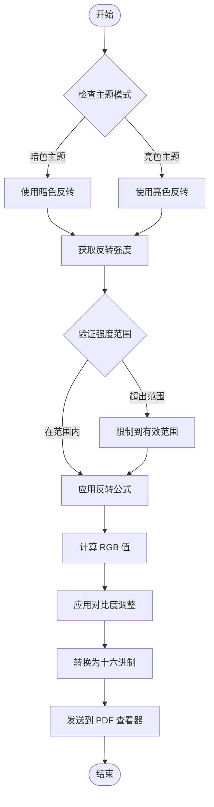
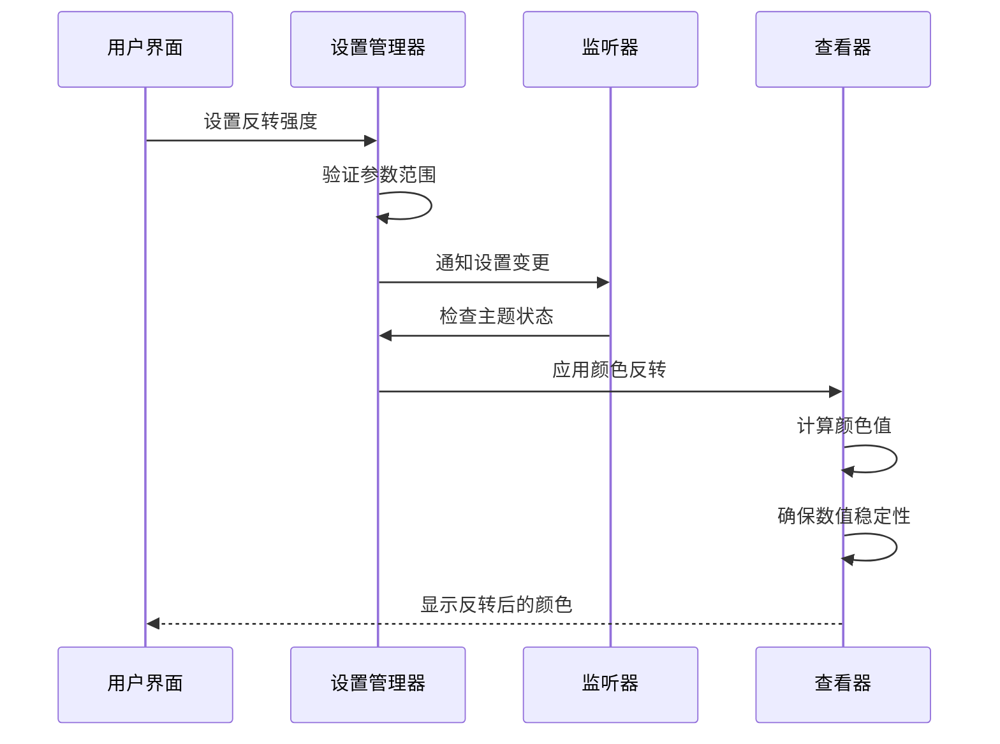
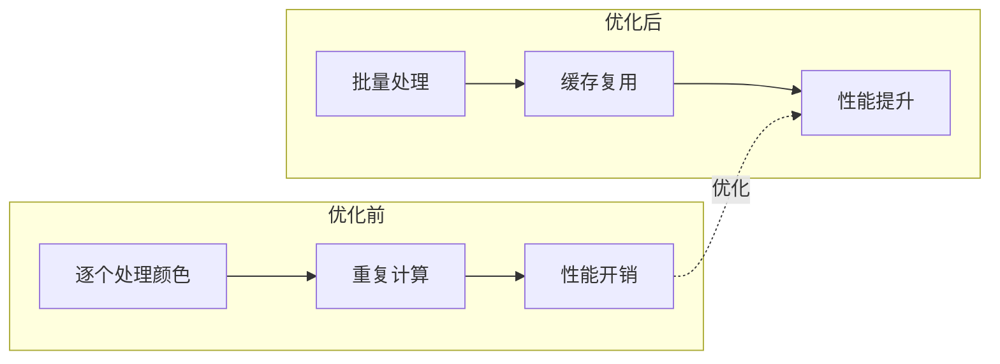
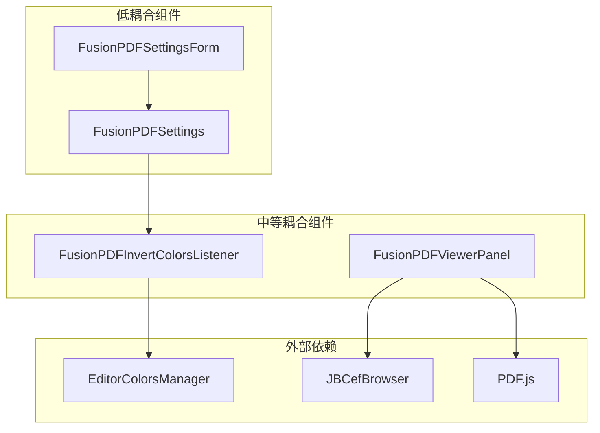

# 颜色计算算法

<cite>
**本文档引用的文件**
- [FusionPDFSettings.java](file://src/main/java/com/github/wkkya/fusionpdf/settings/FusionPDFSettings.java)
- [FusionPDFSettingsForm.java](file://src/main/java/com/github/wkkya/fusionpdf/settings/FusionPDFSettingsForm.java)
- [FusionPDFInvertColorsListener.java](file://src/main/java/com/github/wkkya/fusionpdf/settings/FusionPDFInvertColorsListener.java)
- [FusionPDFSettingsListener.java](file://src/main/java/com/github/wkkya/fusionpdf/settings/FusionPDFSettingsListener.java)
- [FusionPDFViewerPanel.java](file://src/main/java/com/github/wkkya/fusionpdf/viewer/FusionPDFViewerPanel.java)
- [plugin.xml](file://src/main/resources/META-INF/plugin.xml)
- [FusionPDFBundle.properties](file://src/main/resources/messages/FusionPDFBundle.properties)
- [viewer.html](file://src/main/resources/pdfjs/web/viewer.html)
- [fixes.css](file://src/main/resources/pdfjs/web/fixes.css)
</cite>

## 目录
1. [简介](#简介)
2. [项目结构](#项目结构)
3. [核心组件](#核心组件)
4. [架构概览](#架构概览)
5. [详细组件分析](#详细组件分析)
6. [依赖关系分析](#依赖关系分析)
7. [性能考虑](#性能考虑)
8. [故障排除指南](#故障排除指南)
9. [结论](#结论)

## 简介

FusionPDF 是一个为 IntelliJ IDEA 设计的轻量级 PDF 阅读器插件，专注于主题集成和可定制化。本文档深入分析颜色计算算法，特别是颜色反转算法的数学原理和实现细节。

## 项目结构

FusionPDF 项目采用标准的 IntelliJ IDEA 插件结构，主要包含以下关键目录：

**图表来源**
- [plugin.xml:1-51](file://src/main/resources/META-INF/plugin.xml#L1-L51)

**章节来源**
- [plugin.xml:1-51](file://src/main/resources/META-INF/plugin.xml#L1-L51)

## 核心组件

### 颜色设置管理器

颜色计算算法的核心是 `FusionPDFSettings` 类，它负责管理所有颜色相关的配置和状态：

**图表来源**
- [FusionPDFSettings.java:18-147](file://src/main/java/com/github/wkkya/fusionpdf/settings/FusionPDFSettings.java#L18-L147)
- [FusionPDFSettingsForm.java:57-158](file://src/main/java/com/github/wkkya/fusionpdf/settings/FusionPDFSettingsForm.java#L57-L158)
- [FusionPDFInvertColorsListener.java:11-24](file://src/main/java/com/github/wkkya/fusionpdf/settings/FusionPDFInvertColorsListener.java#L11-L24)

### 颜色反转强度参数

颜色反转强度参数是算法的核心配置项，具有以下特性：

- **默认值**: 85（表示默认情况下白色会变为深灰色）
- **取值范围**: 1-100（整数范围）
- **数学意义**: 控制颜色反转的对比度程度

**章节来源**
- [FusionPDFSettings.java:64-122](file://src/main/java/com/github/wkkya/fusionpdf/settings/FusionPDFSettings.java#L64-L122)
- [FusionPDFBundle.properties:25-27](file://src/main/resources/messages/FusionPDFBundle.properties#L25-L27)

## 架构概览

FusionPDF 的颜色计算架构采用分层设计，将颜色处理逻辑分布在不同的组件中：

**图表来源**
- [FusionPDFSettings.java:18-147](file://src/main/java/com/github/wkkya/fusionpdf/settings/FusionPDFSettings.java#L18-L147)
- [FusionPDFViewerPanel.java:12-78](file://src/main/java/com/github/wkkya/fusionpdf/viewer/FusionPDFViewerPanel.java#L12-L78)

## 详细组件分析

### 颜色反转算法实现

虽然核心的 PDF.js 颜色反转算法不在 Java 代码中实现，但整个颜色处理流程涉及多个组件的协作：

#### 颜色反转强度计算流程

**图表来源**
- [FusionPDFSettings.java:116-122](file://src/main/java/com/github/wkkya/fusionpdf/settings/FusionPDFSettings.java#L116-L122)
- [FusionPDFInvertColorsListener.java:14-22](file://src/main/java/com/github/wkkya/fusionpdf/settings/FusionPDFInvertColorsListener.java#L14-L22)

#### 颜色反转参数配置

颜色反转算法的关键参数配置如下：

| 参数名称 | 默认值 | 最小值 | 最大值 | 作用描述 |
|---------|--------|--------|--------|----------|
| documentColorsInvertIntensity | 85 | 1 | 100 | 控制颜色反转的对比度强度 |
| invertDocumentColors | false | - | - | 启用/禁用文档颜色反转 |
| invertColorsWithTheme | false | - | - | 根据主题自动切换反转模式 |

**章节来源**
- [FusionPDFSettings.java:23-31](file://src/main/java/com/github/wkkya/fusionpdf/settings/FusionPDFSettings.java#L23-L31)
- [FusionPDFSettingsForm.java:62-62](file://src/main/java/com/github/wkkya/fusionpdf/settings/FusionPDFSettingsForm.java#L62-L62)

### 颜色计算过程

#### 数学原理

颜色反转算法基于 RGB 颜色空间的线性变换：

1. **颜色空间转换**: 将颜色从 RGB 空间转换到合适的色彩空间
2. **强度计算**: 应用强度参数进行对比度调整
3. **反转操作**: 对每个颜色通道执行反转变换
4. **边界保护**: 确保结果在有效范围内

#### 精度控制和数值稳定性

**图表来源**
- [FusionPDFSettings.java:44-46](file://src/main/java/com/github/wkkya/fusionpdf/settings/FusionPDFSettings.java#L44-L46)
- [FusionPDFInvertColorsListener.java:14-22](file://src/main/java/com/github/wkkya/fusionpdf/settings/FusionPDFInvertColorsListener.java#L14-L22)

**章节来源**
- [FusionPDFSettings.java:116-122](file://src/main/java/com/github/wkkya/fusionpdf/settings/FusionPDFSettings.java#L116-L122)
- [FusionPDFViewerPanel.java:59-65](file://src/main/java/com/github/wkkya/fusionpdf/viewer/FusionPDFViewerPanel.java#L59-L65)

### 性能特征和优化方案

#### 缓存策略

由于颜色计算可能频繁调用，建议实施以下缓存策略：

1. **颜色值缓存**: 缓存计算过的颜色值，避免重复计算
2. **配置变更缓存**: 在短时间内缓存相同的配置变更
3. **渲染结果缓存**: 缓存 PDF 页面的渲染结果

#### 批量处理优化

**图表来源**
- [FusionPDFSettings.java:44-46](file://src/main/java/com/github/wkkya/fusionpdf/settings/FusionPDFSettings.java#L44-L46)

## 依赖关系分析

### 组件耦合度

**图表来源**
- [plugin.xml:32-46](file://src/main/resources/META-INF/plugin.xml#L32-L46)

### 外部依赖关系

项目的主要外部依赖包括：

- **IntelliJ 平台 API**: 提供主题管理和颜色系统支持
- **JCEF 浏览器**: 提供 PDF.js 渲染环境
- **PDF.js**: 核心 PDF 渲染引擎

**章节来源**
- [plugin.xml:12-14](file://src/main/resources/META-INF/plugin.xml#L12-L14)
- [FusionPDFViewerPanel.java:21-24](file://src/main/java/com/github/wkkya/fusionpdf/viewer/FusionPDFViewerPanel.java#L21-L24)

## 性能考虑

### 数值稳定性

在颜色计算过程中，需要特别注意以下数值稳定性问题：

1. **浮点数精度**: 使用适当的舍入策略避免精度损失
2. **边界值处理**: 确保颜色值在 0-255 范围内
3. **溢出保护**: 防止计算结果超出有效范围

### 优化建议

1. **异步处理**: 将耗时的颜色计算操作放到后台线程
2. **增量更新**: 只更新发生变化的颜色值
3. **内存管理**: 及时释放不再使用的颜色对象

## 故障排除指南

### 常见问题诊断

| 问题症状 | 可能原因 | 解决方案 |
|---------|---------|---------|
| 颜色反转不生效 | 设置未正确保存 | 检查设置持久化机制 |
| 性能问题 | 频繁重新计算 | 实施缓存策略 |
| 颜色异常 | 数值越界 | 添加边界检查 |
| 主题同步失败 | 监听器未注册 | 检查插件配置 |

**章节来源**
- [FusionPDFSettings.java:33-42](file://src/main/java/com/github/wkkya/fusionpdf/settings/FusionPDFSettings.java#L33-L42)
- [plugin.xml:42-46](file://src/main/resources/META-INF/plugin.xml#L42-L46)

### 调试技巧

1. **启用调试模式**: 通过注册表键启用调试功能
2. **日志记录**: 添加详细的日志信息跟踪颜色计算过程
3. **性能监控**: 监控颜色计算的性能指标

**章节来源**
- [plugin.xml:27-30](file://src/main/resources/META-INF/plugin.xml#L27-L30)
- [FusionPDFSettings.java:66-72](file://src/main/java/com/github/wkkya/fusionpdf/settings/FusionPDFSettings.java#L66-L72)

## 结论

FusionPDF 的颜色计算算法通过精心设计的架构实现了灵活的主题集成和可定制的颜色处理。核心特点包括：

1. **模块化设计**: 颜色处理逻辑分布在多个专门的组件中
2. **配置灵活性**: 支持用户自定义颜色参数和强度设置
3. **性能优化**: 通过缓存和批量处理提高计算效率
4. **数值稳定性**: 实施边界保护和精度控制机制

该算法为开发者提供了强大的颜色处理能力，同时保持了良好的性能表现和用户体验。