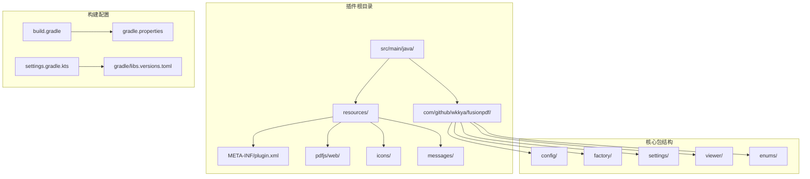
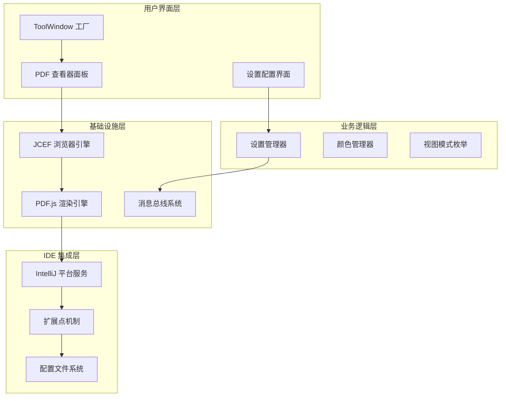
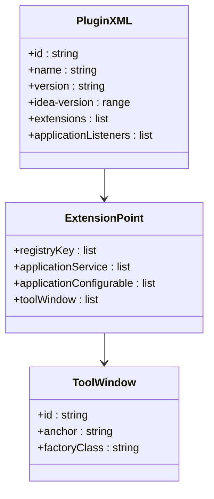
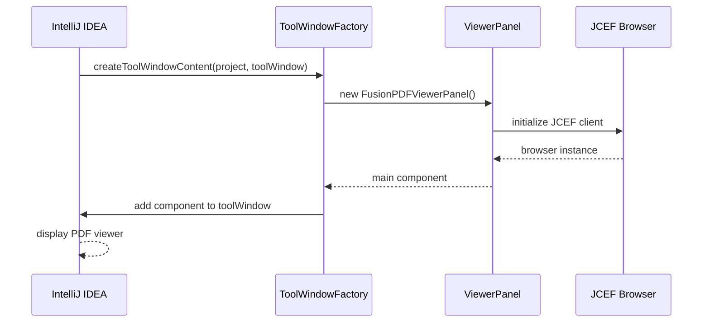
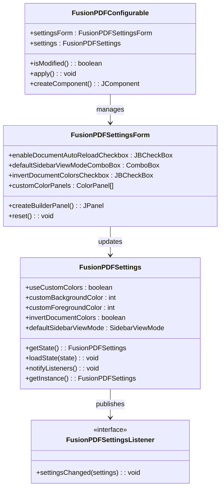
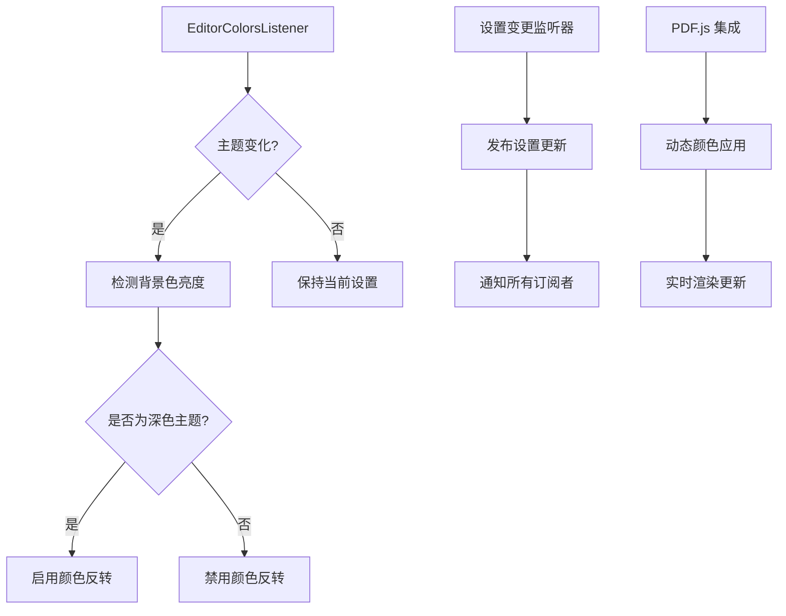
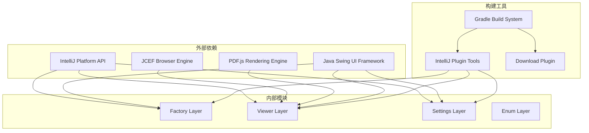

# 插件架构总览

<cite>
**本文档引用的文件**
- [plugin.xml](file://src/main/resources/META-INF/plugin.xml)
- [FusionPDFToolWindowFactory.java](file://src/main/java/com/github/wkkya/fusionpdf/factory/FusionPDFToolWindowFactory.java)
- [FusionPDFViewerPanel.java](file://src/main/java/com/github/wkkya/fusionpdf/viewer/FusionPDFViewerPanel.java)
- [FusionPDFSettings.java](file://src/main/java/com/github/wkkya/fusionpdf/settings/FusionPDFSettings.java)
- [FusionPDFConfigurable.java](file://src/main/java/com/github/wkkya/fusionpdf/settings/FusionPDFConfigurable.java)
- [FusionPDFSettingsForm.java](file://src/main/java/com/github/wkkya/fusionpdf/settings/FusionPDFSettingsForm.java)
- [FusionPDFSettingsListener.java](file://src/main/java/com/github/wkkya/fusionpdf/settings/FusionPDFSettingsListener.java)
- [FusionPDFInvertColorsListener.java](file://src/main/java/com/github/wkkya/fusionpdf/settings/FusionPDFInvertColorsListener.java)
- [SidebarViewMode.java](file://src/main/java/com/github/wkkya/fusionpdf/enums/SidebarViewMode.java)
- [build.gradle](file://build.gradle)
- [gradle.properties](file://gradle.properties)
- [settings.gradle.kts](file://settings.gradle.kts)
- [README.md](file://README.md)
</cite>

## 目录
1. [简介](#简介)
2. [项目结构](#项目结构)
3. [核心组件](#核心组件)
4. [架构概览](#架构概览)
5. [详细组件分析](#详细组件分析)
6. [依赖关系分析](#依赖关系分析)
7. [性能考虑](#性能考虑)
8. [故障排除指南](#故障排除指南)
9. [结论](#结论)

## 简介

FusionPDF 是一个专为 IntelliJ IDEA 设计的轻量级 PDF 阅读器插件，它无缝集成了 PDF 查看功能到 IDE 中，提供了主题匹配和自定义选项，包括背景色和文本颜色的个性化设置。该插件支持 PDF 缩放功能以进行详细查看，支持扫描图像 PDF 以处理各种文档类型，并包含快速导航、PDF 内搜索和书签管理等功能，显著提升生产力和阅读体验。

## 项目结构

FusionPDF 插件采用标准的 IntelliJ IDEA 插件项目结构，遵循模块化设计原则：

**图表来源**
- [plugin.xml:1-51](file://src/main/resources/META-INF/plugin.xml#L1-L51)
- [build.gradle:1-115](file://build.gradle#L1-L115)
- [gradle.properties:1-54](file://gradle.properties#L1-L54)

**章节来源**
- [plugin.xml:1-51](file://src/main/resources/META-INF/plugin.xml#L1-L51)
- [build.gradle:1-115](file://build.gradle#L1-L115)
- [gradle.properties:1-54](file://gradle.properties#L1-L54)

## 核心组件

FusionPDF 插件的核心架构由以下主要组件构成：

### 工厂组件
- **FusionPDFToolWindowFactory**: 实现 ToolWindowFactory 接口，负责创建和管理 PDF 查看工具窗口
- **FusionPDFViewerPanel**: 主要的 PDF 查看器面板，基于 JCEF 技术实现 PDF 渲染

### 设置管理组件
- **FusionPDFSettings**: 应用程序级别的 PDF 设置持久化组件
- **FusionPDFConfigurable**: 设置界面的可配置实现
- **FusionPDFSettingsForm**: 用户界面设置表单

### 监听器组件
- **FusionPDFInvertColorsListener**: 监听编辑器颜色方案变化的监听器
- **FusionPDFSettingsListener**: 设置变更通知接口

**章节来源**
- [FusionPDFToolWindowFactory.java:1-21](file://src/main/java/com/github/wkkya/fusionpdf/factory/FusionPDFToolWindowFactory.java#L1-L21)
- [FusionPDFViewerPanel.java:1-78](file://src/main/java/com/github/wkkya/fusionpdf/viewer/FusionPDFViewerPanel.java#L1-L78)
- [FusionPDFSettings.java:1-151](file://src/main/java/com/github/wkkya/fusionpdf/settings/FusionPDFSettings.java#L1-L151)

## 架构概览

FusionPDF 插件采用分层架构设计，实现了清晰的关注点分离：

**图表来源**
- [plugin.xml:26-46](file://src/main/resources/META-INF/plugin.xml#L26-L46)
- [FusionPDFToolWindowFactory.java:12-18](file://src/main/java/com/github/wkkya/fusionpdf/factory/FusionPDFToolWindowFactory.java#L12-L18)
- [FusionPDFViewerPanel.java:12-38](file://src/main/java/com/github/wkkya/fusionpdf/viewer/FusionPDFViewerPanel.java#L12-L38)

## 详细组件分析

### 插件配置系统

插件通过 `plugin.xml` 文件声明其核心配置和扩展点：

**图表来源**
- [plugin.xml:26-46](file://src/main/resources/META-INF/plugin.xml#L26-L46)

插件配置文件的关键特性包括：

1. **兼容性声明**: 指定支持的 IntelliJ IDEA 版本范围
2. **依赖管理**: 声明对平台模块的依赖
3. **扩展点注册**: 注册各种扩展点和监听器
4. **工具窗口定义**: 定义 PDF 查看工具窗口

**章节来源**
- [plugin.xml:1-51](file://src/main/resources/META-INF/plugin.xml#L1-L51)

### 工具窗口工厂机制

FusionPDF 使用 IntelliJ IDEA 的 ToolWindowFactory 扩展点机制来集成 IDE 功能：

**图表来源**
- [FusionPDFToolWindowFactory.java:12-18](file://src/main/java/com/github/wkkya/fusionpdf/factory/FusionPDFToolWindowFactory.java#L12-L18)
- [FusionPDFViewerPanel.java:17-38](file://src/main/java/com/github/wkkya/fusionpdf/viewer/FusionPDFViewerPanel.java#L17-L38)

工具窗口工厂的工作流程：
1. **初始化**: 创建 FusionPDFViewerPanel 实例
2. **浏览器配置**: 初始化 JCEF 浏览器客户端
3. **内容加载**: 将查看器面板添加到工具窗口中
4. **PDF.js 集成**: 加载并配置 PDF.js 渲染引擎

**章节来源**
- [FusionPDFToolWindowFactory.java:1-21](file://src/main/java/com/github/wkkya/fusionpdf/factory/FusionPDFToolWindowFactory.java#L1-L21)
- [FusionPDFViewerPanel.java:1-78](file://src/main/java/com/github/wkkya/fusionpdf/viewer/FusionPDFViewerPanel.java#L1-L78)

### 设置管理系统

插件采用基于消息总线的设置管理架构：

**图表来源**
- [FusionPDFSettings.java:17-46](file://src/main/java/com/github/wkkya/fusionpdf/settings/FusionPDFSettings.java#L17-L46)
- [FusionPDFSettingsForm.java:18-87](file://src/main/java/com/github/wkkya/fusionpdf/settings/FusionPDFSettingsForm.java#L18-L87)
- [FusionPDFConfigurable.java:7-74](file://src/main/java/com/github/wkkya/fusionpdf/settings/FusionPDFConfigurable.java#L7-L74)

设置管理系统的特性：
1. **持久化存储**: 使用 PersistentStateComponent 实现设置持久化
2. **消息总线通信**: 通过 ApplicationMessageBus 发布设置变更通知
3. **主题集成**: 自动响应 IDE 主题变化
4. **用户界面**: 提供直观的图形化设置界面

**章节来源**
- [FusionPDFSettings.java:1-151](file://src/main/java/com/github/wkkya/fusionpdf/settings/FusionPDFSettings.java#L1-L151)
- [FusionPDFSettingsForm.java:1-159](file://src/main/java/com/github/wkkya/fusionpdf/settings/FusionPDFSettingsForm.java#L1-L159)
- [FusionPDFConfigurable.java:1-76](file://src/main/java/com/github/wkkya/fusionpdf/settings/FusionPDFConfigurable.java#L1-L76)

### 监听器机制

插件实现了多种监听器来响应 IDE 环境的变化：

**图表来源**
- [FusionPDFInvertColorsListener.java:11-23](file://src/main/java/com/github/wkkya/fusionpdf/settings/FusionPDFInvertColorsListener.java#L11-L23)
- [FusionPDFSettingsListener.java:3-6](file://src/main/java/com/github/wkkya/fusionpdf/settings/FusionPDFSettingsListener.java#L3-L6)

监听器的工作机制：
1. **主题感知**: 自动检测 IDE 主题变化
2. **智能适配**: 根据主题亮度自动调整 PDF 颜色
3. **实时更新**: 通过消息总线实时通知所有组件

**章节来源**
- [FusionPDFInvertColorsListener.java:1-25](file://src/main/java/com/github/wkkya/fusionpdf/settings/FusionPDFInvertColorsListener.java#L1-L25)
- [FusionPDFSettingsListener.java:1-7](file://src/main/java/com/github/wkkya/fusionpdf/settings/FusionPDFSettingsListener.java#L1-L7)

## 依赖关系分析

FusionPDF 插件的依赖关系体现了清晰的分层架构：

**图表来源**
- [build.gradle:1-115](file://build.gradle#L1-L115)
- [gradle.properties:33-41](file://gradle.properties#L33-L41)

构建配置的关键特性：
1. **版本管理**: 明确指定 IntelliJ 平台版本和类型
2. **插件下载**: 自动下载和配置 PDF.js 资源
3. **JCEF 支持**: 启用 JCEF 浏览器引擎
4. **资源打包**: 自动处理静态资源文件

**章节来源**
- [build.gradle:1-115](file://build.gradle#L1-L115)
- [gradle.properties:1-54](file://gradle.properties#L1-L54)

## 性能考虑

FusionPDF 插件在设计时充分考虑了性能优化：

### 资源管理
- **延迟初始化**: PDF 查看器仅在需要时初始化
- **内存优化**: 合理管理 JCEF 浏览器实例的生命周期
- **缓存策略**: 利用 IDE 的缓存机制减少重复加载

### 渲染优化
- **JCEF OSR**: 启用离屏渲染提高性能
- **增量更新**: 仅在设置变更时更新渲染
- **资源压缩**: 自动处理 PDF.js 资源文件

### 最佳实践建议
1. **异步操作**: 所有耗时操作应异步执行
2. **资源清理**: 及时释放不再使用的资源
3. **错误处理**: 实现健壮的异常处理机制
4. **测试覆盖**: 确保关键路径有足够的测试覆盖

## 故障排除指南

### 常见问题及解决方案

**JCEF 初始化失败**
- 检查 JBR 版本兼容性
- 确认 `-Djcef.enabled=true` 参数已设置
- 验证 PDF.js 资源文件完整性

**PDF 加载超时**
- 调整 `fusion.pdf.jcefLatchTimeout` 超时值
- 检查网络连接状态
- 验证 PDF 文件格式有效性

**颜色显示异常**
- 检查主题设置配置
- 验证颜色值的有效性
- 确认消息总线通知正常工作

**章节来源**
- [plugin.xml:26-31](file://src/main/resources/META-INF/plugin.xml#L26-L31)
- [build.gradle:80-95](file://build.gradle#L80-L95)

### 调试技巧
1. **启用调试模式**: 设置 `fusion.pdf.debug=true`
2. **监控资源使用**: 使用 IDE 性能分析工具
3. **日志记录**: 实现详细的错误日志记录
4. **单元测试**: 编写针对关键组件的测试用例

## 结论

FusionPDF 插件展现了优秀的 IntelliJ IDEA 插件开发实践，通过清晰的架构设计和合理的组件分离，实现了功能丰富且性能优异的 PDF 阅读体验。插件成功地将 PDF.js 渲染引擎与 IntelliJ 平台深度集成，提供了无缝的主题匹配和自定义选项。

该插件的设计体现了以下最佳实践：
- **模块化设计**: 清晰的分层架构便于维护和扩展
- **平台集成**: 充分利用 IntelliJ 平台的服务和扩展点机制
- **用户体验**: 提供直观的设置界面和流畅的交互体验
- **性能优化**: 通过合理的资源管理和异步处理提升性能

未来可以考虑的功能增强包括：
- 更丰富的 PDF 操作功能
- 多语言支持
- 高级搜索和注释功能
- 与其他 IDE 功能的更深度集成