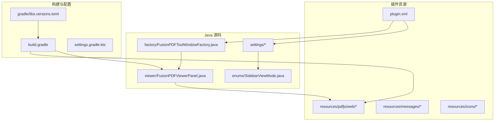
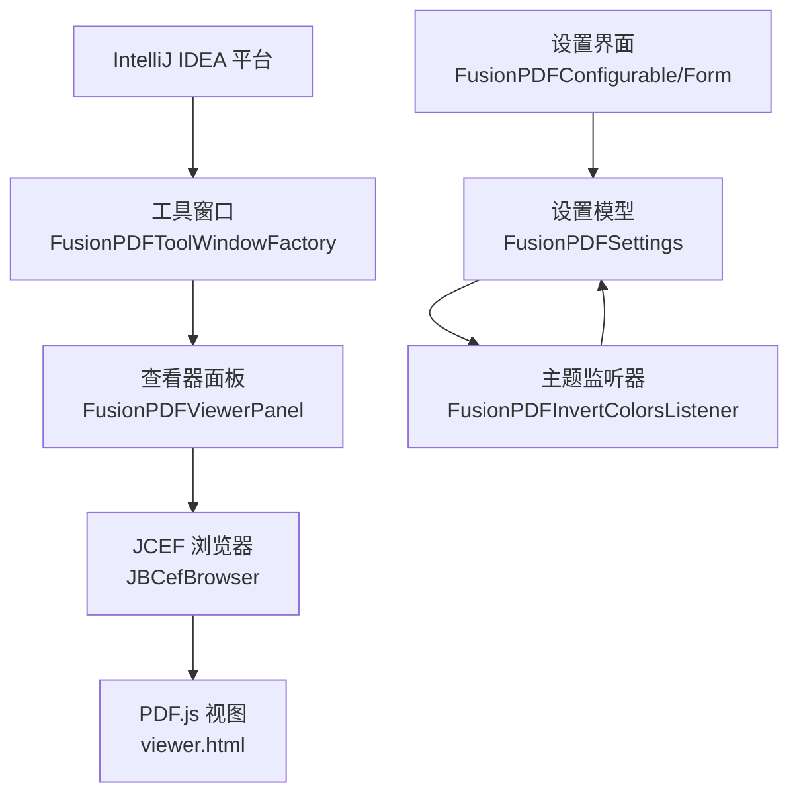
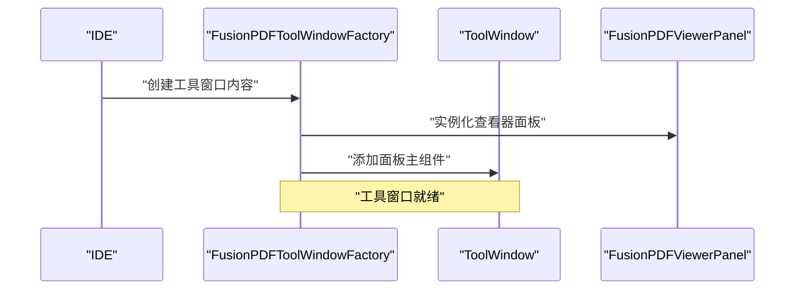
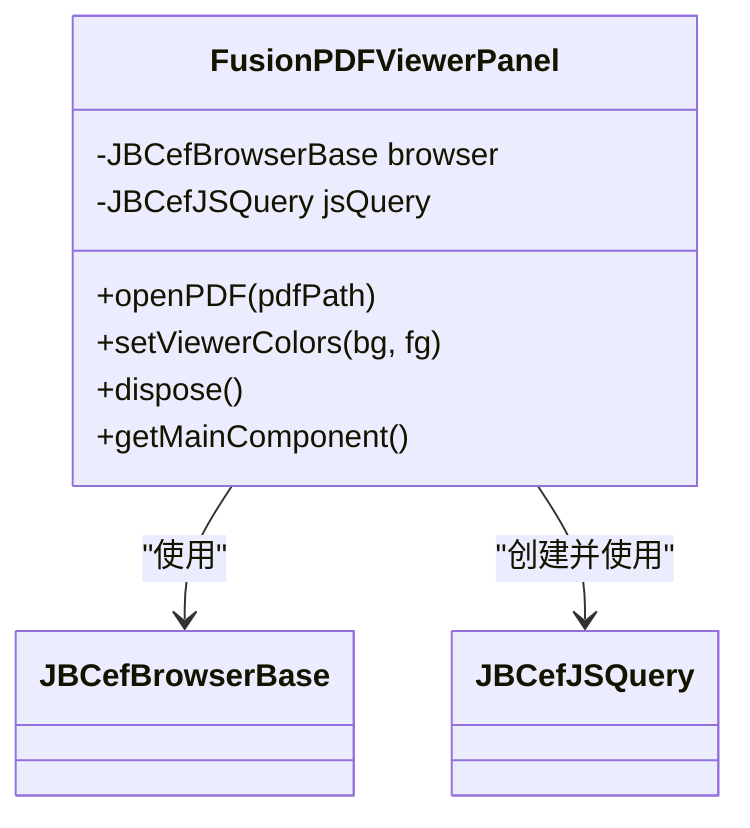
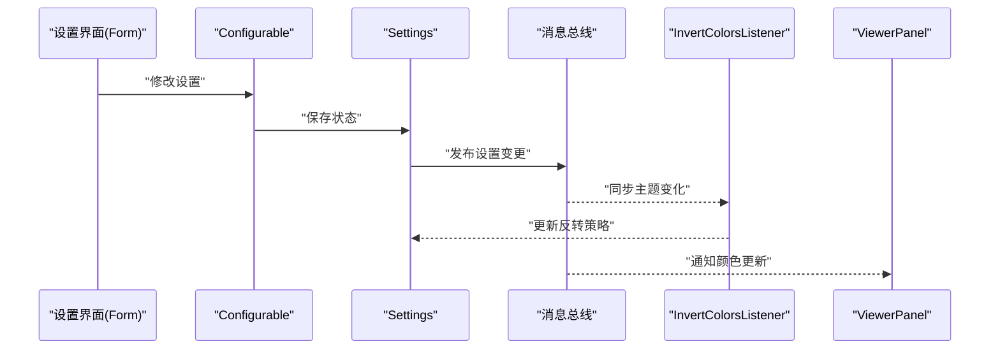
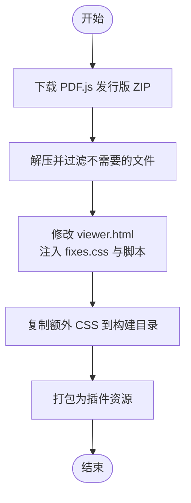
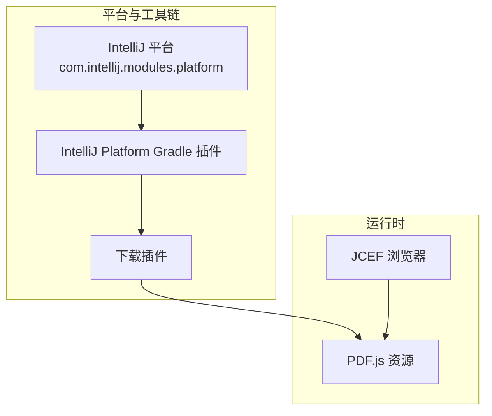

# 架构设计

<cite>
**本文引用的文件**
- [plugin.xml](file://src/main/resources/META-INF/plugin.xml)
- [FusionPDFToolWindowFactory.java](file://src/main/java/com/github/wkkya/fusionpdf/factory/FusionPDFToolWindowFactory.java)
- [FusionPDFViewerPanel.java](file://src/main/java/com/github/wkkya/fusionpdf/viewer/FusionPDFViewerPanel.java)
- [FusionPDFSettings.java](file://src/main/java/com/github/wkkya/fusionpdf/settings/FusionPDFSettings.java)
- [FusionPDFConfigurable.java](file://src/main/java/com/github/wkkya/fusionpdf/settings/FusionPDFConfigurable.java)
- [FusionPDFSettingsForm.java](file://src/main/java/com/github/wkkya/fusionpdf/settings/FusionPDFSettingsForm.java)
- [FusionPDFInvertColorsListener.java](file://src/main/java/com/github/wkkya/fusionpdf/settings/FusionPDFInvertColorsListener.java)
- [FusionPDFSettingsListener.java](file://src/main/java/com/github/wkkya/fusionpdf/settings/FusionPDFSettingsListener.java)
- [SidebarViewMode.java](file://src/main/java/com/github/wkkya/fusionpdf/enums/SidebarViewMode.java)
- [build.gradle](file://build.gradle)
- [libs.versions.toml](file://gradle/libs.versions.toml)
- [viewer.html](file://src/main/resources/pdfjs/web/viewer.html)
- [fixes.css](file://src/main/resources/pdfjs/web/fixes.css)
- [README.md](file://README.md)
</cite>

## 目录
1. [引言](#引言)
2. [项目结构](#项目结构)
3. [核心组件](#核心组件)
4. [架构总览](#架构总览)
5. [详细组件分析](#详细组件分析)
6. [依赖分析](#依赖分析)
7. [性能考量](#性能考量)
8. [故障排查指南](#故障排查指南)
9. [结论](#结论)
10. [附录](#附录)

## 引言
本架构设计文档面向 FusionPDF 插件，系统性阐述其在 IntelliJ IDEA 平台上的整体架构与模块化设计。重点覆盖以下方面：
- 基于 IntelliJ IDEA 插件框架的扩展点与生命周期管理
- ToolWindowFactory、ViewerPanel 与设置系统的协作机制
- 技术选型与权衡（JCEF 技术栈与 PDF.js 集成）
- 系统边界与职责分离，以及与 IDE 主题系统的集成方式
- 性能优化、内存管理与用户体验设计
- 技术栈与第三方依赖的版本兼容性说明

## 项目结构
FusionPDF 采用标准的 IntelliJ 插件目录结构，核心源码位于 src/main/java，资源位于 src/main/resources。插件通过 plugin.xml 声明扩展点，构建脚本通过 Gradle 控制下载与打包 PDF.js 资源，并启用 JCEF 支持。

**图表来源**
- [plugin.xml:1-51](file://src/main/resources/META-INF/plugin.xml#L1-L51)
- [FusionPDFToolWindowFactory.java:1-21](file://src/main/java/com/github/wkkya/fusionpdf/factory/FusionPDFToolWindowFactory.java#L1-L21)
- [FusionPDFViewerPanel.java:1-78](file://src/main/java/com/github/wkkya/fusionpdf/viewer/FusionPDFViewerPanel.java#L1-L78)
- [build.gradle:1-115](file://build.gradle#L1-L115)
- [libs.versions.toml:1-21](file://gradle/libs.versions.toml#L1-L21)

**章节来源**
- [plugin.xml:1-51](file://src/main/resources/META-INF/plugin.xml#L1-L51)
- [build.gradle:1-115](file://build.gradle#L1-L115)
- [libs.versions.toml:1-21](file://gradle/libs.versions.toml#L1-L21)

## 核心组件
- 工具窗口工厂（ToolWindowFactory）：负责创建并注入 PDF 查看器面板至 IDE 底部工具窗口。
- 查看器面板（ViewerPanel）：基于 JCEF 的浏览器容器，加载 PDF.js viewer.html，实现 PDF 的渲染与交互。
- 设置系统（Settings）：持久化用户偏好，监听 IDE 主题变化，广播设置变更事件。
- 设置界面（Configurable/Form）：提供图形化配置表单，支持主题颜色同步与自定义颜色。
- 枚举类型（SidebarViewMode）：用于控制侧边栏视图模式的默认值。

**章节来源**
- [FusionPDFToolWindowFactory.java:1-21](file://src/main/java/com/github/wkkya/fusionpdf/factory/FusionPDFToolWindowFactory.java#L1-L21)
- [FusionPDFViewerPanel.java:1-78](file://src/main/java/com/github/wkkya/fusionpdf/viewer/FusionPDFViewerPanel.java#L1-L78)
- [FusionPDFSettings.java:1-151](file://src/main/java/com/github/wkkya/fusionpdf/settings/FusionPDFSettings.java#L1-L151)
- [FusionPDFConfigurable.java:1-76](file://src/main/java/com/github/wkkya/fusionpdf/settings/FusionPDFConfigurable.java#L1-L76)
- [FusionPDFSettingsForm.java:1-159](file://src/main/java/com/github/wkkya/fusionpdf/settings/FusionPDFSettingsForm.java#L1-L159)
- [SidebarViewMode.java:1-22](file://src/main/java/com/github/wkkya/fusionpdf/enums/SidebarViewMode.java#L1-L22)

## 架构总览
FusionPDF 的运行时架构围绕“工具窗口 + 浏览器容器 + PDF.js 视图”展开。IDE 启动后，ToolWindowFactory 在底部创建工具窗口，ViewerPanel 初始化 JBCefBrowser 并加载本地 PDF.js viewer.html；设置系统通过消息总线与监听器实现主题联动与配置更新；构建脚本负责下载并内嵌 PDF.js 资源，确保离线可用。

**图表来源**
- [plugin.xml:36-36](file://src/main/resources/META-INF/plugin.xml#L36-L36)
- [FusionPDFToolWindowFactory.java:12-18](file://src/main/java/com/github/wkkya/fusionpdf/factory/FusionPDFToolWindowFactory.java#L12-L18)
- [FusionPDFViewerPanel.java:12-52](file://src/main/java/com/github/wkkya/fusionpdf/viewer/FusionPDFViewerPanel.java#L12-L52)
- [FusionPDFSettings.java:17-46](file://src/main/java/com/github/wkkya/fusionpdf/settings/FusionPDFSettings.java#L17-L46)
- [FusionPDFInvertColorsListener.java:11-23](file://src/main/java/com/github/wkkya/fusionpdf/settings/FusionPDFInvertColorsListener.java#L11-L23)
- [viewer.html:1-175](file://src/main/resources/pdfjs/web/viewer.html#L1-L175)

## 详细组件分析

### 组件一：工具窗口工厂（ToolWindowFactory）
- 职责：在 IDE 底部注册并创建 FusionPDF 工具窗口，注入主面板。
- 关键点：通过 ToolWindowFactory 接口约定，将 ViewerPanel 的主组件加入工具窗口根组件。
- 交互：与 ViewerPanel 解耦，仅负责装配与生命周期初始化。

**图表来源**
- [FusionPDFToolWindowFactory.java:12-18](file://src/main/java/com/github/wkkya/fusionpdf/factory/FusionPDFToolWindowFactory.java#L12-L18)

**章节来源**
- [FusionPDFToolWindowFactory.java:1-21](file://src/main/java/com/github/wkkya/fusionpdf/factory/FusionPDFToolWindowFactory.java#L1-L21)
- [plugin.xml:36-36](file://src/main/resources/META-INF/plugin.xml#L36-L36)

### 组件二：查看器面板（ViewerPanel）
- 职责：承载 JCEF 浏览器，加载 PDF.js viewer.html，提供打开 PDF 与颜色设置的 JS 交互接口。
- 关键点：
  - 初始化 JBCefClient 与 JBCefBrowser，创建 JBCefJSQuery 以实现双向 JS 通信。
  - 通过本地资源路径加载 viewer.html，避免网络依赖。
  - 提供 openPDF 与 setViewerColors 方法，分别触发 PDF 加载与颜色设置。
  - dispose 释放资源，防止内存泄漏。
- 与 PDF.js 的交互：通过 executeJavaScript 调用 viewer.html 中的全局函数（如 loadPDF），实现 PDF 文件加载。

**图表来源**
- [FusionPDFViewerPanel.java:12-76](file://src/main/java/com/github/wkkya/fusionpdf/viewer/FusionPDFViewerPanel.java#L12-L76)

**章节来源**
- [FusionPDFViewerPanel.java:1-78](file://src/main/java/com/github/wkkya/fusionpdf/viewer/FusionPDFViewerPanel.java#L1-L78)
- [viewer.html:156-171](file://src/main/resources/pdfjs/web/viewer.html#L156-L171)

### 组件三：设置系统（Settings、Configurable、Form、Listener）
- 设置模型（FusionPDFSettings）：
  - 持久化存储：@State 注解声明持久化文件名与状态读写。
  - 默认值：从 EditorColorsManager 获取 IDE 默认背景/前景色。
  - 注册表开关：通过 Registry 访问调试、实验特性、JCEF OSR 等开关。
  - 通知机制：通过 ApplicationMessageBus 发布设置变更事件。
- 设置界面（FusionPDFConfigurable/Form）：
  - Configurable 提供 UI 生命周期与应用/重置逻辑。
  - Form 提供通用设置、文档颜色反转、查看器颜色等 UI 控件与行为。
- 主题监听器（FusionPDFInvertColorsListener）：
  - 监听 EditorColorsListener，根据当前主题深浅自动切换文档颜色反转策略，并通知设置变更。

**图表来源**
- [FusionPDFSettings.java:17-46](file://src/main/java/com/github/wkkya/fusionpdf/settings/FusionPDFSettings.java#L17-L46)
- [FusionPDFConfigurable.java:37-53](file://src/main/java/com/github/wkkya/fusionpdf/settings/FusionPDFConfigurable.java#L37-L53)
- [FusionPDFInvertColorsListener.java:11-23](file://src/main/java/com/github/wkkya/fusionpdf/settings/FusionPDFInvertColorsListener.java#L11-L23)
- [FusionPDFViewerPanel.java:59-65](file://src/main/java/com/github/wkkya/fusionpdf/viewer/FusionPDFViewerPanel.java#L59-L65)

**章节来源**
- [FusionPDFSettings.java:1-151](file://src/main/java/com/github/wkkya/fusionpdf/settings/FusionPDFSettings.java#L1-L151)
- [FusionPDFConfigurable.java:1-76](file://src/main/java/com/github/wkkya/fusionpdf/settings/FusionPDFConfigurable.java#L1-L76)
- [FusionPDFSettingsForm.java:1-159](file://src/main/java/com/github/wkkya/fusionpdf/settings/FusionPDFSettingsForm.java#L1-L159)
- [FusionPDFInvertColorsListener.java:1-25](file://src/main/java/com/github/wkkya/fusionpdf/settings/FusionPDFInvertColorsListener.java#L1-L25)
- [FusionPDFSettingsListener.java:1-7](file://src/main/java/com/github/wkkya/fusionpdf/settings/FusionPDFSettingsListener.java#L1-L7)

### 组件四：PDF.js 集成与资源处理
- viewer.html：PDF.js 的最小可运行视图，包含加载 PDF、分页渲染、工具栏等基础功能。
- fixes.css：隐藏部分 UI 元素，适配 IDE 工具窗口布局。
- 构建流程：Gradle 任务下载 PDF.js 发行版，解压并修改 viewer.html，注入额外脚本与样式，最终打包进插件资源。

**图表来源**
- [build.gradle:36-75](file://build.gradle#L36-L75)
- [viewer.html:1-175](file://src/main/resources/pdfjs/web/viewer.html#L1-L175)
- [fixes.css:1-22](file://src/main/resources/pdfjs/web/fixes.css#L1-L22)

**章节来源**
- [build.gradle:8-75](file://build.gradle#L8-L75)
- [viewer.html:1-175](file://src/main/resources/pdfjs/web/viewer.html#L1-L175)
- [fixes.css:1-22](file://src/main/resources/pdfjs/web/fixes.css#L1-L22)

### 组件五：系统边界与职责分离
- 工具窗口边界：由 plugin.xml 声明，工厂负责装配，面板负责渲染。
- 设置边界：Configurable/Form 负责 UI 交互，Settings 负责状态与通知，Listener 负责主题联动。
- PDF.js 边界：ViewerPanel 仅作为浏览器容器与 JS 调用桥接，不直接处理 PDF 业务逻辑。
- 资源边界：PDF.js 资源在构建期打包，运行期通过本地资源路径访问，降低外部依赖风险。

**章节来源**
- [plugin.xml:32-46](file://src/main/resources/META-INF/plugin.xml#L32-L46)
- [FusionPDFViewerPanel.java:49-57](file://src/main/java/com/github/wkkya/fusionpdf/viewer/FusionPDFViewerPanel.java#L49-L57)
- [build.gradle:36-75](file://build.gradle#L36-L75)

## 依赖分析
- 插件依赖 IntelliJ 平台模块，兼容版本范围由 plugin.xml 指定。
- 构建阶段依赖 org.jetbrains.intellij 插件与下载插件，用于拉取 PDF.js 并打包资源。
- 运行时依赖 JCEF（IDE 启动参数中显式启用），ViewerPanel 通过 JBCef API 初始化浏览器。

**图表来源**
- [plugin.xml:12-14](file://src/main/resources/META-INF/plugin.xml#L12-L14)
- [build.gradle:4-6](file://build.gradle#L4-L6)
- [build.gradle:36-75](file://build.gradle#L36-L75)
- [FusionPDFViewerPanel.java:21-24](file://src/main/java/com/github/wkkya/fusionpdf/viewer/FusionPDFViewerPanel.java#L21-L24)

**章节来源**
- [plugin.xml:12-14](file://src/main/resources/META-INF/plugin.xml#L12-L14)
- [build.gradle:4-6](file://build.gradle#L4-L6)
- [build.gradle:80-95](file://build.gradle#L80-L95)

## 性能考量
- JCEF 与 PDF.js 的资源加载
  - 通过本地资源路径加载 viewer.html 与 PDF.js，减少网络延迟与失败风险。
  - 构建期预处理 viewer.html，避免运行时字符串替换开销。
- 渲染与内存管理
  - ViewerPanel 在 dispose 中释放 JBCefJSQuery 与 JBCefBrowser，防止内存泄漏。
  - PDF.js 分页渲染采用队列机制，避免并发渲染导致的卡顿。
- UI 响应与主题联动
  - 设置变更通过消息总线异步通知，避免阻塞 UI 线程。
  - 主题监听器仅在启用“按主题反转”时生效，降低不必要的计算。
- 启动参数与 JVM 调优
  - 构建脚本设置较大的堆内存与启用 JCEF，提升大文档加载稳定性。

**章节来源**
- [FusionPDFViewerPanel.java:67-70](file://src/main/java/com/github/wkkya/fusionpdf/viewer/FusionPDFViewerPanel.java#L67-L70)
- [viewer.html:104-110](file://src/main/resources/pdfjs/web/viewer.html#L104-L110)
- [build.gradle:84-90](file://build.gradle#L84-L90)

## 故障排查指南
- 工具窗口未显示
  - 检查 plugin.xml 中 toolWindow 声明与工厂类是否正确。
  - 确认 ToolWindowFactory 的 createToolWindowContent 是否被调用。
- PDF 无法加载
  - 确认 viewer.html 已被打包且路径正确。
  - 检查 ViewerPanel.openPDF 是否调用 executeJavaScript 成功。
- 颜色不匹配或主题未响应
  - 确认 EditorColorsListener 是否注册成功。
  - 检查设置中的“按主题反转”开关与反转强度。
- JCEF 相关问题
  - 确认 IDE 启动参数已启用 ide.browser.jcef.enabled。
  - 检查运行时 JVM 参数是否包含 JCEF 所需导出与沙箱配置。

**章节来源**
- [plugin.xml:36-46](file://src/main/resources/META-INF/plugin.xml#L36-L46)
- [FusionPDFViewerPanel.java:54-57](file://src/main/java/com/github/wkkya/fusionpdf/viewer/FusionPDFViewerPanel.java#L54-L57)
- [FusionPDFInvertColorsListener.java:11-23](file://src/main/java/com/github/wkkya/fusionpdf/settings/FusionPDFInvertColorsListener.java#L11-L23)
- [build.gradle:84-90](file://build.gradle#L84-L90)

## 结论
FusionPDF 通过清晰的模块划分与平台扩展点，实现了轻量、可定制的 PDF 阅读体验。其核心优势在于：
- 基于 JCEF 与 PDF.js 的稳定渲染能力，结合本地资源打包，确保离线可用与性能可控。
- 与 IDE 主题系统深度集成，提供自动颜色反转与自定义颜色选项。
- 通过设置模型与消息总线实现配置的持久化与实时更新，兼顾易用性与一致性。

## 附录

### 技术栈与版本兼容性
- IntelliJ 平台版本范围：since-build 与 until-build 在 plugin.xml 中明确声明。
- PDF.js 版本：在构建脚本中固定版本号，确保与 viewer.html 的 API 兼容。
- Gradle 插件：使用 org.jetbrains.intellij 与下载插件进行资源拉取与打包。
- Kotlin/JVM：项目包含 Kotlin 插件声明，便于后续扩展。

**章节来源**
- [plugin.xml:12-12](file://src/main/resources/META-INF/plugin.xml#L12-L12)
- [build.gradle:8-8](file://build.gradle#L8-L8)
- [libs.versions.toml:15-21](file://gradle/libs.versions.toml#L15-L21)

### 设计决策与权衡
- 选择 JCEF + PDF.js 的理由
  - 无需依赖系统浏览器，保证跨平台一致性与可移植性。
  - PDF.js 提供成熟的渲染与交互能力，满足插件需求。
- 资源内嵌策略
  - 构建期下载并修改 viewer.html，减少运行时网络与解析成本。
- 主题集成策略
  - 通过 EditorColorsListener 自动适配深浅主题，降低用户配置成本。
- 可扩展性
  - 设置系统采用消息总线与监听器模式，便于未来扩展更多主题或渲染策略。

**章节来源**
- [README.md:10-16](file://README.md#L10-L16)
- [FusionPDFSettings.java:66-72](file://src/main/java/com/github/wkkya/fusionpdf/settings/FusionPDFSettings.java#L66-L72)
- [build.gradle:36-75](file://build.gradle#L36-L75)