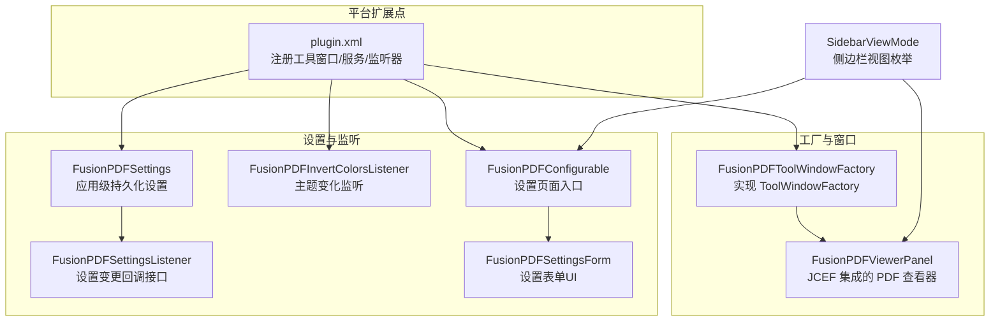
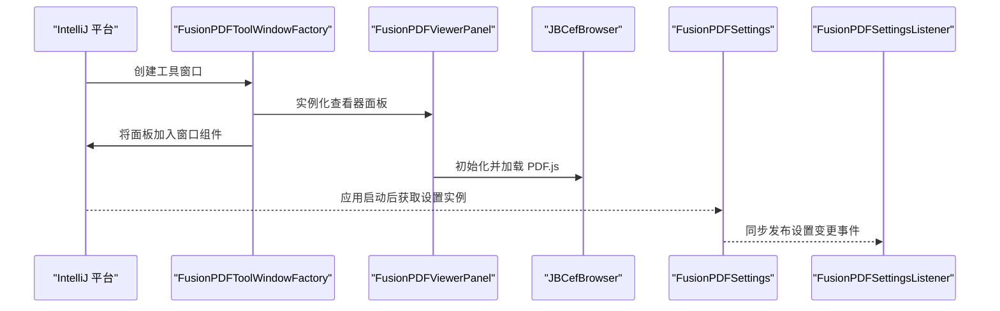
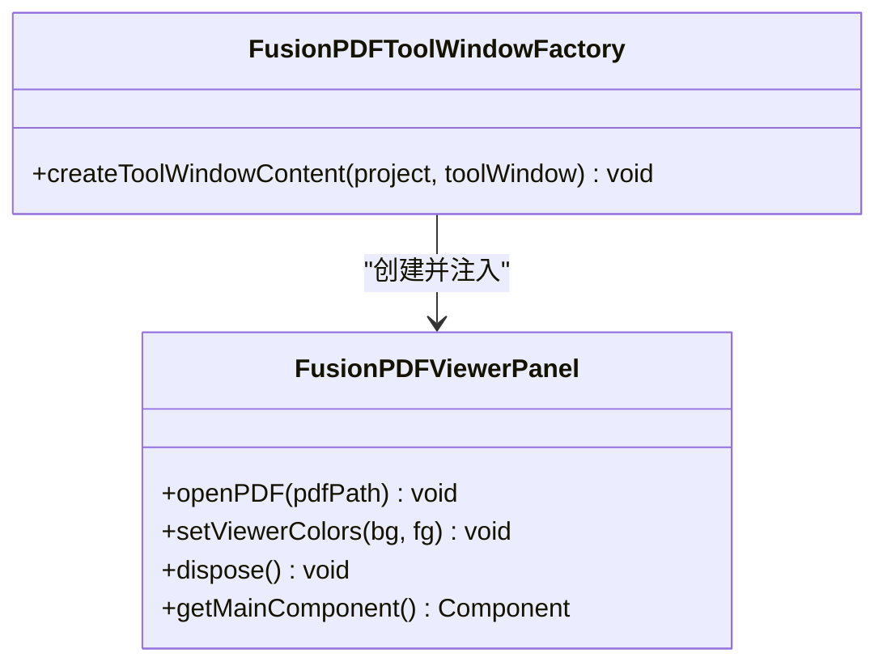
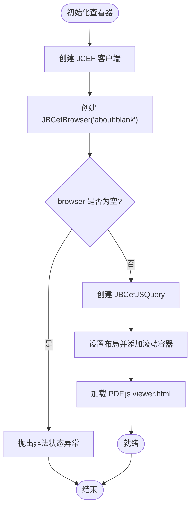
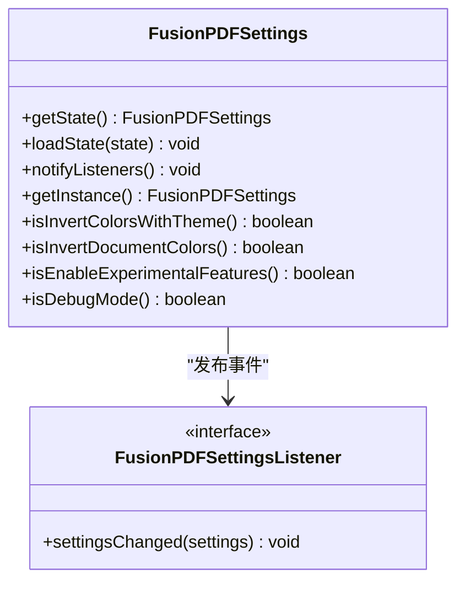
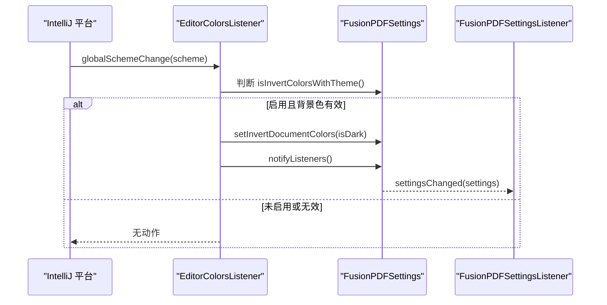
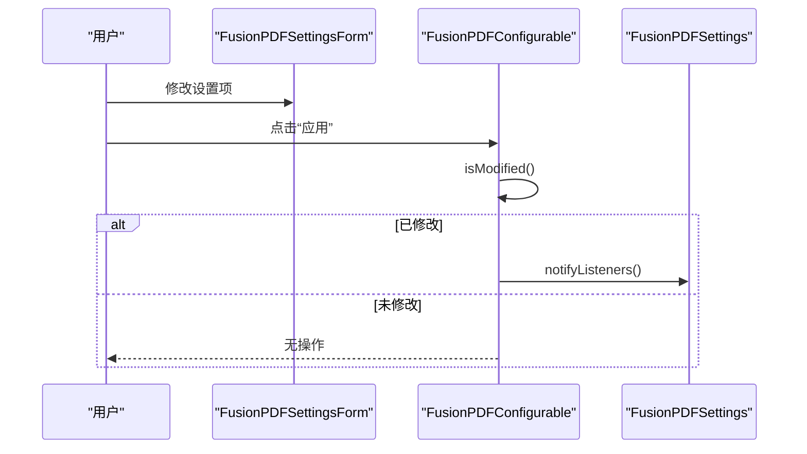
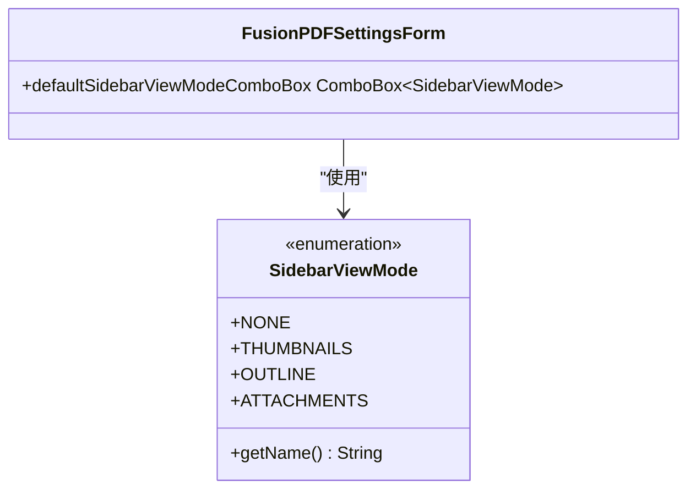
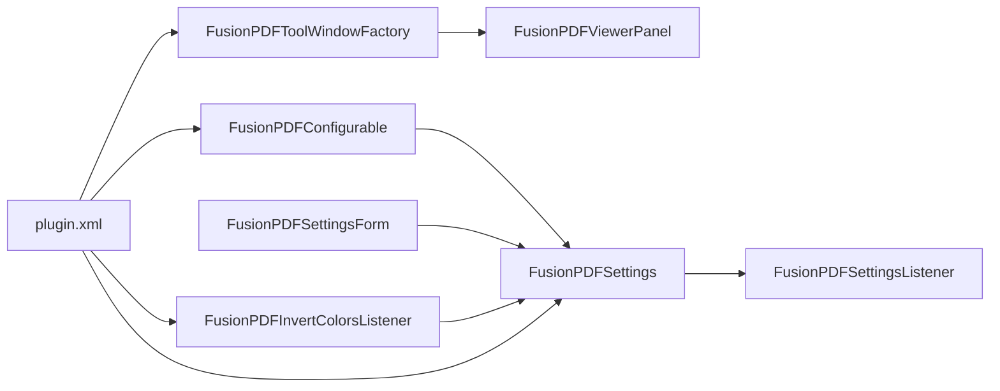

# 组件交互模式

<cite>
**本文引用的文件**
- [FusionPDFToolWindowFactory.java](file://src/main/java/com/github/wkkya/fusionpdf/factory/FusionPDFToolWindowFactory.java)
- [FusionPDFViewerPanel.java](file://src/main/java/com/github/wkkya/fusionpdf/viewer/FusionPDFViewerPanel.java)
- [FusionPDFSettings.java](file://src/main/java/com/github/wkkya/fusionpdf/settings/FusionPDFSettings.java)
- [FusionPDFSettingsListener.java](file://src/main/java/com/github/wkkya/fusionpdf/settings/FusionPDFSettingsListener.java)
- [FusionPDFInvertColorsListener.java](file://src/main/java/com/github/wkkya/fusionpdf/settings/FusionPDFInvertColorsListener.java)
- [FusionPDFConfigurable.java](file://src/main/java/com/github/wkkya/fusionpdf/settings/FusionPDFConfigurable.java)
- [FusionPDFSettingsForm.java](file://src/main/java/com/github/wkkya/fusionpdf/settings/FusionPDFSettingsForm.java)
- [SidebarViewMode.java](file://src/main/java/com/github/wkkya/fusionpdf/enums/SidebarViewMode.java)
- [plugin.xml](file://src/main/resources/META-INF/plugin.xml)
- [README.md](file://README.md)
</cite>

## 目录
1. [简介](#简介)
2. [项目结构](#项目结构)
3. [核心组件](#核心组件)
4. [架构总览](#架构总览)
5. [详细组件分析](#详细组件分析)
6. [依赖分析](#依赖分析)
7. [性能考虑](#性能考虑)
8. [故障排查指南](#故障排查指南)
9. [结论](#结论)
10. [附录](#附录)

## 简介
本文件聚焦于 FusionPDF 插件内部“组件交互模式”的架构文档，围绕以下目标展开：
- 解释插件如何通过 ToolWindowFactory 创建并管理 PDF 查看器组件
- 描述设置变更通知、主题切换事件与用户操作事件在组件间的传播路径
- 分析组件解耦的设计原则（接口抽象、事件驱动、异步处理）
- 展示典型使用场景下的调用链与数据流
- 讨论错误处理与异常传播机制
- 提供性能监控与调试支持的实现细节

## 项目结构
FusionPDF 的核心由“工具窗口工厂”、“查看器面板”、“设置系统”、“配置界面”等模块组成，并通过 IntelliJ 平台的扩展点进行装配。

**图表来源**
- [plugin.xml:26-46](file://src/main/resources/META-INF/plugin.xml#L26-L46)
- [FusionPDFToolWindowFactory.java:12-18](file://src/main/java/com/github/wkkya/fusionpdf/factory/FusionPDFToolWindowFactory.java#L12-L18)
- [FusionPDFViewerPanel.java:12-38](file://src/main/java/com/github/wkkya/fusionpdf/viewer/FusionPDFViewerPanel.java#L12-L38)
- [FusionPDFSettings.java:17-46](file://src/main/java/com/github/wkkya/fusionpdf/settings/FusionPDFSettings.java#L17-L46)
- [FusionPDFInvertColorsListener.java:11-24](file://src/main/java/com/github/wkkya/fusionpdf/settings/FusionPDFInvertColorsListener.java#L11-L24)
- [FusionPDFConfigurable.java:7-74](file://src/main/java/com/github/wkkya/fusionpdf/settings/FusionPDFConfigurable.java#L7-L74)
- [FusionPDFSettingsForm.java:18-87](file://src/main/java/com/github/wkkya/fusionpdf/settings/FusionPDFSettingsForm.java#L18-L87)
- [SidebarViewMode.java:3-21](file://src/main/java/com/github/wkkya/fusionpdf/enums/SidebarViewMode.java#L3-L21)

**章节来源**
- [plugin.xml:26-46](file://src/main/resources/META-INF/plugin.xml#L26-L46)
- [README.md:10-46](file://README.md#L10-L46)

## 核心组件
- 工具窗口工厂：负责创建“FusionPDF”工具窗口并注入查看器面板。
- 查看器面板：基于 JCEF 承载 PDF.js viewer，提供打开 PDF、设置颜色等能力。
- 设置系统：应用级持久化设置，支持主题联动与实验特性开关。
- 配置界面：提供设置表单与应用逻辑，触发设置变更广播。
- 主题监听器：响应 IDE 主题变化，按需更新文档颜色策略并广播。

**章节来源**
- [FusionPDFToolWindowFactory.java:12-18](file://src/main/java/com/github/wkkya/fusionpdf/factory/FusionPDFToolWindowFactory.java#L12-L18)
- [FusionPDFViewerPanel.java:12-76](file://src/main/java/com/github/wkkya/fusionpdf/viewer/FusionPDFViewerPanel.java#L12-L76)
- [FusionPDFSettings.java:17-147](file://src/main/java/com/github/wkkya/fusionpdf/settings/FusionPDFSettings.java#L17-L147)
- [FusionPDFConfigurable.java:7-74](file://src/main/java/com/github/wkkya/fusionpdf/settings/FusionPDFConfigurable.java#L7-L74)
- [FusionPDFInvertColorsListener.java:11-24](file://src/main/java/com/github/wkkya/fusionpdf/settings/FusionPDFInvertColorsListener.java#L11-L24)

## 架构总览
下图展示了从“工具窗口创建”到“查看器加载 PDF.js”再到“设置变更广播”的整体交互流程。

**图表来源**
- [FusionPDFToolWindowFactory.java:12-18](file://src/main/java/com/github/wkkya/fusionpdf/factory/FusionPDFToolWindowFactory.java#L12-L18)
- [FusionPDFViewerPanel.java:17-52](file://src/main/java/com/github/wkkya/fusionpdf/viewer/FusionPDFViewerPanel.java#L17-L52)
- [FusionPDFSettings.java:44-46](file://src/main/java/com/github/wkkya/fusionpdf/settings/FusionPDFSettings.java#L44-L46)
- [plugin.xml:32-36](file://src/main/resources/META-INF/plugin.xml#L32-L36)

## 详细组件分析

### 工具窗口工厂与生命周期管理
- 工厂职责：实现 ToolWindowFactory，在工具窗口创建时注入查看器面板。
- 生命周期：查看器面板作为窗口内容组件存在；dispose 时释放 JCEF 资源。
- 依赖注入：工厂直接构造查看器面板，形成“窗口 → 面板”的直接依赖。

**图表来源**
- [FusionPDFToolWindowFactory.java:12-18](file://src/main/java/com/github/wkkya/fusionpdf/factory/FusionPDFToolWindowFactory.java#L12-L18)
- [FusionPDFViewerPanel.java:12-76](file://src/main/java/com/github/wkkya/fusionpdf/viewer/FusionPDFViewerPanel.java#L12-L76)

**章节来源**
- [FusionPDFToolWindowFactory.java:12-18](file://src/main/java/com/github/wkkya/fusionpdf/factory/FusionPDFToolWindowFactory.java#L12-L18)
- [FusionPDFViewerPanel.java:67-75](file://src/main/java/com/github/wkkya/fusionpdf/viewer/FusionPDFViewerPanel.java#L67-L75)

### 查看器面板与 PDF.js 集成
- 初始化：创建 JCEF 客户端与浏览器实例，确保非空后再创建 JS 查询对象。
- 布局：使用滚动面板承载浏览器组件，设置为主内容区域。
- 加载：定位资源路径并加载 PDF.js viewer 页面。
- 交互：通过执行 JavaScript 与 PDF.js 通信，实现打开 PDF 与颜色设置。
- 资源释放：显式释放 JS 查询与浏览器资源。

**图表来源**
- [FusionPDFViewerPanel.java:17-52](file://src/main/java/com/github/wkkya/fusionpdf/viewer/FusionPDFViewerPanel.java#L17-L52)

**章节来源**
- [FusionPDFViewerPanel.java:17-76](file://src/main/java/com/github/wkkya/fusionpdf/viewer/FusionPDFViewerPanel.java#L17-L76)

### 设置系统与消息总线
- 单例访问：通过应用服务获取设置实例，保证全局一致性。
- 持久化：@State 注解声明持久化存储与文件名。
- 事件总线：使用 ApplicationManager.getMessageBus().syncPublisher 发布设置变更事件。
- 监听器接口：FusionPDFSettingsListener 定义设置变更回调。

**图表来源**
- [FusionPDFSettings.java:17-46](file://src/main/java/com/github/wkkya/fusionpdf/settings/FusionPDFSettings.java#L17-L46)
- [FusionPDFSettingsListener.java:3-6](file://src/main/java/com/github/wkkya/fusionpdf/settings/FusionPDFSettingsListener.java#L3-L6)

**章节来源**
- [FusionPDFSettings.java:17-147](file://src/main/java/com/github/wkkya/fusionpdf/settings/FusionPDFSettings.java#L17-L147)

### 主题切换与颜色联动
- 监听主题变化：EditorColorsListener 回调中判断是否启用“随主题反转文档颜色”。
- 自动决策：根据当前背景色明暗设定文档颜色反转状态。
- 变更广播：调用设置实例的 notifyListeners 触发订阅者更新。

**图表来源**
- [FusionPDFInvertColorsListener.java:11-24](file://src/main/java/com/github/wkkya/fusionpdf/settings/FusionPDFInvertColorsListener.java#L11-L24)
- [FusionPDFSettings.java:44-46](file://src/main/java/com/github/wkkya/fusionpdf/settings/FusionPDFSettings.java#L44-L46)

**章节来源**
- [FusionPDFInvertColorsListener.java:11-24](file://src/main/java/com/github/wkkya/fusionpdf/settings/FusionPDFInvertColorsListener.java#L11-L24)

### 配置界面与用户操作事件
- 表单组件：包含复选框、下拉框、颜色选择器与重置链接。
- 修改检测：isModified 返回值占位，实际逻辑可扩展。
- 应用设置：apply 中在有修改时调用设置实例的 notifyListeners。
- UI 生命周期：disposeUIResources 清理表单引用。

**图表来源**
- [FusionPDFConfigurable.java:12-53](file://src/main/java/com/github/wkkya/fusionpdf/settings/FusionPDFConfigurable.java#L12-L53)
- [FusionPDFSettingsForm.java:36-87](file://src/main/java/com/github/wkkya/fusionpdf/settings/FusionPDFSettingsForm.java#L36-L87)
- [FusionPDFSettings.java:44-46](file://src/main/java/com/github/wkkya/fusionpdf/settings/FusionPDFSettings.java#L44-L46)

**章节来源**
- [FusionPDFConfigurable.java:7-74](file://src/main/java/com/github/wkkya/fusionpdf/settings/FusionPDFConfigurable.java#L7-L74)
- [FusionPDFSettingsForm.java:18-159](file://src/main/java/com/github/wkkya/fusionpdf/settings/FusionPDFSettingsForm.java#L18-L159)

### 侧边栏视图模式
- 枚举定义：NONE、THUMBNAILS、OUTLINE、ATTACHMENTS。
- 表单渲染：ComboBox 使用自定义渲染器映射显示文本。
- 默认值：设置系统提供默认侧边栏视图模式。

**图表来源**
- [SidebarViewMode.java:3-21](file://src/main/java/com/github/wkkya/fusionpdf/enums/SidebarViewMode.java#L3-L21)
- [FusionPDFSettingsForm.java:43-54](file://src/main/java/com/github/wkkya/fusionpdf/settings/FusionPDFSettingsForm.java#L43-L54)

**章节来源**
- [SidebarViewMode.java:3-21](file://src/main/java/com/github/wkkya/fusionpdf/enums/SidebarViewMode.java#L3-L21)
- [FusionPDFSettingsForm.java:43-54](file://src/main/java/com/github/wkkya/fusionpdf/settings/FusionPDFSettingsForm.java#L43-L54)

## 依赖分析
- 组件耦合度：工厂与面板之间为直接依赖；设置系统通过单例与消息总线被广泛依赖。
- 外部依赖：JCEF 浏览器、IntelliJ 应用服务与消息总线、注册表键。
- 扩展点装配：plugin.xml 将工厂、服务、配置项与监听器统一注册。

**图表来源**
- [plugin.xml:26-46](file://src/main/resources/META-INF/plugin.xml#L26-L46)
- [FusionPDFToolWindowFactory.java:12-18](file://src/main/java/com/github/wkkya/fusionpdf/factory/FusionPDFToolWindowFactory.java#L12-L18)
- [FusionPDFViewerPanel.java:12-38](file://src/main/java/com/github/wkkya/fusionpdf/viewer/FusionPDFViewerPanel.java#L12-L38)
- [FusionPDFSettings.java:17-46](file://src/main/java/com/github/wkkya/fusionpdf/settings/FusionPDFSettings.java#L17-L46)
- [FusionPDFConfigurable.java:7-34](file://src/main/java/com/github/wkkya/fusionpdf/settings/FusionPDFConfigurable.java#L7-L34)
- [FusionPDFInvertColorsListener.java:11-24](file://src/main/java/com/github/wkkya/fusionpdf/settings/FusionPDFInvertColorsListener.java#L11-L24)

**章节来源**
- [plugin.xml:26-46](file://src/main/resources/META-INF/plugin.xml#L26-L46)

## 性能考虑
- 轻量化设计：README 明确强调“轻量”，避免对 IDE 性能造成显著负担。
- JCEF 资源管理：查看器面板在 dispose 中释放 JS 查询与浏览器实例，防止内存泄漏。
- 异步与同步：设置变更通过同步发布（syncPublisher）确保订阅者及时感知。
- 实验特性与调试开关：通过注册表键控制实验功能与调试模式，便于在开发阶段启用诊断能力。

**章节来源**
- [README.md:10-16](file://README.md#L10-L16)
- [FusionPDFViewerPanel.java:67-70](file://src/main/java/com/github/wkkya/fusionpdf/viewer/FusionPDFViewerPanel.java#L67-L70)
- [FusionPDFSettings.java:44-46](file://src/main/java/com/github/wkkya/fusionpdf/settings/FusionPDFSettings.java#L44-L46)
- [plugin.xml:27-30](file://src/main/resources/META-INF/plugin.xml#L27-L30)

## 故障排查指南
- 浏览器初始化失败：查看器构造函数中若浏览器实例为空则抛出非法状态异常，应检查 JCEF 初始化与客户端创建流程。
- PDF.js 加载失败：确认资源路径与 viewer.html 存在，确保加载 URL 正确。
- 设置变更未生效：确认已调用设置实例的 notifyListeners，且订阅者正确注册。
- 主题切换未触发：检查 EditorColorsListener 是否注册，以及 isInvertColorsWithTheme 开关状态。

**章节来源**
- [FusionPDFViewerPanel.java:25-30](file://src/main/java/com/github/wkkya/fusionpdf/viewer/FusionPDFViewerPanel.java#L25-L30)
- [FusionPDFViewerPanel.java:49-52](file://src/main/java/com/github/wkkya/fusionpdf/viewer/FusionPDFViewerPanel.java#L49-L52)
- [FusionPDFSettings.java:44-46](file://src/main/java/com/github/wkkya/fusionpdf/settings/FusionPDFSettings.java#L44-L46)
- [plugin.xml:42-46](file://src/main/resources/META-INF/plugin.xml#L42-L46)

## 结论
FusionPDF 采用“工厂 + 面板 + 设置系统 + 配置界面 + 主题监听”的组合架构，通过 ToolWindowFactory 将查看器注入工具窗口，借助应用服务与消息总线实现设置变更的事件驱动传播。组件间通过接口抽象（如设置监听器）与平台扩展点实现解耦，配合 JCEF 资源管理与注册表开关保障性能与可调试性。该设计在满足主题适配与个性化需求的同时，保持了良好的可维护性与扩展空间。

## 附录
- 兼容版本：插件声明支持特定构建号范围，确保在目标 IDE 版本上稳定运行。
- 扩展点清单：工具窗口工厂、应用服务、配置页面、监听器均在 plugin.xml 中集中注册。

**章节来源**
- [plugin.xml:11-14](file://src/main/resources/META-INF/plugin.xml#L11-L14)
- [plugin.xml:26-46](file://src/main/resources/META-INF/plugin.xml#L26-L46)