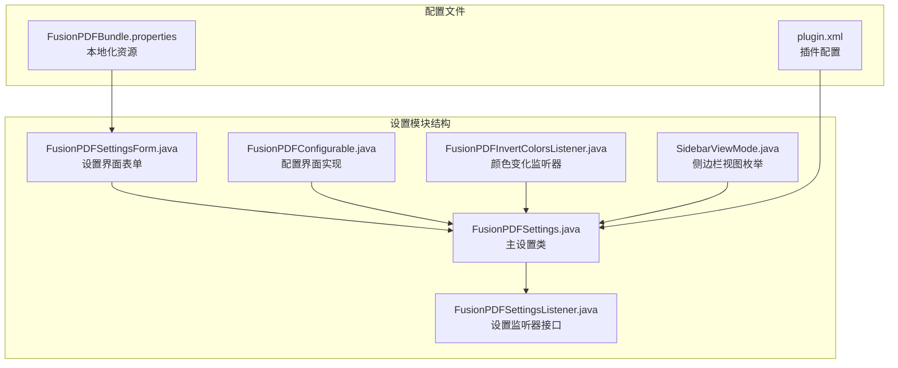
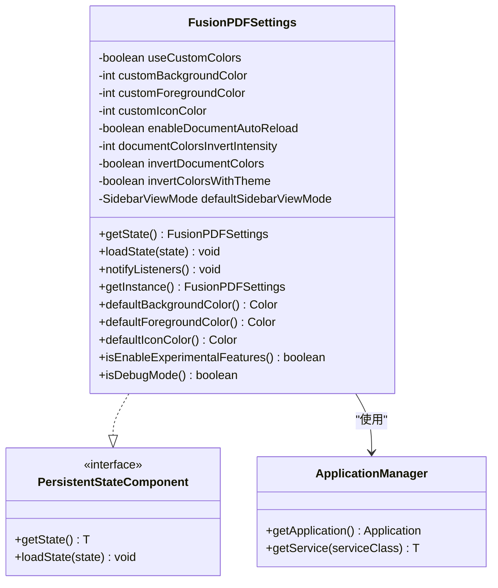
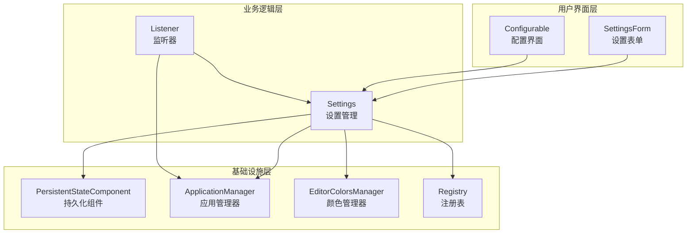
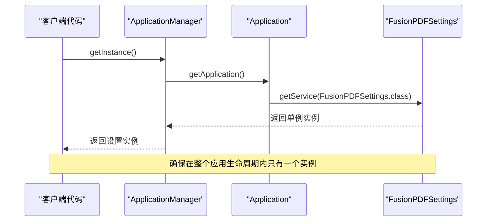
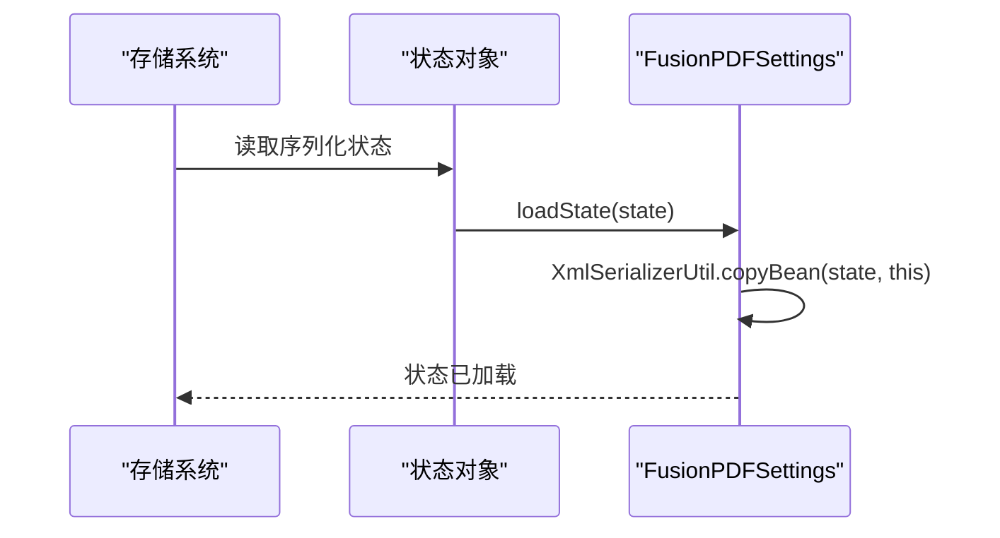
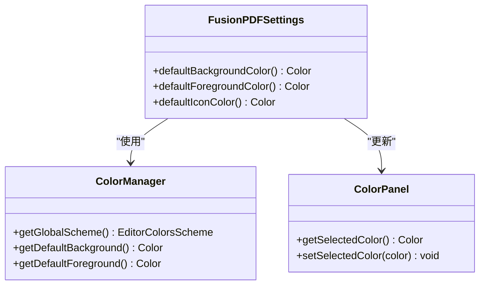
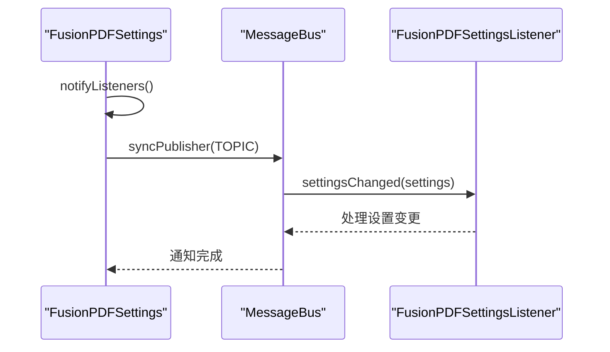
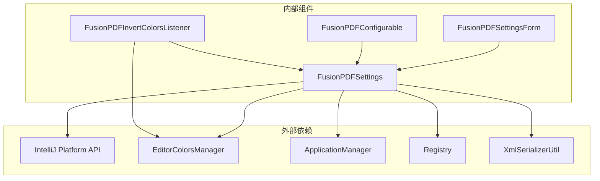
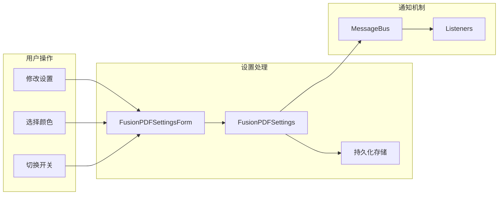

# 设置数据模型

<cite>
**本文档引用的文件**
- [FusionPDFSettings.java](file://src/main/java/com/github/wkkya/fusionpdf/settings/FusionPDFSettings.java)
- [FusionPDFSettingsForm.java](file://src/main/java/com/github/wkkya/fusionpdf/settings/FusionPDFSettingsForm.java)
- [FusionPDFConfigurable.java](file://src/main/java/com/github/wkkya/fusionpdf/settings/FusionPDFConfigurable.java)
- [FusionPDFSettingsListener.java](file://src/main/java/com/github/wkkya/fusionpdf/settings/FusionPDFSettingsListener.java)
- [FusionPDFInvertColorsListener.java](file://src/main/java/com/github/wkkya/fusionpdf/settings/FusionPDFInvertColorsListener.java)
- [SidebarViewMode.java](file://src/main/java/com/github/wkkya/fusionpdf/enums/SidebarViewMode.java)
- [plugin.xml](file://src/main/resources/META-INF/plugin.xml)
- [FusionPDFBundle.properties](file://src/main/resources/messages/FusionPDFBundle.properties)
</cite>

## 目录
1. [简介](#简介)
2. [项目结构](#项目结构)
3. [核心组件](#核心组件)
4. [架构概览](#架构概览)
5. [详细组件分析](#详细组件分析)
6. [依赖关系分析](#依赖关系分析)
7. [性能考虑](#性能考虑)
8. [故障排除指南](#故障排除指南)
9. [结论](#结论)

## 简介

FusionPDF 设置数据模型是 IntelliJ IDEA 插件中的核心配置系统，负责管理 PDF 查看器的各种用户偏好设置。该系统采用单例模式实现，通过持久化状态组件确保设置在 IDE 重启后仍然有效。本文档将深入分析 FusionPDFSettings 类的实现细节，包括单例模式、颜色管理、文档处理设置和视图模式配置。

## 项目结构

FusionPDF 的设置相关文件组织结构如下：



**图表来源**
- [FusionPDFSettings.java:1-151](file://src/main/java/com/github/wkkya/fusionpdf/settings/FusionPDFSettings.java#L1-L151)
- [FusionPDFSettingsForm.java:1-159](file://src/main/java/com/github/wkkya/fusionpdf/settings/FusionPDFSettingsForm.java#L1-L159)
- [plugin.xml:1-51](file://src/main/resources/META-INF/plugin.xml#L1-L51)

**章节来源**
- [FusionPDFSettings.java:1-151](file://src/main/java/com/github/wkkya/fusionpdf/settings/FusionPDFSettings.java#L1-L151)
- [plugin.xml:26-35](file://src/main/resources/META-INF/plugin.xml#L26-L35)

## 核心组件

### FusionPDFSettings 类

FusionPDFSettings 是整个设置系统的中心类，实现了 PersistentStateComponent 接口，提供以下核心功能：

#### 单例模式实现



**图表来源**
- [FusionPDFSettings.java:17-50](file://src/main/java/com/github/wkkya/fusionpdf/settings/FusionPDFSettings.java#L17-L50)

#### 关键属性详解

| 属性名 | 数据类型 | 默认值 | 取值范围 | 描述 |
|--------|----------|--------|----------|------|
| useCustomColors | boolean | false | true/false | 是否启用自定义颜色 |
| customBackgroundColor | int | IDE主题背景色RGB值 | 0-16777215 | 自定义背景颜色（RGB整数） |
| customForegroundColor | int | IDE主题前景色RGB值 | 0-16777215 | 自定义前景颜色（RGB整数） |
| customIconColor | int | IDE主题前景色RGB值 | 0-16777215 | 自定义图标颜色（RGB整数） |
| enableDocumentAutoReload | boolean | true | true/false | 文档更改时自动重新加载 |
| documentColorsInvertIntensity | int | 85 | 1-100 | 文档颜色反转强度 |
| invertDocumentColors | boolean | false | true/false | 是否反转文档颜色 |
| invertColorsWithTheme | boolean | false | true/false | 基于主题自动反转颜色 |
| defaultSidebarViewMode | SidebarViewMode | ATTACHMENTS | NONE/THUMBNAILS/OUTLINE/ATTACHMENTS | 默认侧边栏视图模式 |

**章节来源**
- [FusionPDFSettings.java:23-31](file://src/main/java/com/github/wkkya/fusionpdf/settings/FusionPDFSettings.java#L23-L31)
- [FusionPDFSettings.java:64](file://src/main/java/com/github/wkkya/fusionpdf/settings/FusionPDFSettings.java#L64)

## 架构概览

FusionPDF 设置系统的整体架构采用分层设计，确保了良好的可维护性和扩展性：



**图表来源**
- [FusionPDFSettings.java:17-46](file://src/main/java/com/github/wkkya/fusionpdf/settings/FusionPDFSettings.java#L17-L46)
- [plugin.xml:26-35](file://src/main/resources/META-INF/plugin.xml#L26-L35)

## 详细组件分析

### 单例模式实现机制

FusionPDFSettings 使用 IntelliJ 平台的应用服务机制实现单例模式：

#### getInstance() 方法流程



**图表来源**
- [FusionPDFSettings.java:48-50](file://src/main/java/com/github/wkkya/fusionpdf/settings/FusionPDFSettings.java#L48-L50)

#### ApplicationManager 的使用

ApplicationManager 提供了访问应用程序上下文和获取服务实例的能力。通过 `getApplication().getService(FusionPDFSettings.class)` 确保了设置实例的全局唯一性。

**章节来源**
- [FusionPDFSettings.java:48-50](file://src/main/java/com/github/wkkya/fusionpdf/settings/FusionPDFSettings.java#L48-L50)

### PersistentStateComponent 接口实现

#### getState() 方法

getState() 方法返回当前设置对象的完整状态，用于序列化存储：

```mermaid
flowchart TD
A[调用 getState()] --> B[返回 this]
B --> C[序列化到 fusion_pdf.xml]
C --> D[保存到用户配置目录]
style A fill:#e1f5fe
style D fill:#c8e6c9
```

**图表来源**
- [FusionPDFSettings.java:33-37](file://src/main/java/com/github/wkkya/fusionpdf/settings/FusionPDFSettings.java#L33-L37)

#### loadState() 方法

loadState() 方法使用 XmlSerializerUtil.copyBean() 进行深度复制，确保设置状态的正确恢复：



**图表来源**
- [FusionPDFSettings.java:39-42](file://src/main/java/com/github/wkkya/fusionpdf/settings/FusionPDFSettings.java#L39-L42)

**章节来源**
- [FusionPDFSettings.java:33-42](file://src/main/java/com/github/wkkya/fusionpdf/settings/FusionPDFSettings.java#L33-L42)

### 颜色管理系统

#### 默认颜色值获取机制

FusionPDFSettings 提供了从 EditorColorsManager 获取 IDE 主题颜色的方法：



**图表来源**
- [FusionPDFSettings.java:52-62](file://src/main/java/com/github/wkkya/fusionpdf/settings/FusionPDFSettings.java#L52-L62)

#### 颜色值的数据类型和转换

所有颜色值都以 RGB 整数形式存储，通过 Color 类进行转换：

- 存储格式：int（RGB值）
- 获取方式：new Color(rgbValue)
- 设置方式：color.getRGB()

**章节来源**
- [FusionPDFSettings.java:24-26](file://src/main/java/com/github/wkkya/fusionpdf/settings/FusionPDFSettings.java#L24-L26)
- [FusionPDFSettingsForm.java:67-77](file://src/main/java/com/github/wkkya/fusionpdf/settings/FusionPDFSettingsForm.java#L67-L77)

### 实验性功能和调试模式

#### 注册表配置方式

FusionPDF 通过 plugin.xml 中的 registryKey 元素注册实验性功能和调试选项：

| 键名 | 默认值 | 描述 |
|------|--------|------|
| fusion.pdf.enableExperimentalFeatures | false | 启用 PDF 查看器实验性功能 |
| fusion.pdf.debug | false | 启用 PDF 查看器调试模式 |
| fusion.pdf.jcefLatchTimeout | 10000 | 设置 WebView 加载的最大等待时间 |
| fusion.pdf.use.jcef.osr.view | true | 启用 JCEF 屏幕外渲染 |

#### 访问方法

```mermaid
flowchart TD
A[isEnableExperimentalFeatures] --> B[Registry.is("fusion.pdf.enableExperimentalFeatures")]
C[isDebugMode] --> D[Registry.is("fusion.pdf.debug", false)]
style A fill:#e3f2fd
style C fill:#e3f2fd
```

**图表来源**
- [FusionPDFSettings.java:66-72](file://src/main/java/com/github/wkkya/fusionpdf/settings/FusionPDFSettings.java#L66-L72)
- [plugin.xml:27-30](file://src/main/resources/META-INF/plugin.xml#L27-L30)

**章节来源**
- [plugin.xml:27-30](file://src/main/resources/META-INF/plugin.xml#L27-L30)
- [FusionPDFSettings.java:66-72](file://src/main/java/com/github/wkkya/fusionpdf/settings/FusionPDFSettings.java#L66-L72)

### 视图模式设置

#### SidebarViewMode 枚举

SidebarViewMode 定义了 PDF 查看器的侧边栏显示模式：

| 枚举值 | 描述 | 对应翻译 |
|--------|------|----------|
| NONE | 关闭 | 无 |
| THUMBNAILS | 缩略图 | 缩略图 |
| OUTLINE | 大纲 | 大纲 |
| ATTACHMENTS | 附件 | 附件 |

**章节来源**
- [SidebarViewMode.java:3-21](file://src/main/java/com/github/wkkya/fusionpdf/enums/SidebarViewMode.java#L3-L21)

### 设置监听器系统

#### FusionPDFSettingsListener 接口

设置监听器采用函数式接口设计，提供设置变更通知机制：



**图表来源**
- [FusionPDFSettings.java:20-46](file://src/main/java/com/github/wkkya/fusionpdf/settings/FusionPDFSettings.java#L20-L46)

**章节来源**
- [FusionPDFSettingsListener.java:3-6](file://src/main/java/com/github/wkkya/fusionpdf/settings/FusionPDFSettingsListener.java#L3-L6)

## 依赖关系分析

### 组件间依赖关系



**图表来源**
- [FusionPDFSettings.java:3-15](file://src/main/java/com/github/wkkya/fusionpdf/settings/FusionPDFSettings.java#L3-L15)
- [FusionPDFInvertColorsListener.java:3-6](file://src/main/java/com/github/wkkya/fusionpdf/settings/FusionPDFInvertColorsListener.java#L3-L6)

### 数据流分析



**图表来源**
- [FusionPDFSettingsForm.java:36-87](file://src/main/java/com/github/wkkya/fusionpdf/settings/FusionPDFSettingsForm.java#L36-L87)
- [FusionPDFSettings.java:44-46](file://src/main/java/com/github/wkkya/fusionpdf/settings/FusionPDFSettings.java#L44-L46)

**章节来源**
- [FusionPDFSettingsForm.java:36-87](file://src/main/java/com/github/wkkya/fusionpdf/settings/FusionPDFSettingsForm.java#L36-L87)
- [FusionPDFSettings.java:44-46](file://src/main/java/com/github/wkkya/fusionpdf/settings/FusionPDFSettings.java#L44-L46)

## 性能考虑

### 序列化性能优化

1. **增量更新**：只在设置发生实际变化时触发通知
2. **批量处理**：通过 MessageBus 批量发布设置变更
3. **内存管理**：使用基本数据类型存储颜色值，减少内存占用

### 颜色管理优化

1. **延迟计算**：默认颜色值在首次需要时才从 EditorColorsManager 获取
2. **缓存机制**：颜色值以整数形式直接存储，避免重复的颜色对象创建
3. **主题监听**：通过 EditorColorsListener 实现主题变化的响应式更新

## 故障排除指南

### 常见问题及解决方案

#### 设置无法持久化

**症状**：重启 IDE 后设置丢失
**原因**：PersistentStateComponent 配置错误或文件权限问题
**解决**：检查 fusion_pdf.xml 文件是否正确写入用户配置目录

#### 颜色设置不生效

**症状**：自定义颜色未按预期显示
**原因**：颜色值格式错误或主题覆盖
**解决**：确认颜色值为有效的 RGB 整数，检查主题颜色优先级

#### 监听器不工作

**症状**：设置变更后界面不更新
**原因**：MessageBus 配置错误或监听器注册失败
**解决**：验证 TOPIC 定义和监听器注册过程

**章节来源**
- [FusionPDFSettings.java:33-42](file://src/main/java/com/github/wkkya/fusionpdf/settings/FusionPDFSettings.java#L33-L42)
- [FusionPDFSettings.java:44-46](file://src/main/java/com/github/wkkya/fusionpdf/settings/FusionPDFSettings.java#L44-L46)

## 结论

FusionPDF 设置数据模型展现了优秀的软件架构设计，通过以下关键特性实现了高度的可维护性和用户体验：

1. **单例模式保证**：通过 ApplicationManager 确保设置实例的全局唯一性
2. **持久化机制**：基于 PersistentStateComponent 的可靠状态管理
3. **主题集成**：深度集成 IntelliJ 平台的颜色管理和主题系统
4. **监听器架构**：响应式的设置变更通知机制
5. **扩展性设计**：清晰的接口分离和模块化组织

该设置系统为 FusionPDF 插件提供了稳定、可靠的配置管理基础，支持用户根据个人偏好定制 PDF 查看体验，同时保持与 IDE 主题的无缝集成。