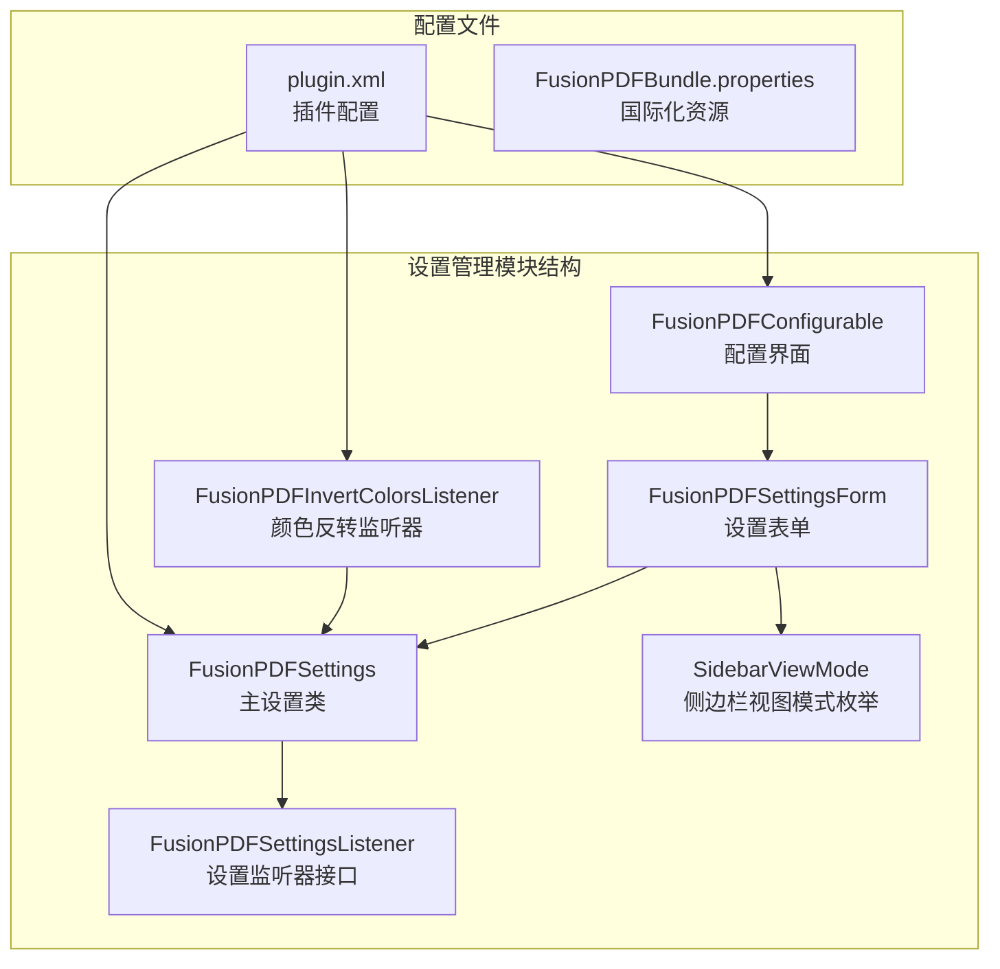
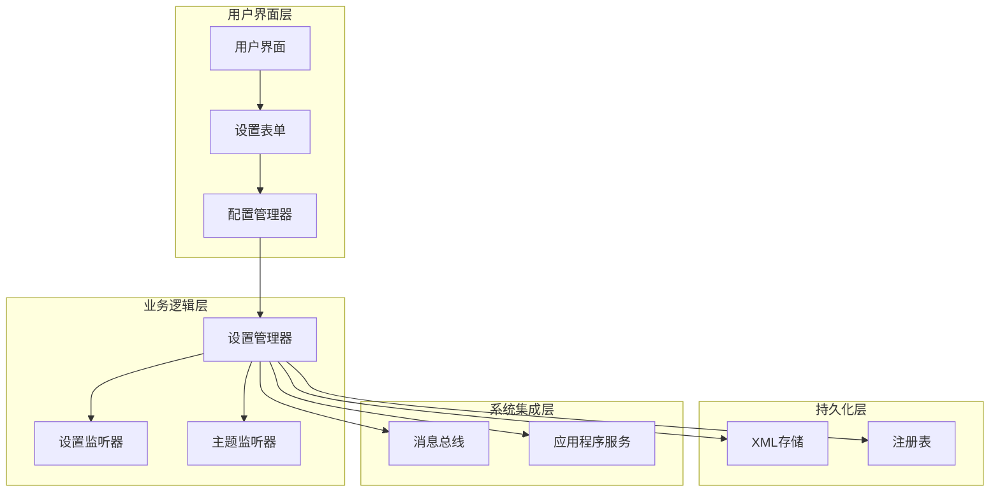
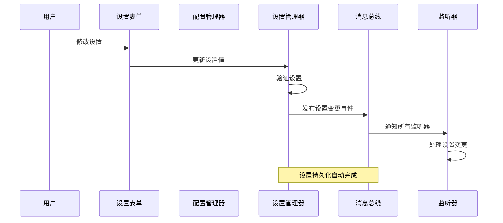
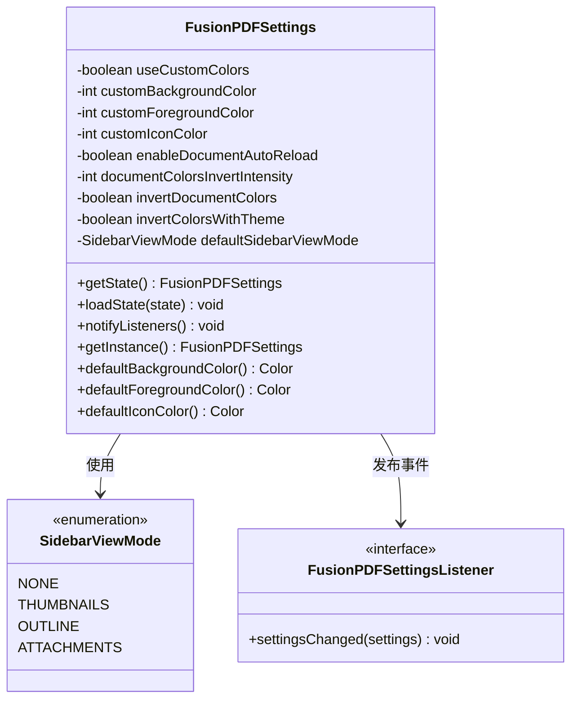
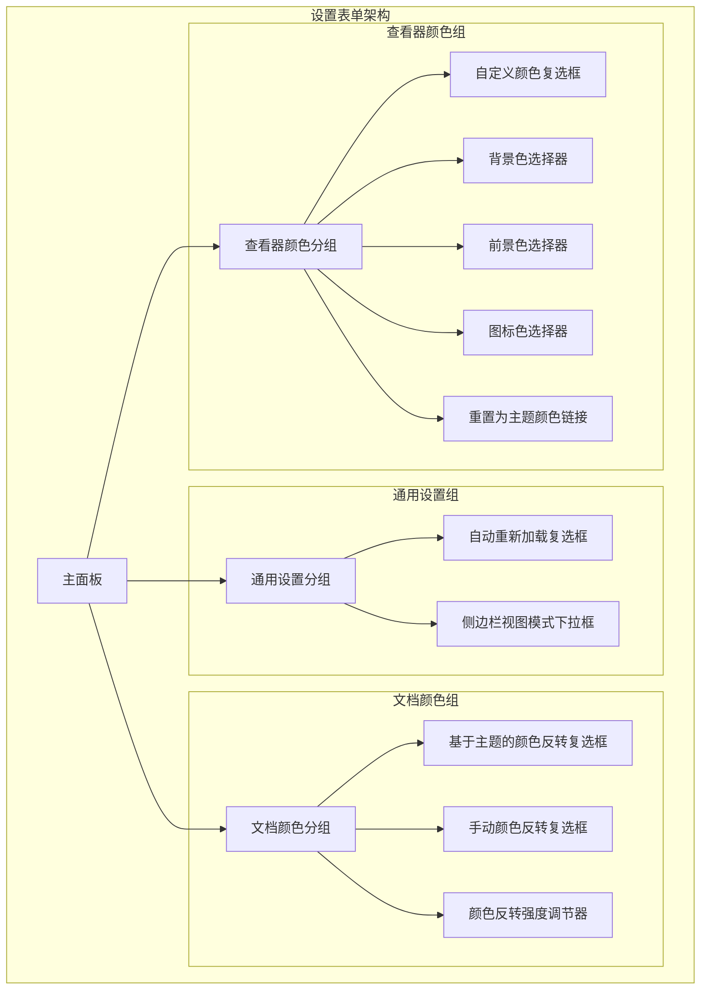
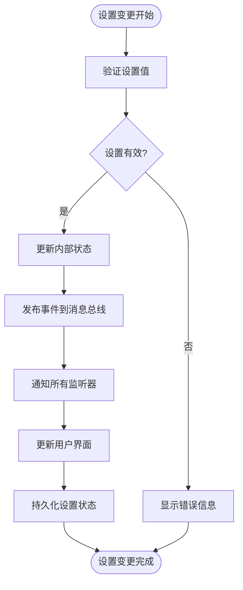
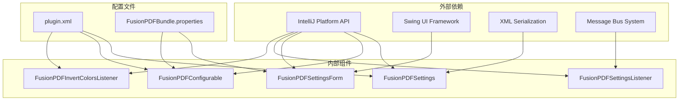

# 设置管理架构

<cite>
**本文档引用的文件**
- [FusionPDFSettings.java](file://src/main/java/com/github/wkkya/fusionpdf/settings/FusionPDFSettings.java)
- [FusionPDFConfigurable.java](file://src/main/java/com/github/wkkya/fusionpdf/settings/FusionPDFConfigurable.java)
- [FusionPDFSettingsForm.java](file://src/main/java/com/github/wkkya/fusionpdf/settings/FusionPDFSettingsForm.java)
- [FusionPDFSettingsListener.java](file://src/main/java/com/github/wkkya/fusionpdf/settings/FusionPDFSettingsListener.java)
- [FusionPDFInvertColorsListener.java](file://src/main/java/com/github/wkkya/fusionpdf/settings/FusionPDFInvertColorsListener.java)
- [SidebarViewMode.java](file://src/main/java/com/github/wkkya/fusionpdf/enums/SidebarViewMode.java)
- [plugin.xml](file://src/main/resources/META-INF/plugin.xml)
- [FusionPDFBundle.properties](file://src/main/resources/messages/FusionPDFBundle.properties)
</cite>

## 目录
1. [引言](#引言)
2. [项目结构](#项目结构)
3. [核心组件](#核心组件)
4. [架构概览](#架构概览)
5. [详细组件分析](#详细组件分析)
6. [依赖关系分析](#依赖关系分析)
7. [性能考虑](#性能考虑)
8. [故障排除指南](#故障排除指南)
9. [结论](#结论)
10. [附录](#附录)

## 引言

FusionPDF 设置管理模块是 IntelliJ IDEA 插件中的关键组件，负责管理 PDF 查看器的各种配置选项。该模块采用单例模式设计，实现了完整的设置持久化机制，并提供了直观的用户界面来管理各种显示和行为设置。

## 项目结构

设置管理模块位于 `src/main/java/com/github/wkkya/fusionpdf/settings/` 目录下，包含以下核心文件：

**图表来源**
- [FusionPDFSettings.java:1-151](file://src/main/java/com/github/wkkya/fusionpdf/settings/FusionPDFSettings.java#L1-L151)
- [FusionPDFConfigurable.java:1-76](file://src/main/java/com/github/wkkya/fusionpdf/settings/FusionPDFConfigurable.java#L1-L76)
- [FusionPDFSettingsForm.java:1-159](file://src/main/java/com/github/wkkya/fusionpdf/settings/FusionPDFSettingsForm.java#L1-L159)
- [plugin.xml:1-51](file://src/main/resources/META-INF/plugin.xml#L1-L51)

**章节来源**
- [plugin.xml:26-46](file://src/main/resources/META-INF/plugin.xml#L26-L46)

## 核心组件

### FusionPDFSettings - 单例设置管理器

FusionPDFSettings 是整个设置系统的核心，采用了单例模式和持久化组件设计：

- **单例模式实现**：通过 `ApplicationManager.getApplication().getService()` 获取全局实例
- **持久化机制**：使用 `@State` 注解将设置保存到 `fusion_pdf.xml` 文件中
- **主题集成**：自动与 IntelliJ IDEA 的编辑器颜色方案集成
- **实验功能控制**：通过注册表键值控制实验性功能的启用

### FusionPDFConfigurable - 配置界面管理器

实现了 IntelliJ IDEA 的 `Configurable` 接口，负责设置界面的创建和管理：

- **界面生命周期管理**：创建、重置和销毁设置表单
- **修改状态检测**：判断设置是否被修改
- **应用设置**：将用户输入应用到设置对象
- **通知机制**：在设置变更时通知监听器

### FusionPDFSettingsForm - 设置表单界面

基于 Swing 的用户界面组件，提供直观的设置管理体验：

- **分组布局**：将设置分为通用设置、文档颜色和查看器颜色三个组
- **多种控件**：支持复选框、下拉框、颜色选择器和数值调节器
- **实时预览**：颜色更改即时反映到设置对象
- **主题同步**：支持将颜色重置为当前主题颜色

**章节来源**
- [FusionPDFSettings.java:17-50](file://src/main/java/com/github/wkkya/fusionpdf/settings/FusionPDFSettings.java#L17-L50)
- [FusionPDFConfigurable.java:7-75](file://src/main/java/com/github/wkkya/fusionpdf/settings/FusionPDFConfigurable.java#L7-L75)
- [FusionPDFSettingsForm.java:18-159](file://src/main/java/com/github/wkkya/fusionpdf/settings/FusionPDFSettingsForm.java#L18-L159)

## 架构概览

设置管理系统采用分层架构设计，确保了良好的关注点分离和可维护性：

**图表来源**
- [FusionPDFSettings.java:17-46](file://src/main/java/com/github/wkkya/fusionpdf/settings/FusionPDFSettings.java#L17-L46)
- [plugin.xml:32-46](file://src/main/resources/META-INF/plugin.xml#L32-L46)

### 数据流架构

设置数据在系统中的流动过程如下：

**图表来源**
- [FusionPDFSettings.java:44-46](file://src/main/java/com/github/wkkya/fusionpdf/settings/FusionPDFSettings.java#L44-L46)
- [FusionPDFConfigurable.java:37-53](file://src/main/java/com/github/wkkya/fusionpdf/settings/FusionPDFConfigurable.java#L37-L53)

## 详细组件分析

### 设置数据模型

设置系统定义了丰富的配置选项，涵盖 PDF 查看器的各个方面：

**图表来源**
- [FusionPDFSettings.java:18-147](file://src/main/java/com/github/wkkya/fusionpdf/settings/FusionPDFSettings.java#L18-L147)
- [SidebarViewMode.java:3-21](file://src/main/java/com/github/wkkya/fusionpdf/enums/SidebarViewMode.java#L3-L21)

### 设置表单架构

设置表单采用模块化设计，将不同类型的设置组织在逻辑分组中：

**图表来源**
- [FusionPDFSettingsForm.java:36-119](file://src/main/java/com/github/wkkya/fusionpdf/settings/FusionPDFSettingsForm.java#L36-L119)

### 设置变更通知机制

设置系统实现了完整的事件驱动架构，确保各组件能够及时响应设置变更：

**图表来源**
- [FusionPDFSettings.java:44-46](file://src/main/java/com/github/wkkya/fusionpdf/settings/FusionPDFSettings.java#L44-L46)
- [FusionPDFConfigurable.java:50-52](file://src/main/java/com/github/wkkya/fusionpdf/settings/FusionPDFConfigurable.java#L50-L52)

**章节来源**
- [FusionPDFSettings.java:20-46](file://src/main/java/com/github/wkkya/fusionpdf/settings/FusionPDFSettings.java#L20-L46)
- [FusionPDFSettingsListener.java:4-6](file://src/main/java/com/github/wkkya/fusionpdf/settings/FusionPDFSettingsListener.java#L4-L6)

## 依赖关系分析

设置系统与其他系统组件的依赖关系如下：

**图表来源**
- [plugin.xml:32-46](file://src/main/resources/META-INF/plugin.xml#L32-L46)
- [FusionPDFSettings.java:4-13](file://src/main/java/com/github/wkkya/fusionpdf/settings/FusionPDFSettings.java#L4-L13)

### 组件耦合度分析

- **低耦合设计**：各组件职责明确，相互之间通过接口通信
- **高内聚性**：每个组件专注于特定的功能领域
- **松散耦合**：通过消息总线实现组件间的解耦

**章节来源**
- [plugin.xml:26-46](file://src/main/resources/META-INF/plugin.xml#L26-L46)

## 性能考虑

设置系统在设计时充分考虑了性能优化：

### 内存管理
- **单例模式**：避免重复创建设置实例，减少内存占用
- **延迟初始化**：设置表单仅在需要时创建
- **资源清理**：正确释放 UI 资源，防止内存泄漏

### 响应性优化
- **异步通知**：设置变更通知采用异步机制
- **批量更新**：支持批量设置变更操作
- **UI 更新优化**：避免不必要的界面重绘

### 持久化性能
- **增量保存**：只保存变更的设置项
- **后台序列化**：设置保存在后台线程执行
- **缓存机制**：常用设置值进行内存缓存

## 故障排除指南

### 常见问题及解决方案

#### 设置无法保存
**症状**：修改设置后重启后恢复默认值
**原因**：XML 序列化失败或文件权限问题
**解决**：检查 `fusion_pdf.xml` 文件权限，确认磁盘空间充足

#### 设置界面不响应
**症状**：修改设置后界面无变化
**原因**：监听器未正确注册或事件未发布
**解决**：检查 `plugin.xml` 中的监听器配置，验证 `notifyListeners()` 方法调用

#### 主题颜色不同步
**症状**：切换 IDE 主题后设置未更新
**原因**：主题监听器未正确实现
**解决**：检查 `FusionPDFInvertColorsListener` 实现，确认 `EditorColorsListener` 接口正确继承

#### 设置重置失效
**症状**：点击重置按钮后设置未恢复默认值
**原因**：`reset()` 方法实现问题
**解决**：验证 `FusionPDFSettingsForm.reset()` 方法，确保所有控件都重置到正确状态

**章节来源**
- [FusionPDFSettingsForm.java:147-157](file://src/main/java/com/github/wkkya/fusionpdf/settings/FusionPDFSettingsForm.java#L147-L157)
- [FusionPDFInvertColorsListener.java:11-24](file://src/main/java/com/github/wkkya/fusionpdf/settings/FusionPDFInvertColorsListener.java#L11-L24)

## 结论

FusionPDF 设置管理模块展现了优秀的软件架构设计，通过以下关键特性实现了高质量的设置管理：

### 设计优势
- **单例模式**：确保设置的一致性和全局可访问性
- **持久化机制**：自动保存和恢复设置状态
- **事件驱动架构**：实现组件间的松耦合通信
- **主题集成**：与 IDE 主题无缝集成
- **可扩展性**：支持动态添加新的设置选项

### 技术亮点
- **模块化设计**：清晰的职责分离和组件边界
- **异步处理**：避免阻塞 UI 线程
- **资源管理**：完善的生命周期管理
- **国际化支持**：多语言界面支持

该架构为 FusionPDF 插件提供了稳定可靠的设置管理基础，为未来的功能扩展和维护奠定了坚实的技术基础。

## 附录

### 设置选项完整列表

| 设置类别 | 设置名称 | 默认值 | 类型 | 描述 |
|---------|----------|--------|------|------|
| 通用设置 | 自动重新加载 | true | 布尔值 | 文档变更时自动重新加载 |
| 通用设置 | 默认侧边栏视图模式 | ATTACHMENTS | 枚举 | PDF 查看器默认侧边栏显示模式 |
| 文档颜色 | 基于主题的颜色反转 | false | 布尔值 | 根据 IDE 主题自动调整文档颜色 |
| 文档颜色 | 手动颜色反转 | false | 布尔值 | 手动控制文档颜色反转 |
| 文档颜色 | 颜色反转强度 | 85 | 整数 | 颜色反转的对比度设置（1-100） |
| 查看器颜色 | 自定义颜色 | false | 布尔值 | 启用自定义查看器颜色 |
| 查看器颜色 | 自定义背景色 | IDE 默认背景色 | 颜色值 | 查看器背景颜色 |
| 查看器颜色 | 自定义前景色 | IDE 默认前景色 | 颜色值 | 查看器文本颜色 |
| 查看器颜色 | 自定义图标色 | 前景色 | 颜色值 | 查看器图标颜色 |

### 配置文件位置

设置数据存储在以下位置：
- **Windows**: `%APPDATA%\JetBrains\IntelliJIdea<version>\config\fusion_pdf.xml`
- **macOS**: `$HOME/Library/Application Support/JetBrains/IntelliJIdea<version>/fusion_pdf.xml`
- **Linux**: `$HOME/.cache/JetBrains/IntelliJIdea<version>/fusion_pdf.xml`

### 版本兼容性

插件支持的 IntelliJ IDEA 版本范围：
- **起始版本**: 233.1
- **结束版本**: 243.*
- **兼容性**: 向后兼容主要版本更新