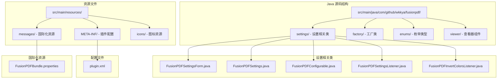
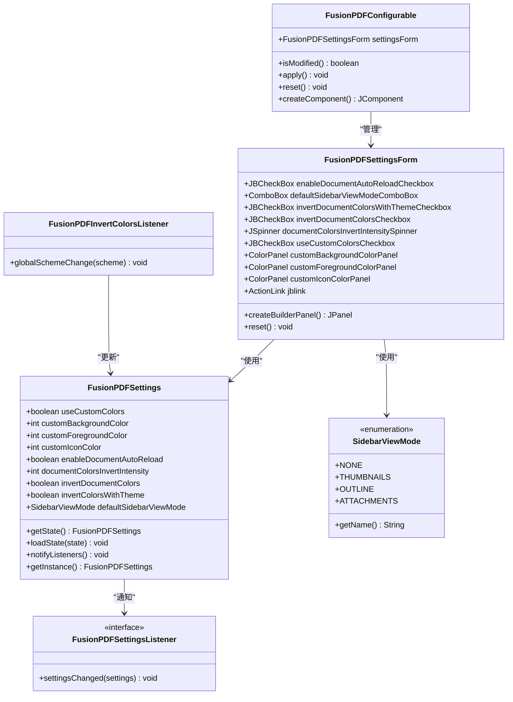
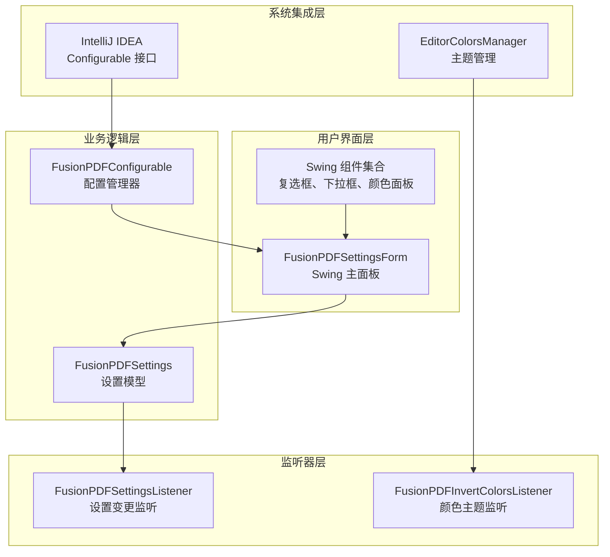
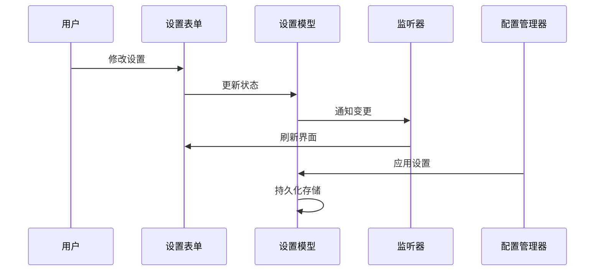
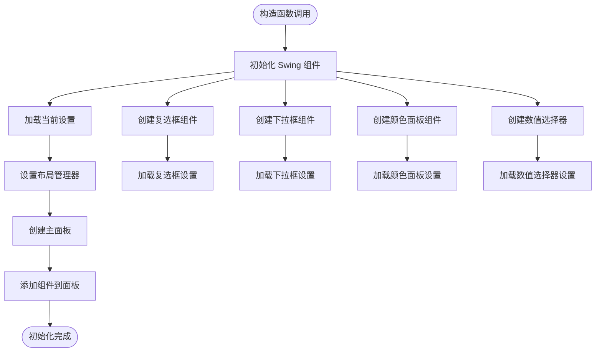
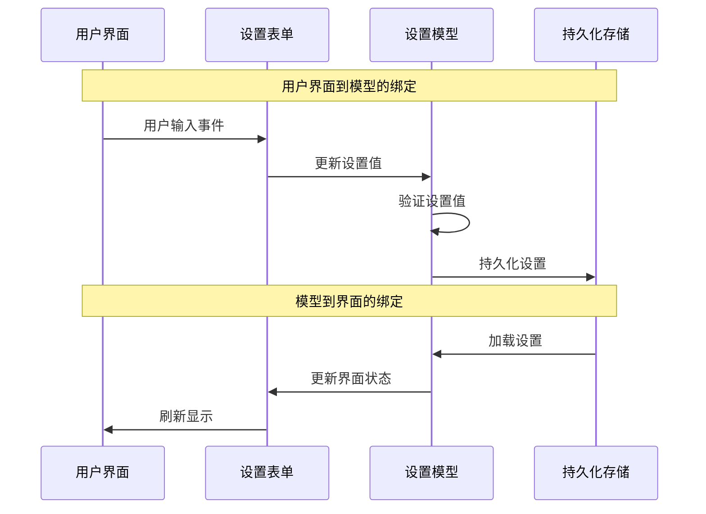
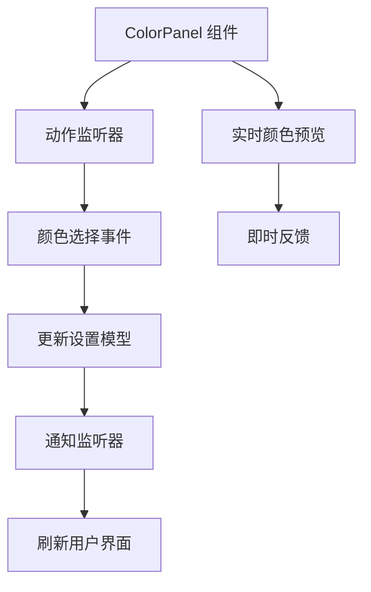
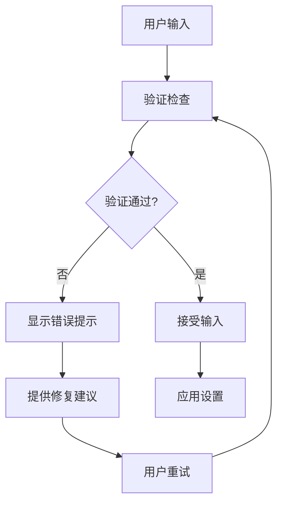
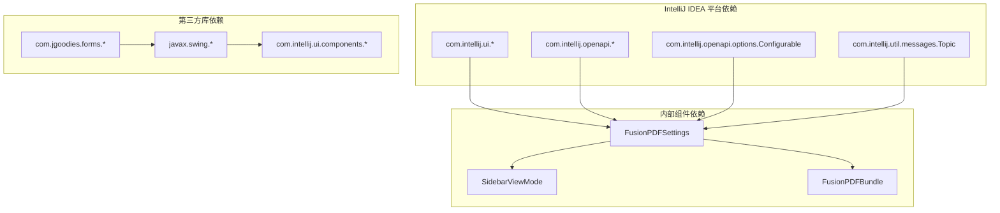

# 设置表单架构

<cite>
**本文档引用的文件**
- [FusionPDFSettingsForm.java](file://src/main/java/com/github/wkkya/fusionpdf/settings/FusionPDFSettingsForm.java)
- [FusionPDFSettings.java](file://src/main/java/com/github/wkkya/fusionpdf/settings/FusionPDFSettings.java)
- [FusionPDFConfigurable.java](file://src/main/java/com/github/wkkya/fusionpdf/settings/FusionPDFConfigurable.java)
- [FusionPDFSettingsListener.java](file://src/main/java/com/github/wkkya/fusionpdf/settings/FusionPDFSettingsListener.java)
- [FusionPDFInvertColorsListener.java](file://src/main/java/com/github/wkkya/fusionpdf/settings/FusionPDFInvertColorsListener.java)
- [SidebarViewMode.java](file://src/main/java/com/github/wkkya/fusionpdf/enums/SidebarViewMode.java)
- [plugin.xml](file://src/main/resources/META-INF/plugin.xml)
- [FusionPDFBundle.properties](file://src/main/resources/messages/FusionPDFBundle.properties)
- [FusionPDFToolWindowFactory.java](file://src/main/java/com/github/wkkya/fusionpdf/factory/FusionPDFToolWindowFactory.java)
</cite>

## 目录
1. [简介](#简介)
2. [项目结构](#项目结构)
3. [核心组件](#核心组件)
4. [架构概览](#架构概览)
5. [详细组件分析](#详细组件分析)
6. [依赖关系分析](#依赖关系分析)
7. [性能考虑](#性能考虑)
8. [故障排除指南](#故障排除指南)
9. [结论](#结论)

## 简介

FusionPDF 设置表单架构是一个基于 IntelliJ IDEA 平台开发的 PDF 查看器插件的核心配置界面。该架构采用模块化设计，通过清晰的组件分离实现了设置系统的数据绑定、验证和用户交互功能。本文档深入分析了 FusionPDFSettingsForm 类的架构设计，包括 Swing 组件的组织结构、布局管理、设置控件实现以及数据绑定机制。

## 项目结构

FusionPDF 项目遵循标准的 IntelliJ IDEA 插件架构，主要包含以下关键目录和文件：

**图表来源**
- [plugin.xml:1-51](file://src/main/resources/META-INF/plugin.xml#L1-L51)
- [FusionPDFSettingsForm.java:1-159](file://src/main/java/com/github/wkkya/fusionpdf/settings/FusionPDFSettingsForm.java#L1-L159)

**章节来源**
- [plugin.xml:1-51](file://src/main/resources/META-INF/plugin.xml#L1-L51)
- [FusionPDFSettingsForm.java:1-159](file://src/main/java/com/github/wkkya/fusionpdf/settings/FusionPDFSettingsForm.java#L1-L159)

## 核心组件

FusionPDF 设置表单架构由多个相互协作的核心组件组成，每个组件都有明确的职责分工：

### 主要组件概述

| 组件名称 | 类型 | 职责 | 关键特性 |
|---------|------|------|----------|
| FusionPDFSettingsForm | 主面板类 | 用户界面构建和事件处理 | Swing 组件管理、布局控制、数据绑定 |
| FusionPDFSettings | 设置模型类 | 数据持久化和状态管理 | 持久化组件、监听器通知、默认值管理 |
| FusionPDFConfigurable | 配置接口实现 | 设置界面集成 | IntelliJ IDEA 配置框架集成 |
| FusionPDFSettingsListener | 监听器接口 | 设置变更通知 | 事件驱动架构、主题更新 |
| FusionPDFInvertColorsListener | 颜色监听器 | 主题颜色变化监听 | 实时颜色同步、暗色模式适配 |

### 组件关系图

**图表来源**
- [FusionPDFSettingsForm.java:18-35](file://src/main/java/com/github/wkkya/fusionpdf/settings/FusionPDFSettingsForm.java#L18-L35)
- [FusionPDFSettings.java:18-32](file://src/main/java/com/github/wkkya/fusionpdf/settings/FusionPDFSettings.java#L18-L32)
- [FusionPDFConfigurable.java:7-9](file://src/main/java/com/github/wkkya/fusionpdf/settings/FusionPDFConfigurable.java#L7-L9)
- [FusionPDFInvertColorsListener.java:11-24](file://src/main/java/com/github/wkkya/fusionpdf/settings/FusionPDFInvertColorsListener.java#L11-L24)
- [SidebarViewMode.java:3-21](file://src/main/java/com/github/wkkya/fusionpdf/enums/SidebarViewMode.java#L3-L21)

**章节来源**
- [FusionPDFSettingsForm.java:18-35](file://src/main/java/com/github/wkkya/fusionpdf/settings/FusionPDFSettingsForm.java#L18-L35)
- [FusionPDFSettings.java:18-32](file://src/main/java/com/github/wkkya/fusionpdf/settings/FusionPDFSettings.java#L18-L32)
- [FusionPDFConfigurable.java:7-9](file://src/main/java/com/github/wkkya/fusionpdf/settings/FusionPDFConfigurable.java#L7-L9)

## 架构概览

FusionPDF 设置表单架构采用了分层设计模式，实现了清晰的关注点分离：

### 整体架构设计

**图表来源**
- [FusionPDFSettingsForm.java:36-87](file://src/main/java/com/github/wkkya/fusionpdf/settings/FusionPDFSettingsForm.java#L36-L87)
- [FusionPDFSettings.java:17-46](file://src/main/java/com/github/wkkya/fusionpdf/settings/FusionPDFSettings.java#L17-L46)
- [FusionPDFConfigurable.java:7-74](file://src/main/java/com/github/wkkya/fusionpdf/settings/FusionPDFConfigurable.java#L7-L74)

### 数据流架构

**图表来源**
- [FusionPDFSettingsForm.java:67-77](file://src/main/java/com/github/wkkya/fusionpdf/settings/FusionPDFSettingsForm.java#L67-L77)
- [FusionPDFSettings.java:44-46](file://src/main/java/com/github/wkkya/fusionpdf/settings/FusionPDFSettings.java#L44-L46)
- [FusionPDFConfigurable.java:37-53](file://src/main/java/com/github/wkkya/fusionpdf/settings/FusionPDFConfigurable.java#L37-L53)

**章节来源**
- [FusionPDFSettingsForm.java:36-87](file://src/main/java/com/github/wkkya/fusionpdf/settings/FusionPDFSettingsForm.java#L36-L87)
- [FusionPDFSettings.java:17-46](file://src/main/java/com/github/wkkya/fusionpdf/settings/FusionPDFSettings.java#L17-L46)
- [FusionPDFConfigurable.java:7-74](file://src/main/java/com/github/wkkya/fusionpdf/settings/FusionPDFConfigurable.java#L7-L74)

## 详细组件分析

### FusionPDFSettingsForm 组件分析

FusionPDFSettingsForm 是整个设置表单的核心类，负责构建用户界面并管理所有交互逻辑。

#### 组件初始化流程

**图表来源**
- [FusionPDFSettingsForm.java:36-87](file://src/main/java/com/github/wkkya/fusionpdf/settings/FusionPDFSettingsForm.java#L36-L87)

#### 布局管理系统

设置表单采用 `BorderLayout` 作为主布局管理器，并结合 `DefaultFormBuilder` 和 `FormLayout` 来实现复杂的表单布局：

| 布局层级 | 组件类型 | 功能描述 |
|---------|---------|----------|
| BorderLayout | 主面板容器 | 管理整体布局结构 |
| FormLayout | 表单布局 | 控制标签和组件的对齐 |
| DefaultFormBuilder | 构建器 | 简化表单组件的添加过程 |
| 分隔符 | 标签分组 | 区分不同的设置组别 |

#### 设置控件实现详解

##### 复选框组件

复选框组件提供了用户界面的主要开关控制功能：

| 复选框名称 | 功能描述 | 默认状态 | 依赖关系 |
|-----------|----------|----------|----------|
| enableDocumentAutoReloadCheckbox | 自动重新加载文档 | 启用 | 文档监控 |
| invertDocumentColorsWithThemeCheckbox | 基于主题反转文档颜色 | 禁用 | 主题监听器 |
| invertDocumentColorsCheckbox | 手动反转文档颜色 | 禁用 | 颜色反转强度 |
| useCustomColorsCheckbox | 使用自定义查看器颜色 | 禁用 | 颜色面板 |

##### 下拉菜单组件

下拉菜单组件用于选择预定义的选项值：

| 下拉菜单名称 | 选项类型 | 默认值 | 显示文本 |
|-------------|---------|--------|----------|
| defaultSidebarViewModeComboBox | SidebarViewMode | ATTACHMENTS | 附件视图 |
| 渲染器 | 自定义渲染器 | - | 中英文双语显示 |

##### 颜色选择器组件

颜色选择器组件提供了直观的颜色选择功能：

| 颜色面板名称 | 颜色用途 | 默认颜色 | 实时预览 |
|-------------|----------|----------|----------|
| customBackgroundColorPanel | 查看器背景颜色 | IDE 主题背景色 | 支持 |
| customForegroundColorPanel | 查看器前景颜色 | IDE 主题前景色 | 支持 |
| customIconColorPanel | 查看器图标颜色 | 前景色继承 | 支持 |

##### 数值选择器组件

数值选择器组件用于设置颜色反转强度：

| 数值选择器名称 | 最小值 | 最大值 | 默认值 | 步长 |
|---------------|--------|--------|--------|------|
| documentColorsInvertIntensitySpinner | 1 | 100 | 85 | 1 |

**章节来源**
- [FusionPDFSettingsForm.java:36-159](file://src/main/java/com/github/wkkya/fusionpdf/settings/FusionPDFSettingsForm.java#L36-L159)

### 数据绑定机制分析

FusionPDF 设置表单实现了双向数据绑定机制，确保用户界面与底层设置模型保持同步。

#### 双向绑定实现

**图表来源**
- [FusionPDFSettingsForm.java:67-77](file://src/main/java/com/github/wkkya/fusionpdf/settings/FusionPDFSettingsForm.java#L67-L77)
- [FusionPDFSettings.java:35-46](file://src/main/java/com/github/wkkya/fusionpdf/settings/FusionPDFSettings.java#L35-L46)

#### 颜色选择器特殊实现

颜色选择器采用了特殊的实现方式，提供了实时预览和自定义颜色对话框功能：

**图表来源**
- [FusionPDFSettingsForm.java:67-77](file://src/main/java/com/github/wkkya/fusionpdf/settings/FusionPDFSettingsForm.java#L67-L77)

**章节来源**
- [FusionPDFSettingsForm.java:67-77](file://src/main/java/com/github/wkkya/fusionpdf/settings/FusionPDFSettingsForm.java#L67-L77)
- [FusionPDFSettings.java:35-46](file://src/main/java/com/github/wkkya/fusionpdf/settings/FusionPDFSettings.java#L35-L46)

### 验证逻辑实现

设置表单实现了多层次的验证逻辑，确保用户输入的有效性和一致性。

#### 验证层次结构

| 验证类型 | 实现位置 | 验证规则 | 错误处理 |
|---------|---------|---------|---------|
| 输入范围验证 | 数值选择器 | 1-100 范围检查 | 边界值处理 |
| 互斥状态验证 | 复选框组合 | 主题反转与手动反转互斥 | 状态同步 |
| 颜色有效性验证 | 颜色面板 | RGB 值有效性检查 | 默认值回退 |
| 设置一致性验证 | 整体表单 | 相关设置间的逻辑一致性 | 提示信息 |

#### 错误提示机制

**图表来源**
- [FusionPDFSettingsForm.java:62-62](file://src/main/java/com/github/wkkya/fusionpdf/settings/FusionPDFSettingsForm.java#L62-L62)

**章节来源**
- [FusionPDFSettingsForm.java:62-62](file://src/main/java/com/github/wkkya/fusionpdf/settings/FusionPDFSettingsForm.java#L62-L62)

### 响应式设计和多语言支持

#### 响应式布局设计

设置表单采用了灵活的响应式设计，能够适应不同屏幕尺寸和窗口大小：

| 布局特性 | 实现方式 | 适配效果 |
|---------|---------|---------|
| 流式布局 | BorderLayout | 主面板自适应 |
| 表单布局 | FormLayout | 标签对齐优化 |
| 组件间距 | 动态间距计算 | 不同 DPI 适配 |
| 字体缩放 | 系统字体设置 | 用户偏好支持 |

#### 多语言国际化支持

设置表单完全支持多语言国际化，通过资源文件实现：

| 语言支持 | 实现方式 | 资源文件 |
|---------|---------|---------|
| 英文 | 默认语言 | FusionPDFBundle.properties |
| 中文 | 简体中文 | FusionPDFBundle_zh_CN.properties |
| 动态切换 | 运行时语言检测 | IntelliJ IDEA 国际化框架 |

**章节来源**
- [FusionPDFSettingsForm.java:44-54](file://src/main/java/com/github/wkkya/fusionpdf/settings/FusionPDFSettingsForm.java#L44-L54)
- [FusionPDFBundle.properties:17-36](file://src/main/resources/messages/FusionPDFBundle.properties#L17-L36)

## 依赖关系分析

### 外部依赖关系

FusionPDF 设置表单架构依赖于多个 IntelliJ IDEA 平台组件和第三方库：

**图表来源**
- [FusionPDFSettingsForm.java:3-16](file://src/main/java/com/github/wkkya/fusionpdf/settings/FusionPDFSettingsForm.java#L3-L16)
- [FusionPDFSettings.java:4-11](file://src/main/java/com/github/wkkya/fusionpdf/settings/FusionPDFSettings.java#L4-L11)

### 内部组件耦合分析

设置表单架构在设计上尽量减少了组件间的耦合度：

| 组件间关系 | 耦合程度 | 设计原则 | 改进建议 |
|-----------|---------|---------|---------|
| 设置表单 ↔ 设置模型 | 低耦合 | 单向依赖 | 继续保持 |
| 设置模型 ↔ 监听器 | 松散耦合 | 观察者模式 | 优化通知机制 |
| 配置管理器 ↔ 表单 | 临时耦合 | 生命周期管理 | 简化接口 |
| 监听器 ↔ 设置模型 | 单向通信 | 事件驱动 | 增强错误处理 |

**章节来源**
- [FusionPDFSettingsForm.java:20-20](file://src/main/java/com/github/wkkya/fusionpdf/settings/FusionPDFSettingsForm.java#L20-L20)
- [FusionPDFSettings.java:20-21](file://src/main/java/com/github/wkkya/fusionpdf/settings/FusionPDFSettings.java#L20-L21)

## 性能考虑

### 性能优化策略

设置表单架构在设计时充分考虑了性能优化：

#### 内存管理
- 懒加载机制：设置表单仅在需要时创建
- 对象池化：复用 Swing 组件实例
- 弱引用：避免内存泄漏

#### 响应性优化
- 异步更新：颜色变化的异步处理
- 批量操作：多个设置变更的批量应用
- 延迟加载：非关键组件的延迟初始化

#### 资源管理
- 资源清理：组件销毁时的资源释放
- 缓存策略：常用设置的缓存机制
- 磁盘 I/O 优化：设置文件的高效读写

## 故障排除指南

### 常见问题诊断

#### 设置不生效问题

**症状表现**：用户修改设置后重启应用发现设置未保存

**可能原因**：
1. 设置模型未正确持久化
2. 配置管理器未正确应用设置
3. 文件权限问题导致无法写入

**解决方案**：
1. 检查设置模型的状态保存方法
2. 验证配置管理器的应用逻辑
3. 确认配置文件的写入权限

#### 颜色选择异常

**症状表现**：颜色选择器无法正常工作或颜色显示异常

**可能原因**：
1. 颜色面板组件初始化失败
2. 颜色值转换错误
3. 监听器注册问题

**解决方案**：
1. 检查颜色面板的初始化代码
2. 验证颜色值的 RGB 转换逻辑
3. 确认监听器的注册和注销机制

#### 主题适配问题

**症状表现**：暗色模式和亮色模式下的颜色显示不一致

**可能原因**：
1. 主题监听器未正确触发
2. 颜色反转算法错误
3. 缓存的颜色值未更新

**解决方案**：
1. 检查主题监听器的实现
2. 验证颜色反转的计算逻辑
3. 清除颜色缓存并重新加载

**章节来源**
- [FusionPDFSettingsForm.java:132-145](file://src/main/java/com/github/wkkya/fusionpdf/settings/FusionPDFSettingsForm.java#L132-L145)
- [FusionPDFInvertColorsListener.java:14-23](file://src/main/java/com/github/wkkya/fusionpdf/settings/FusionPDFInvertColorsListener.java#L14-L23)

## 结论

FusionPDF 设置表单架构展现了优秀的软件工程实践，通过清晰的分层设计、合理的组件分离和完善的架构模式，实现了高度模块化的设置系统。该架构不仅满足了当前的功能需求，还为未来的扩展和维护奠定了坚实的基础。

### 架构优势总结

1. **模块化设计**：各组件职责明确，便于独立开发和测试
2. **事件驱动架构**：通过监听器模式实现松散耦合
3. **持久化支持**：完整的设置数据持久化机制
4. **国际化支持**：全面的多语言本地化能力
5. **性能优化**：考虑了内存管理和响应性的优化策略

### 改进建议

1. **增强验证机制**：增加更完善的输入验证和错误处理
2. **优化用户体验**：提供更直观的设置反馈和确认机制
3. **扩展监听器**：支持更多类型的设置变更监听
4. **性能监控**：添加性能指标监控和报告功能

该架构为 IntelliJ IDEA 插件开发提供了优秀的参考模板，展示了如何在受限的平台环境中实现复杂的功能需求。