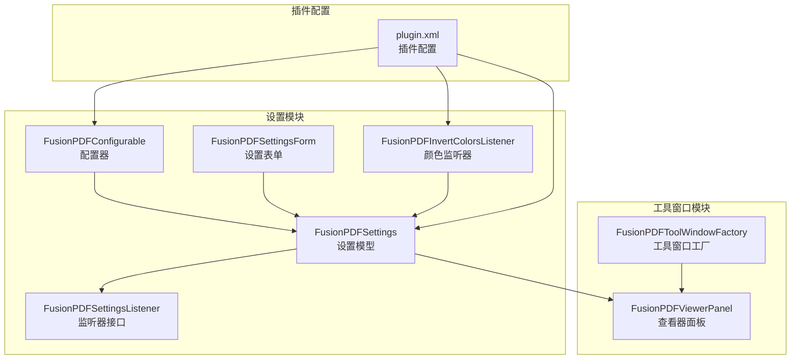
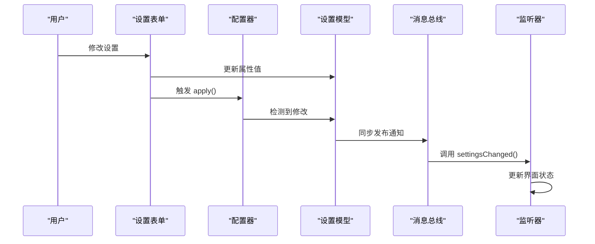
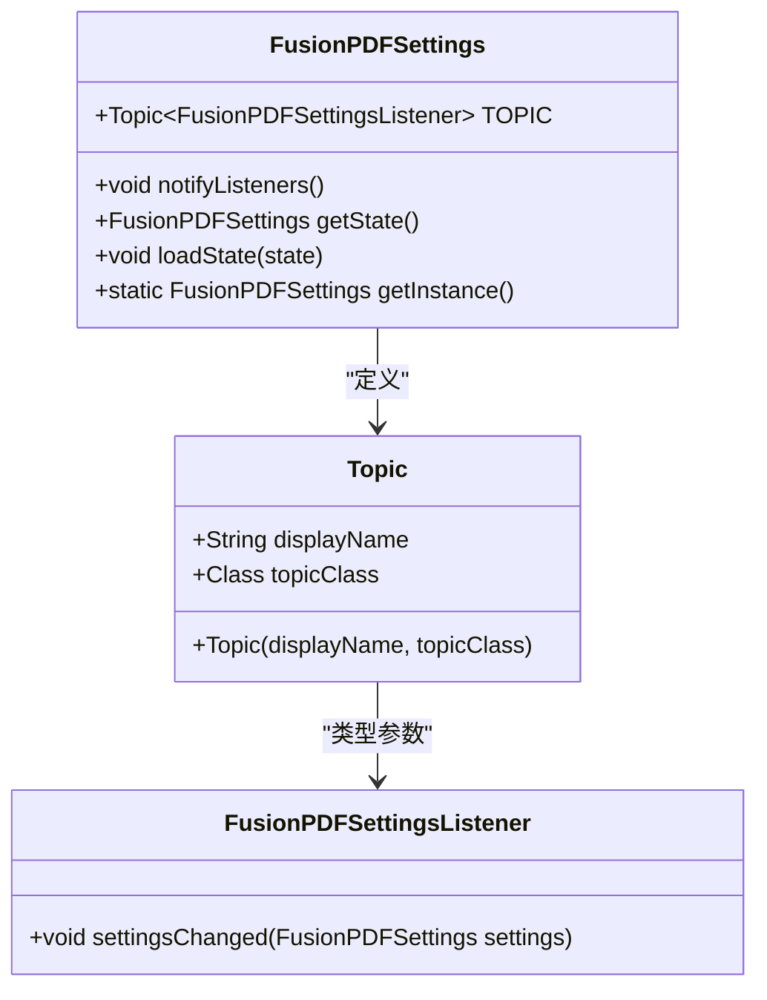
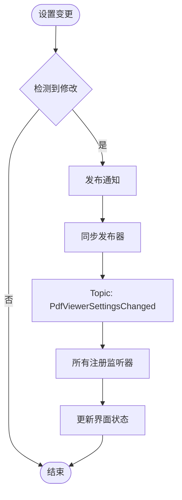
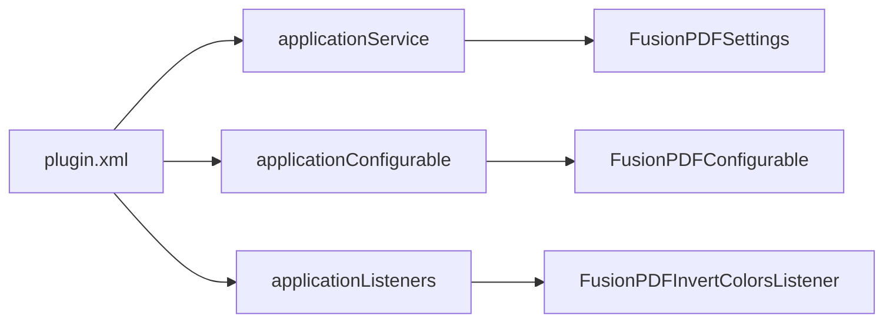
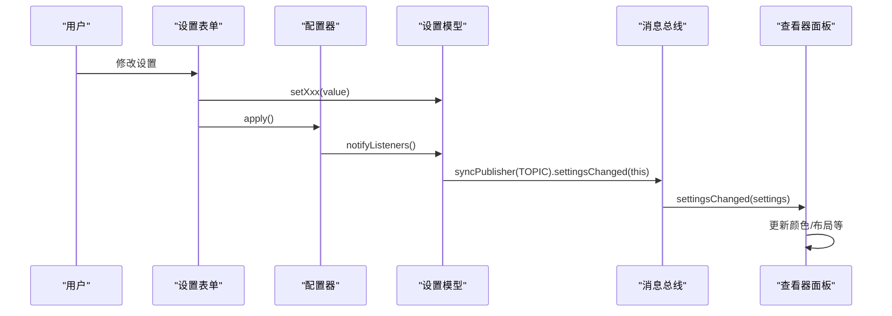
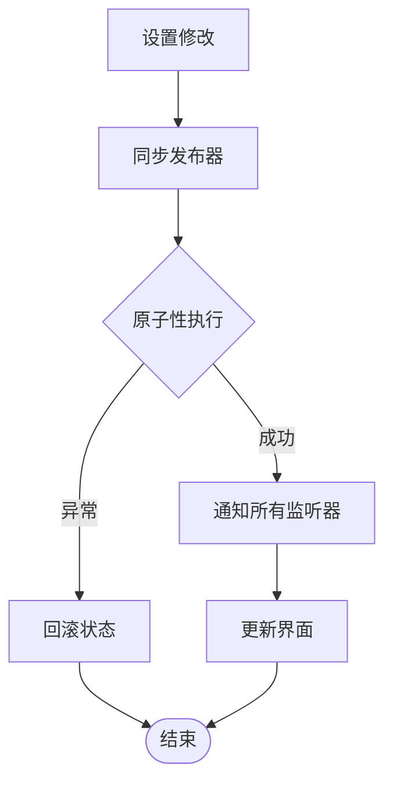
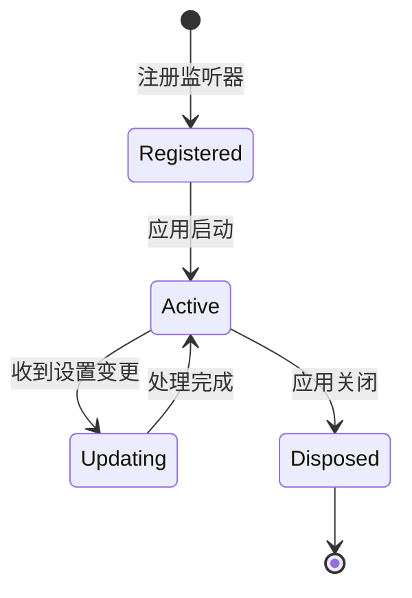
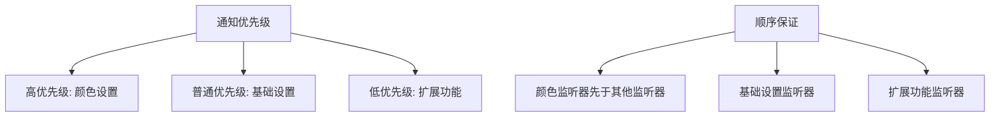
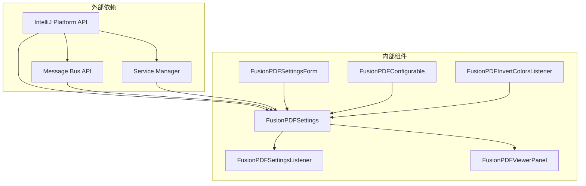

# 设置通知系统

<cite>
**本文引用的文件**
- [FusionPDFSettingsListener.java](file://src/main/java/com/github/wkkya/fusionpdf/settings/FusionPDFSettingsListener.java)
- [FusionPDFSettings.java](file://src/main/java/com/github/wkkya/fusionpdf/settings/FusionPDFSettings.java)
- [FusionPDFSettingsForm.java](file://src/main/java/com/github/wkkya/fusionpdf/settings/FusionPDFSettingsForm.java)
- [FusionPDFInvertColorsListener.java](file://src/main/java/com/github/wkkya/fusionpdf/settings/FusionPDFInvertColorsListener.java)
- [FusionPDFConfigurable.java](file://src/main/java/com/github/wkkya/fusionpdf/settings/FusionPDFConfigurable.java)
- [plugin.xml](file://src/main/resources/META-INF/plugin.xml)
- [FusionPDFToolWindowFactory.java](file://src/main/java/com/github/wkkya/fusionpdf/factory/FusionPDFToolWindowFactory.java)
- [FusionPDFViewerPanel.java](file://src/main/java/com/github/wkkya/fusionpdf/viewer/FusionPDFViewerPanel.java)
</cite>

## 目录
1. [简介](#简介)
2. [项目结构](#项目结构)
3. [核心组件](#核心组件)
4. [架构概览](#架构概览)
5. [详细组件分析](#详细组件分析)
6. [依赖分析](#依赖分析)
7. [性能考虑](#性能考虑)
8. [故障排除指南](#故障排除指南)
9. [结论](#结论)
10. [附录](#附录)

## 简介
本文档深入解析 FusionPDF 插件的设置通知系统，重点阐述消息总线机制的实现、Topic 的创建与消息发布订阅模式、FusionPDFSettingsListener 接口设计与监听器注册机制、设置变更的通知流程以及同步发布器的使用方式。通过分析源代码，我们将提供完整的数据流说明、生命周期管理策略、内存泄漏防护措施、优先级与顺序保证机制，并给出自定义监听器的实现指南与最佳实践。

## 项目结构
FusionPDF 的设置通知系统主要由以下模块组成：
- settings 包：包含设置模型、表单、配置器和颜色监听器
- factory 包：工具窗口工厂，负责创建 PDF 查看器面板
- viewer 包：PDF 查看器面板，负责与 PDF.js 交互
- resources/META-INF/plugin.xml：插件配置文件，声明服务、配置器和监听器

**图表来源**
- [FusionPDFSettings.java:17-50](file://src/main/java/com/github/wkkya/fusionpdf/settings/FusionPDFSettings.java#L17-L50)
- [FusionPDFSettingsListener.java:1-7](file://src/main/java/com/github/wkkya/fusionpdf/settings/FusionPDFSettingsListener.java#L1-L7)
- [FusionPDFSettingsForm.java:1-159](file://src/main/java/com/github/wkkya/fusionpdf/settings/FusionPDFSettingsForm.java#L1-L159)
- [FusionPDFConfigurable.java:1-76](file://src/main/java/com/github/wkkya/fusionpdf/settings/FusionPDFConfigurable.java#L1-L76)
- [FusionPDFInvertColorsListener.java:1-25](file://src/main/java/com/github/wkkya/fusionpdf/settings/FusionPDFInvertColorsListener.java#L1-L25)
- [FusionPDFToolWindowFactory.java:1-21](file://src/main/java/com/github/wkkya/fusionpdf/factory/FusionPDFToolWindowFactory.java#L1-L21)
- [FusionPDFViewerPanel.java:1-78](file://src/main/java/com/github/wkkya/fusionpdf/viewer/FusionPDFViewerPanel.java#L1-L78)
- [plugin.xml:26-46](file://src/main/resources/META-INF/plugin.xml#L26-L46)

**章节来源**
- [plugin.xml:26-46](file://src/main/resources/META-INF/plugin.xml#L26-L46)
- [FusionPDFSettings.java:17-50](file://src/main/java/com/github/wkkya/fusionpdf/settings/FusionPDFSettings.java#L17-L50)

## 核心组件
本节深入分析设置通知系统的核心组件及其职责。

### FusionPDFSettings（设置模型）
- 实现 PersistentStateComponent，支持持久化存储
- 定义 Topic<FusionPDFSettingsListener> 作为消息总线的主题
- 提供同步发布器 notifyListeners() 方法
- 管理所有设置项的状态和默认值

关键特性：
- 使用 @State 注解指定存储位置为 fusion_pdf.xml
- 通过 ApplicationManager 获取应用实例进行消息总线操作
- 提供静态方法访问默认颜色和实验性功能开关

**章节来源**
- [FusionPDFSettings.java:17-50](file://src/main/java/com/github/wkkya/fusionpdf/settings/FusionPDFSettings.java#L17-L50)
- [FusionPDFSettings.java:20-46](file://src/main/java/com/github/wkkya/fusionpdf/settings/FusionPDFSettings.java#L20-L46)

### FusionPDFSettingsListener（监听器接口）
- 函数式接口，定义 settingsChanged 回调方法
- 采用单方法接口设计，便于 Lambda 表达式使用
- 作为消息总线的回调契约

**章节来源**
- [FusionPDFSettingsListener.java:1-7](file://src/main/java/com/github/wkkya/fusionpdf/settings/FusionPDFSettingsListener.java#L1-L7)

### FusionPDFSettingsForm（设置表单）
- 继承 JPanel，封装所有设置控件
- 与 FusionPDFSettings 单例建立双向绑定
- 处理颜色选择器事件，实时更新设置值
- 提供 reset() 方法恢复到当前设置状态

**章节来源**
- [FusionPDFSettingsForm.java:18-87](file://src/main/java/com/github/wkkya/fusionpdf/settings/FusionPDFSettingsForm.java#L18-L87)
- [FusionPDFSettingsForm.java:147-158](file://src/main/java/com/github/wkkya/fusionpdf/settings/FusionPDFSettingsForm.java#L147-L158)

### FusionPDFConfigurable（配置器）
- 实现 Configurable 接口，集成到 IDE 设置系统
- 管理设置表单的生命周期
- 在 apply() 中检测修改并触发通知

**章节来源**
- [FusionPDFConfigurable.java:7-76](file://src/main/java/com/github/wkkya/fusionpdf/settings/FusionPDFConfigurable.java#L7-L76)

### FusionPDFInvertColorsListener（颜色监听器）
- 实现 EditorColorsListener 接口
- 监听全局颜色方案变化
- 根据主题深浅自动调整文档颜色反转设置

**章节来源**
- [FusionPDFInvertColorsListener.java:11-25](file://src/main/java/com/github/wkkya/fusionpdf/settings/FusionPDFInvertColorsListener.java#L11-L25)

## 架构概览
设置通知系统基于 IntelliJ Platform 的消息总线机制构建，采用发布-订阅模式实现松耦合通信。

**图表来源**
- [FusionPDFSettingsForm.java:68-77](file://src/main/java/com/github/wkkya/fusionpdf/settings/FusionPDFSettingsForm.java#L68-L77)
- [FusionPDFConfigurable.java:37-53](file://src/main/java/com/github/wkkya/fusionpdf/settings/FusionPDFConfigurable.java#L37-L53)
- [FusionPDFSettings.java:44-46](file://src/main/java/com/github/wkkya/fusionpdf/settings/FusionPDFSettings.java#L44-L46)

## 详细组件分析

### 消息总线机制与 Topic 创建
消息总线机制是设置通知系统的核心基础设施。

**图表来源**
- [FusionPDFSettings.java:20-21](file://src/main/java/com/github/wkkya/fusionpdf/settings/FusionPDFSettings.java#L20-L21)
- [FusionPDFSettingsListener.java:4-5](file://src/main/java/com/github/wkkya/fusionpdf/settings/FusionPDFSettingsListener.java#L4-L5)

实现要点：
- Topic 通过构造函数创建，名称为 "PdfViewerSettingsChanged"
- 使用 ApplicationManager.getApplication().getMessageBus() 获取消息总线实例
- 采用同步发布器 syncPublisher，确保通知的原子性和一致性

**章节来源**
- [FusionPDFSettings.java:20-46](file://src/main/java/com/github/wkkya/fusionpdf/settings/FusionPDFSettings.java#L20-L46)

### 发布订阅模式的应用
发布订阅模式在设置通知中的具体实现：

**图表来源**
- [FusionPDFSettings.java:44-46](file://src/main/java/com/github/wkkya/fusionpdf/settings/FusionPDFSettings.java#L44-L46)
- [FusionPDFConfigurable.java:50-52](file://src/main/java/com/github/wkkya/fusionpdf/settings/FusionPDFConfigurable.java#L50-L52)

### 监听器注册机制
监听器通过插件配置文件进行注册，支持多种注册方式：

**图表来源**
- [plugin.xml:32-46](file://src/main/resources/META-INF/plugin.xml#L32-L46)

注册细节：
- 应用服务：直接注册为应用级服务
- 颜色监听器：通过 applicationListeners 标签注册
- 配置器：作为 IDE 设置页面提供者

**章节来源**
- [plugin.xml:32-46](file://src/main/resources/META-INF/plugin.xml#L32-L46)

### 设置变更通知流程
完整的设置变更通知流程从修改到界面更新：

**图表来源**
- [FusionPDFSettingsForm.java:68-77](file://src/main/java/com/github/wkkya/fusionpdf/settings/FusionPDFSettingsForm.java#L68-L77)
- [FusionPDFConfigurable.java:37-53](file://src/main/java/com/github/wkkya/fusionpdf/settings/FusionPDFConfigurable.java#L37-L53)
- [FusionPDFSettings.java:44-46](file://src/main/java/com/github/wkkya/fusionpdf/settings/FusionPDFSettings.java#L44-L46)
- [FusionPDFViewerPanel.java:59-65](file://src/main/java/com/github/wkkya/fusionpdf/viewer/FusionPDFViewerPanel.java#L59-L65)

### 同步发布器与异步通知处理
系统采用同步发布器确保通知的及时性和一致性：

**图表来源**
- [FusionPDFSettings.java:44-46](file://src/main/java/com/github/wkkya/fusionpdf/settings/FusionPDFSettings.java#L44-L46)

同步发布器的优势：
- 确保所有监听器在同一事务中接收通知
- 避免部分监听器收到半更新状态
- 简化错误处理逻辑

### 监听器生命周期管理
监听器的生命周期管理涉及注册、激活、注销等阶段：

**图表来源**
- [plugin.xml:42-46](file://src/main/resources/META-INF/plugin.xml#L42-L46)
- [FusionPDFInvertColorsListener.java:11-25](file://src/main/java/com/github/wkkya/fusionpdf/settings/FusionPDFInvertColorsListener.java#L11-L25)

生命周期注意事项：
- 颜色监听器在应用启动时自动注册
- 监听器对象随应用生命周期自动管理
- 无需手动注销，避免内存泄漏

### 内存泄漏防护措施
系统通过以下机制防止内存泄漏：

1. **弱引用机制**：IntelliJ Platform 的消息总线内部使用弱引用管理监听器
2. **生命周期绑定**：监听器与应用生命周期绑定，自动清理
3. **单例模式**：设置模型使用单例，避免重复实例
4. **资源释放**：查看器面板提供 dispose() 方法清理资源

**章节来源**
- [FusionPDFViewerPanel.java:67-70](file://src/main/java/com/github/wkkya/fusionpdf/viewer/FusionPDFViewerPanel.java#L67-L70)

### 设置通知优先级与顺序保证
系统通过以下方式保证通知的优先级和顺序：

**图表来源**
- [plugin.xml:42-46](file://src/main/resources/META-INF/plugin.xml#L42-L46)

顺序保证机制：
- 监听器注册顺序决定回调执行顺序
- 颜色监听器作为系统级监听器优先执行
- 自定义监听器按注册顺序依次处理

## 依赖分析
设置通知系统的依赖关系清晰且层次分明：

**图表来源**
- [FusionPDFSettings.java:4-11](file://src/main/java/com/github/wkkya/fusionpdf/settings/FusionPDFSettings.java#L4-L11)
- [plugin.xml:14-32](file://src/main/resources/META-INF/plugin.xml#L14-L32)

依赖关系特点：
- 内部组件之间依赖关系简单明确
- 外部依赖集中在平台 API 层
- 无循环依赖，符合设计原则

**章节来源**
- [FusionPDFSettings.java:4-11](file://src/main/java/com/github/wkkya/fusionpdf/settings/FusionPDFSettings.java#L4-L11)
- [plugin.xml:14-32](file://src/main/resources/META-INF/plugin.xml#L14-L32)

## 性能考虑
设置通知系统的性能优化策略：

### 1. 同步发布器的选择
- 使用 syncPublisher 确保通知的及时性
- 避免异步通知导致的状态不一致
- 对于耗时操作建议在监听器中异步处理

### 2. 监听器数量控制
- 控制活跃监听器数量，避免过多回调
- 合并相似的监听器逻辑
- 及时清理不再需要的监听器

### 3. 设置更新批处理
- 对连续的设置更新进行批处理
- 避免频繁的界面重绘
- 使用延迟更新机制

### 4. 资源管理优化
- 及时释放不再使用的资源
- 避免持有不必要的引用
- 监听器对象的生命周期管理

## 故障排除指南
常见问题及解决方案：

### 1. 监听器未收到通知
**症状**：修改设置后界面没有更新
**排查步骤**：
1. 检查监听器是否正确注册
2. 验证 Topic 名称是否匹配
3. 确认 notifyListeners() 是否被调用

**章节来源**
- [plugin.xml:42-46](file://src/main/resources/META-INF/plugin.xml#L42-L46)
- [FusionPDFSettings.java:44-46](file://src/main/java/com/github/wkkya/fusionpdf/settings/FusionPDFSettings.java#L44-L46)

### 2. 设置无法持久化
**症状**：重启后设置丢失
**排查步骤**：
1. 检查 @State 注解配置
2. 验证存储文件路径
3. 确认 getState()/loadState() 实现

**章节来源**
- [FusionPDFSettings.java:17-42](file://src/main/java/com/github/wkkya/fusionpdf/settings/FusionPDFSettings.java#L17-L42)

### 3. 内存泄漏问题
**症状**：长时间使用后内存占用增加
**排查步骤**：
1. 检查监听器的生命周期
2. 确认资源释放时机
3. 验证单例模式使用

**章节来源**
- [FusionPDFViewerPanel.java:67-70](file://src/main/java/com/github/wkkya/fusionpdf/viewer/FusionPDFViewerPanel.java#L67-L70)

### 4. 颜色设置不同步
**症状**：主题切换后颜色设置不更新
**排查步骤**：
1. 检查 EditorColorsListener 实现
2. 验证全局颜色方案监听
3. 确认 notifyListeners() 调用

**章节来源**
- [FusionPDFInvertColorsListener.java:11-25](file://src/main/java/com/github/wkkya/fusionpdf/settings/FusionPDFInvertColorsListener.java#L11-L25)

## 结论
FusionPDF 的设置通知系统通过精心设计的消息总线机制实现了高效的设置变更传播。系统采用同步发布器确保通知的一致性，通过严格的生命周期管理避免内存泄漏，通过清晰的依赖关系保证了系统的可维护性。该设计为开发者提供了可靠的扩展点，支持自定义监听器的实现和集成。

## 附录

### 自定义监听器实现指南
实现自定义监听器的最佳实践：

1. **接口实现**：实现 FusionPDFSettingsListener 接口
2. **注册方式**：通过 plugin.xml 或代码方式注册
3. **资源管理**：确保监听器对象的生命周期管理
4. **错误处理**：在 settingsChanged() 中处理异常情况
5. **性能优化**：避免在回调中执行耗时操作

### 调试方法
- 使用 IntelliJ Platform 的调试工具监控消息总线
- 在 settingsChanged() 中添加日志输出
- 利用断点调试监听器的执行流程
- 监控内存使用情况，确保无泄漏