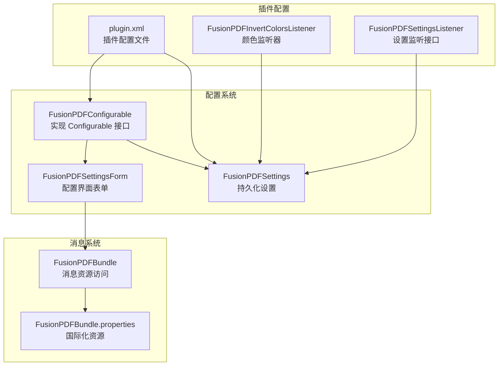
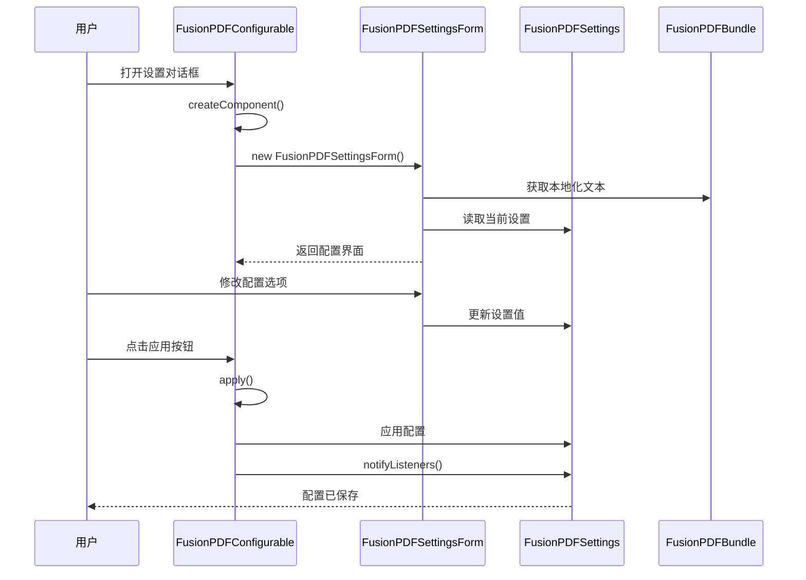
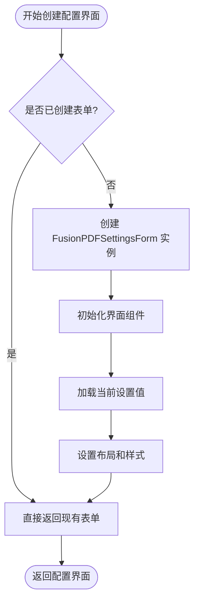
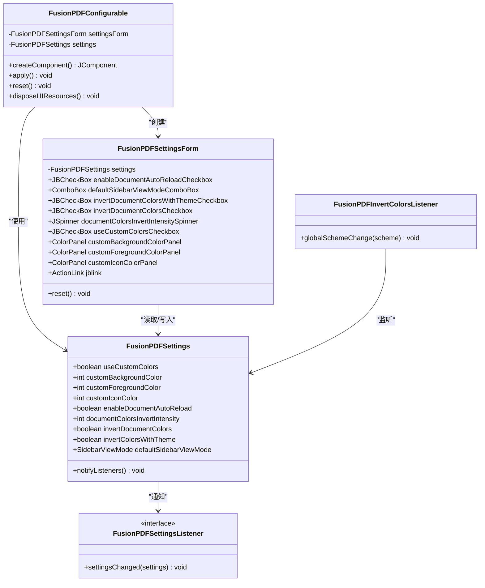

# 配置界面实现

<cite>
**本文档引用的文件**
- [FusionPDFConfigurable.java](file://src/main/java/com/github/wkkya/fusionpdf/settings/FusionPDFConfigurable.java)
- [FusionPDFSettingsForm.java](file://src/main/java/com/github/wkkya/fusionpdf/settings/FusionPDFSettingsForm.java)
- [FusionPDFSettings.java](file://src/main/java/com/github/wkkya/fusionpdf/settings/FusionPDFSettings.java)
- [plugin.xml](file://src/main/resources/META-INF/plugin.xml)
- [FusionPDFBundle.java](file://src/main/java/com/github/wkkya/fusionpdf/bundle/FusionPDFBundle.java)
- [FusionPDFBundle.properties](file://src/main/resources/messages/FusionPDFBundle.properties)
- [FusionPDFSettingsListener.java](file://src/main/java/com/github/wkkya/fusionpdf/settings/FusionPDFSettingsListener.java)
- [FusionPDFInvertColorsListener.java](file://src/main/java/com/github/wkkya/fusionpdf/settings/FusionPDFInvertColorsListener.java)
- [SidebarViewMode.java](file://src/main/java/com/github/wkkya/fusionpdf/enums/SidebarViewMode.java)
</cite>

## 目录
1. [简介](#简介)
2. [项目结构](#项目结构)
3. [核心组件](#核心组件)
4. [架构概览](#架构概览)
5. [详细组件分析](#详细组件分析)
6. [依赖关系分析](#依赖关系分析)
7. [性能考虑](#性能考虑)
8. [故障排除指南](#故障排除指南)
9. [结论](#结论)

## 简介

本文档详细分析了 FusionPDF 插件中 Configurable 接口的实现，重点解释了 FusionPDFConfigurable 类如何实现 IntelliJ Platform 的 Configurable 接口。该实现提供了 PDF 查看器的配置界面，包括文档自动重载、侧边栏视图模式、颜色反转等功能的配置选项。

## 项目结构

FusionPDF 项目的配置界面实现位于以下关键文件中：



**图表来源**
- [FusionPDFConfigurable.java:1-76](file://src/main/java/com/github/wkkya/fusionpdf/settings/FusionPDFConfigurable.java#L1-L76)
- [FusionPDFSettingsForm.java:1-159](file://src/main/java/com/github/wkkya/fusionpdf/settings/FusionPDFSettingsForm.java#L1-L159)
- [plugin.xml:1-51](file://src/main/resources/META-INF/plugin.xml#L1-L51)

**章节来源**
- [plugin.xml:26-36](file://src/main/resources/META-INF/plugin.xml#L26-L36)
- [FusionPDFConfigurable.java:7-76](file://src/main/java/com/github/wkkya/fusionpdf/settings/FusionPDFConfigurable.java#L7-L76)

## 核心组件

### FusionPDFConfigurable 类

FusionPDFConfigurable 是整个配置界面的核心类，实现了 IntelliJ Platform 的 Configurable 接口。该类负责：

- **界面创建**：通过 createComponent() 方法创建并返回配置界面
- **状态管理**：跟踪配置界面的状态变化
- **应用配置**：将用户修改应用到实际设置中
- **生命周期管理**：处理界面的初始化、显示和销毁

### FusionPDFSettingsForm 类

FusionPDFSettingsForm 是具体的配置界面实现，继承自 JPanel，包含以下主要功能区域：

- **通用设置组**：文档自动重载、默认侧边栏视图模式
- **文档颜色组**：基于主题的颜色反转、颜色反转强度
- **查看器颜色组**：自定义背景色、前景色、图标颜色

### FusionPDFSettings 类

FusionPDFSettings 是持久化设置类，使用 @State 注解标记为应用程序级别的设置存储。它包含了所有可配置的参数及其默认值。

**章节来源**
- [FusionPDFConfigurable.java:7-76](file://src/main/java/com/github/wkkya/fusionpdf/settings/FusionPDFConfigurable.java#L7-L76)
- [FusionPDFSettingsForm.java:18-159](file://src/main/java/com/github/wkkya/fusionpdf/settings/FusionPDFSettingsForm.java#L18-L159)
- [FusionPDFSettings.java:17-147](file://src/main/java/com/github/wkkya/fusionpdf/settings/FusionPDFSettings.java#L17-L147)

## 架构概览

配置系统的整体架构遵循 IntelliJ Platform 的标准模式：



**图表来源**
- [FusionPDFConfigurable.java:63-68](file://src/main/java/com/github/wkkya/fusionpdf/settings/FusionPDFConfigurable.java#L63-L68)
- [FusionPDFSettingsForm.java:36-87](file://src/main/java/com/github/wkkya/fusionpdf/settings/FusionPDFSettingsForm.java#L36-L87)
- [FusionPDFSettings.java:44-46](file://src/main/java/com/github/wkkya/fusionpdf/settings/FusionPDFSettings.java#L44-L46)

## 详细组件分析

### Configurable 接口实现

FusionPDFConfigurable 实现了 Configurable 接口的几个关键方法：

#### getId() 方法
虽然在代码中没有显式实现 getId() 方法，但通过 plugin.xml 中的配置可以推断其标识符为 "FusionPDF"。

#### getDisplayName() 方法
```java
@Override
public String getDisplayName() {
    return FusionPDFBundle.message("pdf.viewer.settings.display.name");
}
```
该方法返回配置项在设置对话框中的显示名称，使用国际化资源文件中的键值。

#### createComponent() 方法
```java
@Override
public JComponent createComponent() {
    if (settingsForm == null) {
        settingsForm = new FusionPDFSettingsForm();
    }
    return settingsForm;
}
```
这是配置界面创建的核心方法，采用延迟初始化模式，确保只在需要时创建界面实例。

**章节来源**
- [FusionPDFConfigurable.java:31-34](file://src/main/java/com/github/wkkya/fusionpdf/settings/FusionPDFConfigurable.java#L31-L34)
- [FusionPDFConfigurable.java:63-68](file://src/main/java/com/github/wkkya/fusionpdf/settings/FusionPDFConfigurable.java#L63-L68)

### 配置界面创建流程

配置界面的创建流程如下：



**图表来源**
- [FusionPDFSettingsForm.java:36-87](file://src/main/java/com/github/wkkya/fusionpdf/settings/FusionPDFSettingsForm.java#L36-L87)

#### 界面组件初始化过程

FusionPDFSettingsForm 的初始化过程包括多个步骤：

1. **组件声明**：声明所有需要的 Swing 组件
2. **组件创建**：为每个组件分配内存空间
3. **属性设置**：设置组件的初始状态和外观
4. **事件绑定**：为组件绑定相应的事件处理器
5. **布局配置**：使用 JGoodies Forms 设置组件布局

**章节来源**
- [FusionPDFSettingsForm.java:36-87](file://src/main/java/com/github/wkkya/fusionpdf/settings/FusionPDFSettingsForm.java#L36-L87)

### 配置界面生命周期管理

配置界面的生命周期管理涉及以下几个关键阶段：

#### 界面显示阶段
- 从 FusionPDFSettingsForm 读取当前设置值
- 将设置值应用到各个界面组件
- 显示完整的配置界面给用户

#### 用户交互阶段
- 用户修改各种配置选项
- 实时更新对应的设置值
- 支持撤销操作（reset）

#### 配置保存阶段
- 用户点击应用或确定按钮
- 调用 apply() 方法应用配置
- 通知所有监听器配置已更改
- 触发相应的功能更新

**章节来源**
- [FusionPDFConfigurable.java:37-53](file://src/main/java/com/github/wkkya/fusionpdf/settings/FusionPDFConfigurable.java#L37-L53)
- [FusionPDFSettingsForm.java:147-157](file://src/main/java/com/github/wkkya/fusionpdf/settings/FusionPDFSettingsForm.java#L147-L157)

### 配置界面与设置系统的集成

配置界面与设置系统的集成通过以下机制实现：

#### 数据绑定机制
- **单向绑定**：从 FusionPDFSettings 到界面组件的值绑定
- **双向绑定**：从界面组件到 FusionPDFSettings 的值绑定
- **事件驱动**：通过事件监听器实现实时同步

#### 变更通知机制
```java
public void notifyListeners() {
    ApplicationManager.getApplication().getMessageBus().syncPublisher(TOPIC).settingsChanged(this);
}
```
当配置发生更改时，通过消息总线通知所有注册的监听器。

**章节来源**
- [FusionPDFSettings.java:44-46](file://src/main/java/com/github/wkkya/fusionpdf/settings/FusionPDFSettings.java#L44-L46)
- [FusionPDFSettingsListener.java:4-6](file://src/main/java/com/github/wkkya/fusionpdf/settings/FusionPDFSettingsListener.java#L4-L6)

### 国际化支持和本地化处理

FusionPDF 项目提供了完整的国际化支持：

#### 消息资源系统
- 使用 FusionPDFBundle 类统一管理消息资源
- 通过 ResourceBundles 实现多语言支持
- 支持动态语言切换

#### 本地化资源文件
- 主要资源文件：FusionPDFBundle.properties
- 动作资源文件：FusionPDFActionsBundle.properties
- 包含中英文双语支持

#### 国际化实现模式
```java
FusionPDFBundle.message("pdf.viewer.settings.display.name")
```
通过键值对的方式获取对应语言的文本内容。

**章节来源**
- [FusionPDFBundle.java:10-25](file://src/main/java/com/github/wkkya/fusionpdf/bundle/FusionPDFBundle.java#L10-L25)
- [FusionPDFBundle.properties:17-36](file://src/main/resources/messages/FusionPDFBundle.properties#L17-L36)

## 依赖关系分析

配置系统的依赖关系如下：



**图表来源**
- [FusionPDFConfigurable.java:7-76](file://src/main/java/com/github/wkkya/fusionpdf/settings/FusionPDFConfigurable.java#L7-L76)
- [FusionPDFSettingsForm.java:18-159](file://src/main/java/com/github/wkkya/fusionpdf/settings/FusionPDFSettingsForm.java#L18-L159)
- [FusionPDFSettings.java:17-147](file://src/main/java/com/github/wkkya/fusionpdf/settings/FusionPDFSettings.java#L17-L147)

**章节来源**
- [plugin.xml:32-46](file://src/main/resources/META-INF/plugin.xml#L32-L46)
- [FusionPDFInvertColorsListener.java:11-25](file://src/main/java/com/github/wkkya/fusionpdf/settings/FusionPDFInvertColorsListener.java#L11-L25)

## 性能考虑

在配置界面实现中，需要考虑以下性能因素：

### 内存管理
- 使用延迟初始化避免不必要的内存占用
- 在 disposeUIResources() 中释放界面资源
- 合理管理组件引用，防止内存泄漏

### 响应性优化
- 将耗时操作放在后台线程执行
- 使用异步更新机制避免界面冻结
- 合理使用事件过滤器减少不必要的更新

### 资源管理
- 优化图片和图标资源的加载
- 使用缓存机制提高重复访问性能
- 合理管理颜色面板等重型组件

## 故障排除指南

### 常见问题及解决方案

#### 配置不生效
- 检查 apply() 方法是否被正确调用
- 确认 notifyListeners() 是否触发
- 验证监听器是否正确注册

#### 界面显示异常
- 检查组件初始化顺序
- 验证布局管理器配置
- 确认颜色和字体设置

#### 国际化问题
- 检查资源文件是否存在
- 验证键值是否正确
- 确认语言包是否正确加载

**章节来源**
- [FusionPDFConfigurable.java:37-53](file://src/main/java/com/github/wkkya/fusionpdf/settings/FusionPDFConfigurable.java#L37-L53)
- [FusionPDFSettingsForm.java:147-157](file://src/main/java/com/github/wkkya/fusionpdf/settings/FusionPDFSettingsForm.java#L147-L157)

## 结论

FusionPDF 的配置界面实现展示了 IntelliJ Platform 插件开发的最佳实践。通过清晰的分层架构、完善的国际化支持和健壮的生命周期管理，该实现为用户提供了直观易用的配置体验。

关键特性包括：
- **模块化设计**：Configurable、Form、Settings 分离职责
- **国际化支持**：完整的多语言资源管理
- **事件驱动**：基于消息总线的变更通知机制
- **生命周期管理**：完整的界面创建、显示、销毁流程

这个实现为其他 IntelliJ Platform 插件的配置界面开发提供了优秀的参考模板。