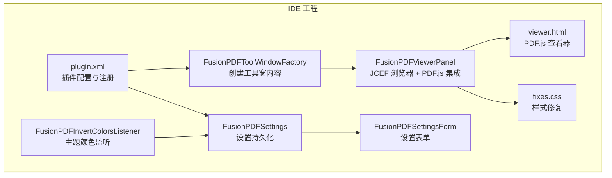
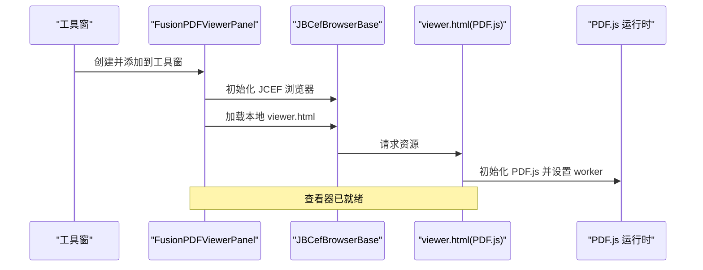
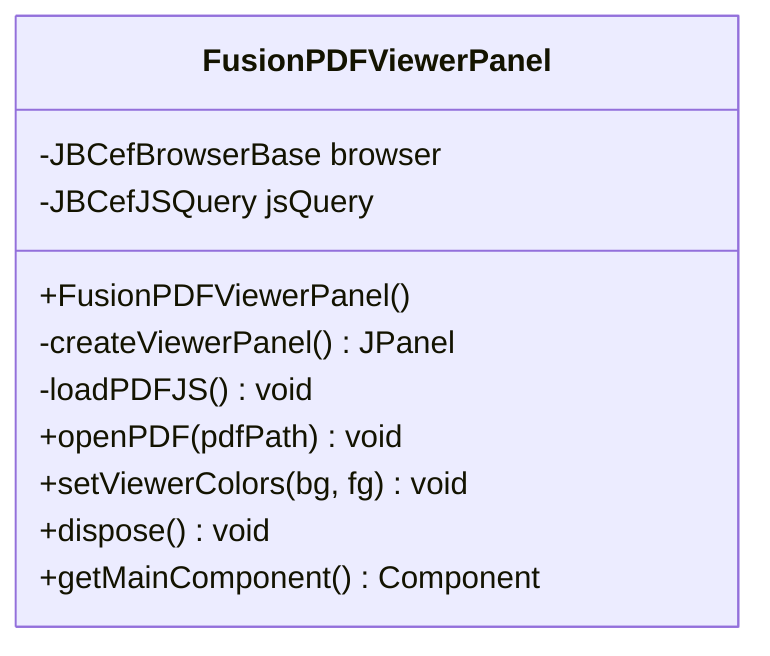
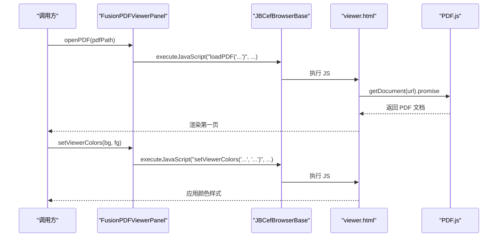
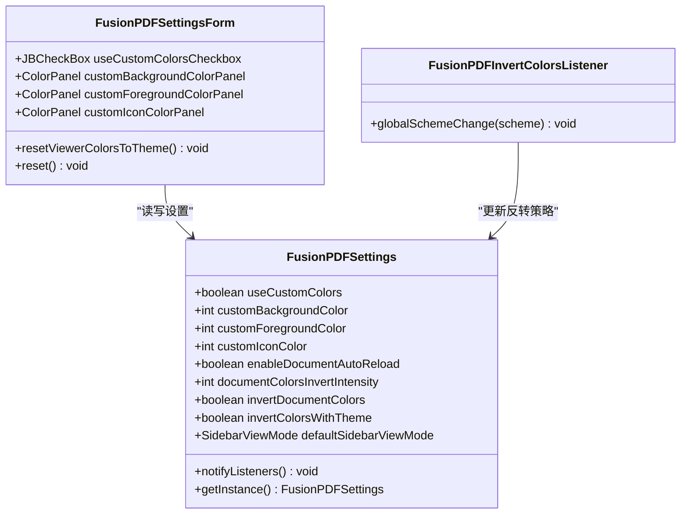
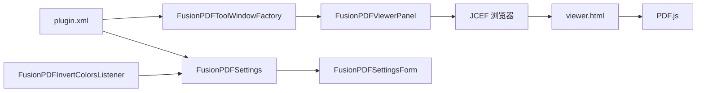

# PDF 查看器模块

<cite>
**本文引用的文件**
- [FusionPDFViewerPanel.java](file://src/main/java/com/github/wkkya/fusionpdf/viewer/FusionPDFViewerPanel.java)
- [viewer.html](file://src/main/resources/pdfjs/web/viewer.html)
- [fixes.css](file://src/main/resources/pdfjs/web/fixes.css)
- [plugin.xml](file://src/main/resources/META-INF/plugin.xml)
- [FusionPDFToolWindowFactory.java](file://src/main/java/com/github/wkkya/fusionpdf/factory/FusionPDFToolWindowFactory.java)
- [FusionPDFSettings.java](file://src/main/java/com/github/wkkya/fusionpdf/settings/FusionPDFSettings.java)
- [FusionPDFSettingsForm.java](file://src/main/java/com/github/wkkya/fusionpdf/settings/FusionPDFSettingsForm.java)
- [FusionPDFInvertColorsListener.java](file://src/main/java/com/github/wkkya/fusionpdf/settings/FusionPDFInvertColorsListener.java)
- [README.md](file://README.md)
</cite>

## 目录
1. [简介](#简介)
2. [项目结构](#项目结构)
3. [核心组件](#核心组件)
4. [架构总览](#架构总览)
5. [详细组件分析](#详细组件分析)
6. [依赖关系分析](#依赖关系分析)
7. [性能考虑](#性能考虑)
8. [故障排查指南](#故障排查指南)
9. [结论](#结论)
10. [附录](#附录)

## 简介
本文件面向 FusionPDF 插件中的 PDF 查看器模块，重点解析 FusionPDFViewerPanel 类的实现原理，涵盖以下方面：
- JCEF 浏览器集成与生命周期管理
- PDF.js 查看器加载机制与 viewer.html 的集成
- PDF 文件渲染流程与跨平台兼容性处理
- openPDF 方法的加载流程、setViewerColors 的颜色设置机制、dispose 的资源清理策略
- 实际使用示例与常见问题解决方案、性能优化建议

## 项目结构
该模块位于 viewer 包中，配合工具窗口工厂类在 IDE 底部工具窗中呈现；PDF.js 资源位于 resources/pdfjs/web 目录下；设置与监听器位于 settings 包中。



图表来源
- [FusionPDFToolWindowFactory.java:12-19](file://src/main/java/com/github/wkkya/fusionpdf/factory/FusionPDFToolWindowFactory.java#L12-L19)
- [FusionPDFViewerPanel.java:12-38](file://src/main/java/com/github/wkkya/fusionpdf/viewer/FusionPDFViewerPanel.java#L12-L38)
- [viewer.html:1-175](file://src/main/resources/pdfjs/web/viewer.html#L1-L175)
- [fixes.css:1-22](file://src/main/resources/pdfjs/web/fixes.css#L1-L22)
- [FusionPDFSettings.java:17-46](file://src/main/java/com/github/wkkya/fusionpdf/settings/FusionPDFSettings.java#L17-L46)
- [FusionPDFSettingsForm.java:18-87](file://src/main/java/com/github/wkkya/fusionpdf/settings/FusionPDFSettingsForm.java#L18-L87)
- [FusionPDFInvertColorsListener.java:11-24](file://src/main/java/com/github/wkkya/fusionpdf/settings/FusionPDFInvertColorsListener.java#L11-L24)
- [plugin.xml:26-46](file://src/main/resources/META-INF/plugin.xml#L26-L46)

章节来源
- [plugin.xml:11-36](file://src/main/resources/META-INF/plugin.xml#L11-L36)
- [FusionPDFToolWindowFactory.java:12-19](file://src/main/java/com/github/wkkya/fusionpdf/factory/FusionPDFToolWindowFactory.java#L12-L19)

## 核心组件
- FusionPDFViewerPanel：负责 JCEF 浏览器初始化、PDF.js viewer.html 加载、PDF 打开与颜色设置、资源释放等。
- viewer.html：基于 PDF.js 的查看器，提供页面渲染、翻页、文件选择等能力，并通过全局函数暴露给插件调用。
- fixes.css：针对侧边栏、工具栏等元素进行隐藏或定位修复，确保在 IDE 工具窗中的显示效果。
- 设置系统：FusionPDFSettings 提供持久化设置，FusionPDFSettingsForm 提供 UI 表单，FusionPDFInvertColorsListener 响应 IDE 主题变化。
- 工具窗口工厂：将查看器面板注入到 IDE 底部工具窗。

章节来源
- [FusionPDFViewerPanel.java:12-76](file://src/main/java/com/github/wkkya/fusionpdf/viewer/FusionPDFViewerPanel.java#L12-L76)
- [viewer.html:1-175](file://src/main/resources/pdfjs/web/viewer.html#L1-L175)
- [fixes.css:1-22](file://src/main/resources/pdfjs/web/fixes.css#L1-L22)
- [FusionPDFSettings.java:17-147](file://src/main/java/com/github/wkkya/fusionpdf/settings/FusionPDFSettings.java#L17-L147)
- [FusionPDFSettingsForm.java:18-159](file://src/main/java/com/github/wkkya/fusionpdf/settings/FusionPDFSettingsForm.java#L18-L159)
- [FusionPDFInvertColorsListener.java:11-24](file://src/main/java/com/github/wkkya/fusionpdf/settings/FusionPDFInvertColorsListener.java#L11-L24)
- [FusionPDFToolWindowFactory.java:12-19](file://src/main/java/com/github/wkkya/fusionpdf/factory/FusionPDFToolWindowFactory.java#L12-L19)

## 架构总览
PDF 查看器采用“IDE 工具窗 + JCEF 浏览器 + PDF.js 查看器”的三层架构：
- 工具窗层：由工厂类创建并注入 FusionPDFViewerPanel。
- 浏览器层：使用 JCEF 在组件内嵌入 Web 视图，加载本地资源 viewer.html。
- 查看器层：PDF.js 在浏览器中渲染 PDF 页面，插件通过 JS 调用与之交互。



图表来源
- [FusionPDFToolWindowFactory.java:14-18](file://src/main/java/com/github/wkkya/fusionpdf/factory/FusionPDFToolWindowFactory.java#L14-L18)
- [FusionPDFViewerPanel.java:17-38](file://src/main/java/com/github/wkkya/fusionpdf/viewer/FusionPDFViewerPanel.java#L17-L38)
- [viewer.html:59-61](file://src/main/resources/pdfjs/web/viewer.html#L59-L61)

## 详细组件分析

### FusionPDFViewerPanel 组件分析
- JCEF 浏览器初始化
  - 通过 JBCefApp 获取客户端并创建 JBCefBrowserBase 实例，初始地址为 about:blank。
  - 使用 JBCefJSQuery 在浏览器上创建 JS 查询对象，用于后续与 JS 交互。
- 浏览器布局与滚动
  - 将浏览器组件放入 JBScrollPane，并移除边框，保证在工具窗中无缝显示。
- PDF.js 查看器加载
  - 通过 getResource 获取 viewer.html 的外部路径并加载，确保在 IDE 资源目录中可用。
- PDF 打开流程（openPDF）
  - 生成 JS 调用字符串，调用 viewer.html 中的 loadPDF 函数，传入 PDF 文件 URI。
- 颜色设置（setViewerColors）
  - 将传入的背景/前景色转换为十六进制字符串，调用 viewer.html 中的 setViewerColors 函数。
- 资源清理（dispose）
  - 依次释放 JBCefJSQuery 和 JBCefBrowserBase，避免内存泄漏。



图表来源
- [FusionPDFViewerPanel.java:12-76](file://src/main/java/com/github/wkkya/fusionpdf/viewer/FusionPDFViewerPanel.java#L12-L76)



图表来源
- [FusionPDFViewerPanel.java:54-65](file://src/main/java/com/github/wkkya/fusionpdf/viewer/FusionPDFViewerPanel.java#L54-L65)
- [viewer.html:156-171](file://src/main/resources/pdfjs/web/viewer.html#L156-L171)

章节来源
- [FusionPDFViewerPanel.java:17-76](file://src/main/java/com/github/wkkya/fusionpdf/viewer/FusionPDFViewerPanel.java#L17-L76)

### viewer.html 与 PDF.js 集成
- 资源加载
  - 通过 script 标签引入 PDF.js 及其 worker 脚本，设置 workerSrc。
- 页面渲染
  - 使用 Canvas 渲染每一页，维护页码状态与渲染队列，避免并发渲染冲突。
- 事件绑定
  - 提供上一页/下一页按钮与文件选择输入框，支持本地文件读取与渲染。
- 插件接口
  - 暴露 loadPDF(url) 供外部调用；当存在 window.intellij 时，提供 onLoadPDF 回调入口。

```mermaid
flowchart TD
Start(["进入 viewer.html"]) --> Init["初始化 PDF.js 与 worker"]
Init --> BindEvents["绑定翻页与文件选择事件"]
BindEvents --> Ready{"等待外部调用"}
Ready --> |loadPDF(url)| LoadDoc["getDocument(url)"]
LoadDoc --> Render["renderPage(1)"]
Render --> UpdateUI["更新页码与视图"]
Ready --> |setViewerColors| ApplyColors["应用背景/前景色"]
ApplyColors --> UpdateUI
UpdateUI --> Ready
```

图表来源
- [viewer.html:59-171](file://src/main/resources/pdfjs/web/viewer.html#L59-L171)

章节来源
- [viewer.html:1-175](file://src/main/resources/pdfjs/web/viewer.html#L1-L175)

### fixes.css 与跨平台兼容性
- 隐藏冗余 UI
  - 隐藏查找栏、次级工具栏、侧边栏容器等，减少与 IDE 工具窗的视觉冲突。
- 定位修复
  - 对侧边栏容器与查看器容器的定位进行修正，确保在不同窗口尺寸下的稳定显示。
- 媒体查询
  - 针对窄屏设备的侧边栏展开逻辑进行适配，保证布局一致性。

章节来源
- [fixes.css:1-22](file://src/main/resources/pdfjs/web/fixes.css#L1-L22)

### 设置系统与主题联动
- 设置持久化
  - FusionPDFSettings 使用 @State 注解持久化用户偏好，包含是否使用自定义颜色、文档反转强度等。
- 设置表单
  - FusionPDFSettingsForm 提供 UI 控件，允许用户选择背景/前景/图标颜色，并一键同步当前主题颜色。
- 主题监听
  - FusionPDFInvertColorsListener 监听 IDE 全局颜色方案变化，根据背景明暗自动切换文档颜色反转策略。



图表来源
- [FusionPDFSettings.java:17-147](file://src/main/java/com/github/wkkya/fusionpdf/settings/FusionPDFSettings.java#L17-L147)
- [FusionPDFSettingsForm.java:18-159](file://src/main/java/com/github/wkkya/fusionpdf/settings/FusionPDFSettingsForm.java#L18-L159)
- [FusionPDFInvertColorsListener.java:11-24](file://src/main/java/com/github/wkkya/fusionpdf/settings/FusionPDFInvertColorsListener.java#L11-L24)

章节来源
- [FusionPDFSettings.java:17-147](file://src/main/java/com/github/wkkya/fusionpdf/settings/FusionPDFSettings.java#L17-L147)
- [FusionPDFSettingsForm.java:18-159](file://src/main/java/com/github/wkkya/fusionpdf/settings/FusionPDFSettingsForm.java#L18-L159)
- [FusionPDFInvertColorsListener.java:11-24](file://src/main/java/com/github/wkkya/fusionpdf/settings/FusionPDFInvertColorsListener.java#L11-L24)

## 依赖关系分析
- 组件耦合
  - FusionPDFViewerPanel 依赖 JCEF 组件与 viewer.html；viewer.html 依赖 PDF.js；设置系统独立但被 UI 表单与监听器消费。
- 外部依赖
  - PDF.js 作为浏览器端渲染引擎，承担 PDF 解析与 Canvas 渲染职责。
- 配置扩展点
  - plugin.xml 注册了工具窗口、设置服务与监听器，支持调试开关、JCEF OSR 渲染等注册项。



图表来源
- [FusionPDFViewerPanel.java:12-76](file://src/main/java/com/github/wkkya/fusionpdf/viewer/FusionPDFViewerPanel.java#L12-L76)
- [viewer.html:59-61](file://src/main/resources/pdfjs/web/viewer.html#L59-L61)
- [FusionPDFSettings.java:17-46](file://src/main/java/com/github/wkkya/fusionpdf/settings/FusionPDFSettings.java#L17-L46)
- [FusionPDFSettingsForm.java:18-87](file://src/main/java/com/github/wkkya/fusionpdf/settings/FusionPDFSettingsForm.java#L18-L87)
- [FusionPDFInvertColorsListener.java:11-24](file://src/main/java/com/github/wkkya/fusionpdf/settings/FusionPDFInvertColorsListener.java#L11-L24)
- [FusionPDFToolWindowFactory.java:12-19](file://src/main/java/com/github/wkkya/fusionpdf/factory/FusionPDFToolWindowFactory.java#L12-L19)
- [plugin.xml:26-46](file://src/main/resources/META-INF/plugin.xml#L26-L46)

章节来源
- [plugin.xml:26-46](file://src/main/resources/META-INF/plugin.xml#L26-L46)

## 性能考虑
- JCEF 渲染模式
  - 可通过注册项启用 JCEF OSR（Off-Screen Rendering）以降低 CPU 占用，适合长时间阅读场景。
- 文档自动重载
  - 若开启“变更时重载”，文件改动后会自动刷新查看器，但可能带来额外的解析与渲染开销。
- 文档颜色反转强度
  - 反转强度越高对比度越强，但可能影响阅读舒适度；默认值 85 平衡了可读性与对比度。
- PDF.js worker
  - workerSrc 的正确配置可避免主线程阻塞，建议保持默认路径或确保打包后路径一致。

章节来源
- [plugin.xml:27-30](file://src/main/resources/META-INF/plugin.xml#L27-L30)
- [FusionPDFSettings.java:27-31](file://src/main/java/com/github/wkkya/fusionpdf/settings/FusionPDFSettings.java#L27-L31)
- [viewer.html:60-61](file://src/main/resources/pdfjs/web/viewer.html#L60-L61)

## 故障排查指南
- 浏览器初始化失败
  - 现象：抛出“Failed to initialize browser”异常。
  - 排查：确认 JBCefApp 初始化顺序与资源可用性；检查 IDE 是否支持 JCEF。
- 查看器未显示或空白
  - 现象：仅显示空白或加载超时。
  - 排查：确认 viewer.html 资源路径正确；检查 fixes.css 是否生效；验证 PDF.js 资源是否随插件打包。
- PDF 无法打开
  - 现象：调用 openPDF 后无响应。
  - 排查：确认传入的 Path.toUri().toString() 有效且可访问；检查浏览器执行 executeJavaScript 的返回；查看控制台是否有 PDF.js 错误。
- 颜色设置不生效
  - 现象：setViewerColors 调用后界面无变化。
  - 排查：确认 viewer.html 中存在 setViewerColors 函数；检查传入的十六进制颜色格式；验证 CSS 是否覆盖了相关样式。
- 主题颜色未自动切换
  - 现象：切换 IDE 主题后文档颜色未反转。
  - 排查：确认 FusionPDFInvertColorsListener 已注册；检查“按主题反转文档颜色”开关；验证全局颜色方案变化事件是否触发。

章节来源
- [FusionPDFViewerPanel.java:25-30](file://src/main/java/com/github/wkkya/fusionpdf/viewer/FusionPDFViewerPanel.java#L25-L30)
- [viewer.html:156-171](file://src/main/resources/pdfjs/web/viewer.html#L156-L171)
- [FusionPDFInvertColorsListener.java:11-24](file://src/main/java/com/github/wkkya/fusionpdf/settings/FusionPDFInvertColorsListener.java#L11-L24)

## 结论
FusionPDF 的 PDF 查看器模块通过 JCEF 与 PDF.js 的结合，在 IDE 工具窗中提供了轻量、可定制的 PDF 阅读体验。其关键优势在于：
- 与 IDE 主题深度集成，支持自定义背景/前景色与文档颜色反转。
- 通过本地资源 viewer.html 与 fixes.css，实现跨平台兼容与布局稳定。
- 提供 openPDF 与 setViewerColors 等简洁 API，便于上层功能调用。

## 附录

### 使用示例（步骤说明）
- 在工具窗中创建查看器
  - 使用工具窗口工厂创建并添加 FusionPDFViewerPanel 到底部工具窗。
- 打开 PDF 文件
  - 调用 openPDF 方法传入 PDF 文件的 Path，内部通过 JS 调用 viewer.html 的 loadPDF。
- 设置查看器颜色
  - 调用 setViewerColors 方法传入背景与前景颜色，内部通过 JS 调用 viewer.html 的 setViewerColors。
- 释放资源
  - 在不再需要时调用 dispose，释放 JBCefJSQuery 与 JBCefBrowserBase。

章节来源
- [FusionPDFToolWindowFactory.java:14-18](file://src/main/java/com/github/wkkya/fusionpdf/factory/FusionPDFToolWindowFactory.java#L14-L18)
- [FusionPDFViewerPanel.java:54-70](file://src/main/java/com/github/wkkya/fusionpdf/viewer/FusionPDFViewerPanel.java#L54-L70)

### 关键 API 一览
- openPDF(pdfPath)
  - 作用：加载指定 PDF 文件并渲染第一页。
  - 实现要点：构造 JS 调用字符串并执行。
- setViewerColors(backgroundColor, foregroundColor)
  - 作用：设置查看器背景与前景颜色。
  - 实现要点：将颜色转为十六进制并调用 JS 函数。
- dispose()
  - 作用：释放 JS 查询与浏览器资源。
  - 实现要点：先释放 jsQuery，再释放 browser。

章节来源
- [FusionPDFViewerPanel.java:54-70](file://src/main/java/com/github/wkkya/fusionpdf/viewer/FusionPDFViewerPanel.java#L54-L70)