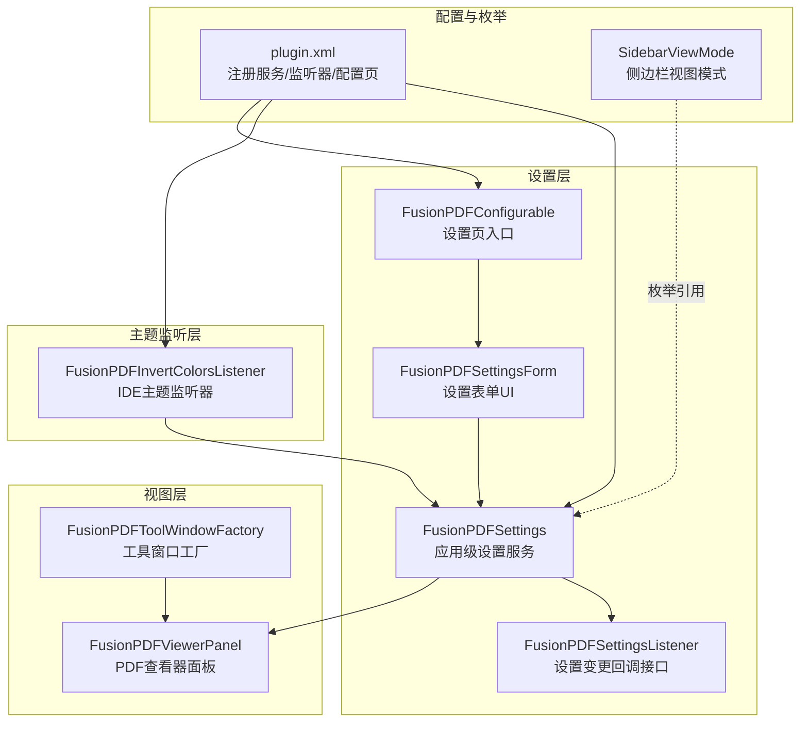
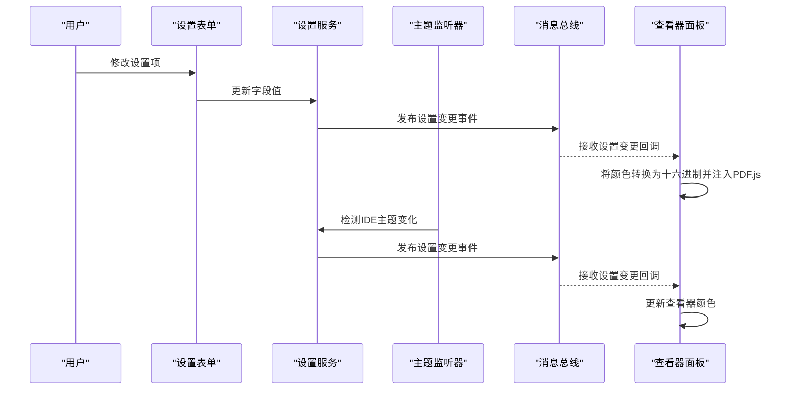
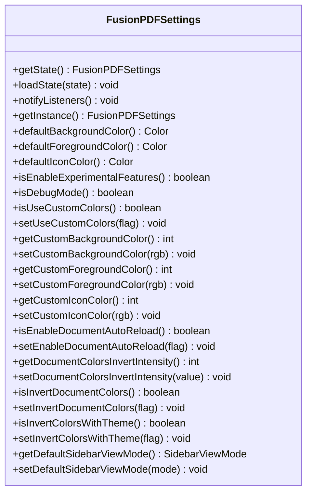
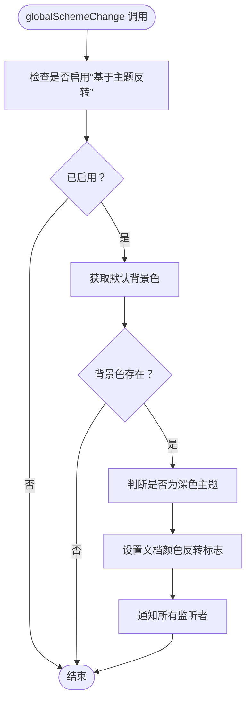
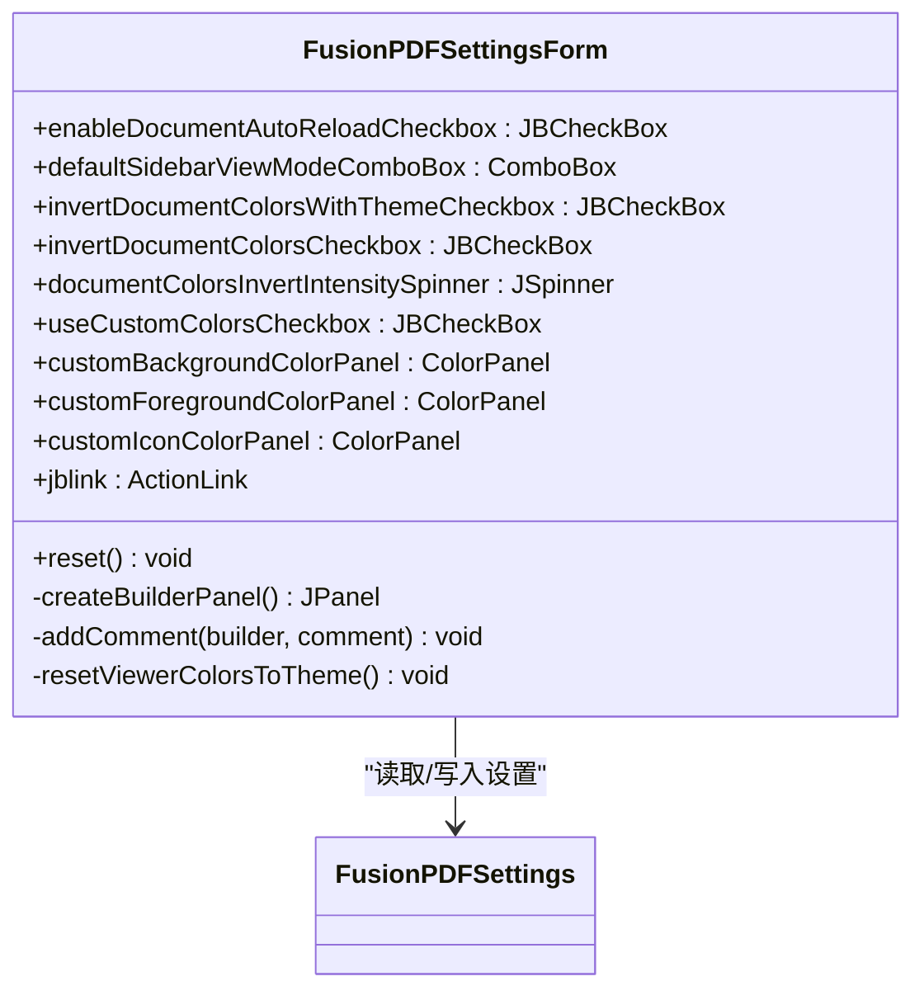
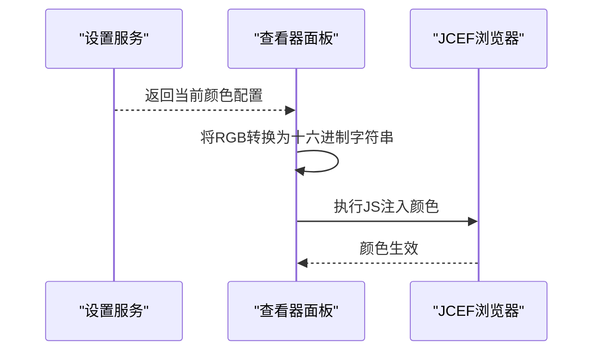
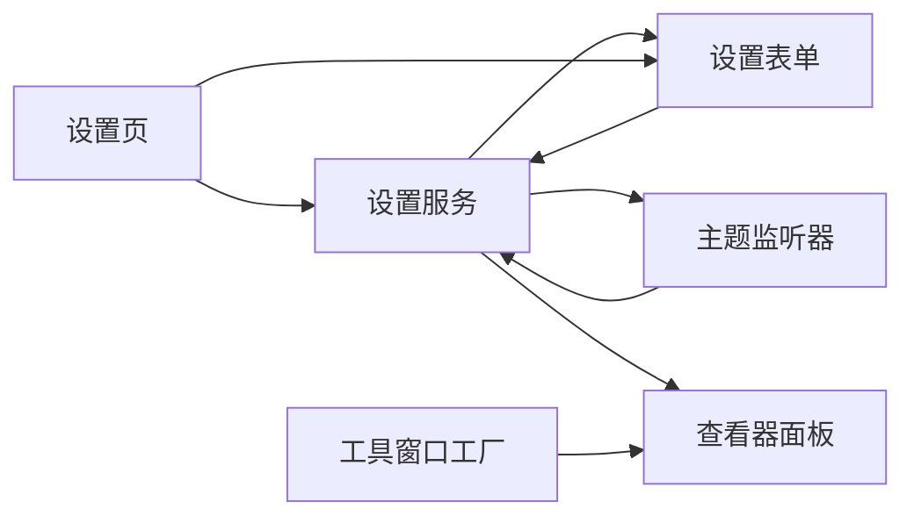

# 主题集成模块

<cite>
**本文档引用的文件**
- [FusionPDFSettings.java](file://src/main/java/com/github/wkkya/fusionpdf/settings/FusionPDFSettings.java)
- [FusionPDFInvertColorsListener.java](file://src/main/java/com/github/wkkya/fusionpdf/settings/FusionPDFInvertColorsListener.java)
- [FusionPDFSettingsForm.java](file://src/main/java/com/github/wkkya/fusionpdf/settings/FusionPDFSettingsForm.java)
- [FusionPDFSettingsListener.java](file://src/main/java/com/github/wkkya/fusionpdf/settings/FusionPDFSettingsListener.java)
- [FusionPDFConfigurable.java](file://src/main/java/com/github/wkkya/fusionpdf/settings/FusionPDFConfigurable.java)
- [SidebarViewMode.java](file://src/main/java/com/github/wkkya/fusionpdf/enums/SidebarViewMode.java)
- [plugin.xml](file://src/main/resources/META-INF/plugin.xml)
- [FusionPDFViewerPanel.java](file://src/main/java/com/github/wkkya/fusionpdf/viewer/FusionPDFViewerPanel.java)
- [FusionPDFToolWindowFactory.java](file://src/main/java/com/github/wkkya/fusionpdf/factory/FusionPDFToolWindowFactory.java)
</cite>

## 目录
1. [简介](#简介)
2. [项目结构](#项目结构)
3. [核心组件](#核心组件)
4. [架构总览](#架构总览)
5. [详细组件分析](#详细组件分析)
6. [依赖关系分析](#依赖关系分析)
7. [性能考虑](#性能考虑)
8. [故障排除指南](#故障排除指南)
9. [结论](#结论)
10. [附录](#附录)

## 简介
本文件面向 FusionPDF 插件的主题集成模块，系统性阐述以下内容：
- FusionPDFSettings 设置管理系统的数据模型、持久化机制、默认值策略与变更通知机制
- FusionPDFInvertColorsListener 颜色反转监听器的 IDE 主题监听、颜色值自动计算与实时响应流程
- 主题颜色的 RGB 值转换、颜色空间处理与跨平台兼容性
- 设置数据模型详解、颜色计算公式说明与主题切换事件处理流程
- 实际使用示例：如何配置自定义颜色、处理主题变化与优化颜色适配效果

## 项目结构
主题集成模块位于 settings 包中，配合 viewer 和 factory 组件共同完成主题感知、颜色适配与界面呈现。关键文件职责如下：
- FusionPDFSettings：应用级设置服务，负责持久化、默认值与变更通知
- FusionPDFInvertColorsListener：IDE 主题监听器，响应全局配色方案变化
- FusionPDFSettingsForm：设置表单 UI，绑定设置项与用户交互
- FusionPDFConfigurable：设置页入口，承载表单并触发通知
- FusionPDFSettingsListener：设置变更回调接口
- SidebarViewMode：侧边栏视图模式枚举
- plugin.xml：注册设置服务、配置页与监听器
- FusionPDFViewerPanel：PDF 查看器面板，负责将颜色传递给 PDF.js
- FusionPDFToolWindowFactory：工具窗口工厂，创建查看器面板

图表来源
- [plugin.xml:26-46](file://src/main/resources/META-INF/plugin.xml#L26-L46)
- [FusionPDFSettings.java:17-50](file://src/main/java/com/github/wkkya/fusionpdf/settings/FusionPDFSettings.java#L17-L50)
- [FusionPDFInvertColorsListener.java:11-24](file://src/main/java/com/github/wkkya/fusionpdf/settings/FusionPDFInvertColorsListener.java#L11-L24)
- [FusionPDFConfigurable.java:7-74](file://src/main/java/com/github/wkkya/fusionpdf/settings/FusionPDFConfigurable.java#L7-L74)
- [FusionPDFSettingsForm.java:18-87](file://src/main/java/com/github/wkkya/fusionpdf/settings/FusionPDFSettingsForm.java#L18-L87)
- [FusionPDFViewerPanel.java:12-76](file://src/main/java/com/github/wkkya/fusionpdf/viewer/FusionPDFViewerPanel.java#L12-L76)
- [FusionPDFToolWindowFactory.java:12-18](file://src/main/java/com/github/wkkya/fusionpdf/factory/FusionPDFToolWindowFactory.java#L12-L18)
- [SidebarViewMode.java:3-21](file://src/main/java/com/github/wkkya/fusionpdf/enums/SidebarViewMode.java#L3-L21)

章节来源
- [plugin.xml:26-46](file://src/main/resources/META-INF/plugin.xml#L26-L46)
- [FusionPDFSettings.java:17-50](file://src/main/java/com/github/wkkya/fusionpdf/settings/FusionPDFSettings.java#L17-L50)
- [FusionPDFSettingsForm.java:18-87](file://src/main/java/com/github/wkkya/fusionpdf/settings/FusionPDFSettingsForm.java#L18-L87)
- [FusionPDFConfigurable.java:7-74](file://src/main/java/com/github/wkkya/fusionpdf/settings/FusionPDFConfigurable.java#L7-L74)
- [FusionPDFInvertColorsListener.java:11-24](file://src/main/java/com/github/wkkya/fusionpdf/settings/FusionPDFInvertColorsListener.java#L11-L24)
- [FusionPDFViewerPanel.java:12-76](file://src/main/java/com/github/wkkya/fusionpdf/viewer/FusionPDFViewerPanel.java#L12-L76)
- [FusionPDFToolWindowFactory.java:12-18](file://src/main/java/com/github/wkkya/fusionpdf/factory/FusionPDFToolWindowFactory.java#L12-L18)
- [SidebarViewMode.java:3-21](file://src/main/java/com/github/wkkya/fusionpdf/enums/SidebarViewMode.java#L3-L21)

## 核心组件
本节聚焦主题集成模块的核心组件及其职责与交互。

- FusionPDFSettings（设置服务）
  - 应用级持久化状态组件，使用注解声明存储位置与文件名
  - 提供默认颜色值与实验特性开关
  - 维护主题颜色反转强度、是否启用主题驱动反转等关键布尔标志
  - 通过消息总线发布设置变更事件，供监听者订阅
  - 提供静态实例获取与默认颜色查询方法

- FusionPDFInvertColorsListener（主题监听器）
  - 实现 IDE 编辑器颜色监听接口
  - 在全局配色方案变化时，根据当前背景色判断深浅主题
  - 自动设置文档颜色反转标志并通知监听者

- FusionPDFSettingsForm（设置表单）
  - 将设置项映射到 UI 控件，包括复选框、下拉框与颜色面板
  - 支持“基于主题反转”与“手动反转”的互斥逻辑
  - 提供一键重置为当前主题颜色的功能

- FusionPDFConfigurable（设置页）
  - 承载设置表单并作为 IDE 设置页入口
  - 处理修改检测与应用流程，必要时触发设置变更通知

- FusionPDFSettingsListener（回调接口）
  - 函数式接口，用于接收设置变更事件

- FusionPDFViewerPanel（查看器面板）
  - 负责将颜色值转换为十六进制字符串并通过 JS 注入方式传递给 PDF.js
  - 提供打开 PDF 与设置查看器颜色的方法

- SidebarViewMode（枚举）
  - 定义侧边栏视图模式，用于设置默认侧边栏显示模式

章节来源
- [FusionPDFSettings.java:17-147](file://src/main/java/com/github/wkkya/fusionpdf/settings/FusionPDFSettings.java#L17-L147)
- [FusionPDFInvertColorsListener.java:11-24](file://src/main/java/com/github/wkkya/fusionpdf/settings/FusionPDFInvertColorsListener.java#L11-L24)
- [FusionPDFSettingsForm.java:18-158](file://src/main/java/com/github/wkkya/fusionpdf/settings/FusionPDFSettingsForm.java#L18-L158)
- [FusionPDFConfigurable.java:7-74](file://src/main/java/com/github/wkkya/fusionpdf/settings/FusionPDFConfigurable.java#L7-L74)
- [FusionPDFSettingsListener.java:3-6](file://src/main/java/com/github/wkkya/fusionpdf/settings/FusionPDFSettingsListener.java#L3-L6)
- [FusionPDFViewerPanel.java:59-65](file://src/main/java/com/github/wkkya/fusionpdf/viewer/FusionPDFViewerPanel.java#L59-L65)
- [SidebarViewMode.java:3-21](file://src/main/java/com/github/wkkya/fusionpdf/enums/SidebarViewMode.java#L3-L21)

## 架构总览
主题集成模块采用“设置服务 + 监听器 + 表单 + 视图”的分层架构：
- 设置服务负责状态持久化与变更广播
- 监听器负责响应 IDE 主题变化并自动更新设置
- 表单负责用户交互与设置项绑定
- 视图负责将最终颜色值传递给 PDF.js 渲染层

图表来源
- [FusionPDFSettings.java:44-46](file://src/main/java/com/github/wkkya/fusionpdf/settings/FusionPDFSettings.java#L44-L46)
- [FusionPDFInvertColorsListener.java:14-23](file://src/main/java/com/github/wkkya/fusionpdf/settings/FusionPDFInvertColorsListener.java#L14-L23)
- [FusionPDFSettingsForm.java:68-77](file://src/main/java/com/github/wkkya/fusionpdf/settings/FusionPDFSettingsForm.java#L68-L77)
- [FusionPDFViewerPanel.java:59-65](file://src/main/java/com/github/wkkya/fusionpdf/viewer/FusionPDFViewerPanel.java#L59-L65)

## 详细组件分析

### FusionPDFSettings（设置管理）
- 数据模型与持久化
  - 使用注解声明状态组件与存储文件名，确保设置在重启后仍可用
  - 通过复制 Bean 的方式加载状态，保证字段一致性
- 默认值与实验特性
  - 默认文档颜色反转强度为固定值
  - 提供实验特性与调试模式的注册表开关
- 颜色与反转控制
  - 维护自定义背景、前景与图标颜色的整型 RGB 值
  - 维护文档颜色反转强度、是否启用主题驱动反转、是否启用自动重载等布尔标志
- 变更通知机制
  - 通过消息总线同步发布设置变更事件，供监听者订阅
  - 提供静态实例获取方法，便于各组件访问

图表来源
- [FusionPDFSettings.java:17-147](file://src/main/java/com/github/wkkya/fusionpdf/settings/FusionPDFSettings.java#L17-L147)

章节来源
- [FusionPDFSettings.java:17-147](file://src/main/java/com/github/wkkya/fusionpdf/settings/FusionPDFSettings.java#L17-L147)

### FusionPDFInvertColorsListener（主题监听器）
- 监听机制
  - 实现 IDE 编辑器颜色监听接口，在全局配色方案变化时被调用
  - 仅在“基于主题反转”选项开启时生效
- 颜色计算与自动反转
  - 获取当前默认背景色，使用工具方法判断深浅主题
  - 自动设置文档颜色反转标志，并通知所有监听者
- 实时响应
  - 设置变更通过消息总线传播，查看器面板等组件即时更新

图表来源
- [FusionPDFInvertColorsListener.java:14-23](file://src/main/java/com/github/wkkya/fusionpdf/settings/FusionPDFInvertColorsListener.java#L14-L23)

章节来源
- [FusionPDFInvertColorsListener.java:11-24](file://src/main/java/com/github/wkkya/fusionpdf/settings/FusionPDFInvertColorsListener.java#L11-L24)

### FusionPDFSettingsForm（设置表单）
- 用户交互与绑定
  - 将设置项映射到 UI 控件，包括复选框、下拉框与颜色面板
  - “基于主题反转”与“手动反转”互斥：前者启用时后者禁用
  - 颜色面板选择颜色后直接写回设置服务的 RGB 值
- 快捷功能
  - 提供一键重置为当前主题颜色的功能，自动从默认配色方案取值

图表来源
- [FusionPDFSettingsForm.java:18-158](file://src/main/java/com/github/wkkya/fusionpdf/settings/FusionPDFSettingsForm.java#L18-L158)

章节来源
- [FusionPDFSettingsForm.java:18-158](file://src/main/java/com/github/wkkya/fusionpdf/settings/FusionPDFSettingsForm.java#L18-L158)

### FusionPDFConfigurable（设置页）
- 设置页入口
  - 承载设置表单并作为 IDE 设置页入口
  - 提供创建组件、重置与释放资源的生命周期方法
- 修改检测与应用
  - 当前实现未启用完整修改检测与应用逻辑，但保留了扩展点
  - 若存在修改，会触发设置变更通知，确保监听者收到最新设置

章节来源
- [FusionPDFConfigurable.java:7-74](file://src/main/java/com/github/wkkya/fusionpdf/settings/FusionPDFConfigurable.java#L7-L74)

### FusionPDFViewerPanel（查看器面板）
- 颜色传递机制
  - 将颜色值转换为十六进制字符串格式
  - 通过执行 JavaScript 代码将颜色注入 PDF.js，实现查看器界面的颜色适配
- 与设置服务的协作
  - 查看器面板通过设置服务获取当前颜色配置，实现主题联动

图表来源
- [FusionPDFViewerPanel.java:59-65](file://src/main/java/com/github/wkkya/fusionpdf/viewer/FusionPDFViewerPanel.java#L59-L65)
- [FusionPDFSettings.java:74-147](file://src/main/java/com/github/wkkya/fusionpdf/settings/FusionPDFSettings.java#L74-L147)

章节来源
- [FusionPDFViewerPanel.java:59-65](file://src/main/java/com/github/wkkya/fusionpdf/viewer/FusionPDFViewerPanel.java#L59-L65)

### SidebarViewMode（侧边栏视图模式）
- 枚举定义了四种侧边栏视图模式，用于设置默认侧边栏显示模式
- 与设置表单中的下拉框绑定，实现用户可选的侧边栏视图

章节来源
- [SidebarViewMode.java:3-21](file://src/main/java/com/github/wkkya/fusionpdf/enums/SidebarViewMode.java#L3-L21)

## 依赖关系分析
- 设置服务与监听器
  - 监听器依赖设置服务进行状态读取与写入
  - 设置服务通过消息总线向监听者广播变更
- 设置表单与设置服务
  - 表单直接读取设置服务的当前值并写回修改
  - 表单提供快捷功能，将当前主题颜色写入设置服务
- 视图层与设置服务
  - 查看器面板从设置服务获取颜色配置，将颜色注入 PDF.js
- 配置与注册
  - plugin.xml 中注册设置服务、配置页与监听器，确保生命周期正确初始化

图表来源
- [plugin.xml:26-46](file://src/main/resources/META-INF/plugin.xml#L26-L46)
- [FusionPDFSettings.java:44-46](file://src/main/java/com/github/wkkya/fusionpdf/settings/FusionPDFSettings.java#L44-L46)
- [FusionPDFInvertColorsListener.java:14-23](file://src/main/java/com/github/wkkya/fusionpdf/settings/FusionPDFInvertColorsListener.java#L14-L23)
- [FusionPDFSettingsForm.java:68-77](file://src/main/java/com/github/wkkya/fusionpdf/settings/FusionPDFSettingsForm.java#L68-L77)
- [FusionPDFConfigurable.java:37-53](file://src/main/java/com/github/wkkya/fusionpdf/settings/FusionPDFConfigurable.java#L37-L53)
- [FusionPDFViewerPanel.java:59-65](file://src/main/java/com/github/wkkya/fusionpdf/viewer/FusionPDFViewerPanel.java#L59-L65)
- [FusionPDFToolWindowFactory.java:14-18](file://src/main/java/com/github/wkkya/fusionpdf/factory/FusionPDFToolWindowFactory.java#L14-L18)

章节来源
- [plugin.xml:26-46](file://src/main/resources/META-INF/plugin.xml#L26-L46)
- [FusionPDFSettings.java:44-46](file://src/main/java/com/github/wkkya/fusionpdf/settings/FusionPDFSettings.java#L44-L46)
- [FusionPDFInvertColorsListener.java:14-23](file://src/main/java/com/github/wkkya/fusionpdf/settings/FusionPDFInvertColorsListener.java#L14-L23)
- [FusionPDFSettingsForm.java:68-77](file://src/main/java/com/github/wkkya/fusionpdf/settings/FusionPDFSettingsForm.java#L68-L77)
- [FusionPDFConfigurable.java:37-53](file://src/main/java/com/github/wkkya/fusionpdf/settings/FusionPDFConfigurable.java#L37-L53)
- [FusionPDFViewerPanel.java:59-65](file://src/main/java/com/github/wkkya/fusionpdf/viewer/FusionPDFViewerPanel.java#L59-L65)
- [FusionPDFToolWindowFactory.java:14-18](file://src/main/java/com/github/wkkya/fusionpdf/factory/FusionPDFToolWindowFactory.java#L14-L18)

## 性能考虑
- 消息总线同步发布
  - 设置变更通过同步消息总线发布，确保监听者及时收到通知，避免异步导致的状态不一致
- 颜色计算简单高效
  - 监听器仅进行一次背景色判断与布尔标志切换，开销极低
- UI 绑定与事件
  - 颜色面板事件直接写回设置服务，减少中间层开销
- PDF.js 注入
  - 颜色转换为十六进制字符串后一次性注入，避免频繁 JS 调用

## 故障排除指南
- 设置未生效
  - 检查设置页是否保存并触发通知
  - 确认消息总线是否正常发布设置变更事件
- 主题监听无效
  - 确认“基于主题反转”选项已启用
  - 检查 IDE 是否正确提供全局配色方案
- 颜色显示异常
  - 确认颜色值转换为十六进制字符串格式正确
  - 检查 PDF.js 是否成功接收并应用颜色

章节来源
- [FusionPDFConfigurable.java:37-53](file://src/main/java/com/github/wkkya/fusionpdf/settings/FusionPDFConfigurable.java#L37-L53)
- [FusionPDFInvertColorsListener.java:14-23](file://src/main/java/com/github/wkkya/fusionpdf/settings/FusionPDFInvertColorsListener.java#L14-L23)
- [FusionPDFViewerPanel.java:59-65](file://src/main/java/com/github/wkkya/fusionpdf/viewer/FusionPDFViewerPanel.java#L59-L65)

## 结论
主题集成模块通过清晰的分层设计实现了：
- 设置服务的持久化与统一管理
- IDE 主题变化的自动感知与响应
- 用户可配置的颜色体系与便捷的快捷重置功能
- 视图层与设置层的松耦合协作，确保主题适配的实时性与稳定性

该模块为 FusionPDF 插件提供了可靠的主题集成基础，既满足了开发者对主题匹配的需求，也为后续扩展（如更复杂的颜色计算或更多主题选项）预留了空间。

## 附录

### 设置数据模型详解
- 关键字段
  - useCustomColors：是否启用自定义颜色
  - customBackgroundColor/customForegroundColor/customIconColor：自定义颜色的 RGB 整型值
  - enableDocumentAutoReload：文档变更时自动重载
  - documentColorsInvertIntensity：文档颜色反转强度（1-100）
  - invertDocumentColors：是否反转文档颜色
  - invertColorsWithTheme：是否基于主题自动反转
  - defaultSidebarViewMode：默认侧边栏视图模式
- 默认值
  - 文档颜色反转强度默认值为固定常量
  - 自定义颜色默认值来自 IDE 全局配色方案
- 存储与加载
  - 使用注解声明状态组件与存储文件名
  - 通过复制 Bean 的方式加载状态，保证字段一致性

章节来源
- [FusionPDFSettings.java:17-147](file://src/main/java/com/github/wkkya/fusionpdf/settings/FusionPDFSettings.java#L17-L147)

### 颜色计算公式与处理
- RGB 值转换
  - 将整型 RGB 值拆分为 R、G、B 分量
  - 使用十六进制格式拼接为字符串，传递给 PDF.js
- 颜色空间与兼容性
  - 使用 AWT 颜色对象表示颜色，确保跨平台兼容
  - 十六进制字符串格式为 PDF.js 所需的标准格式
- 主题适配
  - 通过监听器判断背景色深浅，自动切换文档颜色反转标志
  - 自定义颜色可覆盖默认配色方案，实现个性化适配

章节来源
- [FusionPDFViewerPanel.java:59-65](file://src/main/java/com/github/wkkya/fusionpdf/viewer/FusionPDFViewerPanel.java#L59-L65)
- [FusionPDFInvertColorsListener.java:14-23](file://src/main/java/com/github/wkkya/fusionpdf/settings/FusionPDFInvertColorsListener.java#L14-L23)
- [FusionPDFSettingsForm.java:132-145](file://src/main/java/com/github/wkkya/fusionpdf/settings/FusionPDFSettingsForm.java#L132-L145)

### 主题切换事件处理流程
- IDE 主题变化
  - 监听器接收全局配色方案变化事件
  - 判断当前背景色深浅，设置文档颜色反转标志
  - 通知所有监听者，触发设置变更事件
- 设置变更传播
  - 设置服务通过消息总线发布事件
  - 查看器面板等组件接收事件并更新颜色
- 用户操作
  - 用户在设置表单中修改颜色或反转强度
  - 表单写回设置服务并触发通知
  - 查看器面板接收通知并更新颜色

章节来源
- [plugin.xml:42-46](file://src/main/resources/META-INF/plugin.xml#L42-L46)
- [FusionPDFInvertColorsListener.java:14-23](file://src/main/java/com/github/wkkya/fusionpdf/settings/FusionPDFInvertColorsListener.java#L14-L23)
- [FusionPDFSettings.java:44-46](file://src/main/java/com/github/wkkya/fusionpdf/settings/FusionPDFSettings.java#L44-L46)
- [FusionPDFViewerPanel.java:59-65](file://src/main/java/com/github/wkkya/fusionpdf/viewer/FusionPDFViewerPanel.java#L59-L65)

### 实际使用示例
- 配置自定义颜色
  - 在设置表单中勾选“使用自定义颜色”
  - 通过颜色面板选择背景、前景与图标颜色
  - 点击“设置当前主题颜色”快速恢复为当前主题颜色
- 处理主题变化
  - 启用“基于主题反转”，在深色/浅色主题间自动切换文档颜色反转
  - 调整“反转强度”以获得合适的对比度
- 优化颜色适配效果
  - 若图标颜色与主题不协调，建议使用“设置当前主题颜色”功能
  - 根据个人偏好调整自定义颜色，提升阅读体验

章节来源
- [FusionPDFSettingsForm.java:64-145](file://src/main/java/com/github/wkkya/fusionpdf/settings/FusionPDFSettingsForm.java#L64-L145)
- [FusionPDFInvertColorsListener.java:14-23](file://src/main/java/com/github/wkkya/fusionpdf/settings/FusionPDFInvertColorsListener.java#L14-L23)
- [FusionPDFViewerPanel.java:59-65](file://src/main/java/com/github/wkkya/fusionpdf/viewer/FusionPDFViewerPanel.java#L59-L65)