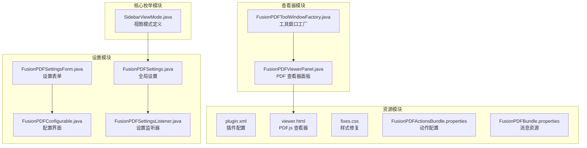
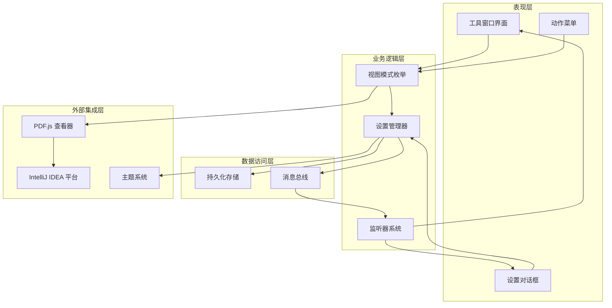
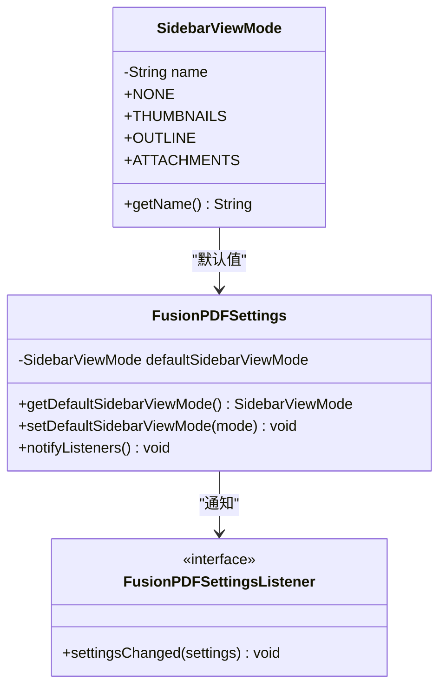
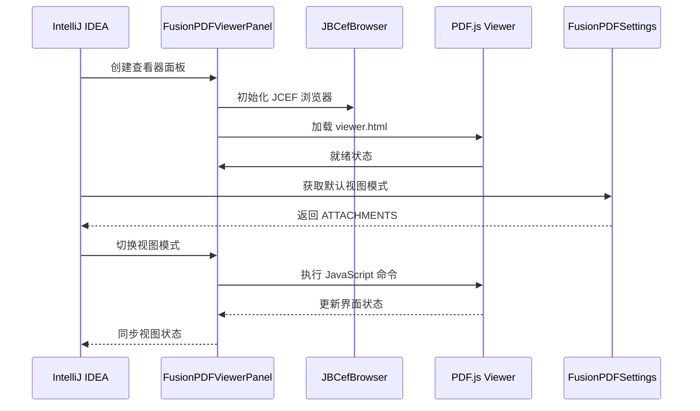
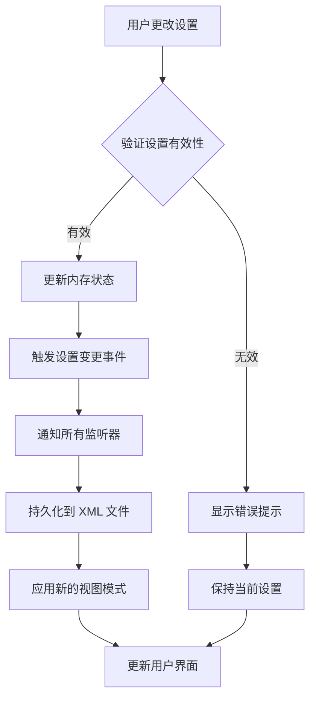
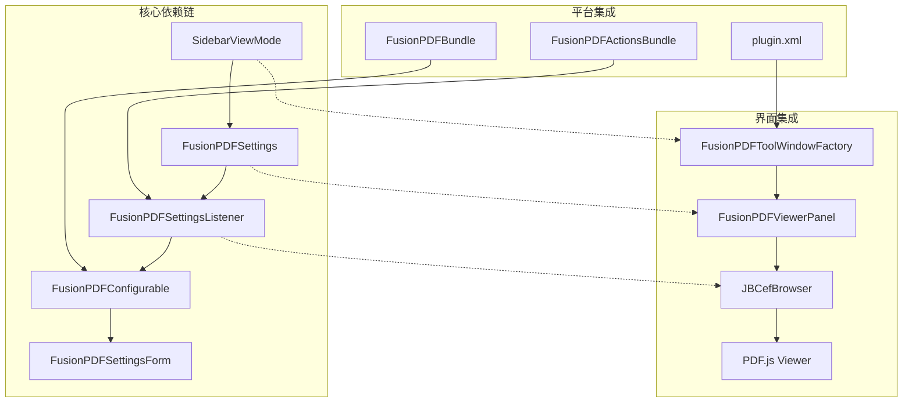

# 侧边栏视图模式

<cite>
**本文档引用的文件**
- [SidebarViewMode.java](file://src/main/java/com/github/wkkya/fusionpdf/enums/SidebarViewMode.java)
- [FusionPDFViewerPanel.java](file://src/main/java/com/github/wkkya/fusionpdf/viewer/FusionPDFViewerPanel.java)
- [FusionPDFToolWindowFactory.java](file://src/main/java/com/github/wkkya/fusionpdf/factory/FusionPDFToolWindowFactory.java)
- [FusionPDFSettings.java](file://src/main/java/com/github/wkkya/fusionpdf/settings/FusionPDFSettings.java)
- [FusionPDFSettingsListener.java](file://src/main/java/com/github/wkkya/fusionpdf/settings/FusionPDFSettingsListener.java)
- [FusionPDFConfigurable.java](file://src/main/java/com/github/wkkya/fusionpdf/settings/FusionPDFConfigurable.java)
- [FusionPDFSettingsForm.java](file://src/main/java/com/github/wkkya/fusionpdf/settings/FusionPDFSettingsForm.java)
- [plugin.xml](file://src/main/resources/META-INF/plugin.xml)
- [viewer.html](file://src/main/resources/pdfjs/web/viewer.html)
- [fixes.css](file://src/main/resources/pdfjs/web/fixes.css)
- [FusionPDFActionsBundle.properties](file://src/main/resources/messages/FusionPDFActionsBundle.properties)
- [FusionPDFBundle.properties](file://src/main/resources/messages/FusionPDFBundle.properties)
</cite>

## 目录
1. [简介](#简介)
2. [项目结构](#项目结构)
3. [核心组件](#核心组件)
4. [架构概览](#架构概览)
5. [详细组件分析](#详细组件分析)
6. [依赖关系分析](#依赖关系分析)
7. [性能考虑](#性能考虑)
8. [故障排除指南](#故障排除指南)
9. [结论](#结论)
10. [附录](#附录)

## 简介

FusionPDF 插件的侧边栏视图模式是一个精心设计的枚举系统，用于管理 PDF 查看器的侧边栏显示模式。该系统支持四种不同的视图模式：无模式、缩略图视图、文档大纲视图和附件视图，为开发者提供了灵活的 PDF 文档导航和浏览体验。

该设计的核心理念是通过类型安全的枚举来统一管理视图模式，确保代码的可维护性和扩展性。每个视图模式都有明确的功能定位和适用场景，为不同类型的 PDF 文档浏览需求提供最佳解决方案。

## 项目结构

FusionPDF 插件采用模块化的项目结构，侧边栏视图模式功能分布在以下关键目录中：



**图表来源**
- [SidebarViewMode.java:1-22](file://src/main/java/com/github/wkkya/fusionpdf/enums/SidebarViewMode.java#L1-L22)
- [FusionPDFViewerPanel.java:1-78](file://src/main/java/com/github/wkkya/fusionpdf/viewer/FusionPDFViewerPanel.java#L1-L78)
- [FusionPDFSettings.java:1-151](file://src/main/java/com/github/wkkya/fusionpdf/settings/FusionPDFSettings.java#L1-L151)

**章节来源**
- [plugin.xml:1-51](file://src/main/resources/META-INF/plugin.xml#L1-L51)
- [SidebarViewMode.java:1-22](file://src/main/java/com/github/wkkya/fusionpdf/enums/SidebarViewMode.java#L1-L22)

## 核心组件

### SidebarViewMode 枚举设计

SidebarViewMode 枚举是整个侧边栏视图模式系统的核心，定义了四种标准视图模式：

| 视图模式 | 值 | 中文名称 | 功能描述 |
|---------|----|----------|----------|
| NONE | 无 | 无模式 | 隐藏侧边栏，最大化主内容区域 |
| THUMBNAILS | 缩略图 | 缩略图视图 | 显示文档页面缩略图，支持快速跳转 |
| OUTLINE | 大纲 | 文档大纲视图 | 显示文档书签和层次结构 |
| ATTACHMENTS | 附件 | 附件视图 | 显示文档附加文件信息 |

每个枚举值都包含一个本地化名称字段，支持多语言界面显示。

**章节来源**
- [SidebarViewMode.java:3-21](file://src/main/java/com/github/wkkya/fusionpdf/enums/SidebarViewMode.java#L3-L21)

### 默认设置配置

FusionPDFSettings 类提供了完整的默认视图模式配置：

- **默认视图模式**: 设置为 ATTACHMENTS（附件视图）
- **持久化存储**: 使用 XML 序列化保存用户偏好
- **主题集成**: 自动适配 IntelliJ IDEA 主题颜色
- **消息总线**: 支持设置变更通知机制

**章节来源**
- [FusionPDFSettings.java:31-46](file://src/main/java/com/github/wkkya/fusionpdf/settings/FusionPDFSettings.java#L31-L46)

## 架构概览

FusionPDF 的侧边栏视图模式架构采用分层设计，确保各组件间的松耦合和高内聚：



**图表来源**
- [FusionPDFToolWindowFactory.java:12-18](file://src/main/java/com/github/wkkya/fusionpdf/factory/FusionPDFToolWindowFactory.java#L12-L18)
- [FusionPDFSettings.java:20-46](file://src/main/java/com/github/wkkya/fusionpdf/settings/FusionPDFSettings.java#L20-L46)

## 详细组件分析

### 视图模式枚举类分析

SidebarViewMode 枚举采用了简洁而高效的设计模式：



**图表来源**
- [SidebarViewMode.java:3-21](file://src/main/java/com/github/wkkya/fusionpdf/enums/SidebarViewMode.java#L3-L21)
- [FusionPDFSettings.java:31-46](file://src/main/java/com/github/wkkya/fusionpdf/settings/FusionPDFSettings.java#L31-L46)

#### 枚举设计特点

1. **类型安全**: 编译时保证视图模式的有效性
2. **本地化支持**: 每个枚举值都包含中文名称
3. **不可变性**: 枚举实例一旦创建就不能修改
4. **序列化支持**: 自动支持 XML 序列化和反序列化

**章节来源**
- [SidebarViewMode.java:12-20](file://src/main/java/com/github/wkkya/fusionpdf/enums/SidebarViewMode.java#L12-L20)

### PDF.js 集成机制

FusionPDFViewerPanel 类负责与 PDF.js 查看器的深度集成：



**图表来源**
- [FusionPDFViewerPanel.java:49-57](file://src/main/java/com/github/wkkya/fusionpdf/viewer/FusionPDFViewerPanel.java#L49-L57)
- [viewer.html:156-171](file://src/main/resources/pdfjs/web/viewer.html#L156-L171)

#### JavaScript 通信机制

系统通过 JBCefJSQuery 实现 Java 和 JavaScript 之间的双向通信：

1. **命令执行**: Java 代码生成 JavaScript 命令字符串
2. **参数传递**: 使用字符串拼接传递 PDF 文件路径
3. **状态同步**: 通过回调函数同步视图状态变化
4. **错误处理**: 统一的异常捕获和错误报告机制

**章节来源**
- [FusionPDFViewerPanel.java:54-65](file://src/main/java/com/github/wkkya/fusionpdf/viewer/FusionPDFViewerPanel.java#L54-L65)

### 设置管理系统

FusionPDFSettings 提供了完整的设置管理功能：



**图表来源**
- [FusionPDFSettings.java:44-46](file://src/main/java/com/github/wkkya/fusionpdf/settings/FusionPDFSettings.java#L44-L46)
- [FusionPDFConfigurable.java:37-52](file://src/main/java/com/github/wkkya/fusionpdf/settings/FusionPDFConfigurable.java#L37-L52)

**章节来源**
- [FusionPDFSettings.java:17-46](file://src/main/java/com/github/wkkya/fusionpdf/settings/FusionPDFSettings.java#L17-L46)

## 依赖关系分析

### 组件间依赖关系



**图表来源**
- [plugin.xml:32-36](file://src/main/resources/META-INF/plugin.xml#L32-L36)
- [FusionPDFToolWindowFactory.java:12-18](file://src/main/java/com/github/wkkya/fusionpdf/factory/FusionPDFToolWindowFactory.java#L12-L18)

### 外部依赖分析

系统对外部依赖主要集中在以下几个方面：

1. **IntelliJ IDEA 平台**: 依赖平台的服务发现和消息总线机制
2. **JCEF 技术**: 使用 Chromium Embedded Framework 进行网页渲染
3. **PDF.js 库**: 基于 Mozilla 的 PDF.js 进行文档渲染
4. **主题系统**: 集成 IntelliJ IDEA 的颜色方案和主题

**章节来源**
- [plugin.xml:12-14](file://src/main/resources/META-INF/plugin.xml#L12-L14)
- [FusionPDFViewerPanel.java:21-30](file://src/main/java/com/github/wkkya/fusionpdf/viewer/FusionPDFViewerPanel.java#L21-L30)

## 性能考虑

### 内存管理优化

1. **浏览器实例管理**: 使用 JBCefBrowser 的生命周期管理
2. **JavaScript 查询缓存**: 通过 JBCefJSQuery 减少重复创建开销
3. **资源清理**: 在 dispose 方法中正确释放所有资源

### 渲染性能优化

1. **延迟加载**: PDF.js 查看器按需加载和渲染
2. **增量更新**: 只更新发生变化的视图元素
3. **缓存策略**: 利用浏览器缓存机制提升加载速度

### 内存泄漏防护

1. **监听器清理**: 正确移除所有注册的监听器
2. **组件销毁**: 确保所有子组件都被正确销毁
3. **资源回收**: 及时释放大对象和临时资源

## 故障排除指南

### 常见问题诊断

#### 视图模式切换失效

**症状**: 用户切换视图模式但界面没有响应

**可能原因**:
1. JavaScript 通信失败
2. PDF.js 查看器未完全加载
3. 设置监听器未正确注册

**解决步骤**:
1. 检查控制台是否有 JavaScript 错误
2. 验证 PDF.js 资源是否正确加载
3. 确认设置变更事件是否正常触发

#### 设置持久化失败

**症状**: 应用重启后设置丢失

**可能原因**:
1. XML 序列化配置错误
2. 文件权限问题
3. 应用程序服务初始化失败

**解决步骤**:
1. 检查 fusion_pdf.xml 文件是否存在
2. 验证文件读写权限
3. 查看应用程序日志中的序列化错误

**章节来源**
- [FusionPDFViewerPanel.java:67-70](file://src/main/java/com/github/wkkya/fusionpdf/viewer/FusionPDFViewerPanel.java#L67-L70)
- [FusionPDFSettings.java:34-42](file://src/main/java/com/github/wkkya/fusionpdf/settings/FusionPDFSettings.java#L34-L42)

### 调试技巧

1. **启用调试模式**: 通过 registry key 启用 PDF 调试模式
2. **检查消息总线**: 监听设置变更事件的发布和订阅
3. **验证 JavaScript 通信**: 确认 executeJavaScript 调用的成功返回

## 结论

FusionPDF 插件的侧边栏视图模式系统展现了优秀的软件架构设计原则。通过枚举类型的安全性、设置管理的灵活性和 PDF.js 集成的深度，为开发者提供了强大而易用的 PDF 文档浏览功能。

该系统的主要优势包括：

1. **类型安全**: 编译时保证视图模式的有效性
2. **扩展性强**: 易于添加新的视图模式和功能
3. **用户体验佳**: 无缝集成 IntelliJ IDEA 平台特性
4. **性能优异**: 优化的渲染和内存管理机制

未来可以考虑的功能增强包括动态视图模式注册、更丰富的自定义选项和更完善的错误处理机制。

## 附录

### 视图模式使用示例

#### 基本使用模式

```java
// 获取默认视图模式
SidebarViewMode defaultMode = FusionPDFSettings.getInstance().getDefaultSidebarViewMode();

// 切换到缩略图视图
FusionPDFSettings.getInstance().setDefaultSidebarViewMode(SidebarViewMode.THUMBNAILS);

// 监听设置变更
FusionPDFSettings.getInstance().addListener(new FusionPDFSettingsListener() {
    @Override
    public void settingsChanged(FusionPDFSettings settings) {
        // 处理视图模式变更
    }
});
```

#### 高级配置选项

| 配置项 | 类型 | 默认值 | 描述 |
|--------|------|--------|------|
| useCustomColors | boolean | false | 是否使用自定义颜色 |
| invertDocumentColors | boolean | false | 是否反转文档颜色 |
| invertColorsWithTheme | boolean | false | 是否根据主题反转颜色 |
| documentColorsInvertIntensity | int | 85 | 颜色反转强度 (0-100) |

**章节来源**
- [FusionPDFSettings.java:74-146](file://src/main/java/com/github/wkkya/fusionpdf/settings/FusionPDFSettings.java#L74-L146)

### 最佳实践建议

1. **类型安全优先**: 始终使用 SidebarViewMode 枚举而不是原始字符串
2. **设置持久化**: 重要设置应保存到 FusionPDFSettings 中
3. **监听器管理**: 正确注册和注销设置监听器
4. **资源清理**: 在适当时机调用 dispose 方法清理资源
5. **错误处理**: 为 JavaScript 通信添加适当的异常处理

### 扩展开发指南

要添加新的视图模式，需要：

1. 在 SidebarViewMode 中添加新的枚举值
2. 在 FusionPDFSettingsForm 中添加对应的 UI 元素
3. 在 FusionPDFActionsBundle.properties 中添加本地化文本
4. 在 PDF.js 中实现相应的 JavaScript 功能
5. 更新设置持久化逻辑以支持新模式