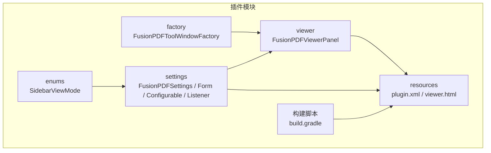
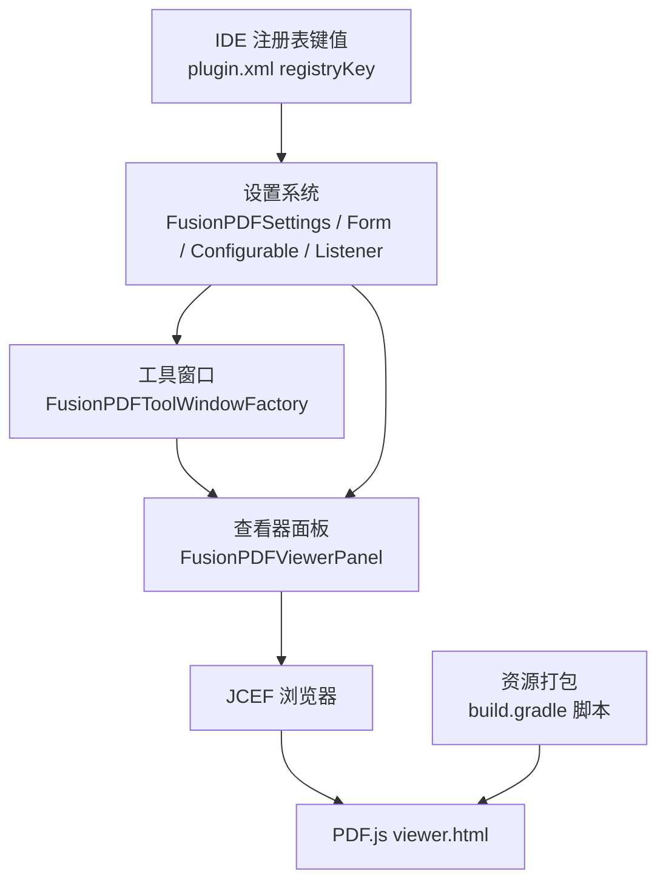
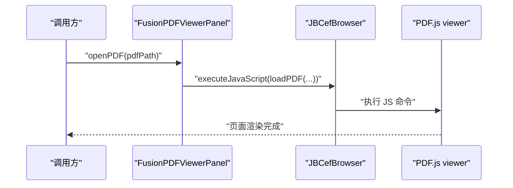
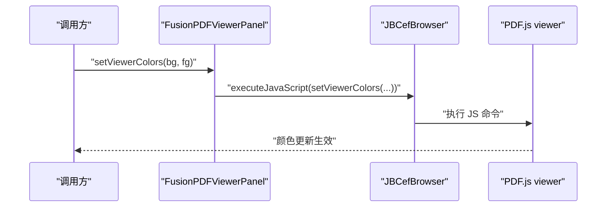
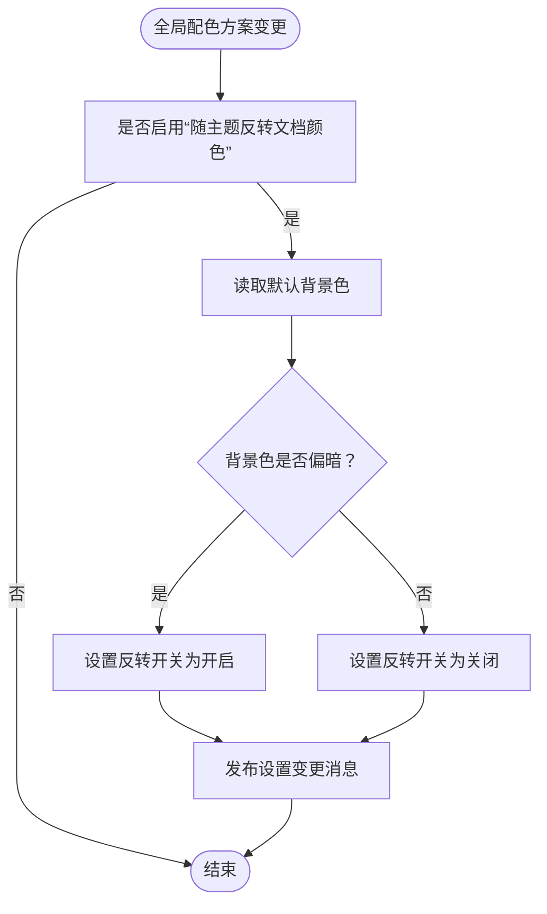
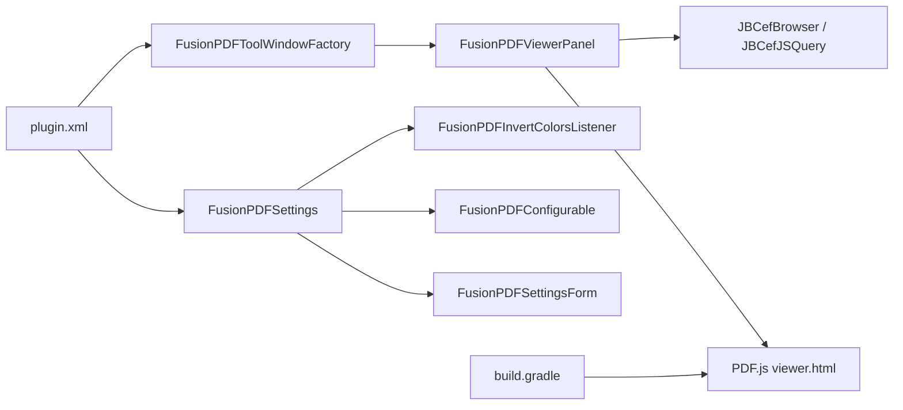

# 核心功能模块

<cite>
**本文引用的文件**
- [FusionPDFViewerPanel.java](file://src/main/java/com/github/wkkya/fusionpdf/viewer/FusionPDFViewerPanel.java)
- [FusionPDFToolWindowFactory.java](file://src/main/java/com/github/wkkya/fusionpdf/factory/FusionPDFToolWindowFactory.java)
- [FusionPDFSettings.java](file://src/main/java/com/github/wkkya/fusionpdf/settings/FusionPDFSettings.java)
- [FusionPDFSettingsForm.java](file://src/main/java/com/github/wkkya/fusionpdf/settings/FusionPDFSettingsForm.java)
- [FusionPDFConfigurable.java](file://src/main/java/com/github/wkkya/fusionpdf/settings/FusionPDFConfigurable.java)
- [FusionPDFInvertColorsListener.java](file://src/main/java/com/github/wkkya/fusionpdf/settings/FusionPDFInvertColorsListener.java)
- [FusionPDFSettingsListener.java](file://src/main/java/com/github/wkkya/fusionpdf/settings/FusionPDFSettingsListener.java)
- [SidebarViewMode.java](file://src/main/java/com/github/wkkya/fusionpdf/enums/SidebarViewMode.java)
- [plugin.xml](file://src/main/resources/META-INF/plugin.xml)
- [build.gradle](file://build.gradle)
- [viewer.html](file://src/main/resources/pdfjs/web/viewer.html)
</cite>

## 目录
1. [简介](#简介)
2. [项目结构](#项目结构)
3. [核心组件](#核心组件)
4. [架构总览](#架构总览)
5. [详细组件分析](#详细组件分析)
6. [依赖关系分析](#依赖关系分析)
7. [性能考虑](#性能考虑)
8. [故障排查指南](#故障排查指南)
9. [结论](#结论)
10. [附录](#附录)

## 简介
本文件面向 FusionPDF 插件的核心功能模块，系统性梳理以下能力：
- PDF 查看器模块：JCEF 集成、PDF.js 集成与渲染引擎配置
- 主题集成模块：IDE 主题适配机制、颜色计算与主题切换处理
- 设置管理系统：设置数据模型、配置界面实现与持久化存储
- 工具窗口集成：ToolWindowFactory 的使用与用户交互处理
同时提供各模块的配置项、参数说明、使用示例以及模块间依赖与数据流图。

## 项目结构
项目采用按功能域分层组织：
- viewer：PDF 查看器 UI 与浏览器桥接
- factory：工具窗口工厂，负责在 IDE 中注册与展示查看器
- settings：设置数据模型、配置界面与监听器
- enums：枚举类型（侧边栏视图模式）
- resources/META-INF/plugin.xml：插件声明与扩展点
- resources/pdfjs/web：打包的 PDF.js 视图页面
- 构建脚本：gradle 配置与 PDF.js 资源下载/注入

图表来源
- [FusionPDFViewerPanel.java:1-78](file://src/main/java/com/github/wkkya/fusionpdf/viewer/FusionPDFViewerPanel.java#L1-L78)
- [FusionPDFToolWindowFactory.java:1-21](file://src/main/java/com/github/wkkya/fusionpdf/factory/FusionPDFToolWindowFactory.java#L1-L21)
- [FusionPDFSettings.java:1-151](file://src/main/java/com/github/wkkya/fusionpdf/settings/FusionPDFSettings.java#L1-L151)
- [FusionPDFSettingsForm.java:1-159](file://src/main/java/com/github/wkkya/fusionpdf/settings/FusionPDFSettingsForm.java#L1-L159)
- [FusionPDFConfigurable.java:1-76](file://src/main/java/com/github/wkkya/fusionpdf/settings/FusionPDFConfigurable.java#L1-L76)
- [SidebarViewMode.java:1-22](file://src/main/java/com/github/wkkya/fusionpdf/enums/SidebarViewMode.java#L1-L22)
- [plugin.xml:1-51](file://src/main/resources/META-INF/plugin.xml#L1-L51)
- [build.gradle:1-115](file://build.gradle#L1-L115)
- [viewer.html:1-175](file://src/main/resources/pdfjs/web/viewer.html#L1-L175)

章节来源
- [plugin.xml:26-46](file://src/main/resources/META-INF/plugin.xml#L26-L46)
- [build.gradle:16-95](file://build.gradle#L16-L95)

## 核心组件
- PDF 查看器面板：基于 JCEF 的嵌入式浏览器，加载 PDF.js viewer 页面，并通过 JS 注入与 IDE 进行颜色与命令交互
- 工具窗口工厂：在 IDE 底部注册 FusionPDF 工具窗口，承载查看器面板
- 设置系统：持久化存储、主题监听、配置表单与应用逻辑
- 枚举类型：侧边栏视图模式定义

章节来源
- [FusionPDFViewerPanel.java:12-78](file://src/main/java/com/github/wkkya/fusionpdf/viewer/FusionPDFViewerPanel.java#L12-L78)
- [FusionPDFToolWindowFactory.java:12-19](file://src/main/java/com/github/wkkya/fusionpdf/factory/FusionPDFToolWindowFactory.java#L12-L19)
- [FusionPDFSettings.java:17-46](file://src/main/java/com/github/wkkya/fusionpdf/settings/FusionPDFSettings.java#L17-L46)
- [SidebarViewMode.java:3-21](file://src/main/java/com/github/wkkya/fusionpdf/enums/SidebarViewMode.java#L3-L21)

## 架构总览
整体架构围绕“工具窗口 → 查看器面板 → JCEF 浏览器 → PDF.js 渲染”的链路展开；设置系统通过消息总线与监听器驱动主题与颜色变更。

图表来源
- [FusionPDFToolWindowFactory.java:12-19](file://src/main/java/com/github/wkkya/fusionpdf/factory/FusionPDFToolWindowFactory.java#L12-L19)
- [FusionPDFViewerPanel.java:17-52](file://src/main/java/com/github/wkkya/fusionpdf/viewer/FusionPDFViewerPanel.java#L17-L52)
- [plugin.xml:26-46](file://src/main/resources/META-INF/plugin.xml#L26-L46)
- [build.gradle:36-75](file://build.gradle#L36-L75)
- [viewer.html:1-175](file://src/main/resources/pdfjs/web/viewer.html#L1-L175)

## 详细组件分析

### PDF 查看器模块（JCEF + PDF.js + 渲染引擎配置）
- 组件职责
  - 初始化 JCEF 客户端与浏览器实例
  - 将浏览器组件嵌入滚动面板并设置布局
  - 加载 PDF.js viewer 页面
  - 提供打开 PDF 文件路径的方法
  - 提供设置查看器背景/前景色的接口（通过 JS 注入）

- 关键流程（打开 PDF）

图表来源
- [FusionPDFViewerPanel.java:54-57](file://src/main/java/com/github/wkkya/fusionpdf/viewer/FusionPDFViewerPanel.java#L54-L57)
- [viewer.html:156-171](file://src/main/resources/pdfjs/web/viewer.html#L156-L171)

- 关键流程（设置查看器颜色）

图表来源
- [FusionPDFViewerPanel.java:59-65](file://src/main/java/com/github/wkkya/fusionpdf/viewer/FusionPDFViewerPanel.java#L59-L65)
- [viewer.html:156-171](file://src/main/resources/pdfjs/web/viewer.html#L156-L171)

- 渲染引擎配置要点
  - PDF.js 通过 worker 加载与渲染，viewer.html 中已内置 worker 路径与加载逻辑
  - 构建脚本会注入额外样式与脚本以适配 IDE 环境
  - JCEF 启用与参数由运行任务配置

章节来源
- [FusionPDFViewerPanel.java:17-52](file://src/main/java/com/github/wkkya/fusionpdf/viewer/FusionPDFViewerPanel.java#L17-L52)
- [viewer.html:1-175](file://src/main/resources/pdfjs/web/viewer.html#L1-L175)
- [build.gradle:36-75](file://build.gradle#L36-L75)

### 主题集成模块（IDE 主题适配、颜色计算与主题切换）
- 适配机制
  - 监听 IDE 全局颜色方案变化
  - 当启用“随主题反转文档颜色”时，根据背景明暗自动切换反转状态
  - 通过消息总线通知设置变更，驱动查看器颜色刷新

- 颜色计算与应用
  - 默认颜色来自全局编辑器配色方案
  - 支持自定义背景/前景/图标颜色
  - 反转强度可配置（1-100），反转开关受主题联动控制

- 关键流程（主题切换）

图表来源
- [FusionPDFInvertColorsListener.java:11-24](file://src/main/java/com/github/wkkya/fusionpdf/settings/FusionPDFInvertColorsListener.java#L11-L24)
- [FusionPDFSettings.java:20-46](file://src/main/java/com/github/wkkya/fusionpdf/settings/FusionPDFSettings.java#L20-L46)

章节来源
- [FusionPDFInvertColorsListener.java:11-24](file://src/main/java/com/github/wkkya/fusionpdf/settings/FusionPDFInvertColorsListener.java#L11-L24)
- [FusionPDFSettings.java:52-64](file://src/main/java/com/github/wkkya/fusionpdf/settings/FusionPDFSettings.java#L52-L64)
- [plugin.xml:42-46](file://src/main/resources/META-INF/plugin.xml#L42-L46)

### 设置管理系统（数据模型、界面与持久化）
- 数据模型（FusionPDFSettings）
  - 持久化字段：自定义颜色、文档自动重载、文档颜色反转、反转强度、随主题反转、默认侧边栏视图模式
  - 默认值：从 IDE 全局配色方案推导，反转强度默认 85
  - 扩展键值：调试模式、JCEF OSR 视图、实验特性等

- 配置界面（FusionPDFSettingsForm）
  - 控件：复选框、下拉框、颜色面板、旋转器、链接按钮
  - 行为：随主题重置查看器颜色、禁用互斥控件、实时写入设置对象

- 配置容器（FusionPDFConfigurable）
  - 实现 IDE 配置页生命周期：创建、修改检测、应用、重置、释放 UI 资源
  - 当设置被修改时触发消息总线广播

- 持久化与消息总线
  - 使用 PersistentStateComponent 与 XML 序列化持久化到 fusion_pdf.xml
  - 通过 Topic 发布设置变更事件，供监听器与查看器响应

章节来源
- [FusionPDFSettings.java:17-46](file://src/main/java/com/github/wkkya/fusionpdf/settings/FusionPDFSettings.java#L17-L46)
- [FusionPDFSettingsForm.java:36-87](file://src/main/java/com/github/wkkya/fusionpdf/settings/FusionPDFSettingsForm.java#L36-L87)
- [FusionPDFConfigurable.java:7-74](file://src/main/java/com/github/wkkya/fusionpdf/settings/FusionPDFConfigurable.java#L7-L74)
- [plugin.xml:26-36](file://src/main/resources/META-INF/plugin.xml#L26-L36)

### 工具窗口集成（ToolWindowFactory 与用户交互）
- 工厂类职责
  - 在 IDE 中注册名为 “FusionPDF” 的工具窗口，锚点为底部
  - 创建查看器面板并加入窗口组件树

- 用户交互
  - 工具窗口作为容器承载查看器面板
  - 查看器面板内部通过 JCEF 与 PDF.js 处理用户翻页、缩放等操作

章节来源
- [FusionPDFToolWindowFactory.java:12-19](file://src/main/java/com/github/wkkya/fusionpdf/factory/FusionPDFToolWindowFactory.java#L12-L19)
- [plugin.xml](file://src/main/resources/META-INF/plugin.xml#L36)

## 依赖关系分析
- 组件耦合
  - 工具窗口工厂依赖查看器面板
  - 查看器面板依赖 JCEF 与 PDF.js 资源
  - 设置系统通过监听器与消息总线影响查看器颜色与行为
- 外部依赖
  - JCEF 与 PDF.js 由构建脚本下载并注入
  - IDE 注册表键值用于控制调试、OSR 视图与实验特性

图表来源
- [FusionPDFToolWindowFactory.java:12-19](file://src/main/java/com/github/wkkya/fusionpdf/factory/FusionPDFToolWindowFactory.java#L12-L19)
- [FusionPDFViewerPanel.java:17-52](file://src/main/java/com/github/wkkya/fusionpdf/viewer/FusionPDFViewerPanel.java#L17-L52)
- [FusionPDFSettings.java:17-46](file://src/main/java/com/github/wkkya/fusionpdf/settings/FusionPDFSettings.java#L17-L46)
- [FusionPDFInvertColorsListener.java:11-24](file://src/main/java/com/github/wkkya/fusionpdf/settings/FusionPDFInvertColorsListener.java#L11-L24)
- [FusionPDFConfigurable.java:7-74](file://src/main/java/com/github/wkkya/fusionpdf/settings/FusionPDFConfigurable.java#L7-L74)
- [FusionPDFSettingsForm.java:36-87](file://src/main/java/com/github/wkkya/fusionpdf/settings/FusionPDFSettingsForm.java#L36-L87)
- [plugin.xml:26-46](file://src/main/resources/META-INF/plugin.xml#L26-L46)
- [build.gradle:36-75](file://build.gradle#L36-L75)

## 性能考虑
- JCEF 渲染与内存
  - 启用 OSR 视图可降低 CPU 占用，但需权衡交互延迟
  - 运行时 JVM 参数建议结合 IDE 版本调整，避免过度占用内存
- PDF.js 渲染
  - worker 加载与缓存策略影响首帧时间
  - 构建脚本已注入 viewer.js 以增强与 IDE 的交互
- 设置变更传播
  - 通过消息总线异步通知，避免阻塞 UI 线程

## 故障排查指南
- 查看器无法加载 PDF
  - 确认 PDF.js 资源已正确下载与注入
  - 检查 viewer.html 是否存在且路径正确
  - 确认 JCEF 已启用且运行参数包含必要开关
- 颜色不随主题变化
  - 检查“随主题反转文档颜色”是否启用
  - 确认 IDE 颜色方案变更事件是否触发监听器
- 设置未生效
  - 确认配置页已保存并触发消息总线
  - 检查 fusion_pdf.xml 是否存在且可读

章节来源
- [build.gradle:36-75](file://build.gradle#L36-L75)
- [plugin.xml:26-46](file://src/main/resources/META-INF/plugin.xml#L26-L46)
- [FusionPDFInvertColorsListener.java:11-24](file://src/main/java/com/github/wkkya/fusionpdf/settings/FusionPDFInvertColorsListener.java#L11-L24)
- [FusionPDFSettings.java:44-46](file://src/main/java/com/github/wkkya/fusionpdf/settings/FusionPDFSettings.java#L44-L46)

## 结论
FusionPDF 通过 JCEF 与 PDF.js 实现轻量级 PDF 查看，结合 IDE 主题监听与设置系统，提供可定制的颜色与视图体验。工具窗口工厂将查看器无缝集成至 IDE 底部，形成闭环的阅读工作流。建议在生产环境中启用 OSR 视图与合适的调试开关，并确保 PDF.js 资源完整注入。

## 附录

### 配置项与参数说明
- 设置项（来自设置模型）
  - 自定义颜色开关：useCustomColors
  - 自定义背景/前景/图标颜色：customBackgroundColor、customForegroundColor、customIconColor
  - 文档自动重载：enableDocumentAutoReload
  - 文档颜色反转：invertDocumentColors
  - 随主题反转：invertColorsWithTheme
  - 反转强度：documentColorsInvertIntensity（默认 85）
  - 默认侧边栏视图模式：defaultSidebarViewMode（NONE/THUMBNAILS/OUTLINE/ATTACHMENTS）

- 注册表键值（来自插件声明）
  - fusion.pdf.debug：启用调试模式
  - fusion.pdf.jcefLatchTimeout：JCEF 加载最大等待时间
  - fusion.pdf.enableExperimentalFeatures：启用实验特性
  - fusion.pdf.use.jcef.osr.view：启用 JCEF OSR 视图

- 使用示例（路径参考）
  - 打开 PDF：调用查看器面板的打开方法
  - 设置颜色：调用查看器面板的颜色设置方法
  - 修改设置：在设置配置页勾选/输入后保存

章节来源
- [FusionPDFSettings.java:23-31](file://src/main/java/com/github/wkkya/fusionpdf/settings/FusionPDFSettings.java#L23-L31)
- [plugin.xml:26-31](file://src/main/resources/META-INF/plugin.xml#L26-L31)
- [FusionPDFSettingsForm.java:22-32](file://src/main/java/com/github/wkkya/fusionpdf/settings/FusionPDFSettingsForm.java#L22-L32)
- [SidebarViewMode.java:3-9](file://src/main/java/com/github/wkkya/fusionpdf/enums/SidebarViewMode.java#L3-L9)