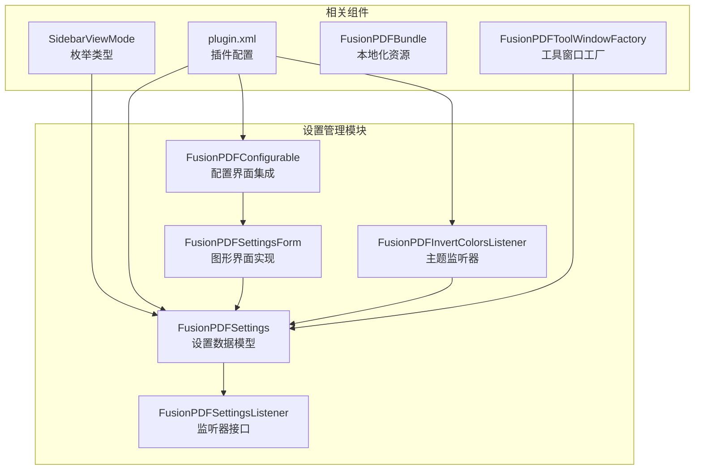
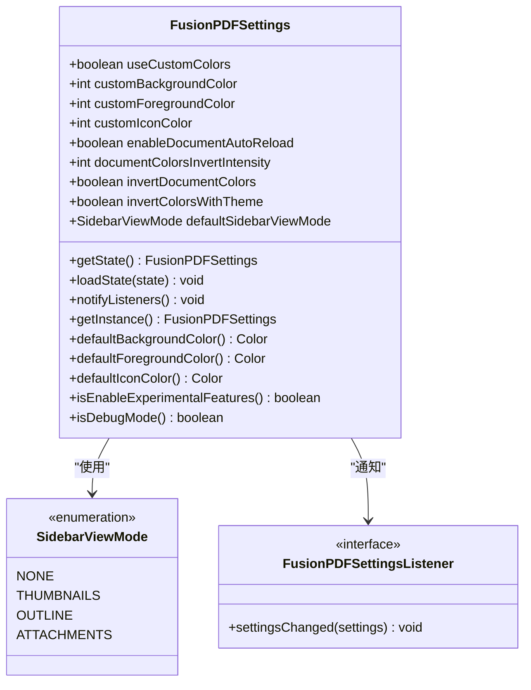
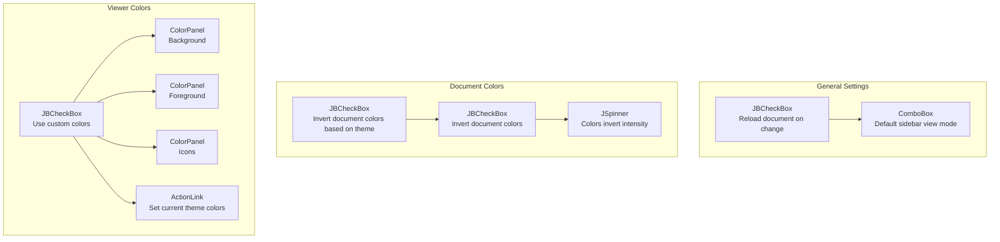
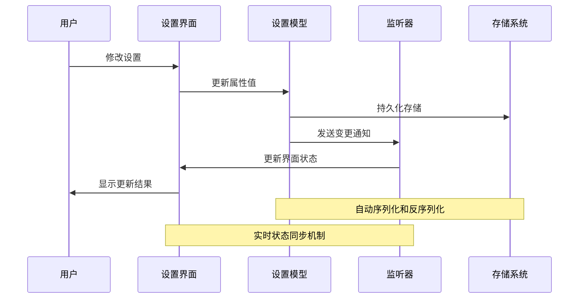
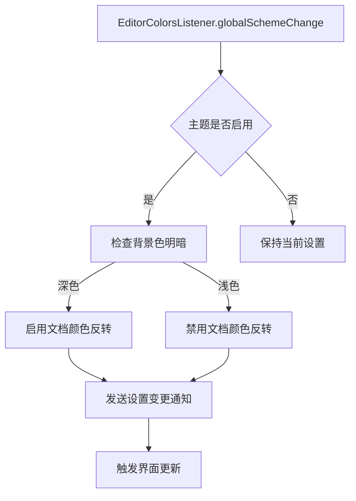
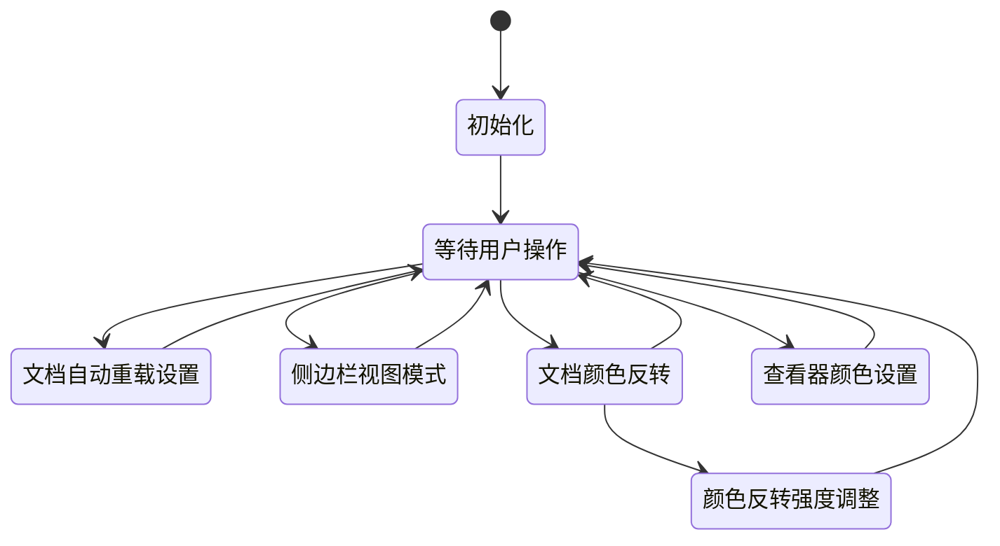
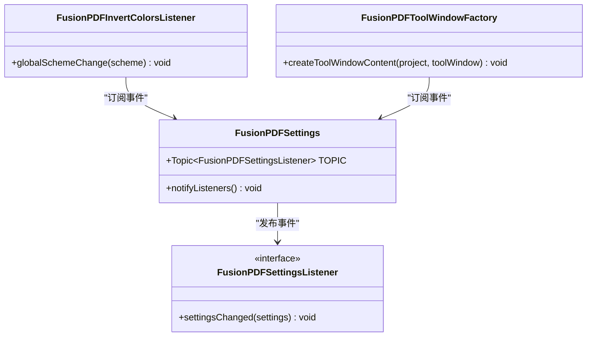
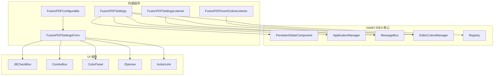

# 设置管理系统

<cite>
**本文档引用的文件**
- [FusionPDFSettings.java](file://src/main/java/com/github/wkkya/fusionpdf/settings/FusionPDFSettings.java)
- [FusionPDFConfigurable.java](file://src/main/java/com/github/wkkya/fusionpdf/settings/FusionPDFConfigurable.java)
- [FusionPDFSettingsForm.java](file://src/main/java/com/github/wkkya/fusionpdf/settings/FusionPDFSettingsForm.java)
- [FusionPDFSettingsListener.java](file://src/main/java/com/github/wkkya/fusionpdf/settings/FusionPDFSettingsListener.java)
- [FusionPDFInvertColorsListener.java](file://src/main/java/com/github/wkkya/fusionpdf/settings/FusionPDFInvertColorsListener.java)
- [SidebarViewMode.java](file://src/main/java/com/github/wkkya/fusionpdf/enums/SidebarViewMode.java)
- [plugin.xml](file://src/main/resources/META-INF/plugin.xml)
- [FusionPDFBundle.properties](file://src/main/resources/messages/FusionPDFBundle.properties)
- [FusionPDFToolWindowFactory.java](file://src/main/java/com/github/wkkya/fusionpdf/factory/FusionPDFToolWindowFactory.java)
</cite>

## 目录
1. [简介](#简介)
2. [项目结构](#项目结构)
3. [核心组件](#核心组件)
4. [架构概览](#架构概览)
5. [详细组件分析](#详细组件分析)
6. [依赖关系分析](#依赖关系分析)
7. [性能考虑](#性能考虑)
8. [故障排除指南](#故障排除指南)
9. [结论](#结论)
10. [附录](#附录)

## 简介

FusionPDF 插件的设置管理系统是一个基于 IntelliJ IDEA 平台的完整配置解决方案，负责管理 PDF 查看器的各种用户偏好设置。该系统提供了从数据模型到用户界面的完整生命周期管理，包括设置的持久化存储、默认值设定、配置验证以及实时状态同步。

系统的核心特性包括：
- **持久化存储**：通过 IntelliJ IDEA 的 PersistentStateComponent 接口实现设置的自动保存和加载
- **主题集成**：自动适配 IDE 主题，支持明暗模式切换
- **实时通知**：基于消息总线的设置变更通知机制
- **用户界面集成**：无缝集成到 IDE 设置界面中

## 项目结构

设置管理系统位于 `src/main/java/com/github/wkkya/fusionpdf/settings/` 目录下，包含以下关键文件：



**图表来源**
- [FusionPDFSettings.java:1-151](file://src/main/java/com/github/wkkya/fusionpdf/settings/FusionPDFSettings.java#L1-L151)
- [FusionPDFConfigurable.java:1-76](file://src/main/java/com/github/wkkya/fusionpdf/settings/FusionPDFConfigurable.java#L1-L76)
- [FusionPDFSettingsForm.java:1-159](file://src/main/java/com/github/wkkya/fusionpdf/settings/FusionPDFSettingsForm.java#L1-L159)

**章节来源**
- [plugin.xml:1-51](file://src/main/resources/META-INF/plugin.xml#L1-L51)
- [FusionPDFSettings.java:17-50](file://src/main/java/com/github/wkkya/fusionpdf/settings/FusionPDFSettings.java#L17-L50)

## 核心组件

### FusionPDFSettings 数据模型

FusionPDFSettings 是整个设置系统的核心数据模型，实现了 PersistentStateComponent 接口，提供以下功能：

#### 数据持久化机制
- **存储位置**：`fusion_pdf.xml` 文件
- **序列化方式**：使用 XmlSerializerUtil 进行 Bean 复制
- **应用范围**：作为 Application Service 提供全局访问

#### 默认值设定策略
系统采用动态默认值策略，确保与 IDE 主题保持一致：
- **背景颜色**：从 EditorColorsManager 获取全局方案的默认背景色
- **前景颜色**：从 EditorColorsManager 获取全局方案的默认前景色
- **图标颜色**：继承自前景颜色
- **反转强度**：默认 85（范围 1-100）

#### 配置项分类



**图表来源**
- [FusionPDFSettings.java:18-147](file://src/main/java/com/github/wkkya/fusionpdf/settings/FusionPDFSettings.java#L18-L147)
- [SidebarViewMode.java:3-21](file://src/main/java/com/github/wkkya/fusionpdf/enums/SidebarViewMode.java#L3-L21)

**章节来源**
- [FusionPDFSettings.java:23-31](file://src/main/java/com/github/wkkya/fusionpdf/settings/FusionPDFSettings.java#L23-L31)
- [FusionPDFSettings.java:52-64](file://src/main/java/com/github/wkkya/fusionpdf/settings/FusionPDFSettings.java#L52-L64)

### FusionPDFConfigurable 配置集成

FusionPDFConfigurable 实现了 IntelliJ IDEA 的 Configurable 接口，负责将设置界面集成到 IDE 的设置系统中：

#### 集成特性
- **显示名称**：通过 FusionPDFBundle 获取本地化标题
- **组件创建**：延迟初始化 FusionPDFSettingsForm
- **生命周期管理**：正确处理 UI 资源的创建和销毁

#### 修改检测机制
当前实现存在注释掉的修改检测逻辑，预留了完整的比较功能：
- 支持所有设置项的变更检测
- 提供精确的状态对比能力
- 为未来的功能完善做好准备

**章节来源**
- [FusionPDFConfigurable.java:7-74](file://src/main/java/com/github/wkkya/fusionpdf/settings/FusionPDFConfigurable.java#L7-L74)

### FusionPDFSettingsForm 图形界面

FusionPDFSettingsForm 提供了完整的用户界面，采用分组布局设计：

#### 界面布局结构



**图表来源**
- [FusionPDFSettingsForm.java:36-119](file://src/main/java/com/github/wkkya/fusionpdf/settings/FusionPDFSettingsForm.java#L36-L119)

#### 颜色选择器实现
- **ColorPanel 组件**：提供直观的颜色选择界面
- **实时更新**：颜色变更时立即更新设置模型
- **主题同步**：支持一键重置为当前主题颜色

**章节来源**
- [FusionPDFSettingsForm.java:67-77](file://src/main/java/com/github/wkkya/fusionpdf/settings/FusionPDFSettingsForm.java#L67-L77)
- [FusionPDFSettingsForm.java:132-145](file://src/main/java/com/github/wkkya/fusionpdf/settings/FusionPDFSettingsForm.java#L132-L145)

## 架构概览

设置管理系统采用分层架构设计，确保各组件职责清晰、耦合度低：



**图表来源**
- [FusionPDFSettings.java:44-46](file://src/main/java/com/github/wkkya/fusionpdf/settings/FusionPDFSettings.java#L44-L46)
- [FusionPDFConfigurable.java:50-52](file://src/main/java/com/github/wkkya/fusionpdf/settings/FusionPDFConfigurable.java#L50-L52)

### 主题监听机制

系统实现了智能的主题适配功能：



**图表来源**
- [FusionPDFInvertColorsListener.java:14-23](file://src/main/java/com/github/wkkya/fusionpdf/settings/FusionPDFInvertColorsListener.java#L14-L23)

**章节来源**
- [FusionPDFInvertColorsListener.java:11-24](file://src/main/java/com/github/wkkya/fusionpdf/settings/FusionPDFInvertColorsListener.java#L11-L24)

## 详细组件分析

### 设置数据模型深度解析

#### 状态管理策略
FusionPDFSettings 采用了单例模式和应用服务模式的组合：
- **全局访问**：通过 ApplicationManager 获取实例
- **状态持久化**：自动序列化到 fusion_pdf.xml 文件
- **主题同步**：动态获取 IDE 主题颜色

#### 配置项验证机制
虽然当前版本主要依赖 IDE 的内置验证，但系统设计支持扩展验证：
- **范围验证**：颜色反转强度范围 1-100
- **类型安全**：强类型属性确保数据完整性
- **默认回退**：缺失配置时自动使用合理默认值

**章节来源**
- [FusionPDFSettings.java:33-42](file://src/main/java/com/github/wkkya/fusionpdf/settings/FusionPDFSettings.java#L33-L42)
- [FusionPDFSettings.java:66-72](file://src/main/java/com/github/wkkya/fusionpdf/settings/FusionPDFSettings.java#L66-L72)

### 配置界面实现细节

#### 用户交互响应机制
设置表单实现了多种交互模式：



**图表来源**
- [FusionPDFSettingsForm.java:36-87](file://src/main/java/com/github/wkkya/fusionpdf/settings/FusionPDFSettingsForm.java#L36-L87)

#### 布局设计原则
- **分组组织**：按功能相关性分组显示设置项
- **层次清晰**：重要设置优先显示，次要设置折叠
- **一致性**：统一的间距和对齐标准
- **可访问性**：适当的标签和提示信息

**章节来源**
- [FusionPDFSettingsForm.java:89-119](file://src/main/java/com/github/wkkya/fusionpdf/settings/FusionPDFSettingsForm.java#L89-L119)

### 监听器模式实现

#### 通知机制设计
系统使用 IntelliJ IDEA 的消息总线机制实现松耦合通信：



**图表来源**
- [FusionPDFSettings.java:20-21](file://src/main/java/com/github/wkkya/fusionpdf/settings/FusionPDFSettings.java#L20-L21)
- [FusionPDFSettingsListener.java:4-6](file://src/main/java/com/github/wkkya/fusionpdf/settings/FusionPDFSettingsListener.java#L4-L6)

#### 状态同步机制
监听器模式确保了系统的状态一致性：
- **即时通知**：设置变更后立即通知所有订阅者
- **批量更新**：避免重复渲染和状态抖动
- **线程安全**：使用 IDE 的同步发布机制

**章节来源**
- [FusionPDFSettings.java:44-46](file://src/main/java/com/github/wkkya/fusionpdf/settings/FusionPDFSettings.java#L44-L46)
- [FusionPDFInvertColorsListener.java:14-23](file://src/main/java/com/github/wkkya/fusionpdf/settings/FusionPDFInvertColorsListener.java#L14-L23)

## 依赖关系分析

### 外部依赖关系



**图表来源**
- [FusionPDFSettings.java:4-15](file://src/main/java/com/github/wkkya/fusionpdf/settings/FusionPDFSettings.java#L4-L15)
- [FusionPDFSettingsForm.java:5-16](file://src/main/java/com/github/wkkya/fusionpdf/settings/FusionPDFSettingsForm.java#L5-L16)

### 内部组件耦合度分析

系统设计遵循高内聚、低耦合的原则：
- **数据模型独立**：FusionPDFSettings 不依赖具体 UI 实现
- **界面解耦**：FusionPDFSettingsForm 仅负责展示和收集数据
- **监听器分离**：主题监听器独立于设置模型
- **配置集成**：FusionPDFConfigurable 仅负责 IDE 集成

**章节来源**
- [plugin.xml:32-46](file://src/main/resources/META-INF/plugin.xml#L32-L46)

## 性能考虑

### 内存使用优化
- **延迟初始化**：设置表单仅在需要时创建
- **对象复用**：颜色面板和组件实例复用
- **增量更新**：仅在设置实际变更时发送通知

### 序列化性能
- **最小化存储**：仅保存必要的配置数据
- **高效序列化**：使用 IDE 内置的 XmlSerializerUtil
- **异步处理**：持久化操作在后台线程执行

### 渲染优化
- **组件缓存**：UI 组件状态缓存避免重复计算
- **事件节流**：高频设置变更的事件合并处理
- **懒加载**：非关键组件的延迟加载

## 故障排除指南

### 常见问题诊断

#### 设置未保存问题
1. **检查存储权限**：确认 fusion_pdf.xml 文件可写
2. **验证序列化**：检查配置数据格式正确性
3. **查看日志**：监控序列化异常信息

#### 界面不更新问题
1. **监听器检查**：确认监听器已正确注册
2. **消息总线验证**：检查 Topic 是否正常工作
3. **UI 线程同步**：确保 UI 更新在正确线程执行

#### 主题适配失效
1. **监听器状态**：验证 FusionPDFInvertColorsListener 是否活跃
2. **颜色方案**：检查 EditorColorsManager 返回的有效性
3. **注册表设置**：确认相关 Registry 键值正确

**章节来源**
- [FusionPDFSettings.java:33-42](file://src/main/java/com/github/wkkya/fusionpdf/settings/FusionPDFSettings.java#L33-L42)
- [FusionPDFConfigurable.java:50-52](file://src/main/java/com/github/wkkya/fusionpdf/settings/FusionPDFConfigurable.java#L50-L52)

### 调试技巧

#### 日志记录
- 在设置变更处添加调试日志
- 监控消息总线事件的传播
- 记录 UI 组件的状态变化

#### 单元测试建议
- 测试设置模型的序列化/反序列化
- 验证监听器的通知机制
- 检查主题变更的响应逻辑

## 结论

FusionPDF 插件的设置管理系统展现了优秀的软件架构设计，成功实现了以下目标：

### 设计优势
- **模块化设计**：清晰的职责分离和组件边界
- **可扩展性**：预留的扩展点支持未来功能增强
- **用户体验**：直观的界面设计和实时反馈机制
- **平台集成**：深度集成 IntelliJ IDEA 生态系统

### 技术亮点
- **智能主题适配**：自动响应 IDE 主题变化
- **持久化存储**：可靠的配置数据管理
- **实时同步**：高效的组件间通信机制
- **本地化支持**：完整的多语言界面

### 改进建议
1. **完善修改检测**：激活注释掉的 isModified 方法实现
2. **增强验证机制**：添加更严格的配置验证
3. **优化性能**：实现更精细的事件处理和状态管理
4. **扩展 API**：提供更丰富的编程接口供第三方扩展

该系统为开发者提供了一个优秀的参考实现，展示了如何在 IntelliJ IDEA 插件中构建高质量的设置管理功能。

## 附录

### API 使用示例

#### 获取设置实例
```java
// 获取全局设置实例
FusionPDFSettings settings = FusionPDFSettings.getInstance();
```

#### 监听设置变更
```java
// 订阅设置变更事件
ApplicationManager.getApplication()
    .getMessageBus()
    .connect()
    .subscribe(FusionPDFSettings.TOPIC, settings -> {
        // 处理设置变更
    });
```

#### 更新设置值
```java
// 更新单个设置项
settings.setUseCustomColors(true);
settings.notifyListeners();
```

### 扩展开发指南

#### 添加新设置项
1. **在 FusionPDFSettings 中添加字段**
2. **添加对应的 getter/setter 方法**
3. **在 UI 表单中添加相应的控件**
4. **在插件配置文件中注册相关资源**

#### 实现自定义监听器
```java
public interface CustomSettingsListener {
    void customSettingsChanged(FusionPDFSettings settings);
}

// 注册监听器
ApplicationManager.getApplication()
    .getMessageBus()
    .syncPublisher(CustomSettingsListener.TOPIC)
    .customSettingsChanged(settings);
```

#### 集成到 IDE 设置界面
1. **创建 Configurable 实现类**
2. **在 plugin.xml 中注册**
3. **实现本地化资源文件**
4. **测试设置界面的可用性**