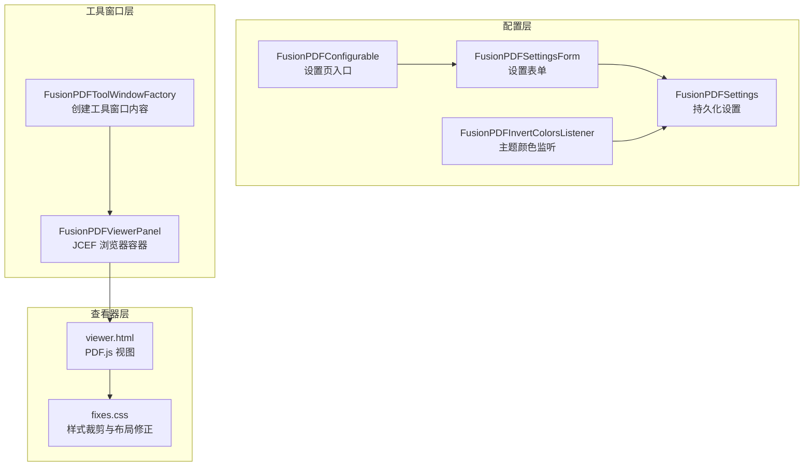
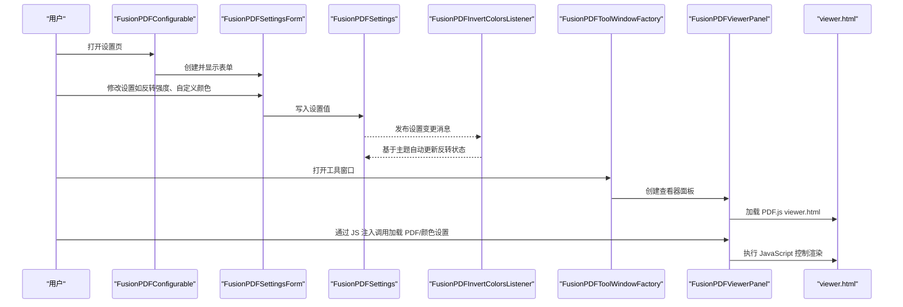
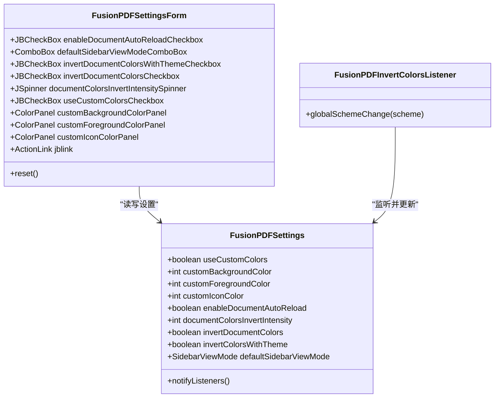
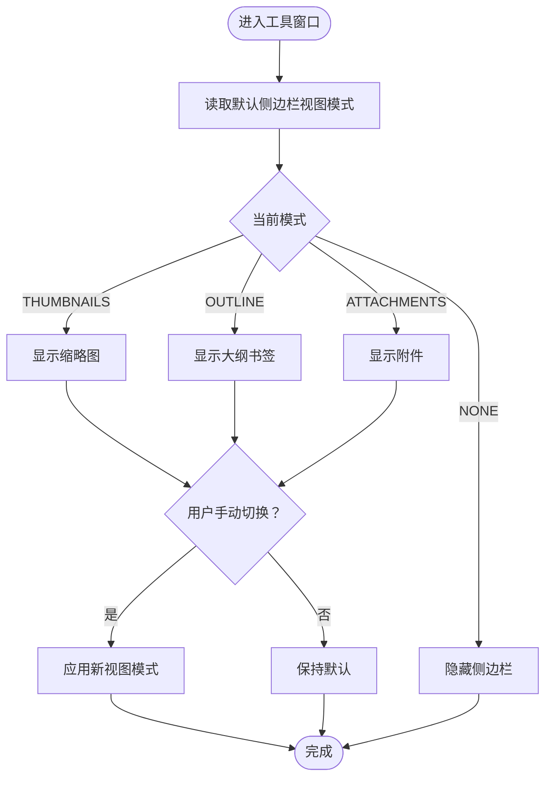
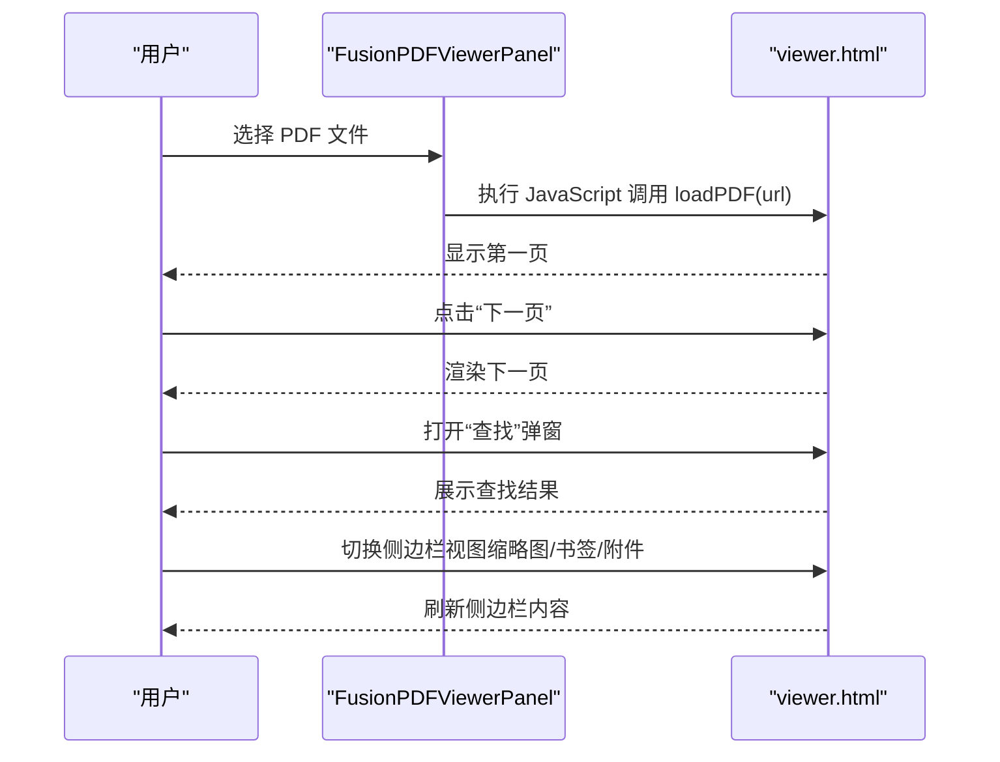
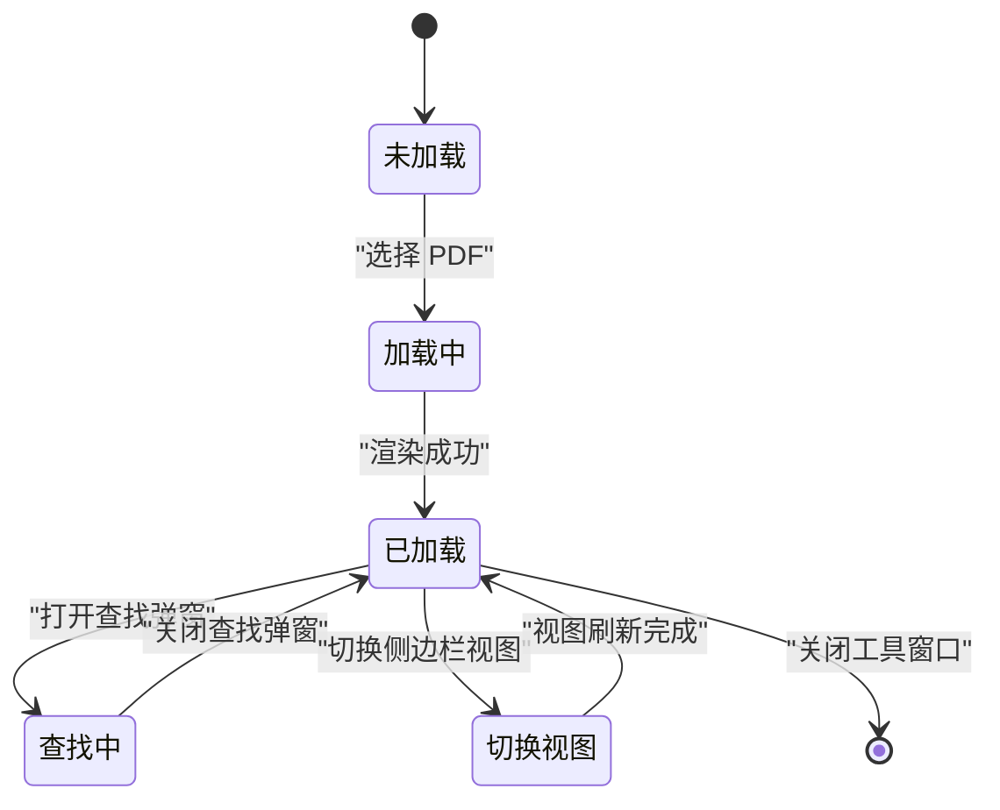
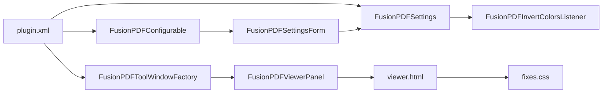

# 用户界面设计

<cite>
**本文引用的文件**
- [FusionPDFConfigurable.java](file://src/main/java/com/github/wkkya/fusionpdf/settings/FusionPDFConfigurable.java)
- [FusionPDFSettingsForm.java](file://src/main/java/com/github/wkkya/fusionpdf/settings/FusionPDFSettingsForm.java)
- [FusionPDFSettings.java](file://src/main/java/com/github/wkkya/fusionpdf/settings/FusionPDFSettings.java)
- [FusionPDFInvertColorsListener.java](file://src/main/java/com/github/wkkya/fusionpdf/settings/FusionPDFInvertColorsListener.java)
- [SidebarViewMode.java](file://src/main/java/com/github/wkkya/fusionpdf/enums/SidebarViewMode.java)
- [FusionPDFToolWindowFactory.java](file://src/main/java/com/github/wkkya/fusionpdf/factory/FusionPDFToolWindowFactory.java)
- [FusionPDFViewerPanel.java](file://src/main/java/com/github/wkkya/fusionpdf/viewer/FusionPDFViewerPanel.java)
- [plugin.xml](file://src/main/resources/META-INF/plugin.xml)
- [viewer.html](file://src/main/resources/pdfjs/web/viewer.html)
- [fixes.css](file://src/main/resources/pdfjs/web/fixes.css)
- [FusionPDFBundle.properties](file://src/main/resources/messages/FusionPDFBundle.properties)
- [FusionPDFActionsBundle.properties](file://src/main/resources/messages/FusionPDFActionsBundle.properties)
</cite>

## 目录
1. [简介](#简介)
2. [项目结构](#项目结构)
3. [核心组件](#核心组件)
4. [架构总览](#架构总览)
5. [详细组件分析](#详细组件分析)
6. [依赖分析](#依赖分析)
7. [性能考虑](#性能考虑)
8. [故障排查指南](#故障排查指南)
9. [结论](#结论)
10. [附录](#附录)

## 简介
本文件面向 FusionPDF 插件的用户界面设计，聚焦以下目标：
- 设置界面的布局与交互：颜色选择器的实现原理、主题适配与自定义颜色配置。
- 侧边栏视图模式管理：缩略图、大纲（书签）、附件等模式的默认值与切换逻辑。
- 工具窗口交互：PDF 打开、页面导航、搜索、滚动方向、缩放、旋转等常用操作。
- 视觉设计规范与主题适配：背景/前景色、图标色、暗黑/明亮主题下的自动反转策略。
- 用户操作流程与界面状态转换：从打开 PDF 到查看、翻页、查找、切换视图的完整路径。
- 无障碍与跨平台兼容性：基于 JCEF 的 Web 视图、IDE 主题集成与可访问性提示。

## 项目结构
FusionPDF 将界面分为三层：
- 配置层：设置项与表单，负责持久化与主题监听。
- 工具窗口层：工具窗口工厂创建主面板，承载 PDF 查看器。
- 查看器层：基于 JCEF 的 PDF.js 视图，负责渲染与交互。

图表来源
- [plugin.xml:32-36](file://src/main/resources/META-INF/plugin.xml#L32-L36)
- [FusionPDFToolWindowFactory.java:12-18](file://src/main/java/com/github/wkkya/fusionpdf/factory/FusionPDFToolWindowFactory.java#L12-L18)
- [FusionPDFViewerPanel.java:12-38](file://src/main/java/com/github/wkkya/fusionpdf/viewer/FusionPDFViewerPanel.java#L12-L38)
- [viewer.html:1-175](file://src/main/resources/pdfjs/web/viewer.html#L1-L175)
- [fixes.css:1-22](file://src/main/resources/pdfjs/web/fixes.css#L1-L22)

章节来源
- [plugin.xml:26-36](file://src/main/resources/META-INF/plugin.xml#L26-L36)
- [FusionPDFToolWindowFactory.java:12-18](file://src/main/java/com/github/wkkya/fusionpdf/factory/FusionPDFToolWindowFactory.java#L12-L18)
- [FusionPDFViewerPanel.java:12-38](file://src/main/java/com/github/wkkya/fusionpdf/viewer/FusionPDFViewerPanel.java#L12-L38)

## 核心组件
- 设置页与表单
  - FusionPDFConfigurable：实现配置页入口，负责创建表单、应用修改、重置与释放 UI 资源。
  - FusionPDFSettingsForm：构建设置表单，包含“通用”“文档颜色”“查看器颜色”三组控件；含颜色面板、下拉框、复选框与强度调节器；提供“恢复为当前主题颜色”的快捷链接。
- 设置模型与主题监听
  - FusionPDFSettings：持久化组件，保存启用自动重载、默认侧边栏视图模式、是否按主题反转文档颜色、反转强度、是否使用自定义颜色及三种颜色值等；提供默认颜色与调试开关读取；通过消息总线发布设置变更。
  - FusionPDFInvertColorsListener：监听 IDE 全局配色方案变化，根据背景明暗自动切换文档颜色反转状态。
- 侧边栏视图模式枚举
  - SidebarViewMode：定义 NONE、THUMBNAILS、OUTLINE、ATTACHMENTS 四种模式。
- 工具窗口与查看器
  - FusionPDFToolWindowFactory：创建工具窗口内容，注入 FusionPDFViewerPanel。
  - FusionPDFViewerPanel：封装 JBCefBrowser，加载 PDF.js viewer.html 并通过 JS 注入方式控制 PDF 加载与颜色设置。

章节来源
- [FusionPDFConfigurable.java:7-74](file://src/main/java/com/github/wkkya/fusionpdf/settings/FusionPDFConfigurable.java#L7-L74)
- [FusionPDFSettingsForm.java:18-159](file://src/main/java/com/github/wkkya/fusionpdf/settings/FusionPDFSettingsForm.java#L18-L159)
- [FusionPDFSettings.java:17-147](file://src/main/java/com/github/wkkya/fusionpdf/settings/FusionPDFSettings.java#L17-L147)
- [FusionPDFInvertColorsListener.java:11-24](file://src/main/java/com/github/wkkya/fusionpdf/settings/FusionPDFInvertColorsListener.java#L11-L24)
- [SidebarViewMode.java:3-21](file://src/main/java/com/github/wkkya/fusionpdf/enums/SidebarViewMode.java#L3-L21)
- [FusionPDFToolWindowFactory.java:12-18](file://src/main/java/com/github/wkkya/fusionpdf/factory/FusionPDFToolWindowFactory.java#L12-L18)
- [FusionPDFViewerPanel.java:12-76](file://src/main/java/com/github/wkkya/fusionpdf/viewer/FusionPDFViewerPanel.java#L12-L76)

## 架构总览
FusionPDF 的界面由“设置—工具窗口—PDF.js 视图”三层构成，数据流与交互如下：

图表来源
- [FusionPDFConfigurable.java:36-53](file://src/main/java/com/github/wkkya/fusionpdf/settings/FusionPDFConfigurable.java#L36-L53)
- [FusionPDFSettingsForm.java:67-77](file://src/main/java/com/github/wkkya/fusionpdf/settings/FusionPDFSettingsForm.java#L67-L77)
- [FusionPDFSettings.java:44-46](file://src/main/java/com/github/wkkya/fusionpdf/settings/FusionPDFSettings.java#L44-L46)
- [FusionPDFInvertColorsListener.java:14-22](file://src/main/java/com/github/wkkya/fusionpdf/settings/FusionPDFInvertColorsListener.java#L14-L22)
- [FusionPDFToolWindowFactory.java:14-17](file://src/main/java/com/github/wkkya/fusionpdf/factory/FusionPDFToolWindowFactory.java#L14-L17)
- [FusionPDFViewerPanel.java:49-57](file://src/main/java/com/github/wkkya/fusionpdf/viewer/FusionPDFViewerPanel.java#L49-L57)
- [viewer.html:156-171](file://src/main/resources/pdfjs/web/viewer.html#L156-L171)

## 详细组件分析

### 设置界面布局与交互
- 布局组织
  - 采用分组面板：通用设置、文档颜色、查看器颜色三组，使用表单布局排列控件。
  - 文档颜色组包含“按主题反转”“反转强度”等；查看器颜色组包含“使用自定义颜色”以及背景/前景/图标三个颜色面板。
- 颜色选择器实现原理
  - 使用颜色面板组件，支持点击选择与回调写回设置；支持“恢复为当前主题颜色”快捷操作，直接读取 IDE 默认配色并写入设置。
- 自定义颜色配置方法
  - 当启用“使用自定义颜色”时，查看器将使用设置中的背景/前景色；图标色默认继承前景色。
- 主题适配
  - 若启用“按主题反转”，则在暗色主题下自动启用文档颜色反转，并通过消息总线通知其他订阅者刷新。

图表来源
- [FusionPDFSettingsForm.java:18-159](file://src/main/java/com/github/wkkya/fusionpdf/settings/FusionPDFSettingsForm.java#L18-L159)
- [FusionPDFSettings.java:17-147](file://src/main/java/com/github/wkkya/fusionpdf/settings/FusionPDFSettings.java#L17-L147)
- [FusionPDFInvertColorsListener.java:11-24](file://src/main/java/com/github/wkkya/fusionpdf/settings/FusionPDFInvertColorsListener.java#L11-L24)

章节来源
- [FusionPDFSettingsForm.java:36-119](file://src/main/java/com/github/wkkya/fusionpdf/settings/FusionPDFSettingsForm.java#L36-L119)
- [FusionPDFSettings.java:23-31](file://src/main/java/com/github/wkkya/fusionpdf/settings/FusionPDFSettings.java#L23-L31)
- [FusionPDFInvertColorsListener.java:14-22](file://src/main/java/com/github/wkkya/fusionpdf/settings/FusionPDFInvertColorsListener.java#L14-L22)

### 侧边栏视图模式管理
- 模式定义
  - NONE：关闭侧边栏
  - THUMBNAILS：缩略图
  - OUTLINE：大纲（书签）
  - ATTACHMENTS：附件
- 默认值与切换
  - 默认侧边栏视图模式在设置中持久化；设置页提供下拉框用于选择默认模式。
  - 工具窗口侧包含多个动作以切换视图模式（隐藏侧边栏、缩略图、附件、书签）。

图表来源
- [SidebarViewMode.java:3-21](file://src/main/java/com/github/wkkya/fusionpdf/enums/SidebarViewMode.java#L3-L21)
- [FusionPDFSettings.java:140-146](file://src/main/java/com/github/wkkya/fusionpdf/settings/FusionPDFSettings.java#L140-L146)
- [FusionPDFActionsBundle.properties:23-38](file://src/main/resources/messages/FusionPDFActionsBundle.properties#L23-L38)

章节来源
- [SidebarViewMode.java:3-21](file://src/main/java/com/github/wkkya/fusionpdf/enums/SidebarViewMode.java#L3-L21)
- [FusionPDFSettings.java:140-146](file://src/main/java/com/github/wkkya/fusionpdf/settings/FusionPDFSettings.java#L140-L146)
- [FusionPDFActionsBundle.properties:23-38](file://src/main/resources/messages/FusionPDFActionsBundle.properties#L23-L38)

### 工具窗口用户交互设计
- PDF 打开与加载
  - 通过查看器面板向 PDF.js 注入 JavaScript 调用，传入 PDF 文件路径或 URL，触发加载与渲染。
- 页面导航
  - 提供上一页/下一页按钮与页码显示；内部使用队列避免并发渲染冲突。
- 搜索功能
  - 提供“在文档中查找”弹窗与前后查找动作，配合 PDF.js 的搜索能力。
- 缩放与滚动
  - 支持增加/减少缩放与切换滚动方向（垂直/水平）。
- 旋转与演示模式
  - 支持顺时针/逆时针旋转文档；支持进入/退出演示模式。
- 侧边栏视图切换
  - 通过工具窗口的动作组切换缩略图、附件、书签视图，或隐藏侧边栏。

图表来源
- [FusionPDFViewerPanel.java:54-57](file://src/main/java/com/github/wkkya/fusionpdf/viewer/FusionPDFViewerPanel.java#L54-L57)
- [viewer.html:130-154](file://src/main/resources/pdfjs/web/viewer.html#L130-L154)
- [viewer.html:156-171](file://src/main/resources/pdfjs/web/viewer.html#L156-L171)
- [FusionPDFActionsBundle.properties:77-86](file://src/main/resources/messages/FusionPDFActionsBundle.properties#L77-L86)

章节来源
- [FusionPDFViewerPanel.java:54-57](file://src/main/java/com/github/wkkya/fusionpdf/viewer/FusionPDFViewerPanel.java#L54-L57)
- [viewer.html:130-154](file://src/main/resources/pdfjs/web/viewer.html#L130-L154)
- [FusionPDFActionsBundle.properties:39-53](file://src/main/resources/messages/FusionPDFActionsBundle.properties#L39-L53)

### 视觉设计规范与主题适配
- 默认颜色来源
  - 查看器默认背景/前景色来自 IDE 全局配色方案；图标色默认与前景一致。
- 自定义颜色优先级
  - 启用“使用自定义颜色”后，查看器使用设置中的背景/前景/图标色。
- 主题反转策略
  - 若启用“按主题反转”，在暗色主题下自动启用文档颜色反转；反转强度可在 1–100 之间调整。
- 样式裁剪
  - 通过 CSS 隐藏 PDF.js 的部分工具条与侧栏容器，确保与 IDE 工具窗口风格一致。

章节来源
- [FusionPDFSettings.java:52-62](file://src/main/java/com/github/wkkya/fusionpdf/settings/FusionPDFSettings.java#L52-L62)
- [FusionPDFSettingsForm.java:67-77](file://src/main/java/com/github/wkkya/fusionpdf/settings/FusionPDFSettingsForm.java#L67-L77)
- [FusionPDFInvertColorsListener.java:14-22](file://src/main/java/com/github/wkkya/fusionpdf/settings/FusionPDFInvertColorsListener.java#L14-L22)
- [fixes.css:1-22](file://src/main/resources/pdfjs/web/fixes.css#L1-L22)

### 用户操作流程图与状态转换
- 打开 PDF 并进入查看
  - 用户在工具窗口中选择 PDF，查看器加载 PDF.js 并渲染第一页。
- 页面浏览与查找
  - 用户通过上下页按钮翻页；打开查找弹窗进行全文检索。
- 视图模式切换
  - 用户在工具窗口动作中切换侧边栏视图（缩略图/书签/附件），或隐藏侧边栏。
- 设置生效
  - 用户在设置页修改颜色或视图模式，默认设置在下次打开时生效；若启用“按主题反转”，主题变化会即时生效。

图表来源
- [viewer.html:156-171](file://src/main/resources/pdfjs/web/viewer.html#L156-L171)
- [FusionPDFActionsBundle.properties:77-86](file://src/main/resources/messages/FusionPDFActionsBundle.properties#L77-L86)

## 依赖分析
- 组件耦合
  - 设置表单依赖设置模型；设置模型通过消息总线通知监听器；工具窗口依赖查看器面板；查看器面板依赖 PDF.js 视图。
- 外部依赖
  - JCEF 浏览器用于承载 PDF.js；PDF.js 提供文档解析与渲染；IDE 主题系统提供颜色方案。
- 集成点
  - plugin.xml 声明扩展点、注册服务与工具窗口；动作与消息资源提供 UI 文本与行为。

图表来源
- [plugin.xml:32-36](file://src/main/resources/META-INF/plugin.xml#L32-L36)
- [FusionPDFConfigurable.java:7-9](file://src/main/java/com/github/wkkya/fusionpdf/settings/FusionPDFConfigurable.java#L7-L9)
- [FusionPDFToolWindowFactory.java:12-18](file://src/main/java/com/github/wkkya/fusionpdf/factory/FusionPDFToolWindowFactory.java#L12-L18)
- [FusionPDFViewerPanel.java:12-38](file://src/main/java/com/github/wkkya/fusionpdf/viewer/FusionPDFViewerPanel.java#L12-L38)
- [viewer.html:1-175](file://src/main/resources/pdfjs/web/viewer.html#L1-L175)
- [fixes.css:1-22](file://src/main/resources/pdfjs/web/fixes.css#L1-L22)

章节来源
- [plugin.xml:26-46](file://src/main/resources/META-INF/plugin.xml#L26-L46)
- [FusionPDFConfigurable.java:7-74](file://src/main/java/com/github/wkkya/fusionpdf/settings/FusionPDFConfigurable.java#L7-L74)
- [FusionPDFSettings.java:17-46](file://src/main/java/com/github/wkkya/fusionpdf/settings/FusionPDFSettings.java#L17-L46)

## 性能考虑
- 渲染优化
  - PDF.js 使用队列避免并发渲染，减少卡顿与重复绘制。
- 资源加载
  - 通过 JCEF 加载 PDF.js 资源，建议确保网络与磁盘 IO 良好，避免大文件频繁重载。
- 主题监听
  - 主题切换仅在启用“按主题反转”时触发，避免不必要的计算。
- 可选特性
  - 提供实验性功能与调试开关，便于在开发阶段评估性能影响。

## 故障排查指南
- 无法打开 PDF
  - 检查查看器是否正确加载 viewer.html；确认通过 JS 注入调用已执行。
- 颜色不生效
  - 确认“使用自定义颜色”是否启用；检查主题反转开关与强度设置。
- 侧边栏不可见
  - 检查默认视图模式是否被设为 NONE；尝试通过工具窗口动作切换到缩略图/书签/附件。
- 查找不到搜索结果
  - 确认 PDF 是否为可搜索文本；某些扫描版 PDF 可能需要 OCR 支持。

章节来源
- [FusionPDFViewerPanel.java:49-57](file://src/main/java/com/github/wkkya/fusionpdf/viewer/FusionPDFViewerPanel.java#L49-L57)
- [FusionPDFSettingsForm.java:67-77](file://src/main/java/com/github/wkkya/fusionpdf/settings/FusionPDFSettingsForm.java#L67-L77)
- [FusionPDFActionsBundle.properties:77-86](file://src/main/resources/messages/FusionPDFActionsBundle.properties#L77-L86)

## 结论
FusionPDF 通过清晰的三层架构实现了与 IDE 的深度集成：设置页提供灵活的主题与颜色定制，工具窗口承载 PDF.js 查看器，动作系统覆盖导航、搜索与视图切换。整体设计强调主题一致性、可访问性与易用性，适合在多平台环境下稳定运行。

## 附录
- 文本与动作资源
  - 设置页与工具栏动作的文案来自消息资源文件，涵盖通用设置、文档颜色、查看器颜色、导航、搜索、旋转与演示模式等。
- 样式与布局
  - fixes.css 对 PDF.js 的工具条与侧栏容器进行裁剪，确保与 IDE 工具窗口风格一致。

章节来源
- [FusionPDFBundle.properties:17-36](file://src/main/resources/messages/FusionPDFBundle.properties#L17-L36)
- [FusionPDFActionsBundle.properties:1-113](file://src/main/resources/messages/FusionPDFActionsBundle.properties#L1-L113)
- [fixes.css:1-22](file://src/main/resources/pdfjs/web/fixes.css#L1-L22)