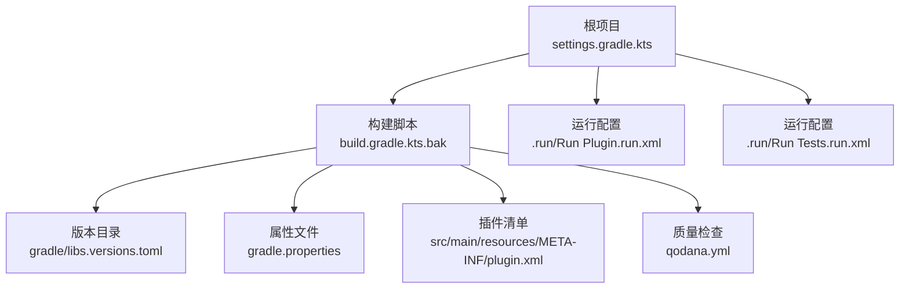
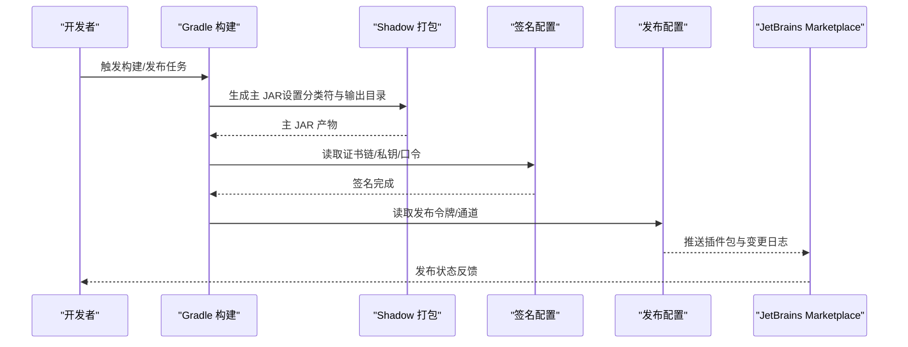
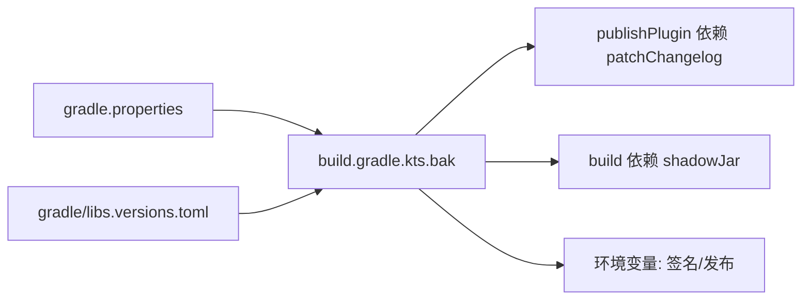

# 配置与部署

<cite>
**本文引用的文件**
- [build.gradle.kts.bak](file://build.gradle.kts.bak)
- [gradle.properties](file://gradle.properties)
- [gradle\libs.versions.toml](file://gradle/libs.versions.toml)
- [settings.gradle.kts](file://settings.gradle.kts)
- [qodana.yml](file://qodana.yml)
- [.run\Run Plugin.run.xml](file://.run/Run Plugin.run.xml)
- [.run\Run Tests.run.xml](file://.run/Run Tests.run.xml)
- [src\main\resources\META-INF\plugin.xml](file://src/main/resources/META-INF/plugin.xml)
- [README.md](file://README.md)
</cite>

## 目录
1. [简介](#简介)
2. [项目结构](#项目结构)
3. [核心组件](#核心组件)
4. [架构总览](#架构总览)
5. [详细组件分析](#详细组件分析)
6. [依赖分析](#依赖分析)
7. [性能考虑](#性能考虑)
8. [故障排查指南](#故障排查指南)
9. [结论](#结论)
10. [附录](#附录)

## 简介
本文件面向 FusionPDF 插件的配置与部署，覆盖构建配置（Gradle 构建脚本、依赖管理、打包流程）、发布与分发（JetBrains Marketplace 提交与版本通道）、CI/CD 流程（自动化测试、代码质量检查、发布）、开发环境配置（IDE 设置、调试与热重载）、部署最佳实践与性能优化、插件签名与安全、兼容性测试流程等。

## 项目结构
仓库采用标准的 IntelliJ 平台插件工程布局，关键位置如下：
- 构建与版本信息：根目录的 Gradle 配置与属性文件
- 版本目录：gradle/libs.versions.toml 统一声明插件与库版本
- 插件清单：src/main/resources/META-INF/plugin.xml
- 运行配置：.run 下的 IDE 运行/测试配置
- 质量检查：qodana.yml

图表来源
- [settings.gradle.kts:1-6](file://settings.gradle.kts#L1-L6)
- [build.gradle.kts.bak:1-182](file://build.gradle.kts.bak#L1-L182)
- [gradle\libs.versions.toml:1-21](file://gradle/libs.versions.toml#L1-L21)
- [gradle.properties:1-54](file://gradle.properties#L1-L54)
- [src\main\resources\META-INF\plugin.xml:1-51](file://src/main/resources/META-INF/plugin.xml#L1-L51)
- [qodana.yml:1-13](file://qodana.yml#L1-L13)
- [.run\Run Plugin.run.xml:1-26](file://.run/Run Plugin.run.xml#L1-L26)
- [.run\Run Tests.run.xml:1-26](file://.run/Run Tests.run.xml#L1-L26)

章节来源
- [settings.gradle.kts:1-6](file://settings.gradle.kts#L1-L6)
- [build.gradle.kts.bak:1-182](file://build.gradle.kts.bak#L1-L182)
- [gradle\libs.versions.toml:1-21](file://gradle/libs.versions.toml#L1-L21)
- [gradle.properties:1-54](file://gradle.properties#L1-L54)
- [src\main\resources\META-INF\plugin.xml:1-51](file://src/main/resources/META-INF/plugin.xml#L1-L51)
- [qodana.yml:1-13](file://qodana.yml#L1-L13)
- [.run\Run Plugin.run.xml:1-26](file://.run/Run Plugin.run.xml#L1-L26)
- [.run\Run Tests.run.xml:1-26](file://.run/Run Tests.run.xml#L1-L26)

## 核心组件
- 构建与平台插件：使用 IntelliJ Platform Gradle Plugin 管理平台类型、版本、插件依赖、验证与发布；启用 Gradle Changelog、Qodana、Kover 等插件。
- 依赖管理：通过版本目录统一管理插件与库版本；平台依赖通过属性文件注入。
- 打包与签名：Shadow 插件用于打包；IntelliJ Platform 插件提供签名与发布令牌配置。
- 质量与覆盖率：Kover 报告与检查；Qodana 作为静态分析入口。
- 运行与测试：IDE 运行配置与 Gradle 任务；UI 测试运行器集成。

章节来源
- [build.gradle.kts.bak:6-14](file://build.gradle.kts.bak#L6-L14)
- [build.gradle.kts.bak:35-54](file://build.gradle.kts.bak#L35-L54)
- [build.gradle.kts.bak:94-114](file://build.gradle.kts.bak#L94-L114)
- [build.gradle.kts.bak:122-131](file://build.gradle.kts.bak#L122-L131)
- [build.gradle.kts.bak:133-161](file://build.gradle.kts.bak#L133-L161)
- [gradle\libs.versions.toml:12-21](file://gradle/libs.versions.toml#L12-L21)
- [gradle.properties:34-47](file://gradle.properties#L34-L47)

## 架构总览
下图展示从构建到发布的整体流程，以及关键配置点如何影响产物与发布行为。

图表来源
- [build.gradle.kts.bak:151-161](file://build.gradle.kts.bak#L151-L161)
- [build.gradle.kts.bak:94-114](file://build.gradle.kts.bak#L94-L114)
- [build.gradle.kts.bak:138-140](file://build.gradle.kts.bak#L138-L140)

章节来源
- [build.gradle.kts.bak:94-114](file://build.gradle.kts.bak#L94-L114)
- [build.gradle.kts.bak:138-140](file://build.gradle.kts.bak#L138-L140)
- [build.gradle.kts.bak:151-161](file://build.gradle.kts.bak#L151-L161)

## 详细组件分析

### 构建脚本与配置项
- 插件与版本：启用 Java/Kotlin 支持、Shadow、IntelliJ Platform、Changelog、Qodana、Kover。
- 语言级别：JVM Toolchain 指向 17。
- 仓库：Maven Central 与平台默认仓库。
- 依赖：平台类型与版本、捆绑插件、市场插件、仪器化工具、插件验证器、ZipSigner、测试框架。
- 插件元数据：从 README 中抽取“插件描述”段落，转换为 HTML；变更日志按版本渲染；IDE 版本范围由属性文件注入。
- 签名与发布：从环境变量读取证书链、私钥与口令；发布令牌来自环境变量；根据版本后缀推导发布通道。
- 质量与覆盖率：Kover 总体报告 XML 检查开启；Qodana 使用推荐配置。
- 任务：更新 Wrapper 版本；在发布前补丁变更日志；编译与执行编码统一为 UTF-8；ShadowJar 分类符清空并指定输出目录；构建阶段依赖 ShadowJar。

章节来源
- [build.gradle.kts.bak:6-14](file://build.gradle.kts.bak#L6-L14)
- [build.gradle.kts.bak:19-22](file://build.gradle.kts.bak#L19-L22)
- [build.gradle.kts.bak:25-32](file://build.gradle.kts.bak#L25-L32)
- [build.gradle.kts.bak:35-54](file://build.gradle.kts.bak#L35-L54)
- [build.gradle.kts.bak:57-91](file://build.gradle.kts.bak#L57-L91)
- [build.gradle.kts.bak:94-114](file://build.gradle.kts.bak#L94-L114)
- [build.gradle.kts.bak:117-121](file://build.gradle.kts.bak#L117-L121)
- [build.gradle.kts.bak:122-131](file://build.gradle.kts.bak#L122-L131)
- [build.gradle.kts.bak:133-161](file://build.gradle.kts.bak#L133-L161)

### 依赖管理与版本目录
- 版本目录统一声明 junit、changelog、intelliJPlatform、kotlin、kover、qodana 等版本与插件 ID。
- 库与插件通过 ref 引用版本，避免重复与不一致。

章节来源
- [gradle\libs.versions.toml:1-21](file://gradle/libs.versions.toml#L1-L21)

### 属性文件与平台配置
- 基本属性：插件组、名称、仓库地址、语义化版本、代理配置、编码、JBR 变体、日志路径、构建号范围、平台类型与版本、插件依赖列表、Gradle 版本、Kotlin 标准库策略、配置缓存与构建缓存开关。
- 说明：这些属性被构建脚本读取，驱动插件元数据、平台兼容性与打包行为。

章节来源
- [gradle.properties:1-54](file://gradle.properties#L1-L54)

### 插件清单与扩展点
- 清单文件定义插件 ID、名称、版本、供应商、兼容版本范围、依赖模块、描述与变更日志片段。
- 扩展点：注册表键（调试、超时、实验特性、JCEF OSR）、应用服务与可配置界面、工具窗口工厂、颜色监听器等。

章节来源
- [src\main\resources\META-INF\plugin.xml:1-51](file://src/main/resources/META-INF/plugin.xml#L1-L51)

### 开发运行与测试配置
- 运行配置：.run/Run Plugin.run.xml 将 runIde 作为 Gradle 任务运行，并指向 IDE 日志路径；.run/Run Tests.run.xml 将 check 作为测试任务运行。
- UI 测试运行器：在构建脚本中定义了 runIdeForUiTests 任务，包含机器人服务器端口与隐私策略参数，并附加 robotServerPlugin 插件。

章节来源
- [.run\Run Plugin.run.xml:1-26](file://.run/Run Plugin.run.xml#L1-L26)
- [.run\Run Tests.run.xml:1-26](file://.run/Run Tests.run.xml#L1-L26)
- [build.gradle.kts.bak:163-181](file://build.gradle.kts.bak#L163-L181)

### 代码质量与分析
- Qodana：使用官方社区镜像，JDK 17，推荐配置文件，排除 .qodana 目录。
- Kover：总体报告启用 XML 输出并在检查时强制校验。

章节来源
- [qodana.yml:1-13](file://qodana.yml#L1-L13)
- [build.gradle.kts.bak:122-131](file://build.gradle.kts.bak#L122-L131)

### README 与变更日志集成
- 构建脚本从 README.md 中抽取“插件描述”段落，转换为 HTML 作为插件描述；变更日志按版本渲染为 HTML 并注入到插件元数据。
- README.md 包含英文与中文说明、功能列表与安装指引。

章节来源
- [build.gradle.kts.bak:61-85](file://build.gradle.kts.bak#L61-L85)
- [README.md:1-59](file://README.md#L1-L59)

## 依赖分析
- 构建脚本对版本目录的依赖：通过 alias 引入插件与库。
- 平台依赖：通过属性文件注入平台类型、版本、捆绑插件与市场插件列表。
- 任务耦合：publishPlugin 依赖 patchChangelog；build 依赖 shadowJar。
- 环境变量：签名与发布依赖 CERTIFICATE_CHAIN、PRIVATE_KEY、PRIVATE_KEY_PASSWORD、PUBLISH_TOKEN。

图表来源
- [gradle.properties:34-47](file://gradle.properties#L34-L47)
- [gradle\libs.versions.toml:12-21](file://gradle/libs.versions.toml#L12-L21)
- [build.gradle.kts.bak:138-140](file://build.gradle.kts.bak#L138-L140)
- [build.gradle.kts.bak:157-161](file://build.gradle.kts.bak#L157-L161)
- [build.gradle.kts.bak:94-114](file://build.gradle.kts.bak#L94-L114)

章节来源
- [gradle.properties:34-47](file://gradle.properties#L34-L47)
- [gradle\libs.versions.toml:12-21](file://gradle/libs.versions.toml#L12-L21)
- [build.gradle.kts.bak:138-140](file://build.gradle.kts.bak#L138-L140)
- [build.gradle.kts.bak:157-161](file://build.gradle.kts.bak#L157-L161)
- [build.gradle.kts.bak:94-114](file://build.gradle.kts.bak#L94-L114)

## 性能考虑
- 编码一致性：编译与执行均设置为 UTF-8，避免中文乱码与字符集问题。
- 构建缓存与配置缓存：启用构建缓存与配置缓存，提升重复构建速度。
- 轻量设计：插件定位为轻量，减少对 IDE 性能的影响。
- JBR 变体：使用 JCEF 变体，有助于 WebView 性能与稳定性。

章节来源
- [build.gradle.kts.bak:142-149](file://build.gradle.kts.bak#L142-L149)
- [gradle.properties:50-53](file://gradle.properties#L50-L53)
- [gradle.properties:24-25](file://gradle.properties#L24-L25)
- [README.md:14-16](file://README.md#L14-L16)

## 故障排查指南
- 插件描述缺失：若 README 中缺少“插件描述”标记段落，构建会抛出异常。请确保包含开始与结束标记。
- 签名失败：检查环境变量 CERTIFICATE_CHAIN、PRIVATE_KEY、PRIVATE_KEY_PASSWORD 是否正确设置。
- 发布失败：确认 PUBLISH_TOKEN 正确；检查版本通道推导逻辑是否符合预期。
- 编码问题：若出现控制台或文件编码异常，请确认 UTF-8 设置已在编译与执行任务中生效。
- 平台兼容性：核对 sinceBuild/untilBuild 与平台版本是否匹配；必要时调整平台类型与版本属性。

章节来源
- [build.gradle.kts.bak:67-72](file://build.gradle.kts.bak#L67-L72)
- [build.gradle.kts.bak:94-114](file://build.gradle.kts.bak#L94-L114)
- [build.gradle.kts.bak:142-149](file://build.gradle.kts.bak#L142-L149)
- [src\main\resources\META-INF\plugin.xml:11-12](file://src/main/resources/META-INF/plugin.xml#L11-L12)
- [gradle.properties:34-35](file://gradle.properties#L34-L35)

## 结论
本项目通过版本目录统一管理依赖，借助 IntelliJ Platform Gradle Plugin 实现平台兼容、签名与发布；结合 Shadow 打包、Kover 与 Qodana，形成从构建到质量保障的完整闭环。配合运行与测试配置，开发者可以高效地进行本地调试与 UI 测试。发布至 JetBrains Marketplace 时，建议完善变更日志与版本通道策略，并确保签名与发布令牌配置正确。

## 附录

### 发布与分发机制
- 版本管理：遵循语义化版本；版本后缀用于推导发布通道。
- 发布令牌：从环境变量读取，用于向 Marketplace 推送。
- 渠道策略：基于版本中的预发布标签自动选择通道。
- 变更日志：从 changelog 文件渲染为 HTML 注入插件元数据。

章节来源
- [build.gradle.kts.bak:100-106](file://build.gradle.kts.bak#L100-L106)
- [build.gradle.kts.bak:117-121](file://build.gradle.kts.bak#L117-L121)
- [build.gradle.kts.bak:74-85](file://build.gradle.kts.bak#L74-L85)

### CI/CD 工作流配置
- 当前仓库未包含 GitHub Actions 工作流目录。建议新增工作流以实现自动化测试、代码质量检查与发布。
- 参考要点：触发条件（如推送/PR）、矩阵测试（多平台/多版本）、质量门禁（Qodana/Kover）、构建与打包、发布（读取令牌）。

章节来源
- [qodana.yml:1-13](file://qodana.yml#L1-L13)
- [build.gradle.kts.bak:122-131](file://build.gradle.kts.bak#L122-L131)

### 开发环境配置指南
- IDE 运行：使用 .run/Run Plugin.run.xml 运行 IDE；使用 .run/Run Tests.run.xml 运行测试。
- 调试配置：运行配置已启用外部系统调试进程；可在 IDE 中附加调试。
- 热重载机制：IntelliJ 平台插件支持热重载与重新加载；建议在开发阶段频繁使用 runIde 任务。

章节来源
- [.run\Run Plugin.run.xml:1-26](file://.run/Run Plugin.run.xml#L1-L26)
- [.run\Run Tests.run.xml:1-26](file://.run/Run Tests.run.xml#L1-L26)

### 插件签名与安全
- 签名参数：证书链、私钥与口令从环境变量读取；建议在 CI 中安全存储。
- 发布令牌：从环境变量读取；建议限制访问权限与轮换策略。

章节来源
- [build.gradle.kts.bak:94-114](file://build.gradle.kts.bak#L94-L114)

### 兼容性测试流程
- 插件验证器：启用插件验证器，按推荐 IDE 列表进行验证。
- 平台版本：通过属性文件配置平台类型与版本；清单文件定义 sinceBuild/untilBuild。
- UI 测试：提供 runIdeForUiTests 任务，便于 UI 自动化测试。

章节来源
- [build.gradle.kts.bak:108-112](file://build.gradle.kts.bak#L108-L112)
- [gradle.properties:34-35](file://gradle.properties#L34-L35)
- [src\main\resources\META-INF\plugin.xml:11-12](file://src/main/resources/META-INF/plugin.xml#L11-L12)
- [build.gradle.kts.bak:163-181](file://build.gradle.kts.bak#L163-L181)