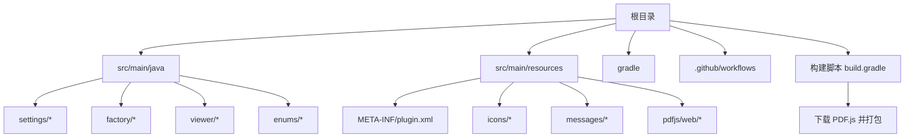
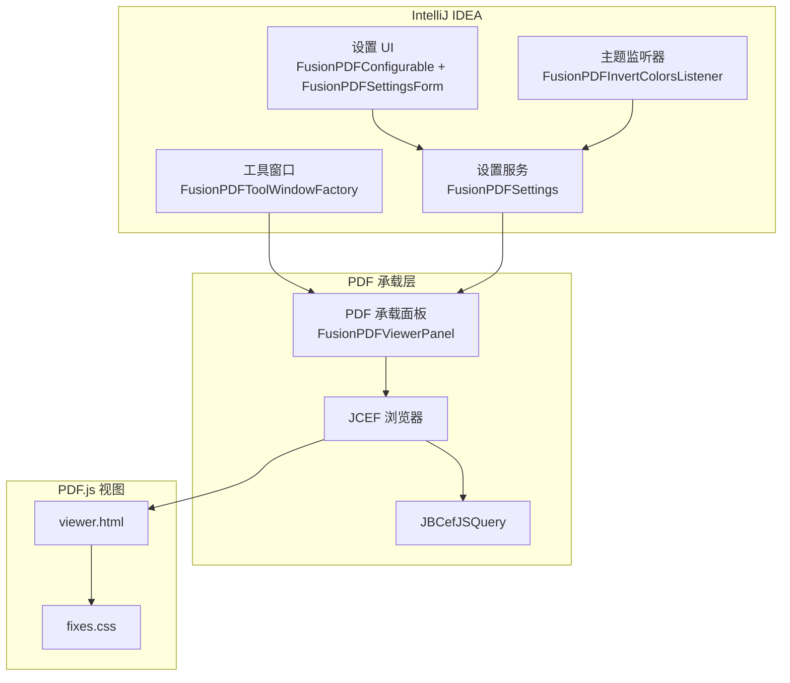
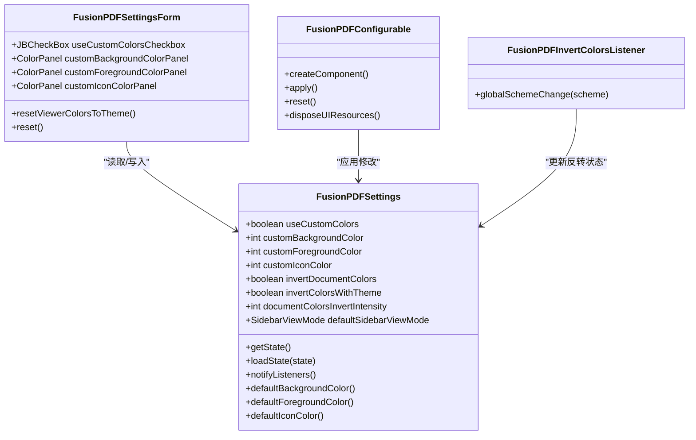
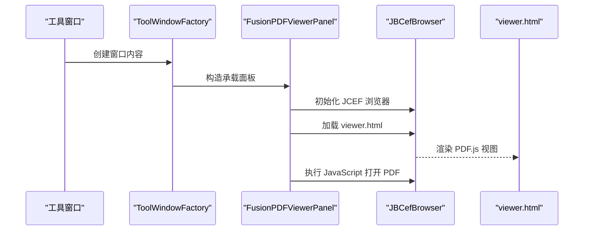
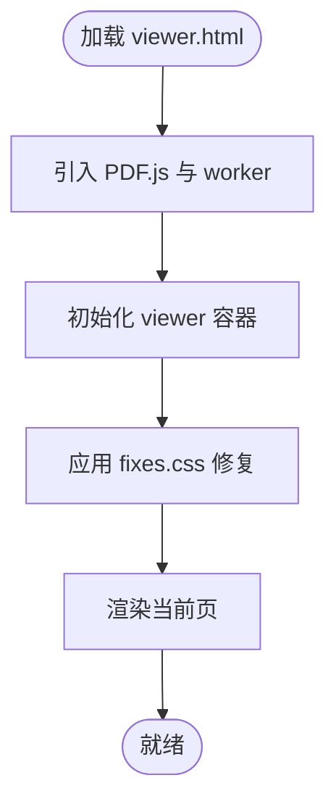
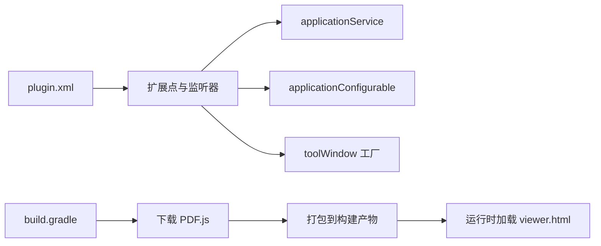

# 项目概述

<cite>
**本文引用的文件**
- [README.md](file://README.md)
- [README.zh-CN.md](file://README.zh-CN.md)
- [plugin.xml](file://src/main/resources/META-INF/plugin.xml)
- [build.gradle](file://build.gradle)
- [FusionPDFSettings.java](file://src/main/java/com/github/wkkya/fusionpdf/settings/FusionPDFSettings.java)
- [FusionPDFConfigurable.java](file://src/main/java/com/github/wkkya/fusionpdf/settings/FusionPDFConfigurable.java)
- [FusionPDFSettingsForm.java](file://src/main/java/com/github/wkkya/fusionpdf/settings/FusionPDFSettingsForm.java)
- [FusionPDFInvertColorsListener.java](file://src/main/java/com/github/wkkya/fusionpdf/settings/FusionPDFInvertColorsListener.java)
- [FusionPDFToolWindowFactory.java](file://src/main/java/com/github/wkkya/fusionpdf/factory/FusionPDFToolWindowFactory.java)
- [FusionPDFViewerPanel.java](file://src/main/java/com/github/wkkya/fusionpdf/viewer/FusionPDFViewerPanel.java)
- [SidebarViewMode.java](file://src/main/java/com/github/wkkya/fusionpdf/enums/SidebarViewMode.java)
- [viewer.html](file://src/main/resources/pdfjs/web/viewer.html)
- [fixes.css](file://src/main/resources/pdfjs/web/fixes.css)
- [FusionPDFBundle.properties](file://src/main/resources/messages/FusionPDFBundle.properties)
- [FusionPDFActionsBundle.properties](file://src/main/resources/messages/FusionPDFActionsBundle.properties)
</cite>

## 目录
1. [引言](#引言)
2. [项目结构](#项目结构)
3. [核心组件](#核心组件)
4. [架构总览](#架构总览)
5. [详细组件分析](#详细组件分析)
6. [依赖关系分析](#依赖关系分析)
7. [性能考量](#性能考量)
8. [故障排查指南](#故障排查指南)
9. [结论](#结论)
10. [附录](#附录)

## 引言
FusionPDF 是一款专为 IntelliJ IDEA 设计的轻量级 PDF 阅读插件，旨在将 PDF 查看体验无缝融入开发环境。其核心价值在于：
- 主题一体化：自动适配 IDE 的明暗主题，确保界面风格统一
- 可定制化：支持自定义字体颜色、背景色与图标色，满足个性化阅读偏好
- 轻量化设计：采用 JCEF 内嵌浏览器承载 PDF.js，尽量减少对 IDE 性能的影响
- 背景移除：通过 CSS 修复策略隐藏 PDF 工具栏与侧边栏，聚焦内容本身

目标用户群体包括：
- 需要在 IDE 中直接阅读技术文档、手册、论文等 PDF 的开发者
- 对阅读体验有较高要求，希望获得与 IDE 主题一致的视觉感受的用户
- 希望在不切换应用的情况下完成文档查阅与检索的工程师

## 项目结构
项目采用标准的 IntelliJ 平台插件结构，核心目录与职责如下：
- src/main/java：Java 实现，包含设置、工厂、视图与枚举等模块
- src/main/resources：资源文件，含插件声明、图标、消息与 PDF.js 视图
- gradle：版本与依赖管理
- .github/workflows：CI/CD 流程（如适用）
- 构建脚本负责下载并打包 PDF.js 到构建产物中，以便插件运行时加载

**图表来源**
- [plugin.xml:1-51](file://src/main/resources/META-INF/plugin.xml#L1-L51)
- [build.gradle:1-115](file://build.gradle#L1-L115)

**章节来源**
- [plugin.xml:1-51](file://src/main/resources/META-INF/plugin.xml#L1-L51)
- [build.gradle:1-115](file://build.gradle#L1-L115)

## 核心组件
- 设置与配置
  - FusionPDFSettings：持久化存储用户偏好（自定义颜色、文档反转、侧边栏模式等），并提供默认主题色与注册表开关访问
  - FusionPDFConfigurable + FusionPDFSettingsForm：提供设置 UI 与应用逻辑，支持主题色一键同步
  - FusionPDFInvertColorsListener：监听 IDE 主题变化，按需启用/禁用文档颜色反转
- 视图与容器
  - FusionPDFToolWindowFactory：在 IDE 底部创建工具窗口
  - FusionPDFViewerPanel：基于 JCEF 的 PDF.js 承载器，负责加载 PDF.js viewer、注入颜色与打开 PDF
- 枚举与资源
  - SidebarViewMode：侧边栏视图模式枚举
  - viewer.html + fixes.css：PDF.js 视图模板与轻量化样式修复
  - 多语言资源：FusionPDFBundle 与 FusionPDFActionsBundle

**章节来源**
- [FusionPDFSettings.java:1-151](file://src/main/java/com/github/wkkya/fusionpdf/settings/FusionPDFSettings.java#L1-L151)
- [FusionPDFConfigurable.java:1-76](file://src/main/java/com/github/wkkya/fusionpdf/settings/FusionPDFConfigurable.java#L1-L76)
- [FusionPDFSettingsForm.java:1-159](file://src/main/java/com/github/wkkya/fusionpdf/settings/FusionPDFSettingsForm.java#L1-L159)
- [FusionPDFInvertColorsListener.java:1-25](file://src/main/java/com/github/wkkya/fusionpdf/settings/FusionPDFInvertColorsListener.java#L1-L25)
- [FusionPDFToolWindowFactory.java:1-21](file://src/main/java/com/github/wkkya/fusionpdf/factory/FusionPDFToolWindowFactory.java#L1-L21)
- [FusionPDFViewerPanel.java:1-78](file://src/main/java/com/github/wkkya/fusionpdf/viewer/FusionPDFViewerPanel.java#L1-L78)
- [SidebarViewMode.java:1-22](file://src/main/java/com/github/wkkya/fusionpdf/enums/SidebarViewMode.java#L1-L22)
- [viewer.html:1-175](file://src/main/resources/pdfjs/web/viewer.html#L1-L175)
- [fixes.css:1-22](file://src/main/resources/pdfjs/web/fixes.css#L1-L22)
- [FusionPDFBundle.properties:1-62](file://src/main/resources/messages/FusionPDFBundle.properties#L1-L62)
- [FusionPDFActionsBundle.properties:1-113](file://src/main/resources/messages/FusionPDFActionsBundle.properties#L1-L113)

## 架构总览
FusionPDF 的整体架构围绕“IDE 工具窗口 + JCEF 承载 + PDF.js 视图”展开，通过设置系统与主题监听器实现与 IDE 的深度集成。

**图表来源**
- [FusionPDFToolWindowFactory.java:12-19](file://src/main/java/com/github/wkkya/fusionpdf/factory/FusionPDFToolWindowFactory.java#L12-L19)
- [FusionPDFViewerPanel.java:12-38](file://src/main/java/com/github/wkkya/fusionpdf/viewer/FusionPDFViewerPanel.java#L12-L38)
- [FusionPDFSettings.java:17-46](file://src/main/java/com/github/wkkya/fusionpdf/settings/FusionPDFSettings.java#L17-L46)
- [FusionPDFConfigurable.java:7-28](file://src/main/java/com/github/wkkya/fusionpdf/settings/FusionPDFConfigurable.java#L7-L28)
- [FusionPDFInvertColorsListener.java:11-23](file://src/main/java/com/github/wkkya/fusionpdf/settings/FusionPDFInvertColorsListener.java#L11-L23)
- [viewer.html:1-175](file://src/main/resources/pdfjs/web/viewer.html#L1-L175)
- [fixes.css:1-22](file://src/main/resources/pdfjs/web/fixes.css#L1-L22)

## 详细组件分析

### 设置与主题适配
- 设置持久化与默认值
  - 使用 PersistentStateComponent 将设置保存到 fusion_pdf.xml
  - 默认颜色来自 EditorColorsManager 的全局方案
- 注册表开关
  - 提供调试模式、JCEF OSR、实验特性等开关
- 主题监听
  - 监听 EditorColorsListener，在深色主题下自动启用文档颜色反转，并通过消息总线通知订阅者

**图表来源**
- [FusionPDFSettings.java:17-146](file://src/main/java/com/github/wkkya/fusionpdf/settings/FusionPDFSettings.java#L17-L146)
- [FusionPDFSettingsForm.java:18-158](file://src/main/java/com/github/wkkya/fusionpdf/settings/FusionPDFSettingsForm.java#L18-L158)
- [FusionPDFConfigurable.java:7-74](file://src/main/java/com/github/wkkya/fusionpdf/settings/FusionPDFConfigurable.java#L7-L74)
- [FusionPDFInvertColorsListener.java:11-23](file://src/main/java/com/github/wkkya/fusionpdf/settings/FusionPDFInvertColorsListener.java#L11-L23)

**章节来源**
- [FusionPDFSettings.java:17-146](file://src/main/java/com/github/wkkya/fusionpdf/settings/FusionPDFSettings.java#L17-L146)
- [FusionPDFSettingsForm.java:36-158](file://src/main/java/com/github/wkkya/fusionpdf/settings/FusionPDFSettingsForm.java#L36-L158)
- [FusionPDFConfigurable.java:7-74](file://src/main/java/com/github/wkkya/fusionpdf/settings/FusionPDFConfigurable.java#L7-L74)
- [FusionPDFInvertColorsListener.java:11-23](file://src/main/java/com/github/wkkya/fusionpdf/settings/FusionPDFInvertColorsListener.java#L11-L23)

### 工具窗口与视图承载
- 工具窗口工厂负责创建底部停靠的 PDF 阅读器面板
- 承载面板基于 JCEF 初始化浏览器实例，创建滚动容器，加载 PDF.js 的 viewer.html
- 通过 executeJavaScript 向前端注入颜色与打开 PDF 的调用

**图表来源**
- [FusionPDFToolWindowFactory.java:12-19](file://src/main/java/com/github/wkkya/fusionpdf/factory/FusionPDFToolWindowFactory.java#L12-L19)
- [FusionPDFViewerPanel.java:17-57](file://src/main/java/com/github/wkkya/fusionpdf/viewer/FusionPDFViewerPanel.java#L17-L57)
- [viewer.html:49-57](file://src/main/resources/pdfjs/web/viewer.html#L49-L57)

**章节来源**
- [FusionPDFToolWindowFactory.java:12-19](file://src/main/java/com/github/wkkya/fusionpdf/factory/FusionPDFToolWindowFactory.java#L12-L19)
- [FusionPDFViewerPanel.java:17-57](file://src/main/java/com/github/wkkya/fusionpdf/viewer/FusionPDFViewerPanel.java#L17-L57)
- [viewer.html:49-57](file://src/main/resources/pdfjs/web/viewer.html#L49-L57)

### PDF.js 视图与样式修复
- viewer.html 作为 PDF.js 的视图入口，内置翻页、上传、搜索等基础能力
- fixes.css 通过隐藏工具栏、调整布局与移除侧边栏顶部边框，使视图更贴合 IDE 工具窗口
- 构建脚本在打包时会修改 viewer.html，注入额外样式与脚本，确保与插件集成

**图表来源**
- [viewer.html:59-101](file://src/main/resources/pdfjs/web/viewer.html#L59-L101)
- [fixes.css:1-22](file://src/main/resources/pdfjs/web/fixes.css#L1-L22)

**章节来源**
- [viewer.html:59-101](file://src/main/resources/pdfjs/web/viewer.html#L59-L101)
- [fixes.css:1-22](file://src/main/resources/pdfjs/web/fixes.css#L1-L22)

### 多语言与动作系统
- 设置与错误提示等文本由 FusionPDFBundle 提供
- 动作（翻页、缩放、旋转、侧边栏模式切换等）由 FusionPDFActionsBundle 定义，便于在 IDE 菜单与工具栏中使用

**章节来源**
- [FusionPDFBundle.properties:1-62](file://src/main/resources/messages/FusionPDFBundle.properties#L1-L62)
- [FusionPDFActionsBundle.properties:1-113](file://src/main/resources/messages/FusionPDFActionsBundle.properties#L1-L113)

## 依赖关系分析
- 插件声明与扩展点
  - plugin.xml 声明插件 ID、名称、版本、兼容性范围与依赖模块
  - 注册 applicationService、applicationConfigurable、toolWindow 工厂与主题监听器
- 构建与运行时依赖
  - build.gradle 使用 intellij-platform 插件与 org.jetbrains.intellij，下载并解压 PDF.js 到构建目录
  - 运行时启用 JCEF，确保内嵌浏览器可用

**图表来源**
- [plugin.xml:26-46](file://src/main/resources/META-INF/plugin.xml#L26-L46)
- [build.gradle:36-75](file://build.gradle#L36-L75)

**章节来源**
- [plugin.xml:26-46](file://src/main/resources/META-INF/plugin.xml#L26-L46)
- [build.gradle:36-75](file://build.gradle#L36-L75)

## 性能考量
- 轻量化设计
  - 仅在需要时加载 PDF.js，避免常驻大体积资源
  - 通过 fixes.css 移除不必要的 UI 组件，降低渲染压力
- JCEF 配置
  - 在运行时启用 JCEF 并设置相关 JVM 参数，保证稳定性与性能
- 设置优化
  - 文档自动重载、反转强度等选项可按需开启，平衡体验与性能

**章节来源**
- [fixes.css:1-22](file://src/main/resources/pdfjs/web/fixes.css#L1-L22)
- [build.gradle:80-95](file://build.gradle#L80-L95)

## 故障排查指南
- 无法加载 PDF
  - 确认 viewer.html 已被正确加载，且构建产物包含 PDF.js 资源
  - 检查 JCEF 是否启用，必要时打开调试模式查看日志
- 颜色不匹配或反转异常
  - 检查主题监听器是否生效，确认“按主题反转文档颜色”与“反转强度”的设置
  - 使用“设置为当前主题颜色”快速同步至 IDE 默认色
- 工具窗口未显示
  - 确认工具窗口工厂已注册，且插件在 IDE 中成功安装与启用

**章节来源**
- [FusionPDFViewerPanel.java:49-57](file://src/main/java/com/github/wkkya/fusionpdf/viewer/FusionPDFViewerPanel.java#L49-L57)
- [FusionPDFInvertColorsListener.java:14-22](file://src/main/java/com/github/wkkya/fusionpdf/settings/FusionPDFInvertColorsListener.java#L14-L22)
- [FusionPDFSettingsForm.java:132-145](file://src/main/java/com/github/wkkya/fusionpdf/settings/FusionPDFSettingsForm.java#L132-L145)
- [plugin.xml:36-36](file://src/main/resources/META-INF/plugin.xml#L36-L36)

## 结论
FusionPDF 以“轻量、可定制、与 IDE 深度融合”为核心设计理念，通过 JCEF + PDF.js 的组合实现高性能的 PDF 阅读体验。其设置系统与主题监听器确保了与 IDE 主题的一致性，而样式修复策略则让视图更贴合工具窗口场景。对于需要在开发环境中高效阅读与检索 PDF 的用户而言，FusionPDF 提供了稳定、易用且可扩展的解决方案。

## 附录
- 安装与使用
  - 从仓库克隆后，使用 Gradle 任务构建并安装插件；运行时启用 JCEF 即可开始使用
- 技术定位
  - 作为开发者工具生态中的“文档阅读增强器”，FusionPDF 与 IDE 的主题系统、颜色方案与工作流紧密结合，提升开发过程中的信息获取效率

**章节来源**
- [README.md:19-27](file://README.md#L19-L27)
- [README.zh-CN.md:18-23](file://README.zh-CN.md#L18-L23)
- [build.gradle:80-95](file://build.gradle#L80-L95)